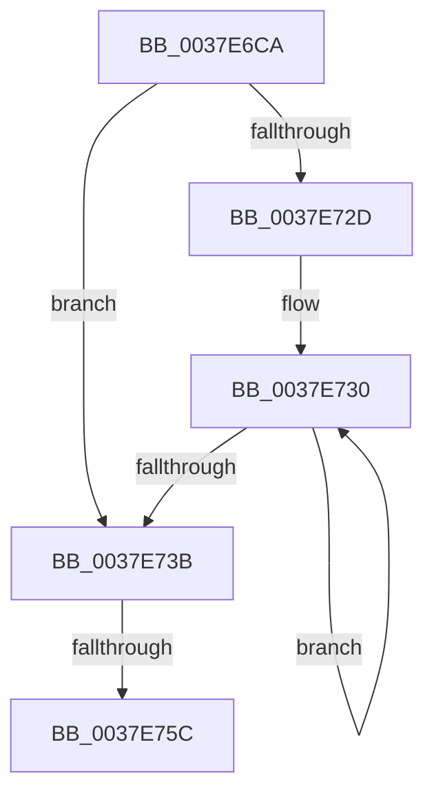

# sub_0037E6CA

- RVA: `0x0037E6CA`–`0x0037E776` (길이 `172` bytes)
- VA: `0x000000014037E6CA`
- 실행 섹션: `.text`
- PDB 이름 있음: `아니요`; PDB Function 태그: `아니요`
- unwind 정보 RVA: `0x0007B66C`
- 디코드: `38`개 명령, `172/172` bytes 표시
- 미해석 바이트: `0` (있으면 어셈블리에 `.byte`로 보존)

> 이 문서는 커널 이미지의 기계어와 PDB 기호를 분석해 생성했습니다. 4번과 5번은 함수 원형과 자료형을 바이너리 사용 방식에서 추정한 C 해석이며 원본 소스 복구 결과는 아닙니다.

## 1. Dependencies

- 직접 호출 지점: **1**; 고유 호출 대상: **1**
- 직접 호출자로 확인된 함수: **0**
- RIP 상대 이미지 참조: **0**

### Outgoing calls
- `0x0037E74A` → [KeQueryPerformanceCounter](KeQueryPerformanceCounter_function_0037E7E0.md) (function, `0x0037E7E0`)

### Direct callers
- 이 함수 시작 RVA로 연결되는 직접 call은 확인되지 않았습니다. 간접 호출은 완전히 역산할 수 없습니다.

### Static image references
- 디코드된 RIP-relative 메모리 참조가 없습니다.

## 2. Other-region calls and transfers

- 다른 실행 섹션으로 향하는 call: **0**
- call이 아닌 외부 분기/꼬리 이동: **2**
  - `0x0037E75A` → [sub_0037E7C1](Unknown_function_0037E7C1.md) (`tail-transfer`)
  - `0x0037E774` → [sub_0037E776 + 0x1B](Unknown_function_0037E776.md) (`tail-transfer`)

## 3. Assembly (complete function range)

```asm
0037E6CA  48 89 5C 24 58                  mov qword ptr [rsp + 0x58], rbx
0037E6CF  48 89 6C 24 60                  mov qword ptr [rsp + 0x60], rbp
0037E6D4  48 89 74 24 68                  mov qword ptr [rsp + 0x68], rsi
0037E6D9  48 89 7C 24 40                  mov qword ptr [rsp + 0x40], rdi
0037E6DE  4C 89 64 24 38                  mov qword ptr [rsp + 0x38], r12
0037E6E3  49 BC 40 03 00 00 80 F7 FF FF   movabs r12, 0xfffff78000000340
0037E6ED  4C 89 6C 24 30                  mov qword ptr [rsp + 0x30], r13
0037E6F2  49 BD 48 03 00 00 80 F7 FF FF   movabs r13, 0xfffff78000000348
0037E6FC  4C 89 74 24 28                  mov qword ptr [rsp + 0x28], r14
0037E701  4C 89 7C 24 20                  mov qword ptr [rsp + 0x20], r15
0037E706  49 BF 58 03 00 00 80 F7 FF FF   movabs r15, 0xfffff78000000358
0037E710  49 8B 1C 24                     mov rbx, qword ptr [r12]
0037E714  48 B9 14 00 00 00 80 F7 FF FF   movabs rcx, 0xfffff78000000014
0037E71E  48 B8 68 03 00 00 80 F7 FF FF   movabs rax, 0xfffff78000000368
0037E728  F6 C3 01                        test bl, 1
0037E72B  74 0E                           je 0x14037e73b
0037E72D  0F 1F 00                        nop dword ptr [rax]
0037E730  F3 90                           pause
0037E732  49 8B 1C 24                     mov rbx, qword ptr [r12]
0037E736  F6 C3 01                        test bl, 1
0037E739  75 F5                           jne 0x14037e730
0037E73B  48 8B 29                        mov rbp, qword ptr [rcx]
0037E73E  33 C9                           xor ecx, ecx
0037E740  49 8B 75 00                     mov rsi, qword ptr [r13]
0037E744  4D 8B 37                        mov r14, qword ptr [r15]
0037E747  0F B6 38                        movzx edi, byte ptr [rax]
0037E74A  E8 91 00 00 00                  call 0x14037e7e0
0037E74F  90                              nop
0037E750  48 8B D0                        mov rdx, rax
0037E753  49 8B 0C 24                     mov rcx, qword ptr [r12]
0037E757  48 3B CB                        cmp rcx, rbx
0037E75A  75 65                           jne 0x14037e7c1
0037E75C  4C 8B 6C 24 30                  mov r13, qword ptr [rsp + 0x30]
0037E761  41 BF 00 00 00 00               mov r15d, 0
0037E767  4C 8B 64 24 38                  mov r12, qword ptr [rsp + 0x38]
0037E76C  48 8B 5C 24 58                  mov rbx, qword ptr [rsp + 0x58]
0037E771  48 3B C6                        cmp rax, rsi
0037E774  76 1B                           jbe 0x14037e791
```

## 4. C-style interpretation (structured pseudocode)

```c
__int64 __fastcall sub_0037E6CA(__int64 a1, __int64 a2, __int64 a3, __int64 a4, __int64 a5, __int64 a6, __int64 a7, __int64 a8, __int64 a9, __int64 a10, __int64 a11)
{
    __int64 result;
    unsigned __int64 v_stack_p20;
    unsigned __int64 v_stack_p28;
    unsigned __int64 v_stack_p30;
    unsigned __int64 v_stack_p38;
    unsigned __int64 v_stack_p40;
    unsigned __int64 v_stack_p58;
    unsigned __int64 v_stack_p60;
    unsigned __int64 v_stack_p68;

    v_stack_p58 = v_rbx;
    v_stack_p60 = v_rbp;
    v_stack_p68 = v_rsi;
    v_stack_p40 = v_rdi;
    v_stack_p38 = v_r12;
    v_stack_p30 = v_r13;
    v_stack_p28 = v_r14;
    v_stack_p20 = v_r15;
    if ((((unsigned __int8)(*(unsigned __int64 *)(v_r12))) & (1)) == 0) goto loc_0037E73B;
loc_0037E730:
    if ((((unsigned __int8)(*(unsigned __int64 *)(v_r12))) & (1)) != 0) goto loc_0037E730;
loc_0037E73B:
    a1 = 0;
    result = KeQueryPerformanceCounter(a1, a2, a3, a4);
}
```

## 5. (Beta) C Style

```c
int64_t sub_0037E6CA(int64_t Arg1, int64_t Arg2, int64_t Arg3, int64_t Arg4, uint64_t Arg5, int64_t Arg6, int64_t Arg7, uint64_t Arg8, uint64_t Arg9, uint64_t Arg10, int64_t Arg11)
{
    int64_t result;
    uint64_t v_stack_p20;
    uint64_t v_stack_p28;
    uint64_t v_stack_p30;
    uint64_t v_stack_p38;
    uint64_t v_stack_p40;
    uint64_t v_stack_p58;
    uint64_t v_stack_p60;
    uint64_t v_stack_p68;

    v_stack_p58 = local_rbx;
    v_stack_p60 = local_rbp;
    v_stack_p68 = local_rsi;
    v_stack_p40 = local_rdi;
    v_stack_p38 = local_r12;
    v_stack_p30 = local_r13;
    v_stack_p28 = local_r14;
    v_stack_p20 = local_r15;
    if ((((uint8_t)(*(uint64_t *)(local_r12))) & (1)) == 0) goto loc_0037E73B;
loc_0037E730:
    if ((((uint8_t)(*(uint64_t *)(local_r12))) & (1)) != 0) goto loc_0037E730;
loc_0037E73B:
    Arg1 = 0;
    result = KeQueryPerformanceCounter(Arg1, Arg2, Arg3, Arg4);
}
```

## 6. Execution-region graph

[열기: 2D/3D 그래프와 함수 탐색 컨트롤 패널](../../../control-panel.html?section=text&rva=0x0037E6CA&view=graph)

- 2D 그래프는 위에서 아래로 흐르고, 3D 그래프는 빈 공간을 드래그해 회전합니다. Shift+드래그는 이동, 휠은 확대·축소, 함수 노드 선택은 대상 보고서 이동입니다.

### Static fallback


