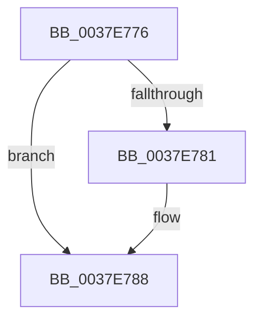

# sub_0037E776

- RVA: `0x0037E776`–`0x0037E7B3` (길이 `61` bytes)
- VA: `0x000000014037E776`
- 실행 섹션: `.text`
- PDB 이름 있음: `아니요`; PDB Function 태그: `아니요`
- unwind 정보 RVA: `0x0007B69C`
- 디코드: `17`개 명령, `61/61` bytes 표시
- 미해석 바이트: `0` (있으면 어셈블리에 `.byte`로 보존)

> 이 문서는 커널 이미지의 기계어와 PDB 기호를 분석해 생성했습니다. 4번과 5번은 함수 원형과 자료형을 바이너리 사용 방식에서 추정한 C 해석이며 원본 소스 복구 결과는 아닙니다.

## 1. Dependencies

- 직접 호출 지점: **0**; 고유 호출 대상: **0**
- 직접 호출자로 확인된 함수: **0**
- RIP 상대 이미지 참조: **0**

### Outgoing calls
- 직접 디코드된 call 명령이 없습니다.

### Direct callers
- 이 함수 시작 RVA로 연결되는 직접 call은 확인되지 않았습니다. 간접 호출은 완전히 역산할 수 없습니다.

### Static image references
- 디코드된 RIP-relative 메모리 참조가 없습니다.

## 2. Other-region calls and transfers

- 다른 실행 섹션으로 향하는 call: **0**
- 별도 외부 분기/꼬리 이동을 확인하지 못했습니다.

## 3. Assembly (complete function range)

```asm
0037E776  48 2B D6                        sub rdx, rsi
0037E779  48 FF CA                        dec rdx
0037E77C  40 84 FF                        test dil, dil
0037E77F  74 07                           je 0x14037e788
0037E781  40 0F B6 CF                     movzx ecx, dil
0037E785  48 D3 E2                        shl rdx, cl
0037E788  49 8B C6                        mov rax, r14
0037E78B  48 F7 E2                        mul rdx
0037E78E  4C 8B FA                        mov r15, rdx
0037E791  4C 8B 74 24 28                  mov r14, qword ptr [rsp + 0x28]
0037E796  49 8D 04 2F                     lea rax, [r15 + rbp]
0037E79A  4C 8B 7C 24 20                  mov r15, qword ptr [rsp + 0x20]
0037E79F  48 8B 6C 24 60                  mov rbp, qword ptr [rsp + 0x60]
0037E7A4  48 8B 7C 24 40                  mov rdi, qword ptr [rsp + 0x40]
0037E7A9  48 8B 74 24 68                  mov rsi, qword ptr [rsp + 0x68]
0037E7AE  48 83 C4 48                     add rsp, 0x48
0037E7B2  C3                              ret
```

## 4. C-style interpretation (structured pseudocode)

```c
__int64 __fastcall sub_0037E776(__int64 a1, __int64 a2, __int64 a3, __int64 a4, __int64 a5, __int64 a6, __int64 a7, __int64 a8, __int64 a9, __int64 a10, __int64 a11, __int64 a12, __int64 a13)
{
    __int64 v_rsp;
    unsigned __int64 v_stack_p20;

    a2 = (a2) - (v_rsi);
    a2 = (a2) - 1;
    if ((unsigned __int8)(v_rdi) != 0) {
        a1 = (unsigned __int8)(v_rdi);
        a2 = (a2) << ((unsigned __int8)(a1));
    }
    v_rsp = (v_rsp) + (72);
    return a2 + v_rbp * 1;
}
```

## 5. (Beta) C Style

```c
int64_t sub_0037E776(int64_t Arg1, int64_t Arg2, int64_t Arg3, int64_t Arg4, int64_t Arg5, uint64_t Arg6, uint64_t Arg7, int64_t Arg8, uint64_t Arg9, uint64_t Arg10, uint64_t Arg11, int64_t Arg12, int64_t Arg13)
{
    int64_t local_rsp;
    uint64_t v_stack_p20;

    Arg2 = (Arg2) - (local_rsi);
    Arg2 = (Arg2) - 1;
    if ((uint8_t)(local_rdi) != 0) {
        Arg1 = (uint8_t)(local_rdi);
        Arg2 = (Arg2) << ((uint8_t)(Arg1));
    }
    local_rsp = (local_rsp) + (72);
    return Arg2 + local_rbp * 1;
}
```

## 6. Execution-region graph

[열기: 2D/3D 그래프와 함수 탐색 컨트롤 패널](../../../control-panel.html?section=text&rva=0x0037E776&view=graph)

- 2D 그래프는 위에서 아래로 흐르고, 3D 그래프는 빈 공간을 드래그해 회전합니다. Shift+드래그는 이동, 휠은 확대·축소, 함수 노드 선택은 대상 보고서 이동입니다.

### Static fallback


