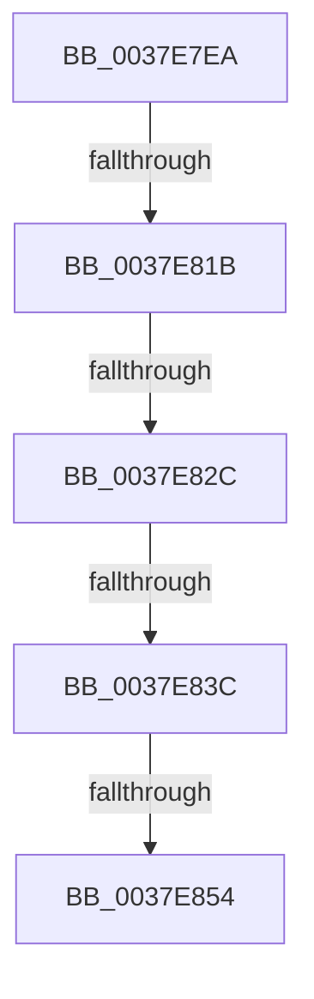

# sub_0037E7EA

- RVA: `0x0037E7EA`–`0x0037E8A1` (길이 `183` bytes)
- VA: `0x000000014037E7EA`
- 실행 섹션: `.text`
- PDB 이름 있음: `아니요`; PDB Function 태그: `아니요`
- unwind 정보 RVA: `0x0007B728`
- 디코드: `35`개 명령, `183/183` bytes 표시
- 미해석 바이트: `0` (있으면 어셈블리에 `.byte`로 보존)

> 이 문서는 커널 이미지의 기계어와 PDB 기호를 분석해 생성했습니다. 4번과 5번은 함수 원형과 자료형을 바이너리 사용 방식에서 추정한 C 해석이며 원본 소스 복구 결과는 아닙니다.

## 1. Dependencies

- 직접 호출 지점: **0**; 고유 호출 대상: **0**
- 직접 호출자로 확인된 함수: **0**
- RIP 상대 이미지 참조: **4**

### Outgoing calls
- 직접 디코드된 call 명령이 없습니다.

### Direct callers
- 이 함수 시작 RVA로 연결되는 직접 call은 확인되지 않았습니다. 간접 호출은 완전히 역산할 수 없습니다.

### Static image references
- `0x0037E7FD` → RVA `0x00FC3FD0` (`.data`; read)
- `0x0037E81B` → RVA `0x00FC40E0` (`.data`; read)
- `0x0037E844` → RVA `0x0041FD10` (`HalpTscQueryCounterOrdered`; read)
- `0x0037E87D` → RVA `0x00FC3FC8` (`.data`; read)

## 2. Other-region calls and transfers

- 다른 실행 섹션으로 향하는 call: **0**
- call이 아닌 외부 분기/꼬리 이동: **5**
  - `0x0037E815` → [sub_0037E8B6](Unknown_function_0037E8B6.md) (`tail-transfer`)
  - `0x0037E826` → [sub_0037E8B6 + 0xD8](Unknown_function_0037E8B6.md) (`tail-transfer`)
  - `0x0037E836` → [sub_0037EAAA + 0x82](Unknown_function_0037EAAA.md) (`tail-transfer`)
  - `0x0037E84E` → [sub_0037EAAA + 0x2F2](Unknown_function_0037EAAA.md) (`tail-transfer`)
  - `0x0037E89B` → [sub_0037EA6D](Unknown_function_0037EA6D.md) (`tail-transfer`)

## 3. Assembly (complete function range)

```asm
0037E7EA  48 89 6C 24 50                  mov qword ptr [rsp + 0x50], rbp
0037E7EF  4C 8B F1                        mov r14, rcx
0037E7F2  48 89 74 24 68                  mov qword ptr [rsp + 0x68], rsi
0037E7F7  41 BC 80 96 98 00               mov r12d, 0x989680
0037E7FD  48 8B 35 CC 57 C4 00            mov rsi, qword ptr [rip + 0xc457cc]
0037E804  48 89 7C 24 28                  mov qword ptr [rsp + 0x28], rdi
0037E809  4C 89 7C 24 20                  mov qword ptr [rsp + 0x20], r15
0037E80E  83 BE E4 00 00 00 05            cmp dword ptr [rsi + 0xe4], 5
0037E815  0F 85 9B 00 00 00               jne 0x14037e8b6
0037E81B  48 83 3D BD 58 C4 00 00         cmp qword ptr [rip + 0xc458bd], 0
0037E823  41 8B DC                        mov ebx, r12d
0037E826  0F 84 62 01 00 00               je 0x14037e98e
0037E82C  F7 86 E0 00 00 00 00 00 01 00   test dword ptr [rsi + 0xe0], 0x10000
0037E836  0F 85 F0 02 00 00               jne 0x14037eb2c
0037E83C  48 8B 4E 48                     mov rcx, qword ptr [rsi + 0x48]
0037E840  48 8B 46 70                     mov rax, qword ptr [rsi + 0x70]
0037E844  48 8D 15 C5 14 0A 00            lea rdx, [rip + 0xa14c5]
0037E84B  48 3B C2                        cmp rax, rdx
0037E84E  0F 85 48 05 00 00               jne 0x14037ed9c
0037E854  0F 01 F9                        rdtscp
0037E857  48 C1 E2 20                     shl rdx, 0x20
0037E85B  48 0B D0                        or rdx, rax
0037E85E  48 8B 05 7B 58 C4 00            mov rax, qword ptr [rip + 0xc4587b]
0037E865  48 B9 B8 03 00 00 80 F7 FF FF   movabs rcx, 0xfffff780000003b8
0037E86F  48 8B 40 08                     mov rax, qword ptr [rax + 8]
0037E873  48 8B 09                        mov rcx, qword ptr [rcx]
0037E876  48 F7 E2                        mul rdx
0037E879  48 8D 04 11                     lea rax, [rcx + rdx]
0037E87D  48 8B 0D 44 57 C4 00            mov rcx, qword ptr [rip + 0xc45744]
0037E884  4C 8B 7C 24 20                  mov r15, qword ptr [rsp + 0x20]
0037E889  48 3B F1                        cmp rsi, rcx
0037E88C  48 8B 74 24 68                  mov rsi, qword ptr [rsp + 0x68]
0037E891  48 8B 7C 24 28                  mov rdi, qword ptr [rsp + 0x28]
0037E896  48 8B 6C 24 50                  mov rbp, qword ptr [rsp + 0x50]
0037E89B  0F 85 CC 01 00 00               jne 0x14037ea6d
```

## 4. C-style interpretation (structured pseudocode)

```c
__int64 __fastcall sub_0037E7EA(__int64 a1, __int64 a2, __int64 a3, __int64 a4, __int64 a5, __int64 a6, __int64 a7, __int64 a8, __int64 a9, __int64 a10, __int64 a11, __int64 a12, __int64 a13)
{
    unsigned __int64 v_stack_p20;
    unsigned __int64 v_stack_p28;
    unsigned __int64 v_stack_p50;
    unsigned __int64 v_stack_p68;

    v_stack_p50 = v_rbp;
    v_stack_p68 = v_rsi;
    v_stack_p28 = v_rdi;
    v_stack_p20 = v_r15;
    a2 = (v_rip + 660677) << (32);
    a2 = (a2) | (*(unsigned __int64 *)(*(unsigned __int64 *)(v_rip + 12867532) + 112));
}
```

## 5. (Beta) C Style

```c
int64_t sub_0037E7EA(int64_t Arg1, int64_t Arg2, int64_t Arg3, int64_t Arg4, int64_t Arg5, uint64_t Arg6, uint64_t Arg7, uint64_t Arg8, uint64_t Arg9, int64_t Arg10, uint64_t Arg11, uint64_t Arg12, int64_t Arg13)
{
    uint64_t v_stack_p20;
    uint64_t v_stack_p28;
    uint64_t v_stack_p50;
    uint64_t v_stack_p68;

    v_stack_p50 = local_rbp;
    v_stack_p68 = local_rsi;
    v_stack_p28 = local_rdi;
    v_stack_p20 = local_r15;
    Arg2 = (v_rip + 660677) << (32);
    Arg2 = (Arg2) | (*(uint64_t *)(*(uint64_t *)(v_rip + 0xC457CC) + 0x70));
}
```

## 6. Execution-region graph

[열기: 2D/3D 그래프와 함수 탐색 컨트롤 패널](../../../control-panel.html?section=text&rva=0x0037E7EA&view=graph)

- 2D 그래프는 위에서 아래로 흐르고, 3D 그래프는 빈 공간을 드래그해 회전합니다. Shift+드래그는 이동, 휠은 확대·축소, 함수 노드 선택은 대상 보고서 이동입니다.

### Static fallback


