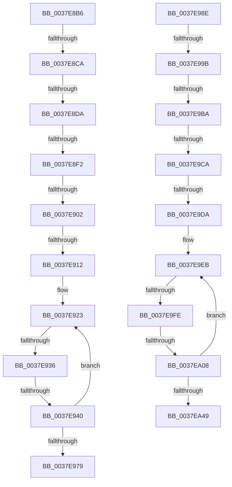

# sub_0037E8B6

- RVA: `0x0037E8B6`–`0x0037EA6D` (길이 `439` bytes)
- VA: `0x000000014037E8B6`
- 실행 섹션: `.text`
- PDB 이름 있음: `아니요`; PDB Function 태그: `아니요`
- unwind 정보 RVA: `0x0007B75C`
- 디코드: `90`개 명령, `439/439` bytes 표시
- 미해석 바이트: `0` (있으면 어셈블리에 `.byte`로 보존)

> 이 문서는 커널 이미지의 기계어와 PDB 기호를 분석해 생성했습니다. 4번과 5번은 함수 원형과 자료형을 바이너리 사용 방식에서 추정한 C 해석이며 원본 소스 복구 결과는 아닙니다.

## 1. Dependencies

- 직접 호출 지점: **2**; 고유 호출 대상: **2**
- 직접 호출자로 확인된 함수: **0**
- RIP 상대 이미지 참조: **4**

### Outgoing calls
- `0x0037E99E` → [HalpTimerGetInternalData](../20/HalpTimerGetInternalData_function_00209500.md) (function, `0x00209500`)
- `0x0037EA63` → [HalpTimerScaleCounter](HalpTimerScaleCounter_function_0037B354.md) (function, `0x0037B354`)

### Direct callers
- 이 함수 시작 RVA로 연결되는 직접 call은 확인되지 않았습니다. 간접 호출은 완전히 역산할 수 없습니다.

### Static image references
- `0x0037E8E2` → RVA `0x00378F50` (`HalpHvCounterQueryCounter`; read)
- `0x0037E8F2` → RVA `0x00E11760` (`.data`; read)
- `0x0037E902` → RVA `0x002DDBC0` (`HvlGetReferenceTimeUsingTscPage`; read)
- `0x0037E923` → RVA `0x00FC6D88` (`ALMOSTRO`; read)

## 2. Other-region calls and transfers

- 다른 실행 섹션으로 향하는 call: **0**
- call이 아닌 외부 분기/꼬리 이동: **15**
  - `0x0037E8C4` → [sub_0037EAAA](Unknown_function_0037EAAA.md) (`tail-transfer`)
  - `0x0037E8D4` → [sub_0037EAAA + 0x105](Unknown_function_0037EAAA.md) (`tail-transfer`)
  - `0x0037E8EC` → [sub_0037EAAA + 0x267](Unknown_function_0037EAAA.md) (`tail-transfer`)
  - `0x0037E8FC` → [sub_0037EAAA + 0x163](Unknown_function_0037EAAA.md) (`tail-transfer`)
  - `0x0037E90C` → [sub_0037EAAA + 0x30C](Unknown_function_0037EAAA.md) (`tail-transfer`)
  - `0x0037E930` → [sub_0037EAAA + 0x138](Unknown_function_0037EAAA.md) (`tail-transfer`)
  - `0x0037E93A` → [sub_0037EAAA + 0x11C](Unknown_function_0037EAAA.md) (`tail-transfer`)
  - `0x0037E989` → [sub_0037E7EA + 0x93](Unknown_function_0037E7EA.md) (`tail-transfer`)
  - `0x0037E995` → [sub_0037EAAA + 0x181](Unknown_function_0037EAAA.md) (`tail-transfer`)
  - `0x0037E9B4` → [sub_0037EAAA + 0x2D1](Unknown_function_0037EAAA.md) (`tail-transfer`)
  - `0x0037E9C4` → [sub_0037EAAA + 0x2BE](Unknown_function_0037EAAA.md) (`tail-transfer`)
  - `0x0037E9D4` → [sub_0037EAAA + 0x2EE](Unknown_function_0037EAAA.md) (`tail-transfer`)
  - `0x0037E9F8` → [sub_0037EAAA + 0x2AA](Unknown_function_0037EAAA.md) (`tail-transfer`)
  - `0x0037EA02` → [sub_0037EAAA + 0x277](Unknown_function_0037EAAA.md) (`tail-transfer`)
  - `0x0037EA68` → [sub_0037E7EA + 0x93](Unknown_function_0037E7EA.md) (`tail-transfer`)

## 3. Assembly (complete function range)

```asm
0037E8B6  83 BE DC 00 00 00 40            cmp dword ptr [rsi + 0xdc], 0x40
0037E8BD  48 8B 9E C0 00 00 00            mov rbx, qword ptr [rsi + 0xc0]
0037E8C4  0F 85 E0 01 00 00               jne 0x14037eaaa
0037E8CA  F7 86 E0 00 00 00 00 00 01 00   test dword ptr [rsi + 0xe0], 0x10000
0037E8D4  0F 85 D5 02 00 00               jne 0x14037ebaf
0037E8DA  48 8B 56 48                     mov rdx, qword ptr [rsi + 0x48]
0037E8DE  48 8B 46 70                     mov rax, qword ptr [rsi + 0x70]
0037E8E2  48 8D 0D 67 A6 FF FF            lea rcx, [rip - 0x5999]
0037E8E9  48 3B C1                        cmp rax, rcx
0037E8EC  0F 85 1F 04 00 00               jne 0x14037ed11
0037E8F2  48 8B 05 67 2E A9 00            mov rax, qword ptr [rip + 0xa92e67]
0037E8F9  48 85 C0                        test rax, rax
0037E8FC  0F 84 0B 03 00 00               je 0x14037ec0d
0037E902  48 8D 0D B7 F2 F5 FF            lea rcx, [rip - 0xa0d49]
0037E909  48 3B C1                        cmp rax, rcx
0037E90C  0F 85 A4 04 00 00               jne 0x14037edb6
0037E912  33 C9                           xor ecx, ecx
0037E914  49 BA 94 02 00 00 80 F7 FF FF   movabs r10, 0xfffff78000000294
0037E91E  48 89 4C 24 60                  mov qword ptr [rsp + 0x60], rcx
0037E923  48 8B 05 5E 84 C4 00            mov rax, qword ptr [rip + 0xc4845e]
0037E92A  44 8B 08                        mov r9d, dword ptr [rax]
0037E92D  45 85 C9                        test r9d, r9d
0037E930  0F 84 AC 02 00 00               je 0x14037ebe2
0037E936  41 80 3A 00                     cmp byte ptr [r10], 0
0037E93A  0F 84 86 02 00 00               je 0x14037ebc6
0037E940  0F 01 F9                        rdtscp
0037E943  48 C1 E2 20                     shl rdx, 0x20
0037E947  48 0B D0                        or rdx, rax
0037E94A  48 8B 05 37 84 C4 00            mov rax, qword ptr [rip + 0xc48437]
0037E951  48 8B 40 08                     mov rax, qword ptr [rax + 8]
0037E955  48 8B 0D 2C 84 C4 00            mov rcx, qword ptr [rip + 0xc4842c]
0037E95C  48 F7 E2                        mul rdx
0037E95F  4C 8B 41 10                     mov r8, qword ptr [rcx + 0x10]
0037E963  48 8B 05 1E 84 C4 00            mov rax, qword ptr [rip + 0xc4841e]
0037E96A  49 03 D0                        add rdx, r8
0037E96D  48 89 54 24 60                  mov qword ptr [rsp + 0x60], rdx
0037E972  8B 08                           mov ecx, dword ptr [rax]
0037E974  41 3B C9                        cmp ecx, r9d
0037E977  75 AA                           jne 0x14037e923
0037E979  48 8B 54 24 60                  mov rdx, qword ptr [rsp + 0x60]
0037E97E  4C 8B BE D0 00 00 00            mov r15, qword ptr [rsi + 0xd0]
0037E985  49 8D 04 17                     lea rax, [r15 + rdx]
0037E989  E9 EF FE FF FF                  jmp 0x14037e87d
0037E98E  83 BE DC 00 00 00 40            cmp dword ptr [rsi + 0xdc], 0x40
0037E995  0F 85 90 02 00 00               jne 0x14037ec2b
0037E99B  48 8B CE                        mov rcx, rsi
0037E99E  E8 5D AB E8 FF                  call 0x140209500
0037E9A3  48 8B D0                        mov rdx, rax
0037E9A6  48 8D 0D A3 A5 FF FF            lea rcx, [rip - 0x5a5d]
0037E9AD  48 8B 46 70                     mov rax, qword ptr [rsi + 0x70]
0037E9B1  48 3B C1                        cmp rax, rcx
0037E9B4  0F 85 C1 03 00 00               jne 0x14037ed7b
0037E9BA  48 8B 05 9F 2D A9 00            mov rax, qword ptr [rip + 0xa92d9f]
0037E9C1  48 85 C0                        test rax, rax
0037E9C4  0F 84 9E 03 00 00               je 0x14037ed68
0037E9CA  48 8D 0D EF F1 F5 FF            lea rcx, [rip - 0xa0e11]
0037E9D1  48 3B C1                        cmp rax, rcx
0037E9D4  0F 85 BE 03 00 00               jne 0x14037ed98
0037E9DA  33 C9                           xor ecx, ecx
0037E9DC  49 BA 94 02 00 00 80 F7 FF FF   movabs r10, 0xfffff78000000294
0037E9E6  48 89 4C 24 58                  mov qword ptr [rsp + 0x58], rcx
0037E9EB  48 8B 05 96 83 C4 00            mov rax, qword ptr [rip + 0xc48396]
0037E9F2  44 8B 08                        mov r9d, dword ptr [rax]
0037E9F5  45 85 C9                        test r9d, r9d
0037E9F8  0F 84 56 03 00 00               je 0x14037ed54
0037E9FE  41 80 3A 00                     cmp byte ptr [r10], 0
0037EA02  0F 84 19 03 00 00               je 0x14037ed21
0037EA08  0F 01 F9                        rdtscp
0037EA0B  4C 8D 44 24 58                  lea r8, [rsp + 0x58]
0037EA10  41 89 08                        mov dword ptr [r8], ecx
0037EA13  48 C1 E2 20                     shl rdx, 0x20
0037EA17  48 0B D0                        or rdx, rax
0037EA1A  48 8B 05 67 83 C4 00            mov rax, qword ptr [rip + 0xc48367]
0037EA21  48 8B 40 08                     mov rax, qword ptr [rax + 8]
0037EA25  48 8B 0D 5C 83 C4 00            mov rcx, qword ptr [rip + 0xc4835c]
0037EA2C  48 F7 E2                        mul rdx
0037EA2F  4C 8B 41 10                     mov r8, qword ptr [rcx + 0x10]
0037EA33  48 8B 05 4E 83 C4 00            mov rax, qword ptr [rip + 0xc4834e]
0037EA3A  49 03 D0                        add rdx, r8
0037EA3D  48 89 54 24 58                  mov qword ptr [rsp + 0x58], rdx
0037EA42  8B 08                           mov ecx, dword ptr [rax]
0037EA44  41 3B C9                        cmp ecx, r9d
0037EA47  75 A2                           jne 0x14037e9eb
0037EA49  48 8B 54 24 58                  mov rdx, qword ptr [rsp + 0x58]
0037EA4E  4C 8B BE D0 00 00 00            mov r15, qword ptr [rsi + 0xd0]
0037EA55  49 8D 0C 17                     lea rcx, [r15 + rdx]
0037EA59  4D 8B C4                        mov r8, r12
0037EA5C  48 8B 96 C0 00 00 00            mov rdx, qword ptr [rsi + 0xc0]
0037EA63  E8 EC C8 FF FF                  call 0x14037b354
0037EA68  E9 10 FE FF FF                  jmp 0x14037e87d
```

## 4. C-style interpretation (structured pseudocode)

```c
__int64 __fastcall sub_0037E8B6(__int64 a1, __int64 a2, __int64 a3, __int64 a4, __int64 a5, __int64 a6, __int64 a7, __int64 a8, __int64 a9, __int64 a10, __int64 a11, __int64 a12)
{
    unsigned __int64 v_stack_p58;
    unsigned __int64 v_stack_p60;

    a1 = 0;
    v_stack_p60 = 0;
loc_0037E923:
    a2 = (*(unsigned __int64 *)(v_rsi + 72)) << (32);
    a2 = (a2) | (*(unsigned __int64 *)(v_rip + 12878942));
    a2 = (a2) + (*(unsigned __int64 *)(*(unsigned __int64 *)(v_rip + 12878892) + 16));
    v_stack_p60 = a2;
    if (((unsigned int)((unsigned int)(*(unsigned int *)(*(unsigned __int64 *)(v_rip + 12878878))))) != ((unsigned int)((unsigned int)(*(unsigned int *)(*(unsigned __int64 *)(v_rip + 12878942)))))) goto loc_0037E923;
}
```

## 5. (Beta) C Style

```c
int64_t sub_0037E8B6(int64_t Arg1, int64_t Arg2, int64_t Arg3, int64_t Arg4, uint64_t Arg5, uint64_t Arg6, uint64_t Arg7, uint64_t Arg8, uint64_t Arg9, uint64_t Arg10, uint64_t Arg11, int64_t Arg12)
{
    uint64_t v_stack_p58;
    uint64_t v_stack_p60;

    Arg1 = 0;
    v_stack_p60 = 0;
loc_0037E923:
    Arg2 = (*(uint64_t *)(local_rsi + 0x48)) << (32);
    Arg2 = (Arg2) | (*(uint64_t *)(v_rip + 0xC4845E));
    Arg2 = (Arg2) + (*(uint64_t *)(*(uint64_t *)(v_rip + 0xC4842C) + 0x10));
    v_stack_p60 = Arg2;
    if (((uint32_t)((uint32_t)(*(uint32_t *)(*(uint64_t *)(v_rip + 0xC4841E))))) != ((uint32_t)((uint32_t)(*(uint32_t *)(*(uint64_t *)(v_rip + 0xC4845E)))))) goto loc_0037E923;
}
```

## 6. Execution-region graph

[열기: 2D/3D 그래프와 함수 탐색 컨트롤 패널](../../../control-panel.html?section=text&rva=0x0037E8B6&view=graph)

- 2D 그래프는 위에서 아래로 흐르고, 3D 그래프는 빈 공간을 드래그해 회전합니다. Shift+드래그는 이동, 휠은 확대·축소, 함수 노드 선택은 대상 보고서 이동입니다.

### Static fallback


