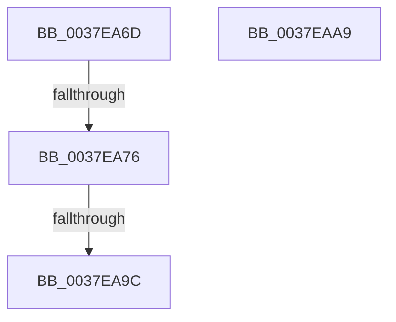

# sub_0037EA6D

- RVA: `0x0037EA6D`–`0x0037EAAA` (길이 `61` bytes)
- VA: `0x000000014037EA6D`
- 실행 섹션: `.text`
- PDB 이름 있음: `아니요`; PDB Function 태그: `아니요`
- unwind 정보 RVA: `0x0007B77C`
- 디코드: `17`개 명령, `61/61` bytes 표시
- 미해석 바이트: `0` (있으면 어셈블리에 `.byte`로 보존)

> 이 문서는 커널 이미지의 기계어와 PDB 기호를 분석해 생성했습니다. 4번과 5번은 함수 원형과 자료형을 바이너리 사용 방식에서 추정한 C 해석이며 원본 소스 복구 결과는 아닙니다.

## 1. Dependencies

- 직접 호출 지점: **1**; 고유 호출 대상: **1**
- 직접 호출자로 확인된 함수: **0**
- RIP 상대 이미지 참조: **0**

### Outgoing calls
- `0x0037EA8E` → [HalpTimerScaleCounter](HalpTimerScaleCounter_function_0037B354.md) (function, `0x0037B354`)

### Direct callers
- 이 함수 시작 RVA로 연결되는 직접 call은 확인되지 않았습니다. 간접 호출은 완전히 역산할 수 없습니다.

### Static image references
- 디코드된 RIP-relative 메모리 참조가 없습니다.

## 2. Other-region calls and transfers

- 다른 실행 섹션으로 향하는 call: **0**
- call이 아닌 외부 분기/꼬리 이동: **2**
  - `0x0037EA70` → [sub_0037E8A1](Unknown_function_0037E8A1.md) (`tail-transfer`)
  - `0x0037EA96` → [sub_0037E8A1 + 0x5](Unknown_function_0037E8A1.md) (`tail-transfer`)

## 3. Assembly (complete function range)

```asm
0037EA6D  48 85 C9                        test rcx, rcx
0037EA70  0F 84 2B FE FF FF               je 0x14037e8a1
0037EA76  83 B9 E4 00 00 00 05            cmp dword ptr [rcx + 0xe4], 5
0037EA7D  48 8B D3                        mov rdx, rbx
0037EA80  4C 8B 81 C0 00 00 00            mov r8, qword ptr [rcx + 0xc0]
0037EA87  48 8B C8                        mov rcx, rax
0037EA8A  4D 0F 44 C4                     cmove r8, r12
0037EA8E  E8 C1 C8 FF FF                  call 0x14037b354
0037EA93  4D 85 F6                        test r14, r14
0037EA96  0F 84 0A FE FF FF               je 0x14037e8a6
0037EA9C  4D 89 06                        mov qword ptr [r14], r8
0037EA9F  48 83 C4 30                     add rsp, 0x30
0037EAA3  41 5E                           pop r14
0037EAA5  41 5C                           pop r12
0037EAA7  5B                              pop rbx
0037EAA8  C3                              ret
0037EAA9  CC                              int3
```

## 4. C-style interpretation (structured pseudocode)

```c
__int64 __fastcall sub_0037EA6D(__int64 a1)
{
    __int64 result;
    __int64 v_rsp;

    a3 = *(unsigned __int64 *)(a1 + 192);
    if ((*(unsigned int *)(a1 + 228)) == 5) { a3 = v_r12; }
    result = HalpTimerScaleCounter(result, v_rbx, a3, a4);
    *(unsigned __int64 *)(v_r14) = a3;
    v_rsp = (v_rsp) + (48);
    return result;
}
```

## 5. (Beta) C Style

```c
int64_t sub_0037EA6D(int64_t Arg1)
{
    int64_t result;
    int64_t local_rsp;

    a3 = *(uint64_t *)(Arg1 + 0xC0);
    if ((*(uint32_t *)(Arg1 + 0xE4)) == 5) { a3 = local_r12; }
    result = HalpTimerScaleCounter(result, local_rbx, a3, a4);
    *(uint64_t *)(local_r14) = a3;
    local_rsp = (local_rsp) + (48);
    return result;
}
```

## 6. Execution-region graph

[열기: 2D/3D 그래프와 함수 탐색 컨트롤 패널](../../../control-panel.html?section=text&rva=0x0037EA6D&view=graph)

- 2D 그래프는 위에서 아래로 흐르고, 3D 그래프는 빈 공간을 드래그해 회전합니다. Shift+드래그는 이동, 휠은 확대·축소, 함수 노드 선택은 대상 보고서 이동입니다.

### Static fallback


