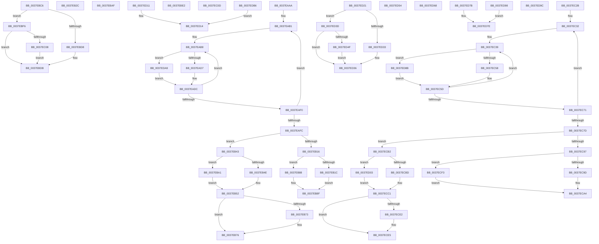

# sub_0037EAAA

- RVA: `0x0037EAAA`–`0x0037EDBD` (길이 `787` bytes)
- VA: `0x000000014037EAAA`
- 실행 섹션: `.text`
- PDB 이름 있음: `아니요`; PDB Function 태그: `아니요`
- unwind 정보 RVA: `0x0007B790`
- 디코드: `195`개 명령, `787/787` bytes 표시
- 미해석 바이트: `0` (있으면 어셈블리에 `.byte`로 보존)

> 이 문서는 커널 이미지의 기계어와 PDB 기호를 분석해 생성했습니다. 4번과 5번은 함수 원형과 자료형을 바이너리 사용 방식에서 추정한 C 해석이며 원본 소스 복구 결과는 아닙니다.

## 1. Dependencies

- 직접 호출 지점: **11**; 고유 호출 대상: **4**
- 직접 호출자로 확인된 함수: **0**
- RIP 상대 이미지 참조: **1**

### Outgoing calls
- `0x0037EAC2` → [HalpTimerGetInternalData](../20/HalpTimerGetInternalData_function_00209500.md) (function, `0x00209500`)
- `0x0037EAD7` → [HalpHpetQueryCounter](HalpHpetQueryCounter_function_00379660.md) (function, `0x00379660`)
- `0x0037EBEC` → [HvlpGetRegister64](HvlpGetRegister64_function_00379050.md) (function, `0x00379050`)
- `0x0037EC43` → [HalpTimerGetInternalData](../20/HalpTimerGetInternalData_function_00209500.md) (function, `0x00209500`)
- `0x0037EC58` → [HalpHpetQueryCounter](HalpHpetQueryCounter_function_00379660.md) (function, `0x00379660`)
- `0x0037ED14` → [guard_dispatch_icall](../6B/guard_dispatch_icall_function_006BAAD0.md) (function, `0x006BAAD0`)
- `0x0037ED5E` → [HvlpGetRegister64](HvlpGetRegister64_function_00379050.md) (function, `0x00379050`)
- `0x0037ED7E` → [guard_dispatch_icall](../6B/guard_dispatch_icall_function_006BAAD0.md) (function, `0x006BAAD0`)
- `0x0037ED8E` → [guard_dispatch_icall](../6B/guard_dispatch_icall_function_006BAAD0.md) (function, `0x006BAAD0`)
- `0x0037ED9C` → [guard_dispatch_icall](../6B/guard_dispatch_icall_function_006BAAD0.md) (function, `0x006BAAD0`)
- `0x0037EDAC` → [guard_dispatch_icall](../6B/guard_dispatch_icall_function_006BAAD0.md) (function, `0x006BAAD0`)

### Direct callers
- 이 함수 시작 RVA로 연결되는 직접 call은 확인되지 않았습니다. 간접 호출은 완전히 역산할 수 없습니다.

### Static image references
- `0x0037EAAA` → RVA `0x00379660` (`HalpHpetQueryCounter`; read)

## 2. Other-region calls and transfers

- 다른 실행 섹션으로 향하는 call: **0**
- call이 아닌 외부 분기/꼬리 이동: **15**
  - `0x0037EB3E` → [sub_0037E7EA + 0x56](Unknown_function_0037E7EA.md) (`tail-transfer`)
  - `0x0037EB83` → [sub_0037E7EA + 0x93](Unknown_function_0037E7EA.md) (`tail-transfer`)
  - `0x0037EB9C` → [sub_0037E7EA + 0x93](Unknown_function_0037E7EA.md) (`tail-transfer`)
  - `0x0037EBC1` → [sub_0037E8B6 + 0x28](Unknown_function_0037E8B6.md) (`tail-transfer`)
  - `0x0037EBDD` → [sub_0037E8B6 + 0x8D](Unknown_function_0037E8B6.md) (`tail-transfer`)
  - `0x0037EBF1` → [sub_0037E8B6 + 0xC3](Unknown_function_0037E8B6.md) (`tail-transfer`)
  - `0x0037EC26` → [sub_0037E7EA + 0x93](Unknown_function_0037E7EA.md) (`tail-transfer`)
  - `0x0037ECAD` → [sub_0037E8B6 + 0x19F](Unknown_function_0037E8B6.md) (`tail-transfer`)
  - `0x0037ECEE` → [sub_0037E8B6 + 0x19F](Unknown_function_0037E8B6.md) (`tail-transfer`)
  - `0x0037ED1C` → [sub_0037E8B6 + 0xC8](Unknown_function_0037E8B6.md) (`tail-transfer`)
  - `0x0037ED38` → [sub_0037E8B6 + 0x15D](Unknown_function_0037E8B6.md) (`tail-transfer`)
  - `0x0037ED63` → [sub_0037E8B6 + 0x193](Unknown_function_0037E8B6.md) (`tail-transfer`)
  - `0x0037ED76` → [sub_0037E8B6 + 0x198](Unknown_function_0037E8B6.md) (`tail-transfer`)
  - `0x0037ED86` → [sub_0037E8B6 + 0x198](Unknown_function_0037E8B6.md) (`tail-transfer`)
  - `0x0037EDA4` → [sub_0037E7EA + 0x74](Unknown_function_0037E7EA.md) (`tail-transfer`)

## 3. Assembly (complete function range)

```asm
0037EAAA  48 8D 2D AF AB FF FF            lea rbp, [rip - 0x5451]
0037EAB1  4C 8B BE D0 00 00 00            mov r15, qword ptr [rsi + 0xd0]
0037EAB8  48 8B BE C8 00 00 00            mov rdi, qword ptr [rsi + 0xc8]
0037EABF  48 8B CE                        mov rcx, rsi
0037EAC2  E8 39 AA E8 FF                  call 0x140209500
0037EAC7  48 8B 56 70                     mov rdx, qword ptr [rsi + 0x70]
0037EACB  48 8B C8                        mov rcx, rax
0037EACE  48 3B D5                        cmp rdx, rbp
0037EAD1  0F 85 D2 02 00 00               jne 0x14037eda9
0037EAD7  E8 84 AB FF FF                  call 0x140379660
0037EADC  4C 8B D0                        mov r10, rax
0037EADF  F0 83 0C 24 00                  lock or dword ptr [rsp], 0
0037EAE4  48 8B 86 C8 00 00 00            mov rax, qword ptr [rsi + 0xc8]
0037EAEB  48 3B F8                        cmp rdi, rax
0037EAEE  75 C8                           jne 0x14037eab8
0037EAF0  48 8B 8E D0 00 00 00            mov rcx, qword ptr [rsi + 0xd0]
0037EAF7  4C 3B F9                        cmp r15, rcx
0037EAFA  75 B5                           jne 0x14037eab1
0037EAFC  44 8B 8E DC 00 00 00            mov r9d, dword ptr [rsi + 0xdc]
0037EB03  41 8D 49 FF                     lea ecx, [r9 - 1]
0037EB07  0F B6 D1                        movzx edx, cl
0037EB0A  49 8B CA                        mov rcx, r10
0037EB0D  48 33 CF                        xor rcx, rdi
0037EB10  48 0F A3 D1                     bt rcx, rdx
0037EB14  72 2D                           jb 0x14037eb43
0037EB16  41 83 F9 40                     cmp r9d, 0x40
0037EB1A  74 6C                           je 0x14037eb88
0037EB1C  41 8B C9                        mov ecx, r9d
0037EB1F  BA 01 00 00 00                  mov edx, 1
0037EB24  48 D3 E2                        shl rdx, cl
0037EB27  48 FF CA                        dec rdx
0037EB2A  EB 63                           jmp 0x14037eb8f
0037EB2C  65 8B 04 25 A4 01 00 00         mov eax, dword ptr gs:[0x1a4]
0037EB34  0F AF 46 50                     imul eax, dword ptr [rsi + 0x50]
0037EB38  8B C8                           mov ecx, eax
0037EB3A  48 03 4E 48                     add rcx, qword ptr [rsi + 0x48]
0037EB3E  E9 FD FC FF FF                  jmp 0x14037e840
0037EB43  BA 01 00 00 00                  mov edx, 1
0037EB48  41 83 F9 40                     cmp r9d, 0x40
0037EB4C  75 53                           jne 0x14037eba1
0037EB4E  4C 8D 42 FE                     lea r8, [rdx - 2]
0037EB52  41 8B C9                        mov ecx, r9d
0037EB55  48 D3 E2                        shl rdx, cl
0037EB58  33 C9                           xor ecx, ecx
0037EB5A  41 83 F9 40                     cmp r9d, 0x40
0037EB5E  48 0F 45 CA                     cmovne rcx, rdx
0037EB62  4C 23 C7                        and r8, rdi
0037EB65  49 8B D0                        mov rdx, r8
0037EB68  48 33 D7                        xor rdx, rdi
0037EB6B  49 0B D2                        or rdx, r10
0037EB6E  4D 3B D0                        cmp r10, r8
0037EB71  73 03                           jae 0x14037eb76
0037EB73  48 03 D1                        add rdx, rcx
0037EB76  F0 48 0F B1 96 C8 00 00 00      lock cmpxchg qword ptr [rsi + 0xc8], rdx
0037EB7F  49 8D 04 17                     lea rax, [r15 + rdx]
0037EB83  E9 F5 FC FF FF                  jmp 0x14037e87d
0037EB88  48 C7 C2 FF FF FF FF            mov rdx, 0xffffffffffffffff
0037EB8F  48 F7 D2                        not rdx
0037EB92  48 23 D7                        and rdx, rdi
0037EB95  49 0B D2                        or rdx, r10
0037EB98  49 8D 04 17                     lea rax, [r15 + rdx]
0037EB9C  E9 DC FC FF FF                  jmp 0x14037e87d
0037EBA1  41 8B C9                        mov ecx, r9d
0037EBA4  4C 8B C2                        mov r8, rdx
0037EBA7  49 D3 E0                        shl r8, cl
0037EBAA  49 FF C8                        dec r8
0037EBAD  EB A3                           jmp 0x14037eb52
0037EBAF  65 8B 04 25 A4 01 00 00         mov eax, dword ptr gs:[0x1a4]
0037EBB7  0F AF 46 50                     imul eax, dword ptr [rsi + 0x50]
0037EBBB  8B D0                           mov edx, eax
0037EBBD  48 03 56 48                     add rdx, qword ptr [rsi + 0x48]
0037EBC1  E9 18 FD FF FF                  jmp 0x14037e8de
0037EBC6  65 48 8B 04 25 20 00 00 00      mov rax, qword ptr gs:[0x20]
0037EBCF  80 B8 8D 00 00 00 02            cmp byte ptr [rax + 0x8d], 2
0037EBD6  75 1E                           jne 0x14037ebf6
0037EBD8  0F AE E8                        lfence
0037EBDB  0F 31                           rdtsc
0037EBDD  E9 61 FD FF FF                  jmp 0x14037e943
0037EBE2  48 8D 54 24 60                  lea rdx, [rsp + 0x60]
0037EBE7  B9 04 00 09 00                  mov ecx, 0x90004
0037EBEC  E8 5F A4 FF FF                  call 0x140379050
0037EBF1  E9 83 FD FF FF                  jmp 0x14037e979
0037EBF6  65 48 8B 04 25 20 00 00 00      mov rax, qword ptr gs:[0x20]
0037EBFF  80 B8 8D 00 00 00 01            cmp byte ptr [rax + 0x8d], 1
0037EC06  75 D3                           jne 0x14037ebdb
0037EC08  0F AE F0                        mfence
0037EC0B  EB CE                           jmp 0x14037ebdb
0037EC0D  B9 20 00 00 40                  mov ecx, 0x40000020
0037EC12  0F 32                           rdmsr
0037EC14  4C 8B BE D0 00 00 00            mov r15, qword ptr [rsi + 0xd0]
0037EC1B  48 C1 E2 20                     shl rdx, 0x20
0037EC1F  48 0B D0                        or rdx, rax
0037EC22  49 8D 04 17                     lea rax, [r15 + rdx]
0037EC26  E9 52 FC FF FF                  jmp 0x14037e87d
0037EC2B  48 8D 2D 2E AA FF FF            lea rbp, [rip - 0x55d2]
0037EC32  4C 8B BE D0 00 00 00            mov r15, qword ptr [rsi + 0xd0]
0037EC39  48 8B BE C8 00 00 00            mov rdi, qword ptr [rsi + 0xc8]
0037EC40  48 8B CE                        mov rcx, rsi
0037EC43  E8 B8 A8 E8 FF                  call 0x140209500
0037EC48  48 8B 56 70                     mov rdx, qword ptr [rsi + 0x70]
0037EC4C  48 8B C8                        mov rcx, rax
0037EC4F  48 3B D5                        cmp rdx, rbp
0037EC52  0F 85 33 01 00 00               jne 0x14037ed8b
0037EC58  E8 03 AA FF FF                  call 0x140379660
0037EC5D  4C 8B D0                        mov r10, rax
0037EC60  F0 83 0C 24 00                  lock or dword ptr [rsp], 0
0037EC65  48 8B 86 C8 00 00 00            mov rax, qword ptr [rsi + 0xc8]
0037EC6C  48 3B F8                        cmp rdi, rax
0037EC6F  75 C8                           jne 0x14037ec39
0037EC71  48 8B 8E D0 00 00 00            mov rcx, qword ptr [rsi + 0xd0]
0037EC78  4C 3B F9                        cmp r15, rcx
0037EC7B  75 B5                           jne 0x14037ec32
0037EC7D  44 8B 8E DC 00 00 00            mov r9d, dword ptr [rsi + 0xdc]
0037EC84  41 8D 49 FF                     lea ecx, [r9 - 1]
0037EC88  0F B6 D1                        movzx edx, cl
0037EC8B  49 8B CA                        mov rcx, r10
0037EC8E  48 33 CF                        xor rcx, rdi
0037EC91  48 0F A3 D1                     bt rcx, rdx
0037EC95  72 1B                           jb 0x14037ecb2
0037EC97  41 83 F9 40                     cmp r9d, 0x40
0037EC9B  75 56                           jne 0x14037ecf3
0037EC9D  48 C7 C2 FF FF FF FF            mov rdx, 0xffffffffffffffff
0037ECA4  48 F7 D2                        not rdx
0037ECA7  48 23 D7                        and rdx, rdi
0037ECAA  49 0B D2                        or rdx, r10
0037ECAD  E9 A3 FD FF FF                  jmp 0x14037ea55
0037ECB2  BA 01 00 00 00                  mov edx, 1
0037ECB7  41 83 F9 40                     cmp r9d, 0x40
0037ECBB  75 46                           jne 0x14037ed03
0037ECBD  4C 8D 42 FE                     lea r8, [rdx - 2]
0037ECC1  41 8B C9                        mov ecx, r9d
0037ECC4  48 D3 E2                        shl rdx, cl
0037ECC7  33 C9                           xor ecx, ecx
0037ECC9  41 83 F9 40                     cmp r9d, 0x40
0037ECCD  48 0F 45 CA                     cmovne rcx, rdx
0037ECD1  4C 23 C7                        and r8, rdi
0037ECD4  49 8B D0                        mov rdx, r8
0037ECD7  48 33 D7                        xor rdx, rdi
0037ECDA  49 0B D2                        or rdx, r10
0037ECDD  4D 3B D0                        cmp r10, r8
0037ECE0  73 03                           jae 0x14037ece5
0037ECE2  48 03 D1                        add rdx, rcx
0037ECE5  F0 48 0F B1 96 C8 00 00 00      lock cmpxchg qword ptr [rsi + 0xc8], rdx
0037ECEE  E9 62 FD FF FF                  jmp 0x14037ea55
0037ECF3  41 8B C9                        mov ecx, r9d
0037ECF6  BA 01 00 00 00                  mov edx, 1
0037ECFB  48 D3 E2                        shl rdx, cl
0037ECFE  48 FF CA                        dec rdx
0037ED01  EB A1                           jmp 0x14037eca4
0037ED03  41 8B C9                        mov ecx, r9d
0037ED06  4C 8B C2                        mov r8, rdx
0037ED09  49 D3 E0                        shl r8, cl
0037ED0C  49 FF C8                        dec r8
0037ED0F  EB B0                           jmp 0x14037ecc1
0037ED11  48 8B CA                        mov rcx, rdx
0037ED14  E8 B7 BD 33 00                  call 0x1406baad0
0037ED19  48 8B D0                        mov rdx, rax
0037ED1C  E9 5D FC FF FF                  jmp 0x14037e97e
0037ED21  65 48 8B 04 25 20 00 00 00      mov rax, qword ptr gs:[0x20]
0037ED2A  80 B8 8D 00 00 00 02            cmp byte ptr [rax + 0x8d], 2
0037ED31  75 0A                           jne 0x14037ed3d
0037ED33  0F AE E8                        lfence
0037ED36  0F 31                           rdtsc
0037ED38  E9 D6 FC FF FF                  jmp 0x14037ea13
0037ED3D  65 48 8B 04 25 20 00 00 00      mov rax, qword ptr gs:[0x20]
0037ED46  80 B8 8D 00 00 00 01            cmp byte ptr [rax + 0x8d], 1
0037ED4D  75 E7                           jne 0x14037ed36
0037ED4F  0F AE F0                        mfence
0037ED52  EB E2                           jmp 0x14037ed36
0037ED54  48 8D 54 24 58                  lea rdx, [rsp + 0x58]
0037ED59  B9 04 00 09 00                  mov ecx, 0x90004
0037ED5E  E8 ED A2 FF FF                  call 0x140379050
0037ED63  E9 E1 FC FF FF                  jmp 0x14037ea49
0037ED68  B9 20 00 00 40                  mov ecx, 0x40000020
0037ED6D  0F 32                           rdmsr
0037ED6F  48 C1 E2 20                     shl rdx, 0x20
0037ED73  48 0B D0                        or rdx, rax
0037ED76  E9 D3 FC FF FF                  jmp 0x14037ea4e
0037ED7B  48 8B CA                        mov rcx, rdx
0037ED7E  E8 4D BD 33 00                  call 0x1406baad0
0037ED83  48 8B D0                        mov rdx, rax
0037ED86  E9 C3 FC FF FF                  jmp 0x14037ea4e
0037ED8B  48 8B C2                        mov rax, rdx
0037ED8E  E8 3D BD 33 00                  call 0x1406baad0
0037ED93  E9 C5 FE FF FF                  jmp 0x14037ec5d
0037ED98  33 C9                           xor ecx, ecx
0037ED9A  EB E2                           jmp 0x14037ed7e
0037ED9C  E8 2F BD 33 00                  call 0x1406baad0
0037EDA1  48 8B D0                        mov rdx, rax
0037EDA4  E9 B5 FA FF FF                  jmp 0x14037e85e
0037EDA9  48 8B C2                        mov rax, rdx
0037EDAC  E8 1F BD 33 00                  call 0x1406baad0
0037EDB1  E9 26 FD FF FF                  jmp 0x14037eadc
0037EDB6  33 C9                           xor ecx, ecx
0037EDB8  E9 57 FF FF FF                  jmp 0x14037ed14
```

## 4. C-style interpretation (structured pseudocode)

```c
__int64 __fastcall sub_0037EAAA(void)
{
    __int64 result;
    unsigned int v_stack_p0;
    unsigned __int64 v_stack_p58;
    unsigned __int64 v_stack_p60;

loc_0037EAB1:
loc_0037EAB8:
    result = HalpTimerGetInternalData(v_rsi, a2, a3, a4);
    if ((*(unsigned __int64 *)(v_rsi + 112)) != (v_rip - 21585)) goto loc_0037EDA9;
    result = HalpHpetQueryCounter(result, *(unsigned __int64 *)(v_rsi + 112), a3, a4);
loc_0037EADC:
    if ((*(unsigned __int64 *)(v_rsi + 200)) != (*(unsigned __int64 *)(v_rsi + 200))) goto loc_0037EAB8;
    if ((*(unsigned __int64 *)(v_rsi + 208)) != (*(unsigned __int64 *)(v_rsi + 208))) goto loc_0037EAB1;
    a1 = (result) ^ (*(unsigned __int64 *)(v_rsi + 200));
    if (condition_is_below) goto loc_0037EB43;
    if (((unsigned int)((unsigned int)(*(unsigned int *)(v_rsi + 220)))) == 64) goto loc_0037EB88;
    a2 = (1) << ((unsigned __int8)((unsigned int)((unsigned int)((unsigned int)(*(unsigned int *)(v_rsi + 220))))));
    a2 = (a2) - 1;
    goto loc_0037EB8F;
loc_0037EB43:
    if (((unsigned int)((unsigned int)(*(unsigned int *)(v_rsi + 220)))) != 64) goto loc_0037EBA1;
loc_0037EB52:
    a2 = (1) << ((unsigned __int8)((unsigned int)((unsigned int)((unsigned int)(*(unsigned int *)(v_rsi + 220))))));
    a1 = 0;
    if (((unsigned int)((unsigned int)(*(unsigned int *)(v_rsi + 220)))) != 64) { a1 = a2; }
    a3 = (1 - 2) & (*(unsigned __int64 *)(v_rsi + 200));
    a2 = (a3) ^ (*(unsigned __int64 *)(v_rsi + 200));
    a2 = (a2) | (result);
    if (result < a3) {
        a2 = (a2) + (a1);
    }
loc_0037EB88:
loc_0037EB8F:
    a2 = ~(-1);
    a2 = (a2) & (*(unsigned __int64 *)(v_rsi + 200));
    a2 = (a2) | (result);
loc_0037EBA1:
    a3 = (a2) << ((unsigned __int8)((unsigned int)((unsigned int)((unsigned int)(*(unsigned int *)(v_rsi + 220))))));
    a3 = (a3) - 1;
    goto loc_0037EB52;
loc_0037EDA9:
    result = guard_dispatch_icall((unsigned int)((unsigned int)((unsigned int)(*(unsigned int *)(v_rsi + 220)))), a2, a3, (unsigned int)(*(unsigned int *)(v_rsi + 220)));
    goto loc_0037EADC;
}
```

## 5. (Beta) C Style

```c
void sub_0037EAAA(void)
{
    int64_t result;
    uint32_t v_stack_p0;
    uint64_t v_stack_p58;
    uint64_t v_stack_p60;

loc_0037EAB1:
loc_0037EAB8:
    result = HalpTimerGetInternalData(local_rsi, a2, a3, a4);
    if ((*(uint64_t *)(local_rsi + 0x70)) != (v_rip - 21585)) goto loc_0037EDA9;
    result = HalpHpetQueryCounter(result, *(uint64_t *)(local_rsi + 0x70), a3, a4);
loc_0037EADC:
    if ((*(uint64_t *)(local_rsi + 0xC8)) != (*(uint64_t *)(local_rsi + 0xC8))) goto loc_0037EAB8;
    if ((*(uint64_t *)(local_rsi + 0xD0)) != (*(uint64_t *)(local_rsi + 0xD0))) goto loc_0037EAB1;
    a1 = (result) ^ (*(uint64_t *)(local_rsi + 0xC8));
    if (condition_is_below) goto loc_0037EB43;
    if (((uint32_t)((uint32_t)(*(uint32_t *)(local_rsi + 0xDC)))) == 64) goto loc_0037EB88;
    a2 = (1) << ((uint8_t)((uint32_t)((uint32_t)((uint32_t)(*(uint32_t *)(local_rsi + 0xDC))))));
    a2 = (a2) - 1;
    goto loc_0037EB8F;
loc_0037EB43:
    if (((uint32_t)((uint32_t)(*(uint32_t *)(local_rsi + 0xDC)))) != 64) goto loc_0037EBA1;
loc_0037EB52:
    a2 = (1) << ((uint8_t)((uint32_t)((uint32_t)((uint32_t)(*(uint32_t *)(local_rsi + 0xDC))))));
    a1 = 0;
    if (((uint32_t)((uint32_t)(*(uint32_t *)(local_rsi + 0xDC)))) != 64) { a1 = a2; }
    a3 = (1 - 2) & (*(uint64_t *)(local_rsi + 0xC8));
    a2 = (a3) ^ (*(uint64_t *)(local_rsi + 0xC8));
    a2 = (a2) | (result);
    if (result < a3) {
        a2 = (a2) + (a1);
    }
loc_0037EB88:
loc_0037EB8F:
    a2 = ~(-1);
    a2 = (a2) & (*(uint64_t *)(local_rsi + 0xC8));
    a2 = (a2) | (result);
loc_0037EBA1:
    a3 = (a2) << ((uint8_t)((uint32_t)((uint32_t)((uint32_t)(*(uint32_t *)(local_rsi + 0xDC))))));
    a3 = (a3) - 1;
    goto loc_0037EB52;
loc_0037EDA9:
    result = guard_dispatch_icall((uint32_t)((uint32_t)((uint32_t)(*(uint32_t *)(local_rsi + 0xDC)))), a2, a3, (uint32_t)(*(uint32_t *)(local_rsi + 0xDC)));
    goto loc_0037EADC;
}
```

## 6. Execution-region graph

[열기: 2D/3D 그래프와 함수 탐색 컨트롤 패널](../../../control-panel.html?section=text&rva=0x0037EAAA&view=graph)

- 2D 그래프는 위에서 아래로 흐르고, 3D 그래프는 빈 공간을 드래그해 회전합니다. Shift+드래그는 이동, 휠은 확대·축소, 함수 노드 선택은 대상 보고서 이동입니다.

### Static fallback


