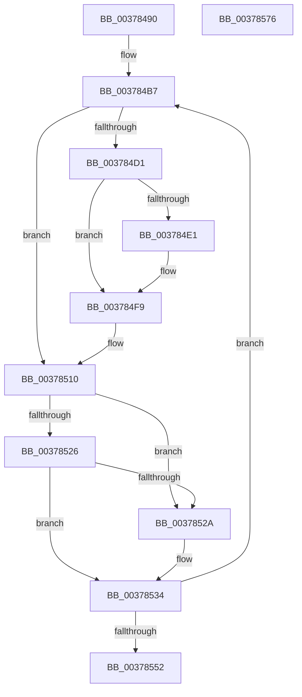

# wil_details_FeatureReporting_IncrementUsageInCache

- RVA: `0x00378490`–`0x00378577` (길이 `231` bytes)
- VA: `0x0000000140378490`
- 실행 섹션: `.text`
- PDB 이름 있음: `예`; PDB Function 태그: `아니요`
- unwind 정보 RVA: `0x0007AE6C`
- 디코드: `70`개 명령, `231/231` bytes 표시
- 미해석 바이트: `0` (있으면 어셈블리에 `.byte`로 보존)

> 이 문서는 커널 이미지의 기계어와 PDB 기호를 분석해 생성했습니다. 4번과 5번은 함수 원형과 자료형을 바이너리 사용 방식에서 추정한 C 해석이며 원본 소스 복구 결과는 아닙니다.

## 1. Dependencies

- 직접 호출 지점: **0**; 고유 호출 대상: **0**
- 직접 호출자로 확인된 함수: **1**
- RIP 상대 이미지 참조: **0**

### Outgoing calls
- 직접 디코드된 call 명령이 없습니다.

### Direct callers
- [wil_details_FeatureReporting_ReportUsageToServiceDirect](wil_details_FeatureReporting_ReportUsageToServiceDirect_function_003783A0.md) at `0x003783F6`

### Static image references
- 디코드된 RIP-relative 메모리 참조가 없습니다.

## 2. Other-region calls and transfers

- 다른 실행 섹션으로 향하는 call: **0**
- 별도 외부 분기/꼬리 이동을 확인하지 못했습니다.

## 3. Assembly (complete function range)

```asm
00378490  48 8B C4                        mov rax, rsp
00378493  48 89 58 08                     mov qword ptr [rax + 8], rbx
00378497  48 89 70 10                     mov qword ptr [rax + 0x10], rsi
0037849B  48 89 78 18                     mov qword ptr [rax + 0x18], rdi
0037849F  4C 89 70 20                     mov qword ptr [rax + 0x20], r14
003784A3  44 8B 11                        mov r10d, dword ptr [rcx]
003784A6  33 F6                           xor esi, esi
003784A8  83 FA 04                        cmp edx, 4
003784AB  41 8B F8                        mov edi, r8d
003784AE  8B DA                           mov ebx, edx
003784B0  4C 8B F1                        mov r14, rcx
003784B3  40 0F 94 C6                     sete sil
003784B7  41 83 61 04 00                  and dword ptr [r9 + 4], 0
003784BC  41 8B C2                        mov eax, r10d
003784BF  83 C8 01                        or eax, 1
003784C2  45 8B C2                        mov r8d, r10d
003784C5  8B C8                           mov ecx, eax
003784C7  C1 E9 0E                        shr ecx, 0xe
003784CA  83 E1 01                        and ecx, 1
003784CD  3B CE                           cmp ecx, esi
003784CF  74 3F                           je 0x140378510
003784D1  44 8B D8                        mov r11d, eax
003784D4  41 C1 EB 05                     shr r11d, 5
003784D8  41 81 E3 FF 01 00 00            and r11d, 0x1ff
003784DF  76 18                           jbe 0x1403784f9
003784E1  8B CB                           mov ecx, ebx
003784E3  45 89 59 04                     mov dword ptr [r9 + 4], r11d
003784E7  F7 D9                           neg ecx
003784E9  1B D2                           sbb edx, edx
003784EB  F7 D2                           not edx
003784ED  83 E2 04                        and edx, 4
003784F0  41 89 51 08                     mov dword ptr [r9 + 8], edx
003784F4  25 1F C0 FF FF                  and eax, 0xffffc01f
003784F9  33 D2                           xor edx, edx
003784FB  B9 00 40 00 00                  mov ecx, 0x4000
00378500  83 FB 04                        cmp ebx, 4
00378503  0F 44 D1                        cmove edx, ecx
00378506  8B C8                           mov ecx, eax
00378508  0F BA F1 0E                     btr ecx, 0xe
0037850C  8B C2                           mov eax, edx
0037850E  0B C1                           or eax, ecx
00378510  8B C8                           mov ecx, eax
00378512  C1 E9 05                        shr ecx, 5
00378515  81 E1 FF 01 00 00               and ecx, 0x1ff
0037851B  8D 14 39                        lea edx, [rcx + rdi]
0037851E  81 FA FF 01 00 00               cmp edx, 0x1ff
00378524  77 04                           ja 0x14037852a
00378526  3B D1                           cmp edx, ecx
00378528  73 0A                           jae 0x140378534
0037852A  8B D7                           mov edx, edi
0037852C  41 89 59 08                     mov dword ptr [r9 + 8], ebx
00378530  41 89 49 04                     mov dword ptr [r9 + 4], ecx
00378534  C1 E2 05                        shl edx, 5
00378537  33 D0                           xor edx, eax
00378539  81 E2 E0 3F 00 00               and edx, 0x3fe0
0037853F  33 D0                           xor edx, eax
00378541  41 8B C2                        mov eax, r10d
00378544  F0 41 0F B1 16                  lock cmpxchg dword ptr [r14], edx
00378549  44 8B D0                        mov r10d, eax
0037854C  0F 85 65 FF FF FF               jne 0x1403784b7
00378552  41 83 61 10 00                  and dword ptr [r9 + 0x10], 0
00378557  41 F7 D0                        not r8d
0037855A  48 8B 5C 24 08                  mov rbx, qword ptr [rsp + 8]
0037855F  41 83 E0 01                     and r8d, 1
00378563  48 8B 74 24 10                  mov rsi, qword ptr [rsp + 0x10]
00378568  48 8B 7C 24 18                  mov rdi, qword ptr [rsp + 0x18]
0037856D  4C 8B 74 24 20                  mov r14, qword ptr [rsp + 0x20]
00378572  45 89 01                        mov dword ptr [r9], r8d
00378575  C3                              ret
00378576  CC                              int3
```

## 4. C-style interpretation (structured pseudocode)

```c
__int64 __fastcall wil_details_FeatureReporting_IncrementUsageInCache(__int64 a1, int a2, int a3, __int64 a4)
{
    __int64 result;
    __int64 v_r11;
    __int64 v_rsi;
    unsigned __int64 v_stack_p10;
    unsigned __int64 v_stack_p18;
    unsigned __int64 v_stack_p20;
    unsigned __int64 v_stack_p8;

    *(unsigned __int64 *)(v_rsp + 8) = v_rbx;
    *(unsigned __int64 *)(v_rsp + 16) = v_rsi;
    *(unsigned __int64 *)(v_rsp + 24) = v_rdi;
    *(unsigned __int64 *)(v_rsp + 32) = v_r14;
    v_rsi = 0;
    v_rsi = (a2 == 4) ? 1 : 0;
loc_003784B7:
    result = (unsigned int)(((unsigned int)((unsigned int)((unsigned int)(*(unsigned int *)(a1))))) | (1));
    a1 = (unsigned int)(((unsigned int)((unsigned int)(result))) >> (14));
    a1 = (unsigned int)((a1) & (1));
    if (((unsigned int)(a1)) == ((unsigned int)(v_rsi))) goto loc_00378510;
    v_r11 = (unsigned int)(((unsigned int)((unsigned int)(result))) >> (5));
    v_r11 = (unsigned int)((v_r11) & (511));
    if (!(condition_is_below_or_equal)) {
        a1 = (unsigned int)((unsigned int)(a2));
        *(unsigned int *)(a4 + 4) = (unsigned int)(v_r11);
        a1 = (unsigned int)(-(a1));
        a2 = (unsigned int)(~(a2));
        a2 = (unsigned int)((a2) & (4));
        *(unsigned int *)(a4 + 8) = a2;
        result = (unsigned int)((result) & (0xFFFFC01FULL));
    }
    a2 = 0;
    if (((unsigned int)((unsigned int)(a2))) == 4) { a2 = (unsigned int)((unsigned int)(0x4000ULL)); }
    result = (unsigned int)(((unsigned int)(a2)) | ((unsigned int)((unsigned int)((unsigned int)(result)))));
loc_00378510:
    a1 = (unsigned int)(((unsigned int)((unsigned int)(result))) >> (5));
    a1 = (unsigned int)((a1) & (511));
    if (((unsigned int)(a1 + (unsigned int)(a3) * 1)) > 511) goto loc_0037852A;
    if (((unsigned int)(a1 + (unsigned int)(a3) * 1)) < ((unsigned int)(a1))) {
        a2 = (unsigned int)((unsigned int)(a3));
        *(unsigned int *)(a4 + 8) = (unsigned int)((unsigned int)(a2));
        *(unsigned int *)(a4 + 4) = (unsigned int)(a1);
    }
    a2 = (unsigned int)((a2) << (5));
    a2 = (unsigned int)((a2) ^ ((unsigned int)(result)));
    a2 = (unsigned int)((a2) & (0x3FE0ULL));
    a2 = (unsigned int)((a2) ^ ((unsigned int)(result)));
    if (condition_is_not_equal) goto loc_003784B7;
    a3 = (unsigned int)(~((unsigned int)((unsigned int)((unsigned int)(*(unsigned int *)(a1))))));
    a3 = (unsigned int)((a3) & (1));
    *(unsigned int *)(a4) = a3;
    return (unsigned int)((unsigned int)((unsigned int)(*(unsigned int *)(a1))));
}
```

## 5. (Beta) C Style

```c
int64_t wil_details_FeatureReporting_IncrementUsageInCache(void *Arg1, int32_t Arg2, int32_t Arg3, void *Arg4)
{
    uint8_t *arg1 = (uint8_t *)Arg1;
    uint8_t *arg4 = (uint8_t *)Arg4;

    int64_t result;
    int64_t local_r11;
    int64_t local_rsi;
    uint64_t v_stack_p10;
    uint64_t v_stack_p18;
    uint64_t v_stack_p20;
    uint64_t v_stack_p8;

    *(uint64_t *)(local_rsp + 0x8) = local_rbx;
    *(uint64_t *)(local_rsp + 0x10) = local_rsi;
    *(uint64_t *)(local_rsp + 0x18) = local_rdi;
    *(uint64_t *)(local_rsp + 0x20) = local_r14;
    local_rsi = 0;
    local_rsi = (Arg2 == 4) ? 1 : 0;
loc_003784B7:
    result = (uint32_t)(((uint32_t)((uint32_t)((uint32_t)(*(uint32_t *)(arg1))))) | (1));
    Arg1 = (uint32_t)(((uint32_t)((uint32_t)(result))) >> (14));
    Arg1 = (uint32_t)((Arg1) & (1));
    if (((uint32_t)(Arg1)) == ((uint32_t)(local_rsi))) goto loc_00378510;
    local_r11 = (uint32_t)(((uint32_t)((uint32_t)(result))) >> (5));
    local_r11 = (uint32_t)((local_r11) & (511));
    if (!(condition_is_below_or_equal)) {
        Arg1 = (uint32_t)((uint32_t)(Arg2));
        *(uint32_t *)(arg4 + 0x4) = (uint32_t)(local_r11);
        Arg1 = (uint32_t)(-(Arg1));
        Arg2 = (uint32_t)(~(Arg2));
        Arg2 = (uint32_t)((Arg2) & (4));
        *(uint32_t *)(arg4 + 0x8) = Arg2;
        result = (uint32_t)((result) & (0xFFFFC01FULL));
    }
    Arg2 = 0;
    if (((uint32_t)((uint32_t)(Arg2))) == 4) { Arg2 = (uint32_t)((uint32_t)(0x4000ULL)); }
    result = (uint32_t)(((uint32_t)(Arg2)) | ((uint32_t)((uint32_t)((uint32_t)(result)))));
loc_00378510:
    Arg1 = (uint32_t)(((uint32_t)((uint32_t)(result))) >> (5));
    Arg1 = (uint32_t)((Arg1) & (511));
    if (((uint32_t)(Arg1 + (uint32_t)(Arg3) * 1)) > 511) goto loc_0037852A;
    if (((uint32_t)(Arg1 + (uint32_t)(Arg3) * 1)) < ((uint32_t)(Arg1))) {
        Arg2 = (uint32_t)((uint32_t)(Arg3));
        *(uint32_t *)(arg4 + 0x8) = (uint32_t)((uint32_t)(Arg2));
        *(uint32_t *)(arg4 + 0x4) = (uint32_t)(Arg1);
    }
    Arg2 = (uint32_t)((Arg2) << (5));
    Arg2 = (uint32_t)((Arg2) ^ ((uint32_t)(result)));
    Arg2 = (uint32_t)((Arg2) & (0x3FE0ULL));
    Arg2 = (uint32_t)((Arg2) ^ ((uint32_t)(result)));
    if (condition_is_not_equal) goto loc_003784B7;
    Arg3 = (uint32_t)(~((uint32_t)((uint32_t)((uint32_t)(*(uint32_t *)(arg1))))));
    Arg3 = (uint32_t)((Arg3) & (1));
    *(uint32_t *)(arg4) = Arg3;
    return (uint32_t)((uint32_t)((uint32_t)(*(uint32_t *)(arg1))));
}
```

### 관측된 메모리 오프셋

구조체 형식이 확인되지 않은 접근은 인자 기준의 오프셋으로만 기록했습니다.

| 기준 인자 | 오프셋 표현 | 폭 (bit) | 접근 |
|---|---:|---:|---|
| `Arg1` | `+ 0x0` | `32` | `R` |
| `Arg4` | `+ 0x0` | `32` | `W` |
| `Arg4` | `+ 0x4` | `32` | `R/W` |
| `Arg4` | `+ 0x4` | `32` | `W` |
| `Arg4` | `+ 0x8` | `32` | `W` |
| `Arg4` | `+ 0x10` | `32` | `R/W` |

## 6. Execution-region graph

[열기: 2D/3D 그래프와 함수 탐색 컨트롤 패널](../../../control-panel.html?section=text&rva=0x00378490&view=graph)

- 2D 그래프는 위에서 아래로 흐르고, 3D 그래프는 빈 공간을 드래그해 회전합니다. Shift+드래그는 이동, 휠은 확대·축소, 함수 노드 선택은 대상 보고서 이동입니다.

### Static fallback


