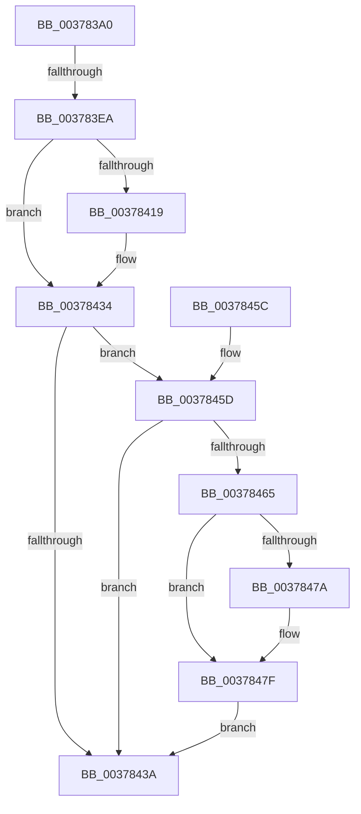

# wil_details_FeatureReporting_ReportUsageToServiceDirect

- RVA: `0x003783A0`–`0x0037848A` (길이 `234` bytes)
- VA: `0x00000001403783A0`
- 실행 섹션: `.text`
- PDB 이름 있음: `예`; PDB Function 태그: `예`
- unwind 정보 RVA: `0x0007AE3C`
- 디코드: `72`개 명령, `234/234` bytes 표시
- 미해석 바이트: `0` (있으면 어셈블리에 `.byte`로 보존)

> 이 문서는 커널 이미지의 기계어와 PDB 기호를 분석해 생성했습니다. 4번과 5번은 함수 원형과 자료형을 바이너리 사용 방식에서 추정한 C 해석이며 원본 소스 복구 결과는 아닙니다.

## 1. Dependencies

- 직접 호출 지점: **4**; 고유 호출 대상: **4**
- 직접 호출자로 확인된 함수: **2**
- RIP 상대 이미지 참조: **2**

### Outgoing calls
- `0x003783F6` → [wil_details_FeatureReporting_IncrementUsageInCache](wil_details_FeatureReporting_IncrementUsageInCache_function_00378490.md) (function, `0x00378490`)
- `0x0037842F` → [guard_dispatch_icall](../6B/guard_dispatch_icall_function_006BAAD0.md) (function, `0x006BAAD0`)
- `0x0037844A` → [_security_check_cookie](../6A/_security_check_cookie_function_006AC640.md) (function, `0x006AC640`)
- `0x00378483` → [CmFcManagerNotifyFeatureUsage](CmFcManagerNotifyFeatureUsage_function_00378598.md) (function, `0x00378598`)

### Direct callers
- [wil_details_FeatureReporting_ReportVariantUsageToService](wil_details_FeatureReporting_ReportVariantUsageToService_function_003782F8.md) at `0x00378333`
- [wil_details_FeatureReporting_ReportUsageToService](../53/wil_details_FeatureReporting_ReportUsageToService_function_0053E6E4.md) at `0x0053E719`

### Static image references
- `0x003783B0` → RVA `0x00E0A740` (`.data`; read)
- `0x003783FF` → RVA `0x00E0F4C8` (`.data`; read)

## 2. Other-region calls and transfers

- 다른 실행 섹션으로 향하는 call: **0**
- call이 아닌 외부 분기/꼬리 이동: **1**
  - `0x003783E4` → [sub_006E4192](../6E/Unknown_function_006E4192.md) (`tail-transfer`)

## 3. Assembly (complete function range)

```asm
003783A0  40 55                           push rbp
003783A2  53                              push rbx
003783A3  56                              push rsi
003783A4  57                              push rdi
003783A5  41 56                           push r14
003783A7  41 57                           push r15
003783A9  48 8B EC                        mov rbp, rsp
003783AC  48 83 EC 78                     sub rsp, 0x78
003783B0  48 8B 05 89 23 A9 00            mov rax, qword ptr [rip + 0xa92389]
003783B7  48 33 C4                        xor rax, rsp
003783BA  48 89 45 F0                     mov qword ptr [rbp - 0x10], rax
003783BE  4C 8B 51 08                     mov r10, qword ptr [rcx + 8]
003783C2  33 C0                           xor eax, eax
003783C4  49 63 F0                        movsxd rsi, r8d
003783C7  33 FF                           xor edi, edi
003783C9  48 89 55 B8                     mov qword ptr [rbp - 0x48], rdx
003783CD  0F 57 C0                        xorps xmm0, xmm0
003783D0  48 89 45 D0                     mov qword ptr [rbp - 0x30], rax
003783D4  4D 8B F1                        mov r14, r9
003783D7  48 8B DA                        mov rbx, rdx
003783DA  4C 8B F9                        mov r15, rcx
003783DD  0F 11 45 C0                     movups xmmword ptr [rbp - 0x40], xmm0
003783E1  83 FE 04                        cmp esi, 4
003783E4  0F 85 A8 BD 36 00               jne 0x1406e4192
003783EA  4C 8D 4D C0                     lea r9, [rbp - 0x40]
003783EE  45 8B C6                        mov r8d, r14d
003783F1  8B D6                           mov edx, esi
003783F3  49 8B CA                        mov rcx, r10
003783F6  E8 95 00 00 00                  call 0x140378490
003783FB  0F 10 45 C0                     movups xmm0, xmmword ptr [rbp - 0x40]
003783FF  48 8B 05 C2 70 A9 00            mov rax, qword ptr [rip + 0xa970c2]
00378406  F2 0F 10 4D D0                  movsd xmm1, qword ptr [rbp - 0x30]
0037840B  F2 0F 11 4D E8                  movsd qword ptr [rbp - 0x18], xmm1
00378410  0F 11 45 D8                     movups xmmword ptr [rbp - 0x28], xmm0
00378414  48 85 C0                        test rax, rax
00378417  74 1B                           je 0x140378434
00378419  4D 8B 4F 08                     mov r9, qword ptr [r15 + 8]
0037841D  48 8D 4D D8                     lea rcx, [rbp - 0x28]
00378421  48 89 4C 24 20                  mov qword ptr [rsp + 0x20], rcx
00378426  45 8B C6                        mov r8d, r14d
00378429  41 8B 4F 18                     mov ecx, dword ptr [r15 + 0x18]
0037842D  8B D6                           mov edx, esi
0037842F  E8 9C 26 34 00                  call 0x1406baad0
00378434  0F BA E3 0A                     bt ebx, 0xa
00378438  72 23                           jb 0x14037845d
0037843A  39 7D E8                        cmp dword ptr [rbp - 0x18], edi
0037843D  40 0F 94 C7                     sete dil
00378441  8B C7                           mov eax, edi
00378443  48 8B 4D F0                     mov rcx, qword ptr [rbp - 0x10]
00378447  48 33 CC                        xor rcx, rsp
0037844A  E8 F1 41 33 00                  call 0x1406ac640
0037844F  48 83 C4 78                     add rsp, 0x78
00378453  41 5F                           pop r15
00378455  41 5E                           pop r14
00378457  5F                              pop rdi
00378458  5E                              pop rsi
00378459  5B                              pop rbx
0037845A  5D                              pop rbp
0037845B  C3                              ret
0037845C  CC                              int3
0037845D  81 FE FE 00 00 00               cmp esi, 0xfe
00378463  74 D5                           je 0x14037843a
00378465  41 8B 47 18                     mov eax, dword ptr [r15 + 0x18]
00378469  48 89 7D B8                     mov qword ptr [rbp - 0x48], rdi
0037846D  89 45 B8                        mov dword ptr [rbp - 0x48], eax
00378470  66 89 75 BC                     mov word ptr [rbp - 0x44], si
00378474  0F BA E3 0B                     bt ebx, 0xb
00378478  73 05                           jae 0x14037847f
0037847A  66 83 4D BE 01                  or word ptr [rbp - 0x42], 1
0037847F  48 8D 55 B8                     lea rdx, [rbp - 0x48]
00378483  E8 10 01 00 00                  call 0x140378598
00378488  EB B0                           jmp 0x14037843a
```

## 4. C-style interpretation (structured pseudocode)

```c
__int64 __fastcall wil_details_FeatureReporting_ReportUsageToServiceDirect(__int64 a1, __int64 a2, int a3, __int64 a4)
{
    __int64 result;
    __int64 v_rdi;
    __int64 v_rsp;
    unsigned __int64 v_stack_m40;
    unsigned __int64 v_stack_m48;
    unsigned __int64 v_stack_m58;
    unsigned __int64 v_stack_m60;
    unsigned __int64 v_stack_m70;
    unsigned __int16 v_stack_m72;
    unsigned __int16 v_stack_m74;
    unsigned __int64 v_stack_m78;
    unsigned __int64 v_stack_m88;

    v_rsp = (v_rsp) - (120);
    result = (*(unsigned __int64 *)(v_rip + 11084681)) ^ (v_rsp);
    v_stack_m40 = result;
    result = 0;
    v_rdi = 0;
    v_stack_m78 = a2;
    v_stack_m60 = 0;
    v_stack_m70 = v_xmm0;
    result = wil_details_FeatureReporting_IncrementUsageInCache(*(unsigned __int64 *)(a1 + 8), (unsigned int)((unsigned int)((int)(a3))), (unsigned int)((unsigned int)(a4)), v_stack_m70);
    v_stack_m48 = v_xmm1;
    v_stack_m58 = v_xmm0;
    result = *(unsigned __int64 *)(v_rip + 11104450);
    if (*(unsigned __int64 *)(v_rip + 11104450) != 0) {
        a4 = *(unsigned __int64 *)(a1 + 8);
        a1 = v_stack_m58;
        v_stack_m88 = a1;
        a3 = (unsigned int)(a4);
        a1 = *(unsigned int *)(a1 + 24);
        a2 = (unsigned int)((int)(a3));
        result = guard_dispatch_icall(a1, a2, a3, a4);
    }
    if (condition_is_below) goto loc_0037845D;
loc_0037843A:
    v_rdi = (v_stack_m48 == 0) ? 1 : 0;
    a1 = (v_stack_m40) ^ (v_rsp);
    result = _security_check_cookie(a1, a2, a3, a4);
    v_rsp = (v_rsp) + (120);
    return result;
loc_0037845D:
    if (((unsigned int)((int)(a3))) == 254) goto loc_0037843A;
    v_stack_m78 = v_rdi;
    v_stack_m78 = (unsigned int)((unsigned int)(*(unsigned int *)(a1 + 24)));
    v_stack_m74 = (unsigned __int16)((int)(a3));
    if (((unsigned int)((int)(a3))) < 254) {
    }
    result = CmFcManagerNotifyFeatureUsage(a1, v_stack_m78, a3, a4);
    goto loc_0037843A;
}
```

## 5. (Beta) C Style

```c
int64_t wil_details_FeatureReporting_ReportUsageToServiceDirect(void *Arg1, int64_t Arg2, int32_t Arg3, int64_t Arg4)
{
    uint8_t *arg1 = (uint8_t *)Arg1;

    int64_t result;
    int64_t local_rdi;
    int64_t local_rsp;
    uint64_t v_stack_m40;
    uint64_t v_stack_m48;
    uint64_t v_stack_m58;
    uint64_t v_stack_m60;
    uint64_t v_stack_m70;
    uint16_t v_stack_m72;
    uint16_t v_stack_m74;
    uint64_t v_stack_m78;
    uint64_t v_stack_m88;

    local_rsp = (local_rsp) - (120);
    result = (*(uint64_t *)(v_rip + 0xA92389)) ^ (local_rsp);
    v_stack_m40 = result;
    result = 0;
    local_rdi = 0;
    v_stack_m78 = Arg2;
    v_stack_m60 = 0;
    v_stack_m70 = v_xmm0;
    result = wil_details_FeatureReporting_IncrementUsageInCache(*(uint64_t *)(arg1 + 0x8), (uint32_t)((uint32_t)((int32_t)(Arg3))), (uint32_t)((uint32_t)(Arg4)), v_stack_m70);
    v_stack_m48 = v_xmm1;
    v_stack_m58 = v_xmm0;
    result = *(uint64_t *)(v_rip + 0xA970C2);
    if (*(uint64_t *)(v_rip + 0xA970C2) != 0) {
        Arg4 = *(uint64_t *)(arg1 + 0x8);
        Arg1 = v_stack_m58;
        v_stack_m88 = Arg1;
        Arg3 = (uint32_t)(Arg4);
        Arg1 = *(uint32_t *)(arg1 + 0x18);
        Arg2 = (uint32_t)((int32_t)(Arg3));
        result = guard_dispatch_icall(Arg1, Arg2, Arg3, Arg4);
    }
    if (condition_is_below) goto loc_0037845D;
loc_0037843A:
    local_rdi = (v_stack_m48 == 0) ? 1 : 0;
    Arg1 = (v_stack_m40) ^ (local_rsp);
    result = _security_check_cookie(Arg1, Arg2, Arg3, Arg4);
    local_rsp = (local_rsp) + (120);
    return result;
loc_0037845D:
    if (((uint32_t)((int32_t)(Arg3))) == 254) goto loc_0037843A;
    v_stack_m78 = local_rdi;
    v_stack_m78 = (uint32_t)((uint32_t)(*(uint32_t *)(arg1 + 0x18)));
    v_stack_m74 = (uint16_t)((int32_t)(Arg3));
    if (((uint32_t)((int32_t)(Arg3))) < 254) {
    }
    result = CmFcManagerNotifyFeatureUsage(Arg1, v_stack_m78, Arg3, Arg4);
    goto loc_0037843A;
}
```

### 관측된 메모리 오프셋

구조체 형식이 확인되지 않은 접근은 인자 기준의 오프셋으로만 기록했습니다.

| 기준 인자 | 오프셋 표현 | 폭 (bit) | 접근 |
|---|---:|---:|---|
| `Arg1` | `+ 0x8` | `64` | `R` |
| `Arg1` | `+ 0x18` | `32` | `R` |

## 6. Execution-region graph

[열기: 2D/3D 그래프와 함수 탐색 컨트롤 패널](../../../control-panel.html?section=text&rva=0x003783A0&view=graph)

- 2D 그래프는 위에서 아래로 흐르고, 3D 그래프는 빈 공간을 드래그해 회전합니다. Shift+드래그는 이동, 휠은 확대·축소, 함수 노드 선택은 대상 보고서 이동입니다.

### Static fallback


