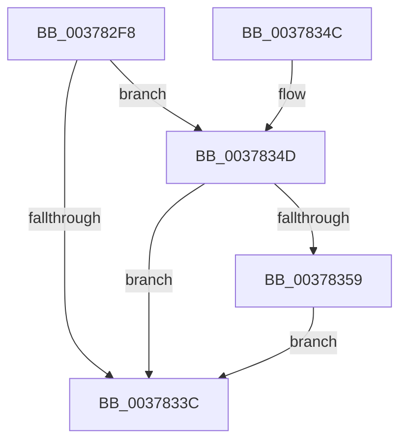

# wil_details_FeatureReporting_ReportVariantUsageToService

- RVA: `0x003782F8`–`0x0037838E` (길이 `150` bytes)
- VA: `0x00000001403782F8`
- 실행 섹션: `.text`
- PDB 이름 있음: `예`; PDB Function 태그: `아니요`
- unwind 정보 RVA: `0x0007AE28`
- 디코드: `39`개 명령, `150/150` bytes 표시
- 미해석 바이트: `0` (있으면 어셈블리에 `.byte`로 보존)

> 이 문서는 커널 이미지의 기계어와 PDB 기호를 분석해 생성했습니다. 4번과 5번은 함수 원형과 자료형을 바이너리 사용 방식에서 추정한 C 해석이며 원본 소스 복구 결과는 아닙니다.

## 1. Dependencies

- 직접 호출 지점: **2**; 고유 호출 대상: **2**
- 직접 호출자로 확인된 함수: **7**
- RIP 상대 이미지 참조: **1**

### Outgoing calls
- `0x00378333` → [wil_details_FeatureReporting_ReportUsageToServiceDirect](wil_details_FeatureReporting_ReportUsageToServiceDirect_function_003783A0.md) (function, `0x003783A0`)
- `0x00378387` → [guard_dispatch_icall](../6B/guard_dispatch_icall_function_006BAAD0.md) (function, `0x006BAAD0`)

### Direct callers
- [Feature_AntiStarvationReadyPeriodVariable__private_GetVariant](../5B/Feature_AntiStarvationReadyPeriodVariable__private_GetVariant_function_005B5FFC.md) at `0x005B6022`
- [Feature_AntiStarvationScanPeriodVariable__private_GetVariant](../5B/Feature_AntiStarvationScanPeriodVariable__private_GetVariant_function_005B603C.md) at `0x005B6062`
- [Feature_AntiStarvationThreadBoostCountVariable__private_GetVariant](../5B/Feature_AntiStarvationThreadBoostCountVariable__private_GetVariant_function_005B607C.md) at `0x005B60A2`
- [Feature_AntiStarvationThreadScanCountVariable__private_GetVariant](../5B/Feature_AntiStarvationThreadScanCountVariable__private_GetVariant_function_005B60BC.md) at `0x005B60E2`
- [Feature_EffectivePriorityNotAlwaysRankBiased__private_GetVariant](../5B/Feature_EffectivePriorityNotAlwaysRankBiased__private_GetVariant_function_005B60FC.md) at `0x005B6122`
- [Feature_UnparkPCoresOnUnimportantUtility__private_GetVariant](../5D/Feature_UnparkPCoresOnUnimportantUtility__private_GetVariant_function_005D9444.md) at `0x005D946A`
- [Feature_AdaptiveHibernateEnhancements__private_GetVariant](../5D/Feature_AdaptiveHibernateEnhancements__private_GetVariant_function_005DC550.md) at `0x005DC576`

### Static image references
- `0x0037834D` → RVA `0x00E0F560` (`.data`; read)

## 2. Other-region calls and transfers

- 다른 실행 섹션으로 향하는 call: **0**
- 별도 외부 분기/꼬리 이동을 확인하지 못했습니다.

## 3. Assembly (complete function range)

```asm
003782F8  48 8B C4                        mov rax, rsp
003782FB  48 89 58 08                     mov qword ptr [rax + 8], rbx
003782FF  48 89 70 10                     mov qword ptr [rax + 0x10], rsi
00378303  44 89 40 18                     mov dword ptr [rax + 0x18], r8d
00378307  57                              push rdi
00378308  48 83 EC 50                     sub rsp, 0x50
0037830C  8B FA                           mov edi, edx
0037830E  C7 40 18 02 00 00 00            mov dword ptr [rax + 0x18], 2
00378315  C1 EF 0C                        shr edi, 0xc
00378318  41 B9 01 00 00 00               mov r9d, 1
0037831E  40 80 E7 3F                     and dil, 0x3f
00378322  48 8B DA                        mov rbx, rdx
00378325  44 0F B6 C7                     movzx r8d, dil
00378329  48 8B F1                        mov rsi, rcx
0037832C  41 81 C0 40 01 00 00            add r8d, 0x140
00378333  E8 68 00 00 00                  call 0x1403783a0
00378338  85 C0                           test eax, eax
0037833A  75 11                           jne 0x14037834d
0037833C  48 8B 5C 24 60                  mov rbx, qword ptr [rsp + 0x60]
00378341  48 8B 74 24 68                  mov rsi, qword ptr [rsp + 0x68]
00378346  48 83 C4 50                     add rsp, 0x50
0037834A  5F                              pop rdi
0037834B  C3                              ret
0037834C  CC                              int3
0037834D  48 8B 05 0C 72 A9 00            mov rax, qword ptr [rip + 0xa9720c]
00378354  48 85 C0                        test rax, rax
00378357  74 E3                           je 0x14037833c
00378359  48 8B 56 10                     mov rdx, qword ptr [rsi + 0x10]
0037835D  48 8D 4C 24 70                  lea rcx, [rsp + 0x70]
00378362  48 C7 44 24 38 01 00 00 00      mov qword ptr [rsp + 0x38], 1
0037836B  83 E3 01                        and ebx, 1
0037836E  40 88 7C 24 30                  mov byte ptr [rsp + 0x30], dil
00378373  44 8B CB                        mov r9d, ebx
00378376  48 89 4C 24 28                  mov qword ptr [rsp + 0x28], rcx
0037837B  45 33 C0                        xor r8d, r8d
0037837E  48 83 64 24 20 00               and qword ptr [rsp + 0x20], 0
00378384  8B 4E 18                        mov ecx, dword ptr [rsi + 0x18]
00378387  E8 44 27 34 00                  call 0x1406baad0
0037838C  EB AE                           jmp 0x14037833c
```

## 4. C-style interpretation (structured pseudocode)

```c
__int64 __fastcall wil_details_FeatureReporting_ReportVariantUsageToService(__int64 a1, __int64 a2, int a3)
{
    __int64 result;
    __int64 v_rbx;
    __int64 v_rdi;
    __int64 v_rsp;
    unsigned __int64 v_stack_p10;
    unsigned __int64 v_stack_p20;
    unsigned __int64 v_stack_p28;
    unsigned __int8 v_stack_p30;
    unsigned __int64 v_stack_p38;
    unsigned __int64 v_stack_p70;
    unsigned __int64 v_stack_p8;

    *(unsigned __int64 *)(v_rsp + 8) = v_rbx;
    *(unsigned __int64 *)(v_rsp + 16) = v_rsi;
    *(unsigned int *)(v_rsp + 24) = a3;
    v_rsp = (v_rsp) - (80);
    *(unsigned int *)(v_rsp + 24) = 2;
    v_rdi = (unsigned int)(((unsigned int)((unsigned int)(a2))) >> (12));
    v_rdi = (unsigned __int8)((v_rdi) & (63));
    a3 = (unsigned int)(((unsigned __int8)(v_rdi)) + (320));
    result = wil_details_FeatureReporting_ReportUsageToServiceDirect(a1, a2, a3, 1);
    if ((unsigned int)(result) != 0) goto loc_0037834D;
loc_0037833C:
    v_rsp = (v_rsp) + (80);
    return result;
loc_0037834D:
    if (*(unsigned __int64 *)(v_rip + 11104780) == 0) goto loc_0037833C;
    v_stack_p38 = 1;
    v_rbx = (unsigned int)((v_stack_p8) & (1));
    v_stack_p30 = (unsigned __int8)(v_rdi);
    v_stack_p28 = v_stack_p70;
    a3 = 0;
    result = guard_dispatch_icall((unsigned int)(*(unsigned int *)(v_stack_p10 + 24)), *(unsigned __int64 *)(v_stack_p10 + 16), a3, (unsigned int)((unsigned int)(v_rbx)));
    goto loc_0037833C;
}
```

## 5. (Beta) C Style

```c
int64_t wil_details_FeatureReporting_ReportVariantUsageToService(void *Arg1, int64_t Arg2, int32_t Arg3)
{
    uint8_t *arg1 = (uint8_t *)Arg1;

    int64_t result;
    int64_t local_rbx;
    int64_t local_rdi;
    int64_t local_rsp;
    uint64_t v_stack_p10;
    uint64_t v_stack_p20;
    uint64_t v_stack_p28;
    uint8_t v_stack_p30;
    uint64_t v_stack_p38;
    uint64_t v_stack_p70;
    uint64_t v_stack_p8;

    *(uint64_t *)(local_rsp + 0x8) = local_rbx;
    *(uint64_t *)(local_rsp + 0x10) = local_rsi;
    *(uint32_t *)(local_rsp + 0x18) = Arg3;
    local_rsp = (local_rsp) - (80);
    *(uint32_t *)(local_rsp + 0x18) = 2;
    local_rdi = (uint32_t)(((uint32_t)((uint32_t)(Arg2))) >> (12));
    local_rdi = (uint8_t)((local_rdi) & (63));
    Arg3 = (uint32_t)(((uint8_t)(local_rdi)) + (320));
    result = wil_details_FeatureReporting_ReportUsageToServiceDirect(Arg1, Arg2, Arg3, 1);
    if ((uint32_t)(result) != 0) goto loc_0037834D;
loc_0037833C:
    local_rsp = (local_rsp) + (80);
    return result;
loc_0037834D:
    if (*(uint64_t *)(v_rip + 0xA9720C) == 0) goto loc_0037833C;
    v_stack_p38 = 1;
    local_rbx = (uint32_t)((v_stack_p8) & (1));
    v_stack_p30 = (uint8_t)(local_rdi);
    v_stack_p28 = v_stack_p70;
    Arg3 = 0;
    result = guard_dispatch_icall((uint32_t)(*(uint32_t *)(v_stack_p10 + 0x18)), *(uint64_t *)(v_stack_p10 + 0x10), Arg3, (uint32_t)((uint32_t)(local_rbx)));
    goto loc_0037833C;
}
```

### 관측된 메모리 오프셋

구조체 형식이 확인되지 않은 접근은 인자 기준의 오프셋으로만 기록했습니다.

| 기준 인자 | 오프셋 표현 | 폭 (bit) | 접근 |
|---|---:|---:|---|
| `Arg1` | `+ 0x10` | `64` | `R` |
| `Arg1` | `+ 0x18` | `32` | `R` |

## 6. Execution-region graph

[열기: 2D/3D 그래프와 함수 탐색 컨트롤 패널](../../../control-panel.html?section=text&rva=0x003782F8&view=graph)

- 2D 그래프는 위에서 아래로 흐르고, 3D 그래프는 빈 공간을 드래그해 회전합니다. Shift+드래그는 이동, 휠은 확대·축소, 함수 노드 선택은 대상 보고서 이동입니다.

### Static fallback


