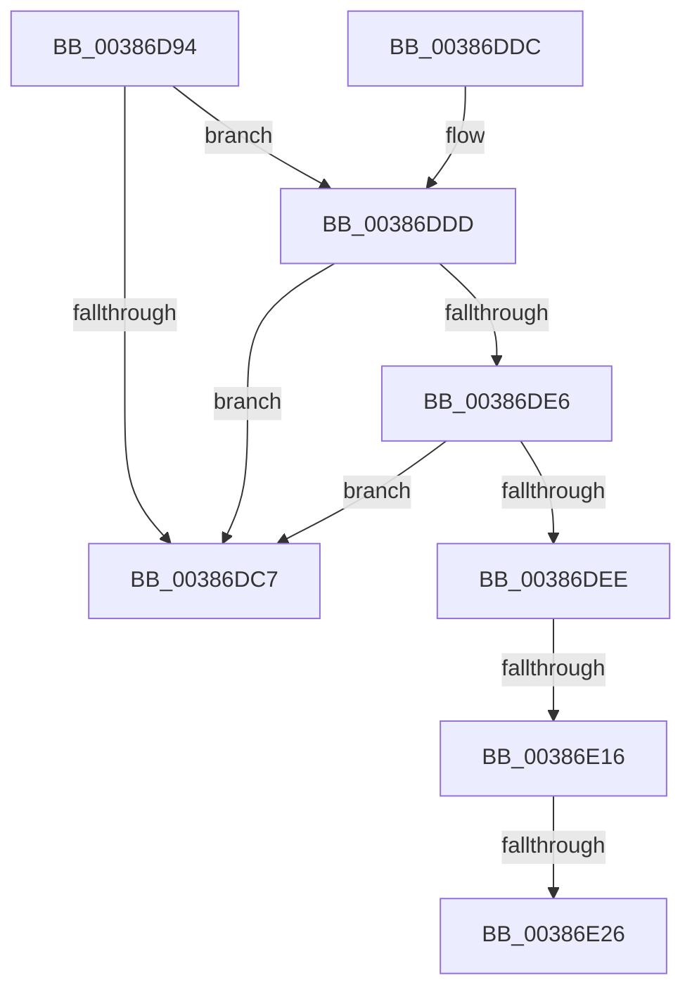

# CcAdjustWriteBehindThreadPoolIfNeeded

- RVA: `0x00386D94`–`0x00386E30` (길이 `156` bytes)
- VA: `0x0000000140386D94`
- 실행 섹션: `.text`
- PDB 이름 있음: `예`; PDB Function 태그: `예`
- unwind 정보 RVA: `0x0007FC8C`
- 디코드: `41`개 명령, `156/156` bytes 표시
- 미해석 바이트: `0` (있으면 어셈블리에 `.byte`로 보존)

> 이 문서는 커널 이미지의 기계어와 PDB 기호를 분석해 생성했습니다. 4번과 5번은 함수 원형과 자료형을 바이너리 사용 방식에서 추정한 C 해석이며 원본 소스 복구 결과는 아닙니다.

## 1. Dependencies

- 직접 호출 지점: **3**; 고유 호출 대상: **3**
- 직접 호출자로 확인된 함수: **5**
- RIP 상대 이미지 참조: **3**

### Outgoing calls
- `0x00386DF0` → [CcGetCurrentNumaNode](../49/CcGetCurrentNumaNode_function_004967F0.md) (function, `0x004967F0`)
- `0x00386E04` → [KeAcquireInStackQueuedSpinLock](../27/KeAcquireInStackQueuedSpinLock_function_002757A0.md) (function, `0x002757A0`)
- `0x00386E19` → [CcIsWriteBehindThreadpoolAtLowPriority](../35/CcIsWriteBehindThreadpoolAtLowPriority_function_003570DC.md) (function, `0x003570DC`)

### Direct callers
- [CcCanIWrite](CcCanIWrite_function_00388250.md) at `0x003884A2`
- [CcChargeDirtyPages](../3C/CcChargeDirtyPages_function_003CBEA0.md) at `0x003CC121`
- [CcUninitializeCacheMap](../3C/CcUninitializeCacheMap_function_003CD520.md) at `0x003CD9A0`
- [CcChargeDirtyPagesInternal](../3C/CcChargeDirtyPagesInternal_function_003CDE10.md) at `0x003CE075`
- [CcQueueLazyWriteScanThread](../57/CcQueueLazyWriteScanThread_function_0057BBD0.md) at `0x0057BD69`

### Static image references
- `0x00386DAD` → RVA `0x00E65B88` (`.data`; read)
- `0x00386DDD` → RVA `0x00E0A874` (`.data`; read)
- `0x00386DE6` → RVA `0x00FC521C` (`ALMOSTRO`; read)

## 2. Other-region calls and transfers

- 다른 실행 섹션으로 향하는 call: **0**
- call이 아닌 외부 분기/꼬리 이동: **3**
  - `0x00386E10` → [sub_006E4CFE](../6E/Unknown_function_006E4CFE.md) (`tail-transfer`)
  - `0x00386E20` → [sub_006E4CFE + 0x58](../6E/Unknown_function_006E4CFE.md) (`tail-transfer`)
  - `0x00386E2B` → [sub_006E4CFE + 0x3B](../6E/Unknown_function_006E4CFE.md) (`tail-transfer`)

## 3. Assembly (complete function range)

```asm
00386D94  4C 8B DC                        mov r11, rsp
00386D97  49 89 5B 08                     mov qword ptr [r11 + 8], rbx
00386D9B  49 89 6B 10                     mov qword ptr [r11 + 0x10], rbp
00386D9F  49 89 73 18                     mov qword ptr [r11 + 0x18], rsi
00386DA3  57                              push rdi
00386DA4  48 83 EC 40                     sub rsp, 0x40
00386DA8  33 C0                           xor eax, eax
00386DAA  40 32 F6                        xor sil, sil
00386DAD  38 05 D5 ED AD 00               cmp byte ptr [rip + 0xadedd5], al
00386DB3  0F 57 C0                        xorps xmm0, xmm0
00386DB6  0F 11 44 24 20                  movups xmmword ptr [rsp + 0x20], xmm0
00386DBB  49 89 43 E8                     mov qword ptr [r11 - 0x18], rax
00386DBF  40 8A EA                        mov bpl, dl
00386DC2  48 8B D9                        mov rbx, rcx
00386DC5  74 16                           je 0x140386ddd
00386DC7  48 8B 5C 24 50                  mov rbx, qword ptr [rsp + 0x50]
00386DCC  48 8B 6C 24 58                  mov rbp, qword ptr [rsp + 0x58]
00386DD1  48 8B 74 24 60                  mov rsi, qword ptr [rsp + 0x60]
00386DD6  48 83 C4 40                     add rsp, 0x40
00386DDA  5F                              pop rdi
00386DDB  C3                              ret
00386DDC  CC                              int3
00386DDD  83 3D 90 3A A8 00 01            cmp dword ptr [rip + 0xa83a90], 1
00386DE4  77 E1                           ja 0x140386dc7
00386DE6  38 05 30 E4 C3 00               cmp byte ptr [rip + 0xc3e430], al
00386DEC  75 D9                           jne 0x140386dc7
00386DEE  33 D2                           xor edx, edx
00386DF0  E8 FB F9 10 00                  call 0x1404967f0
00386DF5  48 8D 54 24 20                  lea rdx, [rsp + 0x20]
00386DFA  48 81 C1 40 03 00 00            add rcx, 0x340
00386E01  48 8B F8                        mov rdi, rax
00386E04  E8 97 E9 EE FF                  call 0x1402757a0
00386E09  83 BB 68 03 00 00 00            cmp dword ptr [rbx + 0x368], 0
00386E10  0F 86 E8 DE 35 00               jbe 0x1406e4cfe
00386E16  48 8B CB                        mov rcx, rbx
00386E19  E8 BE 02 FD FF                  call 0x1403570dc
00386E1E  84 C0                           test al, al
00386E20  0F 84 30 DF 35 00               je 0x1406e4d56
00386E26  40 B6 01                        mov sil, 1
00386E29  33 D2                           xor edx, edx
00386E2B  E9 09 DF 35 00                  jmp 0x1406e4d39
```

## 4. C-style interpretation (structured pseudocode)

```c
__int64 __fastcall CcAdjustWriteBehindThreadPoolIfNeeded(__int64 a1, int a2)
{
    __int64 result;
    __int64 v_rsi;
    __int64 v_rsp;
    unsigned __int64 v_stack_m28;
    unsigned __int64 v_stack_p10;
    unsigned __int64 v_stack_p18;
    unsigned __int64 v_stack_p20;
    unsigned __int64 v_stack_p8;

    *(unsigned __int64 *)(v_rsp + 8) = v_rbx;
    *(unsigned __int64 *)(v_rsp + 16) = v_rbp;
    *(unsigned __int64 *)(v_rsp + 24) = v_rsi;
    v_rsp = (v_rsp) - (64);
    result = 0;
    v_rsi = 0;
    v_stack_m28 = v_xmm0;
    *(unsigned __int64 *)(v_rsp - 24) = 0;
    if ((*(unsigned __int8 *)(v_rip + 11398613)) == 0) goto loc_00386DDD;
loc_00386DC7:
    v_rsp = (v_rsp) + (64);
    return result;
loc_00386DDD:
    if ((*(unsigned int *)(v_rip + 11025040)) > 1) goto loc_00386DC7;
    if ((*(unsigned __int8 *)(v_rip + 12837936)) != 0) goto loc_00386DC7;
    a2 = 0;
    result = CcGetCurrentNumaNode(a1, a2, a3, a4);
    a1 = (a1) + (832);
    result = KeAcquireInStackQueuedSpinLock(a1, v_stack_p20, a3, a4);
    result = CcIsWriteBehindThreadpoolAtLowPriority(v_stack_p8, v_stack_p20, a3, a4);
    a2 = 0;
}
```

## 5. (Beta) C Style

```c
int64_t CcAdjustWriteBehindThreadPoolIfNeeded(void *Arg1, int32_t Arg2)
{
    uint8_t *arg1 = (uint8_t *)Arg1;

    int64_t result;
    int64_t local_rsi;
    int64_t local_rsp;
    uint64_t v_stack_m28;
    uint64_t v_stack_p10;
    uint64_t v_stack_p18;
    uint64_t v_stack_p20;
    uint64_t v_stack_p8;

    *(uint64_t *)(local_rsp + 0x8) = local_rbx;
    *(uint64_t *)(local_rsp + 0x10) = local_rbp;
    *(uint64_t *)(local_rsp + 0x18) = local_rsi;
    local_rsp = (local_rsp) - (64);
    result = 0;
    local_rsi = 0;
    v_stack_m28 = v_xmm0;
    *(uint64_t *)(local_rsp - 0x18) = 0;
    if ((*(uint8_t *)(v_rip + 0xADEDD5)) == 0) goto loc_00386DDD;
loc_00386DC7:
    local_rsp = (local_rsp) + (64);
    return result;
loc_00386DDD:
    if ((*(uint32_t *)(v_rip + 0xA83A90)) > 1) goto loc_00386DC7;
    if ((*(uint8_t *)(v_rip + 0xC3E430)) != 0) goto loc_00386DC7;
    Arg2 = 0;
    result = CcGetCurrentNumaNode(Arg1, Arg2, a3, a4);
    Arg1 = (Arg1) + (832);
    result = KeAcquireInStackQueuedSpinLock(Arg1, v_stack_p20, a3, a4);
    result = CcIsWriteBehindThreadpoolAtLowPriority(v_stack_p8, v_stack_p20, a3, a4);
    Arg2 = 0;
}
```

### 관측된 메모리 오프셋

구조체 형식이 확인되지 않은 접근은 인자 기준의 오프셋으로만 기록했습니다.

| 기준 인자 | 오프셋 표현 | 폭 (bit) | 접근 |
|---|---:|---:|---|
| `Arg1` | `+ 0x368` | `32` | `R` |

## 6. Execution-region graph

[열기: 2D/3D 그래프와 함수 탐색 컨트롤 패널](../../../control-panel.html?section=text&rva=0x00386D94&view=graph)

- 2D 그래프는 위에서 아래로 흐르고, 3D 그래프는 빈 공간을 드래그해 회전합니다. Shift+드래그는 이동, 휠은 확대·축소, 함수 노드 선택은 대상 보고서 이동입니다.

### Static fallback


