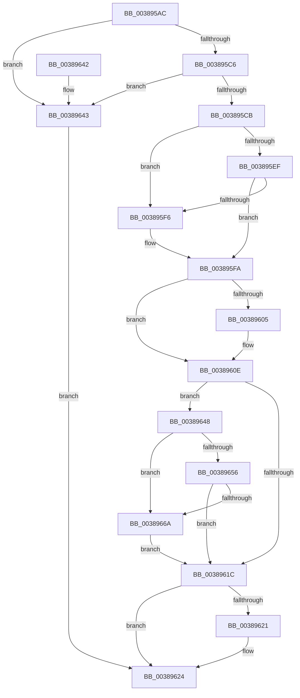

# CcCalculatePagesToWrite

- RVA: `0x003895AC`–`0x00389673` (길이 `199` bytes)
- VA: `0x00000001403895AC`
- 실행 섹션: `.text`
- PDB 이름 있음: `예`; PDB Function 태그: `아니요`
- unwind 정보 RVA: `0x0007FECC`
- 디코드: `60`개 명령, `199/199` bytes 표시
- 미해석 바이트: `0` (있으면 어셈블리에 `.byte`로 보존)

> 이 문서는 커널 이미지의 기계어와 PDB 기호를 분석해 생성했습니다. 4번과 5번은 함수 원형과 자료형을 바이너리 사용 방식에서 추정한 C 해석이며 원본 소스 복구 결과는 아닙니다.

## 1. Dependencies

- 직접 호출 지점: **0**; 고유 호출 대상: **0**
- 직접 호출자로 확인된 함수: **3**
- RIP 상대 이미지 참조: **1**

### Outgoing calls
- 직접 디코드된 call 명령이 없습니다.

### Direct callers
- [CcScanLogHandleList](CcScanLogHandleList_function_0038A26C.md) at `0x0038A3A6`
- [CcLazyWriteScan](../3C/CcLazyWriteScan_function_003C9394.md) at `0x003C957C`
- [CcNotifyExternalCachesInternal](../3C/CcNotifyExternalCachesInternal_function_003C9E00.md) at `0x003C9EAB`

### Static image references
- `0x003895CE` → RVA `0x00E0A870` (`.data`; read)

## 2. Other-region calls and transfers

- 다른 실행 섹션으로 향하는 call: **0**
- 별도 외부 분기/꼬리 이동을 확인하지 못했습니다.

## 3. Assembly (complete function range)

```asm
003895AC  48 89 5C 24 08                  mov qword ptr [rsp + 8], rbx
003895B1  48 89 74 24 10                  mov qword ptr [rsp + 0x10], rsi
003895B6  48 89 7C 24 18                  mov qword ptr [rsp + 0x18], rdi
003895BB  8D 42 FF                        lea eax, [rdx - 1]
003895BE  48 8B F1                        mov rsi, rcx
003895C1  83 F8 01                        cmp eax, 1
003895C4  76 7D                           jbe 0x140389643
003895C6  83 FA 10                        cmp edx, 0x10
003895C9  74 78                           je 0x140389643
003895CB  4D 8B 10                        mov r10, qword ptr [r8]
003895CE  8B 05 9C 12 A8 00               mov eax, dword ptr [rip + 0xa8129c]
003895D4  49 8B D2                        mov rdx, r10
003895D7  4D 8B 58 08                     mov r11, qword ptr [r8 + 8]
003895DB  49 8B 19                        mov rbx, qword ptr [r9]
003895DE  49 8B 79 08                     mov rdi, qword ptr [r9 + 8]
003895E2  45 8B 40 10                     mov r8d, dword ptr [r8 + 0x10]
003895E6  45 8B 49 18                     mov r9d, dword ptr [r9 + 0x18]
003895EA  4C 3B D0                        cmp r10, rax
003895ED  77 07                           ja 0x1403895f6
003895EF  F6 44 24 28 01                  test byte ptr [rsp + 0x28], 1
003895F4  74 04                           je 0x1403895fa
003895F6  48 C1 EA 03                     shr rdx, 3
003895FA  33 C9                           xor ecx, ecx
003895FC  4B 8D 04 10                     lea rax, [r8 + r10]
00389600  49 3B C3                        cmp rax, r11
00389603  76 09                           jbe 0x14038960e
00389605  49 8B C8                        mov rcx, r8
00389608  49 2B CB                        sub rcx, r11
0038960B  49 03 CA                        add rcx, r10
0038960E  4D 8B C2                        mov r8, r10
00389611  4C 2B C2                        sub r8, rdx
00389614  4C 03 C1                        add r8, rcx
00389617  4D 3B C1                        cmp r8, r9
0038961A  77 2C                           ja 0x140389648
0038961C  49 3B D2                        cmp rdx, r10
0038961F  76 03                           jbe 0x140389624
00389621  49 8B D2                        mov rdx, r10
00389624  48 8B 5C 24 08                  mov rbx, qword ptr [rsp + 8]
00389629  B8 FF FF FF FF                  mov eax, 0xffffffff
0038962E  48 8B 74 24 10                  mov rsi, qword ptr [rsp + 0x10]
00389633  48 3B D0                        cmp rdx, rax
00389636  48 8B 7C 24 18                  mov rdi, qword ptr [rsp + 0x18]
0038963B  48 0F 47 D0                     cmova rdx, rax
0038963F  8B C2                           mov eax, edx
00389641  C3                              ret
00389642  CC                              int3
00389643  49 8B 10                        mov rdx, qword ptr [r8]
00389646  EB DC                           jmp 0x140389624
00389648  49 8B C0                        mov rax, r8
0038964B  49 2B C1                        sub rax, r9
0038964E  48 03 D0                        add rdx, rax
00389651  48 3B DF                        cmp rbx, rdi
00389654  72 14                           jb 0x14038966a
00389656  48 8B 46 08                     mov rax, qword ptr [rsi + 8]
0038965A  48 8B 08                        mov rcx, qword ptr [rax]
0038965D  48 81 B9 00 49 00 00 00 10 00 00  cmp qword ptr [rcx + 0x4900], 0x1000
00389668  73 B2                           jae 0x14038961c
0038966A  4D 2B C1                        sub r8, r9
0038966D  4A 8D 14 42                     lea rdx, [rdx + r8*2]
00389671  EB A9                           jmp 0x14038961c
```

## 4. C-style interpretation (structured pseudocode)

```c
__int64 __fastcall CcCalculatePagesToWrite(__int64 a1, __int64 a2, __int64 a3, __int64 a4, unsigned __int8 a5)
{
    __int64 result;
    unsigned __int64 v_stack_p10;
    unsigned __int64 v_stack_p18;
    unsigned __int64 v_stack_p8;

    v_stack_p8 = v_rbx;
    v_stack_p10 = v_rsi;
    v_stack_p18 = v_rdi;
    if (((unsigned int)(a2 - 1)) <= 1) goto loc_00389643;
    if (((unsigned int)(a2)) == 16) goto loc_00389643;
    if ((*(unsigned __int64 *)(a3)) > ((unsigned int)(*(unsigned int *)(v_rip + 11014812)))) goto loc_003895F6;
    if (((a5) & (1)) != 0) {
        a2 = (*(unsigned __int64 *)(a3)) >> (3);
    }
    a1 = 0;
    if (((unsigned int)(*(unsigned int *)(a3 + 16)) + *(unsigned __int64 *)(a3) * 1) >= = (*(unsigned __int64 *)(a3 + 8))) {
        a1 = (unsigned int)(*(unsigned int *)(a3 + 16));
        a1 = (a1) - (*(unsigned __int64 *)(a3 + 8));
        a1 = (a1) + (*(unsigned __int64 *)(a3));
    }
    a3 = (*(unsigned __int64 *)(a3)) - (a2);
    a3 = (a3) + (a1);
    if (a3 > ((unsigned int)(*(unsigned int *)(a4 + 24)))) goto loc_00389648;
loc_0038961C:
    if (a2 >= = (*(unsigned __int64 *)(a3))) {
        a2 = *(unsigned __int64 *)(a3);
    }
    if (a2 > ((unsigned int)(0xFFFFFFFFULL))) { a2 = (unsigned int)(0xFFFFFFFFULL); }
    return (unsigned int)((unsigned int)(a2));
loc_00389643:
    goto loc_00389624;
loc_00389648:
    result = (a3) - ((unsigned int)(*(unsigned int *)(a4 + 24)));
    a2 = (*(unsigned __int64 *)(a3)) + (result);
    if (v_stack_p8 < v_stack_p18) goto loc_0038966A;
    if ((*(unsigned __int64 *)(*(unsigned __int64 *)(*(unsigned __int64 *)(v_stack_p10 + 8)) + 18688)) >= 0x1000ULL) goto loc_0038961C;
loc_0038966A:
    a3 = (a3) - ((unsigned int)(*(unsigned int *)(a4 + 24)));
    goto loc_0038961C;
}
```

## 5. (Beta) C Style

```c
int64_t CcCalculatePagesToWrite(void *Arg1, void *Arg2, void *Arg3, void *Arg4, uint8_t Arg5)
{
    uint8_t *arg1 = (uint8_t *)Arg1;
    uint8_t *arg2 = (uint8_t *)Arg2;
    uint8_t *arg3 = (uint8_t *)Arg3;
    uint8_t *arg4 = (uint8_t *)Arg4;

    int64_t result;
    uint64_t v_stack_p10;
    uint64_t v_stack_p18;
    uint64_t v_stack_p8;

    v_stack_p8 = local_rbx;
    v_stack_p10 = local_rsi;
    v_stack_p18 = local_rdi;
    if (((uint32_t)(Arg2 - 1)) <= 1) goto loc_00389643;
    if (((uint32_t)(Arg2)) == 16) goto loc_00389643;
    if ((*(uint64_t *)(arg3)) > ((uint32_t)(*(uint32_t *)(v_rip + 0xA8129C)))) goto loc_003895F6;
    if (((Arg5) & (1)) != 0) {
        Arg2 = (*(uint64_t *)(arg3)) >> (3);
    }
    Arg1 = 0;
    if (((uint32_t)(*(uint32_t *)(arg3 + 0x10)) + *(uint64_t *)(arg3) * 1) >= = (*(uint64_t *)(arg3 + 0x8))) {
        Arg1 = (uint32_t)(*(uint32_t *)(arg3 + 0x10));
        Arg1 = (Arg1) - (*(uint64_t *)(arg3 + 0x8));
        Arg1 = (Arg1) + (*(uint64_t *)(arg3));
    }
    Arg3 = (*(uint64_t *)(arg3)) - (Arg2);
    Arg3 = (Arg3) + (Arg1);
    if (Arg3 > ((uint32_t)(*(uint32_t *)(arg4 + 0x18)))) goto loc_00389648;
loc_0038961C:
    if (Arg2 >= = (*(uint64_t *)(arg3))) {
        Arg2 = *(uint64_t *)(arg3);
    }
    if (Arg2 > ((uint32_t)(0xFFFFFFFFULL))) { Arg2 = (uint32_t)(0xFFFFFFFFULL); }
    return (uint32_t)((uint32_t)(Arg2));
loc_00389643:
    goto loc_00389624;
loc_00389648:
    result = (Arg3) - ((uint32_t)(*(uint32_t *)(arg4 + 0x18)));
    Arg2 = (*(uint64_t *)(arg3)) + (result);
    if (v_stack_p8 < v_stack_p18) goto loc_0038966A;
    if ((*(uint64_t *)(*(uint64_t *)(*(uint64_t *)(v_stack_p10 + 0x8)) + 0x4900)) >= 0x1000ULL) goto loc_0038961C;
loc_0038966A:
    Arg3 = (Arg3) - ((uint32_t)(*(uint32_t *)(arg4 + 0x18)));
    goto loc_0038961C;
}
```

### 관측된 메모리 오프셋

구조체 형식이 확인되지 않은 접근은 인자 기준의 오프셋으로만 기록했습니다.

| 기준 인자 | 오프셋 표현 | 폭 (bit) | 접근 |
|---|---:|---:|---|
| `Arg1` | `+ 0x8` | `64` | `R` |
| `Arg2` | `- 0x1` | `32` | `R` |
| `Arg3` | `+ 0x0` | `64` | `R` |
| `Arg3` | `+ 0x8` | `64` | `R` |
| `Arg3` | `+ 0x10` | `32` | `R` |
| `Arg4` | `+ 0x0` | `64` | `R` |
| `Arg4` | `+ 0x8` | `64` | `R` |
| `Arg4` | `+ 0x18` | `32` | `R` |

## 6. Execution-region graph

[열기: 2D/3D 그래프와 함수 탐색 컨트롤 패널](../../../control-panel.html?section=text&rva=0x003895AC&view=graph)

- 2D 그래프는 위에서 아래로 흐르고, 3D 그래프는 빈 공간을 드래그해 회전합니다. Shift+드래그는 이동, 휠은 확대·축소, 함수 노드 선택은 대상 보고서 이동입니다.

### Static fallback


