# CcCanIWriteStreamEx

- RVA: `0x0038993C`–`0x00389BE8` (길이 `684` bytes)
- VA: `0x000000014038993C`
- 실행 섹션: `.text`
- PDB 이름 있음: `예`; PDB Function 태그: `예`
- unwind 정보 RVA: `0x0007FF1C`
- 디코드: `176`개 명령, `684/684` bytes 표시
- 미해석 바이트: `0` (있으면 어셈블리에 `.byte`로 보존)

> 이 문서는 커널 이미지의 기계어와 PDB 기호를 분석해 생성했습니다. 4번과 5번은 함수 원형과 자료형을 바이너리 사용 방식에서 추정한 C 해석이며 원본 소스 복구 결과는 아닙니다.

## 1. Dependencies

- 직접 호출 지점: **7**; 고유 호출 대상: **4**
- 직접 호출자로 확인된 함수: **6**
- RIP 상대 이미지 참조: **2**

### Outgoing calls
- `0x00389A20` → [KeAcquireInStackQueuedSpinLock](../27/KeAcquireInStackQueuedSpinLock_function_002757A0.md) (function, `0x002757A0`)
- `0x00389A6D` → [KeReleaseInStackQueuedSpinLock](../34/KeReleaseInStackQueuedSpinLock_function_00342CE0.md) (function, `0x00342CE0`)
- `0x00389AA3` → [MmEnoughMemoryForWrite](../2B/MmEnoughMemoryForWrite_function_002BE470.md) (function, `0x002BE470`)
- `0x00389B18` → [MmEnoughMemoryForWrite](../2B/MmEnoughMemoryForWrite_function_002BE470.md) (function, `0x002BE470`)
- `0x00389B43` → [KeReleaseInStackQueuedSpinLock](../34/KeReleaseInStackQueuedSpinLock_function_00342CE0.md) (function, `0x00342CE0`)
- `0x00389B5E` → [KeAcquireInStackQueuedSpinLock](../27/KeAcquireInStackQueuedSpinLock_function_002757A0.md) (function, `0x002757A0`)
- `0x00389B76` → [CcIsFileObjectDirectMapped](CcIsFileObjectDirectMapped_function_00388D10.md) (function, `0x00388D10`)

### Direct callers
- [CcPostDeferredWrites](../35/CcPostDeferredWrites_function_003590FC.md) at `0x00359191`
- [CcCanIWrite](CcCanIWrite_function_00388250.md) at `0x00388411`
- [CcScheduleReadAheadNuma](CcScheduleReadAheadNuma_function_0038883C.md) at `0x0038890A`
- [CcShouldLazyWriteCacheMap](CcShouldLazyWriteCacheMap_function_003897A0.md) at `0x003898B6`
- [CcForceWriteThrough](CcForceWriteThrough_function_00389E50.md) at `0x0038A021`
- [CcNotifyOfMappedWrite](../40/CcNotifyOfMappedWrite_function_0040338C.md) at `0x00403558`

### Static image references
- `0x00389ACA` → RVA `0x00E65B5C` (`.data`; read)
- `0x00389B05` → RVA `0x00E0A870` (`.data`; read)

## 2. Other-region calls and transfers

- 다른 실행 섹션으로 향하는 call: **0**
- call이 아닌 외부 분기/꼬리 이동: **1**
  - `0x00389AD4` → [sub_006E50B6](../6E/Unknown_function_006E50B6.md) (`tail-transfer`)

## 3. Assembly (complete function range)

```asm
0038993C  48 89 5C 24 18                  mov qword ptr [rsp + 0x18], rbx
00389941  48 89 4C 24 08                  mov qword ptr [rsp + 8], rcx
00389946  55                              push rbp
00389947  56                              push rsi
00389948  57                              push rdi
00389949  41 54                           push r12
0038994B  41 55                           push r13
0038994D  41 56                           push r14
0038994F  41 57                           push r15
00389951  48 83 EC 50                     sub rsp, 0x50
00389955  8B 84 24 B0 00 00 00            mov eax, dword ptr [rsp + 0xb0]
0038995C  4C 8D 92 F8 03 00 00            lea r10, [rdx + 0x3f8]
00389963  45 33 E4                        xor r12d, r12d
00389966  4C 8D 9A E0 03 00 00            lea r11, [rdx + 0x3e0]
0038996D  BB FF 0F 00 00                  mov ebx, 0xfff
00389972  45 0F B6 FC                     movzx r15d, r12b
00389976  85 C3                           test ebx, eax
00389978  44 88 A4 24 A8 00 00 00         mov byte ptr [rsp + 0xa8], r12b
00389980  49 8B E8                        mov rbp, r8
00389983  45 8A EC                        mov r13b, r12b
00389986  4C 8B C1                        mov r8, rcx
00389989  0F 57 C0                        xorps xmm0, xmm0
0038998C  41 8B CC                        mov ecx, r12d
0038998F  4C 8B A4 24 C0 00 00 00         mov r12, qword ptr [rsp + 0xc0]
00389997  0F 95 C1                        setne cl
0038999A  C1 E8 0C                        shr eax, 0xc
0038999D  03 C8                           add ecx, eax
0038999F  33 C0                           xor eax, eax
003899A1  48 85 D2                        test rdx, rdx
003899A4  48 89 44 24 40                  mov qword ptr [rsp + 0x40], rax
003899A9  49 8D 80 38 04 00 00            lea rax, [r8 + 0x438]
003899B0  89 8C 24 B0 00 00 00            mov dword ptr [rsp + 0xb0], ecx
003899B7  4C 0F 44 D0                     cmove r10, rax
003899BB  49 8D 80 20 04 00 00            lea rax, [r8 + 0x420]
003899C2  4C 0F 44 D8                     cmove r11, rax
003899C6  4C 89 94 24 98 00 00 00         mov qword ptr [rsp + 0x98], r10
003899CE  33 D2                           xor edx, edx
003899D0  4C 89 5C 24 20                  mov qword ptr [rsp + 0x20], r11
003899D5  0F 11 44 24 30                  movups xmmword ptr [rsp + 0x30], xmm0
003899DA  4D 85 E4                        test r12, r12
003899DD  0F 85 52 01 00 00               jne 0x140389b35
003899E3  8B B4 24 B8 00 00 00            mov esi, dword ptr [rsp + 0xb8]
003899EA  BF 00 00 00 01                  mov edi, 0x1000000
003899EF  44 3B CF                        cmp r9d, edi
003899F2  44 8B F6                        mov r14d, esi
003899F5  41 0F 46 F9                     cmovbe edi, r9d
003899F9  85 FB                           test ebx, edi
003899FB  8B C7                           mov eax, edi
003899FD  8B DA                           mov ebx, edx
003899FF  0F 95 C3                        setne bl
00389A02  C1 E8 0C                        shr eax, 0xc
00389A05  03 D8                           add ebx, eax
00389A07  89 9C 24 C0 00 00 00            mov dword ptr [rsp + 0xc0], ebx
00389A0E  41 83 E6 08                     and r14d, 8
00389A12  75 27                           jne 0x140389a3b
00389A14  49 8D 88 00 03 00 00            lea rcx, [r8 + 0x300]
00389A1B  48 8D 54 24 30                  lea rdx, [rsp + 0x30]
00389A20  E8 7B BD EE FF                  call 0x1402757a0
00389A25  8B 8C 24 B0 00 00 00            mov ecx, dword ptr [rsp + 0xb0]
00389A2C  33 D2                           xor edx, edx
00389A2E  4C 8B 94 24 98 00 00 00         mov r10, qword ptr [rsp + 0x98]
00389A36  4C 8B 5C 24 20                  mov r11, qword ptr [rsp + 0x20]
00389A3B  44 8B C9                        mov r9d, ecx
00389A3E  49 8B 0B                        mov rcx, qword ptr [r11]
00389A41  8B C3                           mov eax, ebx
00389A43  4C 03 C8                        add r9, rax
00389A46  B8 01 00 00 00                  mov eax, 1
00389A4B  49 03 C9                        add rcx, r9
00389A4E  4C 89 4C 24 28                  mov qword ptr [rsp + 0x28], r9
00389A53  49 3B 0A                        cmp rcx, qword ptr [r10]
00389A56  0F 83 0C 01 00 00               jae 0x140389b68
00389A5C  8A DA                           mov bl, dl
00389A5E  4D 85 E4                        test r12, r12
00389A61  75 67                           jne 0x140389aca
00389A63  45 85 F6                        test r14d, r14d
00389A66  75 0C                           jne 0x140389a74
00389A68  48 8D 4C 24 30                  lea rcx, [rsp + 0x30]
00389A6D  E8 6E 92 FB FF                  call 0x140342ce0
00389A72  33 D2                           xor edx, edx
00389A74  48 8B FA                        mov rdi, rdx
00389A77  38 94 24 A8 00 00 00            cmp byte ptr [rsp + 0xa8], dl
00389A7E  0F 85 4E 01 00 00               jne 0x140389bd2
00389A84  48 85 ED                        test rbp, rbp
00389A87  0F 84 45 01 00 00               je 0x140389bd2
00389A8D  40 F6 C6 0A                     test sil, 0xa
00389A91  75 46                           jne 0x140389ad9
00389A93  48 8B 45 18                     mov rax, qword ptr [rbp + 0x18]
00389A97  F6 40 04 04                     test byte ptr [rax + 4], 4
00389A9B  75 3C                           jne 0x140389ad9
00389A9D  84 DB                           test bl, bl
00389A9F  75 38                           jne 0x140389ad9
00389AA1  33 C9                           xor ecx, ecx
00389AA3  E8 C8 49 F3 FF                  call 0x1402be470
00389AA8  44 8A E8                        mov r13b, al
00389AAB  45 84 ED                        test r13b, r13b
00389AAE  0F 95 C0                        setne al
00389AB1  48 8B 9C 24 A0 00 00 00         mov rbx, qword ptr [rsp + 0xa0]
00389AB9  48 83 C4 50                     add rsp, 0x50
00389ABD  41 5F                           pop r15
00389ABF  41 5E                           pop r14
00389AC1  41 5D                           pop r13
00389AC3  41 5C                           pop r12
00389AC5  5F                              pop rdi
00389AC6  5E                              pop rsi
00389AC7  5D                              pop rbp
00389AC8  C3                              ret
00389AC9  CC                              int3
00389ACA  8B 0D 8C C0 AD 00               mov ecx, dword ptr [rip + 0xadc08c]
00389AD0  85 C9                           test ecx, ecx
00389AD2  74 8F                           je 0x140389a63
00389AD4  E9 DD B5 35 00                  jmp 0x1406e50b6
00389AD9  45 85 F6                        test r14d, r14d
00389ADC  74 6C                           je 0x140389b4a
00389ADE  48 8B 7D 28                     mov rdi, qword ptr [rbp + 0x28]
00389AE2  48 85 FF                        test rdi, rdi
00389AE5  74 39                           je 0x140389b20
00389AE7  48 8B 4F 08                     mov rcx, qword ptr [rdi + 8]
00389AEB  48 85 C9                        test rcx, rcx
00389AEE  74 25                           je 0x140389b15
00389AF0  8B 91 10 01 00 00               mov edx, dword ptr [rcx + 0x110]
00389AF6  85 D2                           test edx, edx
00389AF8  0F 85 A2 00 00 00               jne 0x140389ba0
00389AFE  48 8B 89 00 02 00 00            mov rcx, qword ptr [rcx + 0x200]
00389B05  8B 05 65 0D A8 00               mov eax, dword ptr [rip + 0xa80d65]
00389B0B  48 39 41 28                     cmp qword ptr [rcx + 0x28], rax
00389B0F  0F 86 AD 00 00 00               jbe 0x140389bc2
00389B15  48 8B CF                        mov rcx, rdi
00389B18  E8 53 49 F3 FF                  call 0x1402be470
00389B1D  44 8A E8                        mov r13b, al
00389B20  45 85 F6                        test r14d, r14d
00389B23  74 19                           je 0x140389b3e
00389B25  45 84 FF                        test r15b, r15b
00389B28  0F 84 A4 00 00 00               je 0x140389bd2
00389B2E  32 C0                           xor al, al
00389B30  E9 7C FF FF FF                  jmp 0x140389ab1
00389B35  41 88 14 24                     mov byte ptr [r12], dl
00389B39  E9 A5 FE FF FF                  jmp 0x1403899e3
00389B3E  48 8D 4C 24 30                  lea rcx, [rsp + 0x30]
00389B43  E8 98 91 FB FF                  call 0x140342ce0
00389B48  EB DB                           jmp 0x140389b25
00389B4A  48 8B 8C 24 90 00 00 00         mov rcx, qword ptr [rsp + 0x90]
00389B52  48 8D 54 24 30                  lea rdx, [rsp + 0x30]
00389B57  48 81 C1 00 03 00 00            add rcx, 0x300
00389B5E  E8 3D BC EE FF                  call 0x1402757a0
00389B63  E9 76 FF FF FF                  jmp 0x140389ade
00389B68  8B D8                           mov ebx, eax
00389B6A  48 85 ED                        test rbp, rbp
00389B6D  0F 84 EB FE FF FF               je 0x140389a5e
00389B73  48 8B CD                        mov rcx, rbp
00389B76  E8 95 F1 FF FF                  call 0x140388d10
00389B7B  4C 8B 4C 24 28                  mov r9, qword ptr [rsp + 0x28]
00389B80  33 D2                           xor edx, edx
00389B82  4C 8B 94 24 98 00 00 00         mov r10, qword ptr [rsp + 0x98]
00389B8A  84 C0                           test al, al
00389B8C  4C 8B 5C 24 20                  mov r11, qword ptr [rsp + 0x20]
00389B91  0F 45 DA                        cmovne ebx, edx
00389B94  88 84 24 A8 00 00 00            mov byte ptr [rsp + 0xa8], al
00389B9B  E9 BE FE FF FF                  jmp 0x140389a5e
00389BA0  8B 41 70                        mov eax, dword ptr [rcx + 0x70]
00389BA3  85 C0                           test eax, eax
00389BA5  0F 84 53 FF FF FF               je 0x140389afe
00389BAB  03 84 24 C0 00 00 00            add eax, dword ptr [rsp + 0xc0]
00389BB2  3B C2                           cmp eax, edx
00389BB4  B8 01 00 00 00                  mov eax, 1
00389BB9  44 0F 47 F8                     cmova r15d, eax
00389BBD  E9 3C FF FF FF                  jmp 0x140389afe
00389BC2  40 80 E6 04                     and sil, 4
00389BC6  40 F6 DE                        neg sil
00389BC9  1A C0                           sbb al, al
00389BCB  22 D8                           and bl, al
00389BCD  E9 43 FF FF FF                  jmp 0x140389b15
00389BD2  84 DB                           test bl, bl
00389BD4  0F 85 54 FF FF FF               jne 0x140389b2e
00389BDA  48 85 FF                        test rdi, rdi
00389BDD  0F 85 C8 FE FF FF               jne 0x140389aab
00389BE3  E9 B9 FE FF FF                  jmp 0x140389aa1
```

## 4. C-style interpretation (structured pseudocode)

```c
__int64 __fastcall CcCanIWriteStreamEx(__int64 a1, __int64 a2, __int64 a3, int a4, unsigned int a5, unsigned int a6, unsigned int a7)
{
    __int64 result;
    __int64 v_r10;
    __int64 v_r11;
    __int64 v_r12;
    __int64 v_r14;
    __int64 v_r15;
    __int64 v_rbx;
    __int64 v_rdi;
    __int64 v_rsi;
    __int64 v_rsp;
    unsigned __int64 v_stack_m48;
    unsigned __int64 v_stack_m58;
    unsigned __int64 v_stack_m60;
    unsigned __int64 v_stack_m68;
    unsigned __int64 v_stack_p10;
    unsigned __int64 v_stack_p18;
    unsigned __int8 v_stack_p20;
    unsigned int v_stack_p28;
    unsigned __int64 v_stack_p30;
    unsigned int v_stack_p38;
    unsigned __int64 v_stack_p8;
    unsigned __int64 v_stack_p90;
    unsigned __int64 v_stack_p98;
    unsigned __int8 v_stack_pA8;

    v_stack_p18 = v_rbx;
    v_stack_p8 = a1;
    v_rsp = (v_rsp) - (80);
    v_r12 = 0;
    v_stack_p20 = 0;
    a1 = ((((unsigned int)((unsigned int)(0xFFFULL))) & ((unsigned int)((unsigned int)(a5)))) != 0) ? 1 : 0;
    result = (unsigned int)(((unsigned int)(a5)) >> (12));
    a1 = (unsigned int)((a1) + ((unsigned int)(result)));
    result = 0;
    v_stack_m48 = 0;
    v_stack_p28 = (unsigned int)(a1);
    v_r10 = a2 + 1016;
    if (a2 == 0) { v_r10 = a1 + 1080; }
    v_r11 = a2 + 992;
    if (a2 == 0) { v_r11 = a1 + 1056; }
    v_stack_p10 = v_r10;
    a2 = 0;
    v_stack_m68 = v_r11;
    v_stack_m58 = v_xmm0;
    if (a7 != 0) goto loc_00389B35;
loc_003899E3:
    v_rdi = (unsigned int)(0x1000000ULL);
    if (a4 <= ((unsigned int)((unsigned int)(0x1000000ULL)))) { v_rdi = a4; }
    v_rbx = ((((unsigned int)((unsigned int)(0xFFFULL))) & ((unsigned int)(v_rdi))) != 0) ? 1 : 0;
    result = (unsigned int)(((unsigned int)((unsigned int)(v_rdi))) >> (12));
    v_rbx = (unsigned int)((v_rbx) + ((unsigned int)(result)));
    v_stack_p38 = (unsigned int)(v_rbx);
    v_r14 = (unsigned int)(((unsigned int)((unsigned int)((unsigned int)(a6)))) & (8));
    if (!(condition_is_not_equal)) {
        a1 = a1 + 768;
        a2 = v_stack_m58;
        result = KeAcquireInStackQueuedSpinLock(a1, a2, a1, a4);
        a1 = a5;
        a2 = 0;
        v_r10 = v_stack_p10;
        v_r11 = v_stack_m68;
    }
    a4 = ((unsigned int)((unsigned int)(a1))) + ((unsigned int)((unsigned int)(v_rbx)));
    a1 = (*(unsigned __int64 *)(v_r11)) + (a4);
    v_stack_m60 = a4;
    if (a1 >= (*(unsigned __int64 *)(v_r10))) goto loc_00389B68;
loc_00389A5E:
    if (a7 != 0) goto loc_00389ACA;
loc_00389A63:
    result = 1;
    if ((unsigned int)(v_r14) == 0) {
        a1 = v_stack_m58;
        result = KeReleaseInStackQueuedSpinLock(a1, a2, a1, a4);
        a2 = 0;
    }
    if (v_stack_p20 != 0) goto loc_00389BD2;
    if (a3 == 0) goto loc_00389BD2;
    if ((((unsigned __int8)((unsigned int)(a6))) & (10)) != 0) goto loc_00389AD9;
    if (((*(unsigned __int8 *)(*(unsigned __int64 *)(a3 + 24) + 4)) & (4)) != 0) goto loc_00389AD9;
    if (0 != 0) goto loc_00389AD9;
loc_00389AA1:
    a1 = 0;
    result = MmEnoughMemoryForWrite(a1, a2, a1, a4);
loc_00389AAB:
    result = ((unsigned __int8)((unsigned __int8)(result)) != 0) ? 1 : 0;
loc_00389AB1:
    v_rsp = (v_rsp) + (80);
    return result;
loc_00389ACA:
    if ((unsigned int)((unsigned int)(*(unsigned int *)(v_rip + 11387020))) == 0) goto loc_00389A63;
loc_00389AD9:
    if ((unsigned int)(v_r14) == 0) goto loc_00389B4A;
loc_00389ADE:
    if (*(unsigned __int64 *)(a3 + 40) == 0) goto loc_00389B20;
    if (*(unsigned __int64 *)(*(unsigned __int64 *)(a3 + 40) + 8) == 0) goto loc_00389B15;
    if ((unsigned int)((unsigned int)(*(unsigned int *)(*(unsigned __int64 *)(*(unsigned __int64 *)(a3 + 40) + 8) + 272))) != 0) goto loc_00389BA0;
loc_00389AFE:
    if ((*(unsigned __int64 *)(*(unsigned __int64 *)(*(unsigned __int64 *)(*(unsigned __int64 *)(a3 + 40) + 8) + 512) + 40)) <= ((unsigned int)(*(unsigned int *)(v_rip + 11013477)))) goto loc_00389BC2;
loc_00389B15:
    result = MmEnoughMemoryForWrite(*(unsigned __int64 *)(a3 + 40), (unsigned int)(*(unsigned int *)(*(unsigned __int64 *)(*(unsigned __int64 *)(a3 + 40) + 8) + 272)), a1, a4);
loc_00389B20:
    if ((unsigned int)(v_r14) == 0) goto loc_00389B3E;
loc_00389B25:
    if (0 == 0) goto loc_00389BD2;
loc_00389B2E:
    result = 0;
    goto loc_00389AB1;
loc_00389B35:
    *(unsigned __int8 *)(a7) = (unsigned __int8)((unsigned int)(*(unsigned int *)(*(unsigned __int64 *)(*(unsigned __int64 *)(a3 + 40) + 8) + 272)));
    goto loc_003899E3;
loc_00389B3E:
    result = KeReleaseInStackQueuedSpinLock(v_stack_p30, (unsigned int)(*(unsigned int *)(*(unsigned __int64 *)(*(unsigned __int64 *)(a3 + 40) + 8) + 272)), a1, a4);
    goto loc_00389B25;
loc_00389B4A:
    a1 = (v_stack_p90) + (768);
    result = KeAcquireInStackQueuedSpinLock(a1, v_stack_p30, a1, a4);
    goto loc_00389ADE;
loc_00389B68:
    if (a3 == 0) goto loc_00389A5E;
    result = CcIsFileObjectDirectMapped(a3, v_stack_p30, a1, a4);
    a2 = 0;
    v_rbx = (unsigned int)((unsigned int)(result));
    if ((unsigned __int8)(result) != 0) { v_rbx = 0; }
    v_stack_pA8 = (unsigned __int8)(result);
    goto loc_00389A5E;
loc_00389BA0:
    if ((unsigned int)((unsigned int)(*(unsigned int *)(a3 + 112))) == 0) goto loc_00389AFE;
    result = (unsigned int)(((unsigned int)(*(unsigned int *)(a3 + 112))) + (a7));
    v_r15 = 0;
    if (((unsigned int)(result)) > 0) { v_r15 = 1; }
    goto loc_00389AFE;
loc_00389BC2:
    v_rsi = (unsigned __int8)(((unsigned int)(a6)) & (4));
    v_rsi = (unsigned __int8)(-(v_rsi));
    v_rbx = (unsigned __int8)((v_rbx) & (1));
    goto loc_00389B15;
loc_00389BD2:
    if ((unsigned __int8)(v_rbx) != 0) goto loc_00389B2E;
    if (*(unsigned __int64 *)(a3 + 40) != 0) goto loc_00389AAB;
    goto loc_00389AA1;
}
```

## 5. (Beta) C Style

```c
int64_t CcCanIWriteStreamEx(void *Arg1, void *Arg2, int64_t Arg3, int32_t Arg4, uint32_t Arg5, uint32_t Arg6, uint32_t Arg7)
{
    uint8_t *arg1 = (uint8_t *)Arg1;
    uint8_t *arg2 = (uint8_t *)Arg2;

    int64_t result;
    int64_t local_r10;
    int64_t local_r11;
    int64_t local_r12;
    int64_t local_r14;
    int64_t local_r15;
    int64_t local_rbx;
    int64_t local_rdi;
    int64_t local_rsi;
    int64_t local_rsp;
    uint64_t v_stack_m48;
    uint64_t v_stack_m58;
    uint64_t v_stack_m60;
    uint64_t v_stack_m68;
    uint64_t v_stack_p10;
    uint64_t v_stack_p18;
    uint8_t v_stack_p20;
    uint32_t v_stack_p28;
    uint64_t v_stack_p30;
    uint32_t v_stack_p38;
    uint64_t v_stack_p8;
    uint64_t v_stack_p90;
    uint64_t v_stack_p98;
    uint8_t v_stack_pA8;

    v_stack_p18 = local_rbx;
    v_stack_p8 = Arg1;
    local_rsp = (local_rsp) - (80);
    local_r12 = 0;
    v_stack_p20 = 0;
    Arg1 = ((((uint32_t)((uint32_t)(0xFFFULL))) & ((uint32_t)((uint32_t)(Arg5)))) != 0) ? 1 : 0;
    result = (uint32_t)(((uint32_t)(Arg5)) >> (12));
    Arg1 = (uint32_t)((Arg1) + ((uint32_t)(result)));
    result = 0;
    v_stack_m48 = 0;
    v_stack_p28 = (uint32_t)(Arg1);
    local_r10 = Arg2 + 1016;
    if (Arg2 == NULL) { local_r10 = Arg1 + 1080; }
    local_r11 = Arg2 + 992;
    if (Arg2 == NULL) { local_r11 = Arg1 + 1056; }
    v_stack_p10 = local_r10;
    Arg2 = 0;
    v_stack_m68 = local_r11;
    v_stack_m58 = v_xmm0;
    if (Arg7 != 0) goto loc_00389B35;
loc_003899E3:
    local_rdi = (uint32_t)(0x1000000ULL);
    if (Arg4 <= ((uint32_t)((uint32_t)(0x1000000ULL)))) { local_rdi = Arg4; }
    local_rbx = ((((uint32_t)((uint32_t)(0xFFFULL))) & ((uint32_t)(local_rdi))) != 0) ? 1 : 0;
    result = (uint32_t)(((uint32_t)((uint32_t)(local_rdi))) >> (12));
    local_rbx = (uint32_t)((local_rbx) + ((uint32_t)(result)));
    v_stack_p38 = (uint32_t)(local_rbx);
    local_r14 = (uint32_t)(((uint32_t)((uint32_t)((uint32_t)(Arg6)))) & (8));
    if (!(condition_is_not_equal)) {
        Arg1 = Arg1 + 768;
        Arg2 = v_stack_m58;
        result = KeAcquireInStackQueuedSpinLock(Arg1, Arg2, Arg1, Arg4);
        Arg1 = Arg5;
        Arg2 = 0;
        local_r10 = v_stack_p10;
        local_r11 = v_stack_m68;
    }
    Arg4 = ((uint32_t)((uint32_t)(Arg1))) + ((uint32_t)((uint32_t)(local_rbx)));
    Arg1 = (*(uint64_t *)(local_r11)) + (Arg4);
    v_stack_m60 = Arg4;
    if (Arg1 >= (*(uint64_t *)(local_r10))) goto loc_00389B68;
loc_00389A5E:
    if (Arg7 != 0) goto loc_00389ACA;
loc_00389A63:
    result = 1;
    if ((uint32_t)(local_r14) == 0) {
        Arg1 = v_stack_m58;
        result = KeReleaseInStackQueuedSpinLock(Arg1, Arg2, Arg1, Arg4);
        Arg2 = 0;
    }
    if (v_stack_p20 != 0) goto loc_00389BD2;
    if (Arg3 == 0) goto loc_00389BD2;
    if ((((uint8_t)((uint32_t)(Arg6))) & (10)) != 0) goto loc_00389AD9;
    if (((*(uint8_t *)(*(uint64_t *)(Arg3 + 0x18) + 0x4)) & (4)) != 0) goto loc_00389AD9;
    if (0 != 0) goto loc_00389AD9;
loc_00389AA1:
    Arg1 = 0;
    result = MmEnoughMemoryForWrite(Arg1, Arg2, Arg1, Arg4);
loc_00389AAB:
    result = ((uint8_t)((uint8_t)(result)) != 0) ? 1 : 0;
loc_00389AB1:
    local_rsp = (local_rsp) + (80);
    return result;
loc_00389ACA:
    if ((uint32_t)((uint32_t)(*(uint32_t *)(v_rip + 0xADC08C))) == 0) goto loc_00389A63;
loc_00389AD9:
    if ((uint32_t)(local_r14) == 0) goto loc_00389B4A;
loc_00389ADE:
    if (*(uint64_t *)(Arg3 + 0x28) == 0) goto loc_00389B20;
    if (*(uint64_t *)(*(uint64_t *)(Arg3 + 0x28) + 0x8) == 0) goto loc_00389B15;
    if ((uint32_t)((uint32_t)(*(uint32_t *)(*(uint64_t *)(*(uint64_t *)(Arg3 + 0x28) + 0x8) + 0x110))) != 0) goto loc_00389BA0;
loc_00389AFE:
    if ((*(uint64_t *)(*(uint64_t *)(*(uint64_t *)(*(uint64_t *)(Arg3 + 0x28) + 0x8) + 0x200) + 0x28)) <= ((uint32_t)(*(uint32_t *)(v_rip + 0xA80D65)))) goto loc_00389BC2;
loc_00389B15:
    result = MmEnoughMemoryForWrite(*(uint64_t *)(Arg3 + 0x28), (uint32_t)(*(uint32_t *)(*(uint64_t *)(*(uint64_t *)(Arg3 + 0x28) + 0x8) + 0x110)), Arg1, Arg4);
loc_00389B20:
    if ((uint32_t)(local_r14) == 0) goto loc_00389B3E;
loc_00389B25:
    if (0 == 0) goto loc_00389BD2;
loc_00389B2E:
    result = 0;
    goto loc_00389AB1;
loc_00389B35:
    *(uint8_t *)(Arg7) = (uint8_t)((uint32_t)(*(uint32_t *)(*(uint64_t *)(*(uint64_t *)(Arg3 + 0x28) + 0x8) + 0x110)));
    goto loc_003899E3;
loc_00389B3E:
    result = KeReleaseInStackQueuedSpinLock(v_stack_p30, (uint32_t)(*(uint32_t *)(*(uint64_t *)(*(uint64_t *)(Arg3 + 0x28) + 0x8) + 0x110)), Arg1, Arg4);
    goto loc_00389B25;
loc_00389B4A:
    Arg1 = (v_stack_p90) + (768);
    result = KeAcquireInStackQueuedSpinLock(Arg1, v_stack_p30, Arg1, Arg4);
    goto loc_00389ADE;
loc_00389B68:
    if (Arg3 == 0) goto loc_00389A5E;
    result = CcIsFileObjectDirectMapped(Arg3, v_stack_p30, Arg1, Arg4);
    Arg2 = 0;
    local_rbx = (uint32_t)((uint32_t)(result));
    if ((uint8_t)(result) != 0) { local_rbx = 0; }
    v_stack_pA8 = (uint8_t)(result);
    goto loc_00389A5E;
loc_00389BA0:
    if ((uint32_t)((uint32_t)(*(uint32_t *)(Arg3 + 0x70))) == 0) goto loc_00389AFE;
    result = (uint32_t)(((uint32_t)(*(uint32_t *)(Arg3 + 0x70))) + (Arg7));
    local_r15 = 0;
    if (((uint32_t)(result)) > 0) { local_r15 = 1; }
    goto loc_00389AFE;
loc_00389BC2:
    local_rsi = (uint8_t)(((uint32_t)(Arg6)) & (4));
    local_rsi = (uint8_t)(-(local_rsi));
    local_rbx = (uint8_t)((local_rbx) & (1));
    goto loc_00389B15;
loc_00389BD2:
    if ((uint8_t)(local_rbx) != 0) goto loc_00389B2E;
    if (*(uint64_t *)(Arg3 + 0x28) != 0) goto loc_00389AAB;
    goto loc_00389AA1;
}
```

### 관측된 메모리 오프셋

구조체 형식이 확인되지 않은 접근은 인자 기준의 오프셋으로만 기록했습니다.

| 기준 인자 | 오프셋 표현 | 폭 (bit) | 접근 |
|---|---:|---:|---|
| `Arg1` | `+ 0x300` | `64` | `R` |
| `Arg1` | `+ 0x420` | `64` | `R` |
| `Arg1` | `+ 0x438` | `64` | `R` |
| `Arg2` | `+ 0x3E0` | `64` | `R` |
| `Arg2` | `+ 0x3F8` | `64` | `R` |

## 6. Execution-region graph

[열기: 2D/3D 그래프와 함수 탐색 컨트롤 패널](../../../control-panel.html?section=text&rva=0x0038993C&view=graph)

- 2D 그래프는 위에서 아래로 흐르고, 3D 그래프는 빈 공간을 드래그해 회전합니다. Shift+드래그는 이동, 휠은 확대·축소, 함수 노드 선택은 대상 보고서 이동입니다.

### Static fallback

```mermaid
flowchart TD
  bb_0038993C[BB_0038993C]
  bb_003899E3[BB_003899E3]
  bb_00389A14[BB_00389A14]
  bb_00389A3B[BB_00389A3B]
  bb_00389A5C[BB_00389A5C]
  bb_00389A5E[BB_00389A5E]
  bb_00389A63[BB_00389A63]
  bb_00389A68[BB_00389A68]
  bb_00389A74[BB_00389A74]
  bb_00389A84[BB_00389A84]
  bb_00389A8D[BB_00389A8D]
  bb_00389A93[BB_00389A93]
  bb_00389A9D[BB_00389A9D]
  bb_00389AA1[BB_00389AA1]
  bb_00389AAB[BB_00389AAB]
  bb_00389AB1[BB_00389AB1]
  bb_00389AC9[BB_00389AC9]
  bb_00389ACA[BB_00389ACA]
  bb_00389AD4[BB_00389AD4]
  bb_00389AD9[BB_00389AD9]
  bb_00389ADE[BB_00389ADE]
  bb_00389AE7[BB_00389AE7]
  bb_00389AF0[BB_00389AF0]
  bb_00389AFE[BB_00389AFE]
  bb_00389B15[BB_00389B15]
  bb_00389B20[BB_00389B20]
  bb_00389B25[BB_00389B25]
  bb_00389B2E[BB_00389B2E]
  bb_00389B35[BB_00389B35]
  bb_00389B3E[BB_00389B3E]
  bb_00389B4A[BB_00389B4A]
  bb_00389B68[BB_00389B68]
  bb_00389B73[BB_00389B73]
  bb_00389BA0[BB_00389BA0]
  bb_00389BAB[BB_00389BAB]
  bb_00389BC2[BB_00389BC2]
  bb_00389BD2[BB_00389BD2]
  bb_00389BDA[BB_00389BDA]
  bb_00389BE3[BB_00389BE3]
  bb_0038993C -->|branch| bb_00389B35
  bb_0038993C -->|fallthrough| bb_003899E3
  bb_003899E3 -->|branch| bb_00389A3B
  bb_003899E3 -->|fallthrough| bb_00389A14
  bb_00389A14 -->|flow| bb_00389A3B
  bb_00389A3B -->|branch| bb_00389B68
  bb_00389A3B -->|fallthrough| bb_00389A5C
  bb_00389A5C -->|flow| bb_00389A5E
  bb_00389A5E -->|branch| bb_00389ACA
  bb_00389A5E -->|fallthrough| bb_00389A63
  bb_00389A63 -->|branch| bb_00389A74
  bb_00389A63 -->|fallthrough| bb_00389A68
  bb_00389A68 -->|flow| bb_00389A74
  bb_00389A74 -->|branch| bb_00389BD2
  bb_00389A74 -->|fallthrough| bb_00389A84
  bb_00389A84 -->|branch| bb_00389BD2
  bb_00389A84 -->|fallthrough| bb_00389A8D
  bb_00389A8D -->|branch| bb_00389AD9
  bb_00389A8D -->|fallthrough| bb_00389A93
  bb_00389A93 -->|branch| bb_00389AD9
  bb_00389A93 -->|fallthrough| bb_00389A9D
  bb_00389A9D -->|branch| bb_00389AD9
  bb_00389A9D -->|fallthrough| bb_00389AA1
  bb_00389AA1 -->|flow| bb_00389AAB
  bb_00389AAB -->|flow| bb_00389AB1
  bb_00389AC9 -->|flow| bb_00389ACA
  bb_00389ACA -->|branch| bb_00389A63
  bb_00389ACA -->|fallthrough| bb_00389AD4
  bb_00389AD9 -->|branch| bb_00389B4A
  bb_00389AD9 -->|fallthrough| bb_00389ADE
  bb_00389ADE -->|branch| bb_00389B20
  bb_00389ADE -->|fallthrough| bb_00389AE7
  bb_00389AE7 -->|branch| bb_00389B15
  bb_00389AE7 -->|fallthrough| bb_00389AF0
  bb_00389AF0 -->|branch| bb_00389BA0
  bb_00389AF0 -->|fallthrough| bb_00389AFE
  bb_00389AFE -->|branch| bb_00389BC2
  bb_00389AFE -->|fallthrough| bb_00389B15
  bb_00389B15 -->|flow| bb_00389B20
  bb_00389B20 -->|branch| bb_00389B3E
  bb_00389B20 -->|fallthrough| bb_00389B25
  bb_00389B25 -->|branch| bb_00389BD2
  bb_00389B25 -->|fallthrough| bb_00389B2E
  bb_00389B2E -->|branch| bb_00389AB1
  bb_00389B35 -->|branch| bb_003899E3
  bb_00389B3E -->|branch| bb_00389B25
  bb_00389B4A -->|branch| bb_00389ADE
  bb_00389B68 -->|branch| bb_00389A5E
  bb_00389B68 -->|fallthrough| bb_00389B73
  bb_00389B73 -->|branch| bb_00389A5E
  bb_00389BA0 -->|branch| bb_00389AFE
  bb_00389BA0 -->|fallthrough| bb_00389BAB
  bb_00389BAB -->|branch| bb_00389AFE
  bb_00389BC2 -->|branch| bb_00389B15
  bb_00389BD2 -->|branch| bb_00389B2E
  bb_00389BD2 -->|fallthrough| bb_00389BDA
  bb_00389BDA -->|branch| bb_00389AAB
  bb_00389BDA -->|fallthrough| bb_00389BE3
  bb_00389BE3 -->|branch| bb_00389AA1
```


