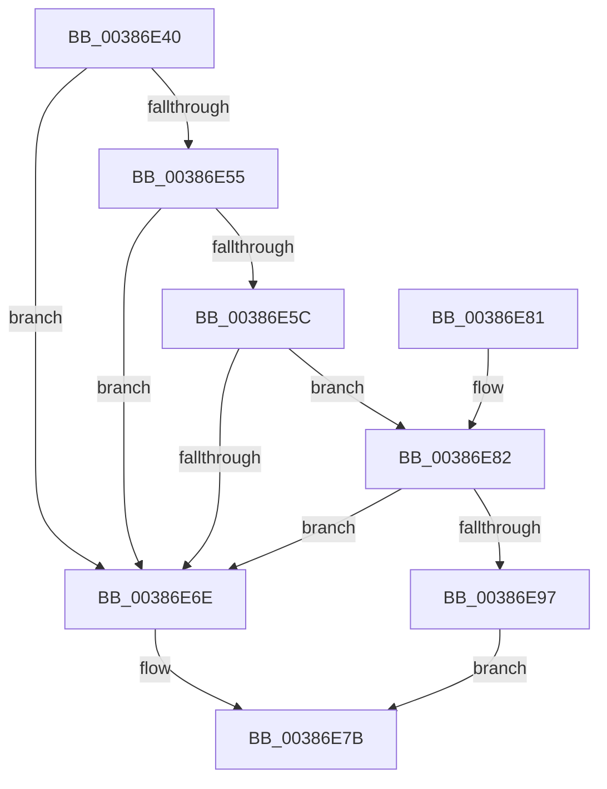

# CcCopyWriteWontFlush

- RVA: `0x00386E40`–`0x00386E9B` (길이 `91` bytes)
- VA: `0x0000000140386E40`
- 실행 섹션: `.text`
- PDB 이름 있음: `예`; PDB Function 태그: `아니요`
- unwind 정보 RVA: `0x00064C68`
- 디코드: `30`개 명령, `91/91` bytes 표시
- 미해석 바이트: `0` (있으면 어셈블리에 `.byte`로 보존)

> 이 문서는 커널 이미지의 기계어와 PDB 기호를 분석해 생성했습니다. 4번과 5번은 함수 원형과 자료형을 바이너리 사용 방식에서 추정한 C 해석이며 원본 소스 복구 결과는 아닙니다.

## 1. Dependencies

- 직접 호출 지점: **3**; 고유 호출 대상: **3**
- 직접 호출자로 확인된 함수: **1**
- RIP 상대 이미지 참조: **0**

### Outgoing calls
- `0x00386E65` → [PsGetIoPriorityThread](../34/PsGetIoPriorityThread_function_00343930.md) (function, `0x00343930`)
- `0x00386E71` → [CcIsFileObjectDirectMapped](CcIsFileObjectDirectMapped_function_00388D10.md) (function, `0x00388D10`)
- `0x00386E8E` → [CcForceWriteThrough](CcForceWriteThrough_function_00389E50.md) (function, `0x00389E50`)

### Direct callers
- [FsRtlCopyWrite](../../page/A4/FsRtlCopyWrite_function_00A48210.md) at `0x00A4829F`

### Static image references
- 디코드된 RIP-relative 메모리 참조가 없습니다.

## 2. Other-region calls and transfers

- 다른 실행 섹션으로 향하는 call: **0**
- 별도 외부 분기/꼬리 이동을 확인하지 못했습니다.

## 3. Assembly (complete function range)

```asm
00386E40  40 53                           push rbx
00386E42  48 83 EC 20                     sub rsp, 0x20
00386E46  45 8B D0                        mov r10d, r8d
00386E49  48 8B D9                        mov rbx, rcx
00386E4C  41 81 F8 00 00 00 01            cmp r8d, 0x1000000
00386E53  73 19                           jae 0x140386e6e
00386E55  8B 41 50                        mov eax, dword ptr [rcx + 0x50]
00386E58  A8 10                           test al, 0x10
00386E5A  75 12                           jne 0x140386e6e
00386E5C  65 48 8B 0C 25 88 01 00 00      mov rcx, qword ptr gs:[0x188]
00386E65  E8 C6 CA FB FF                  call 0x140343930
00386E6A  85 C0                           test eax, eax
00386E6C  7F 14                           jg 0x140386e82
00386E6E  48 8B CB                        mov rcx, rbx
00386E71  E8 9A 1E 00 00                  call 0x140388d10
00386E76  84 C0                           test al, al
00386E78  0F 95 C0                        setne al
00386E7B  48 83 C4 20                     add rsp, 0x20
00386E7F  5B                              pop rbx
00386E80  C3                              ret
00386E81  CC                              int3
00386E82  45 33 C9                        xor r9d, r9d
00386E85  45 33 C0                        xor r8d, r8d
00386E88  41 8B D2                        mov edx, r10d
00386E8B  48 8B CB                        mov rcx, rbx
00386E8E  E8 BD 2F 00 00                  call 0x140389e50
00386E93  84 C0                           test al, al
00386E95  75 D7                           jne 0x140386e6e
00386E97  B0 01                           mov al, 1
00386E99  EB E0                           jmp 0x140386e7b
```

## 4. C-style interpretation (structured pseudocode)

```c
__int64 __fastcall CcCopyWriteWontFlush(__int64 a1, __int64 a2, int a3, int a4)
{
    __int64 result;
    __int64 v_rsp;

    v_rsp = (v_rsp) - (32);
    if (a3 >= 0x1000000ULL) goto loc_00386E6E;
    if ((((unsigned __int8)((unsigned int)(*(unsigned int *)(a1 + 80)))) & (16)) != 0) goto loc_00386E6E;
    result = PsGetIoPriorityThread(*(unsigned __int64 *)(gs_base + (0 + 392)), a2, a3, a4);
    if (condition_is_greater) goto loc_00386E82;
loc_00386E6E:
    result = CcIsFileObjectDirectMapped(a1, a2, a3, a4);
    result = ((unsigned __int8)(result) != 0) ? 1 : 0;
loc_00386E7B:
    v_rsp = (v_rsp) + (32);
    return result;
loc_00386E82:
    a4 = 0;
    a3 = 0;
    result = CcForceWriteThrough(a1, (unsigned int)((unsigned int)((unsigned int)(a3))), a3, a4);
    if ((unsigned __int8)(result) != 0) goto loc_00386E6E;
    goto loc_00386E7B;
}
```

## 5. (Beta) C Style

```c
int64_t CcCopyWriteWontFlush(void *Arg1, int64_t Arg2, int32_t Arg3, int32_t Arg4)
{
    uint8_t *arg1 = (uint8_t *)Arg1;

    int64_t result;
    int64_t local_rsp;

    local_rsp = (local_rsp) - (32);
    if (Arg3 >= 0x1000000ULL) goto loc_00386E6E;
    if ((((uint8_t)((uint32_t)(*(uint32_t *)(arg1 + 0x50)))) & (16)) != 0) goto loc_00386E6E;
    result = PsGetIoPriorityThread(*(uint64_t *)(gs_base + (0 + 0x188)), Arg2, Arg3, Arg4);
    if (condition_is_greater) goto loc_00386E82;
loc_00386E6E:
    result = CcIsFileObjectDirectMapped(Arg1, Arg2, Arg3, Arg4);
    result = ((uint8_t)(result) != 0) ? 1 : 0;
loc_00386E7B:
    local_rsp = (local_rsp) + (32);
    return result;
loc_00386E82:
    Arg4 = 0;
    Arg3 = 0;
    result = CcForceWriteThrough(Arg1, (uint32_t)((uint32_t)((uint32_t)(Arg3))), Arg3, Arg4);
    if ((uint8_t)(result) != 0) goto loc_00386E6E;
    goto loc_00386E7B;
}
```

### 관측된 메모리 오프셋

구조체 형식이 확인되지 않은 접근은 인자 기준의 오프셋으로만 기록했습니다.

| 기준 인자 | 오프셋 표현 | 폭 (bit) | 접근 |
|---|---:|---:|---|
| `Arg1` | `+ 0x50` | `32` | `R` |

## 6. Execution-region graph

[열기: 2D/3D 그래프와 함수 탐색 컨트롤 패널](../../../control-panel.html?section=text&rva=0x00386E40&view=graph)

- 2D 그래프는 위에서 아래로 흐르고, 3D 그래프는 빈 공간을 드래그해 회전합니다. Shift+드래그는 이동, 휠은 확대·축소, 함수 노드 선택은 대상 보고서 이동입니다.

### Static fallback


