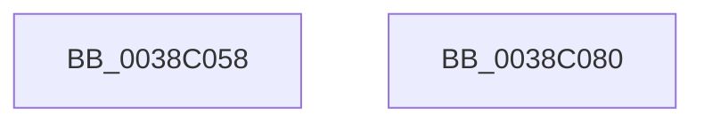

# CcDeallocateVacbLevel

- RVA: `0x0038C058`–`0x0038C081` (길이 `41` bytes)
- VA: `0x000000014038C058`
- 실행 섹션: `.text`
- PDB 이름 있음: `예`; PDB Function 태그: `아니요`
- unwind 정보 RVA: `0x0005C788`
- 디코드: `11`개 명령, `41/41` bytes 표시
- 미해석 바이트: `0` (있으면 어셈블리에 `.byte`로 보존)

> 이 문서는 커널 이미지의 기계어와 PDB 기호를 분석해 생성했습니다. 4번과 5번은 함수 원형과 자료형을 바이너리 사용 방식에서 추정한 C 해석이며 원본 소스 복구 결과는 아닙니다.

## 1. Dependencies

- 직접 호출 지점: **1**; 고유 호출 대상: **1**
- 직접 호출자로 확인된 함수: **1**
- RIP 상대 이미지 참조: **2**

### Outgoing calls
- `0x0038C076` → [ExFreeToNPagedLookasideList](ExFreeToNPagedLookasideList_function_0038D9D0.md) (function, `0x0038D9D0`)

### Direct callers
- [CcSetVacbLargeOffset](../27/CcSetVacbLargeOffset_function_002733D0.md) at `0x002735D8`

### Static image references
- `0x0038C05F` → RVA `0x00E11A80` (`.data`; read)
- `0x0038C068` → RVA `0x00E11B80` (`.data`; read)

## 2. Other-region calls and transfers

- 다른 실행 섹션으로 향하는 call: **0**
- 별도 외부 분기/꼬리 이동을 확인하지 못했습니다.

## 3. Assembly (complete function range)

```asm
0038C058  48 83 EC 28                     sub rsp, 0x28
0038C05C  48 8B C1                        mov rax, rcx
0038C05F  4C 8D 05 1A 5A A8 00            lea r8, [rip + 0xa85a1a]
0038C066  85 D2                           test edx, edx
0038C068  48 8D 0D 11 5B A8 00            lea rcx, [rip + 0xa85b11]
0038C06F  48 8B D0                        mov rdx, rax
0038C072  49 0F 44 C8                     cmove rcx, r8
0038C076  E8 55 19 00 00                  call 0x14038d9d0
0038C07B  48 83 C4 28                     add rsp, 0x28
0038C07F  C3                              ret
0038C080  CC                              int3
```

## 4. C-style interpretation (structured pseudocode)

```c
__int64 __fastcall CcDeallocateVacbLevel(__int64 a1, int a2)
{
    __int64 result;
    __int64 v_rsp;

    v_rsp = (v_rsp) - (40);
    a1 = v_rip + 11033361;
    if (a2 == 0) { a1 = v_rip + 11033114; }
    result = ExFreeToNPagedLookasideList(a1, a1, v_rip + 11033114, a4);
    v_rsp = (v_rsp) + (40);
    return result;
}
```

## 5. (Beta) C Style

```c
int64_t CcDeallocateVacbLevel(int64_t Arg1, int32_t Arg2)
{
    int64_t result;
    int64_t local_rsp;

    local_rsp = (local_rsp) - (40);
    Arg1 = v_rip + 11033361;
    if (Arg2 == 0) { Arg1 = v_rip + 11033114; }
    result = ExFreeToNPagedLookasideList(Arg1, Arg1, v_rip + 11033114, a4);
    local_rsp = (local_rsp) + (40);
    return result;
}
```

## 6. Execution-region graph

[열기: 2D/3D 그래프와 함수 탐색 컨트롤 패널](../../../control-panel.html?section=text&rva=0x0038C058&view=graph)

- 2D 그래프는 위에서 아래로 흐르고, 3D 그래프는 빈 공간을 드래그해 회전합니다. Shift+드래그는 이동, 휠은 확대·축소, 함수 노드 선택은 대상 보고서 이동입니다.

### Static fallback


