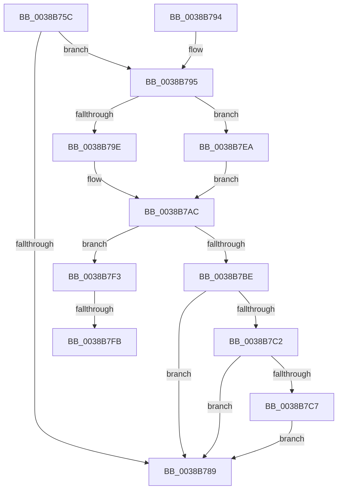

# CcDecrementOpenCount

- RVA: `0x0038B75C`–`0x0038B806` (길이 `170` bytes)
- VA: `0x000000014038B75C`
- 실행 섹션: `.text`
- PDB 이름 있음: `예`; PDB Function 태그: `예`
- unwind 정보 RVA: `0x000800F4`
- 디코드: `46`개 명령, `170/170` bytes 표시
- 미해석 바이트: `0` (있으면 어셈블리에 `.byte`로 보존)

> 이 문서는 커널 이미지의 기계어와 PDB 기호를 분석해 생성했습니다. 4번과 5번은 함수 원형과 자료형을 바이너리 사용 방식에서 추정한 C 해석이며 원본 소스 복구 결과는 아닙니다.

## 1. Dependencies

- 직접 호출 지점: **4**; 고유 호출 대상: **3**
- 직접 호출자로 확인된 함수: **14**
- RIP 상대 이미지 참조: **1**

### Outgoing calls
- `0x0038B77B` → [CcGetPrivateVolumeCacheMap](CcGetPrivateVolumeCacheMap_function_0038B930.md) (function, `0x0038B930`)
- `0x0038B7CE` → [CcInsertIntoDirtySharedCacheMapList](../3C/CcInsertIntoDirtySharedCacheMapList_function_003CD9D8.md) (function, `0x003CD9D8`)
- `0x0038B7E3` → [CcScheduleLazyWriteScan](../3C/CcScheduleLazyWriteScan_function_003CBD20.md) (function, `0x003CBD20`)
- `0x0038B7FB` → [CcInsertIntoDirtySharedCacheMapList](../3C/CcInsertIntoDirtySharedCacheMapList_function_003CD9D8.md) (function, `0x003CD9D8`)

### Direct callers
- [CcSetFileSizesEx](../26/CcSetFileSizesEx_function_0026D070.md) at `0x0026D16B`
- [CcSetFileSizesEx](../26/CcSetFileSizesEx_function_0026D070.md) at `0x0026D2D9`
- [CcUnmapInactiveViewsInternal](../27/CcUnmapInactiveViewsInternal_function_0027174C.md) at `0x00271AD6`
- [CcUnmapInactiveViewsInternal](../27/CcUnmapInactiveViewsInternal_function_0027174C.md) at `0x00271CEC`
- [CcUnmapInactiveViewsInternal](../27/CcUnmapInactiveViewsInternal_function_0027174C.md) at `0x00271D21`
- [CcWriteBehindPreProcess](../35/CcWriteBehindPreProcess_function_00357784.md) at `0x003578C5`
- [CcPurgeCacheSection](CcPurgeCacheSection_function_0038B130.md) at `0x0038B337`
- [CcPurgeCacheSection](CcPurgeCacheSection_function_0038B130.md) at `0x0038B3B5`
- [CcMdlWriteComplete2](../3C/CcMdlWriteComplete2_function_003CA36C.md) at `0x003CA42C`
- [CcGetFlushedValidData](../40/CcGetFlushedValidData_function_00402920.md) at `0x00402AB8`
- [CcNotifyOfMappedWrite](../40/CcNotifyOfMappedWrite_function_0040338C.md) at `0x004034EC`
- [CcNotifyOfMappedWriteComplete](../40/CcNotifyOfMappedWriteComplete_function_0040873C.md) at `0x0040880E`
- [CcCompleteAsyncRead](../45/CcCompleteAsyncRead_function_0045E7DC.md) at `0x0045EA37`
- [CcPerformReadAhead](../48/CcPerformReadAhead_function_0048F738.md) at `0x0048FC82`
- [CcMdlWriteAbort](../57/CcMdlWriteAbort_function_0057DA70.md) at `0x0057DAEA`
- [CcCompleteAsyncRead$fin$1](../6D/CcCompleteAsyncRead_fin_1_function_006D3387.md) at `0x006D34B0`
- [CcPerformReadAhead$fin$1](../6D/CcPerformReadAhead_fin_1_function_006D3929.md) at `0x006D3A31`
- [sub_006E2AF2](../6E/Unknown_function_006E2AF2.md) at `0x006E2AF5`

### Static image references
- `0x0038B795` → RVA `0x00E65B88` (`.data`; read)

## 2. Other-region calls and transfers

- 다른 실행 섹션으로 향하는 call: **0**
- call이 아닌 외부 분기/꼬리 이동: **2**
  - `0x0038B7F5` → [sub_006E53A0](../6E/Unknown_function_006E53A0.md) (`tail-transfer`)
  - `0x0038B801` → [sub_006E53A0](../6E/Unknown_function_006E53A0.md) (`tail-transfer`)

## 3. Assembly (complete function range)

```asm
0038B75C  48 89 5C 24 08                  mov qword ptr [rsp + 8], rbx
0038B761  57                              push rdi
0038B762  48 83 EC 20                     sub rsp, 0x20
0038B766  8B 41 04                        mov eax, dword ptr [rcx + 4]
0038B769  FF C8                           dec eax
0038B76B  89 41 04                        mov dword ptr [rcx + 4], eax
0038B76E  FF 89 20 02 00 00               dec dword ptr [rcx + 0x220]
0038B774  48 8B 99 18 02 00 00            mov rbx, qword ptr [rcx + 0x218]
0038B77B  E8 B0 01 00 00                  call 0x14038b930
0038B780  83 79 04 00                     cmp dword ptr [rcx + 4], 0
0038B784  48 8B F8                        mov rdi, rax
0038B787  74 0C                           je 0x14038b795
0038B789  48 8B 5C 24 30                  mov rbx, qword ptr [rsp + 0x30]
0038B78E  48 83 C4 20                     add rsp, 0x20
0038B792  5F                              pop rdi
0038B793  C3                              ret
0038B794  CC                              int3
0038B795  80 3D EC A3 AD 00 00            cmp byte ptr [rip + 0xada3ec], 0
0038B79C  74 4C                           je 0x14038b7ea
0038B79E  48 8B 91 58 02 00 00            mov rdx, qword ptr [rcx + 0x258]
0038B7A5  48 81 C2 DA 03 00 00            add rdx, 0x3da
0038B7AC  C6 02 01                        mov byte ptr [rdx], 1
0038B7AF  8B 91 98 00 00 00               mov edx, dword ptr [rcx + 0x98]
0038B7B5  8B 41 70                        mov eax, dword ptr [rcx + 0x70]
0038B7B8  0F BA E2 10                     bt edx, 0x10
0038B7BC  72 35                           jb 0x14038b7f3
0038B7BE  85 C0                           test eax, eax
0038B7C0  75 C7                           jne 0x14038b789
0038B7C2  F6 C2 20                        test dl, 0x20
0038B7C5  75 C2                           jne 0x14038b789
0038B7C7  4C 8B 99 18 01 00 00            mov r11, qword ptr [rcx + 0x118]
0038B7CE  E8 05 22 04 00                  call 0x1403cd9d8
0038B7D3  4D 85 DB                        test r11, r11
0038B7D6  41 0F 95 C0                     setne r8b
0038B7DA  45 33 C9                        xor r9d, r9d
0038B7DD  48 8B D7                        mov rdx, rdi
0038B7E0  48 8B CB                        mov rcx, rbx
0038B7E3  E8 38 05 04 00                  call 0x1403cbd20
0038B7E8  EB 9F                           jmp 0x14038b789
0038B7EA  48 8D 93 1A 04 00 00            lea rdx, [rbx + 0x41a]
0038B7F1  EB B9                           jmp 0x14038b7ac
0038B7F3  85 C0                           test eax, eax
0038B7F5  0F 85 A5 9B 35 00               jne 0x1406e53a0
0038B7FB  E8 D8 21 04 00                  call 0x1403cd9d8
0038B800  90                              nop
0038B801  E9 9A 9B 35 00                  jmp 0x1406e53a0
```

## 4. C-style interpretation (structured pseudocode)

```c
__int64 __fastcall CcDecrementOpenCount(__int64 a1, __int64 a2, __int64 a3, int a4)
{
    __int64 result;
    __int64 v_rsp;
    unsigned __int64 v_stack_p8;

    v_stack_p8 = v_rbx;
    v_rsp = (v_rsp) - (32);
    result = (unsigned int)(((unsigned int)(*(unsigned int *)(a1 + 4))) - 1);
    *(unsigned int *)(a1 + 4) = (unsigned int)(result);
    result = CcGetPrivateVolumeCacheMap(a1, a2, a3, a4);
    if ((*(unsigned int *)(a1 + 4)) == 0) goto loc_0038B795;
loc_0038B789:
    v_rsp = (v_rsp) + (32);
    return result;
loc_0038B795:
    if ((*(unsigned __int8 *)(v_rip + 11379692)) == 0) goto loc_0038B7EA;
    a2 = (*(unsigned __int64 *)(a1 + 600)) + (986);
loc_0038B7AC:
    *(unsigned __int8 *)(a2) = 1;
    if (condition_is_below) goto loc_0038B7F3;
    if ((unsigned int)((unsigned int)(*(unsigned int *)(a1 + 112))) != 0) goto loc_0038B789;
    if ((((unsigned __int8)((unsigned int)(*(unsigned int *)(a1 + 152)))) & (32)) != 0) goto loc_0038B789;
    result = CcInsertIntoDirtySharedCacheMapList(a1, (unsigned int)(*(unsigned int *)(a1 + 152)), a3, a4);
    a3 = (*(unsigned __int64 *)(a1 + 280) != 0) ? 1 : 0;
    a4 = 0;
    result = CcScheduleLazyWriteScan(v_stack_p8, result, a3, a4);
    goto loc_0038B789;
loc_0038B7EA:
    goto loc_0038B7AC;
loc_0038B7F3:
    result = CcInsertIntoDirtySharedCacheMapList(v_stack_p8, v_stack_p8 + 1050, a3, a4);
}
```

## 5. (Beta) C Style

```c
int64_t CcDecrementOpenCount(void *Arg1, int64_t Arg2, int64_t Arg3, int32_t Arg4)
{
    uint8_t *arg1 = (uint8_t *)Arg1;

    int64_t result;
    int64_t local_rsp;
    uint64_t v_stack_p8;

    v_stack_p8 = local_rbx;
    local_rsp = (local_rsp) - (32);
    result = (uint32_t)(((uint32_t)(*(uint32_t *)(arg1 + 0x4))) - 1);
    *(uint32_t *)(arg1 + 0x4) = (uint32_t)(result);
    result = CcGetPrivateVolumeCacheMap(Arg1, Arg2, Arg3, Arg4);
    if ((*(uint32_t *)(arg1 + 0x4)) == 0) goto loc_0038B795;
loc_0038B789:
    local_rsp = (local_rsp) + (32);
    return result;
loc_0038B795:
    if ((*(uint8_t *)(v_rip + 0xADA3EC)) == 0) goto loc_0038B7EA;
    Arg2 = (*(uint64_t *)(arg1 + 0x258)) + (986);
loc_0038B7AC:
    *(uint8_t *)(Arg2) = 1;
    if (condition_is_below) goto loc_0038B7F3;
    if ((uint32_t)((uint32_t)(*(uint32_t *)(arg1 + 0x70))) != 0) goto loc_0038B789;
    if ((((uint8_t)((uint32_t)(*(uint32_t *)(arg1 + 0x98)))) & (32)) != 0) goto loc_0038B789;
    result = CcInsertIntoDirtySharedCacheMapList(Arg1, (uint32_t)(*(uint32_t *)(arg1 + 0x98)), Arg3, Arg4);
    Arg3 = (*(uint64_t *)(arg1 + 0x118) != 0) ? 1 : 0;
    Arg4 = 0;
    result = CcScheduleLazyWriteScan(v_stack_p8, result, Arg3, Arg4);
    goto loc_0038B789;
loc_0038B7EA:
    goto loc_0038B7AC;
loc_0038B7F3:
    result = CcInsertIntoDirtySharedCacheMapList(v_stack_p8, v_stack_p8 + 1050, Arg3, Arg4);
}
```

### 관측된 메모리 오프셋

구조체 형식이 확인되지 않은 접근은 인자 기준의 오프셋으로만 기록했습니다.

| 기준 인자 | 오프셋 표현 | 폭 (bit) | 접근 |
|---|---:|---:|---|
| `Arg1` | `+ 0x4` | `32` | `R` |
| `Arg1` | `+ 0x4` | `32` | `W` |
| `Arg1` | `+ 0x218` | `64` | `R` |
| `Arg1` | `+ 0x220` | `32` | `R/W` |

## 6. Execution-region graph

[열기: 2D/3D 그래프와 함수 탐색 컨트롤 패널](../../../control-panel.html?section=text&rva=0x0038B75C&view=graph)

- 2D 그래프는 위에서 아래로 흐르고, 3D 그래프는 빈 공간을 드래그해 회전합니다. Shift+드래그는 이동, 휠은 확대·축소, 함수 노드 선택은 대상 보고서 이동입니다.

### Static fallback


