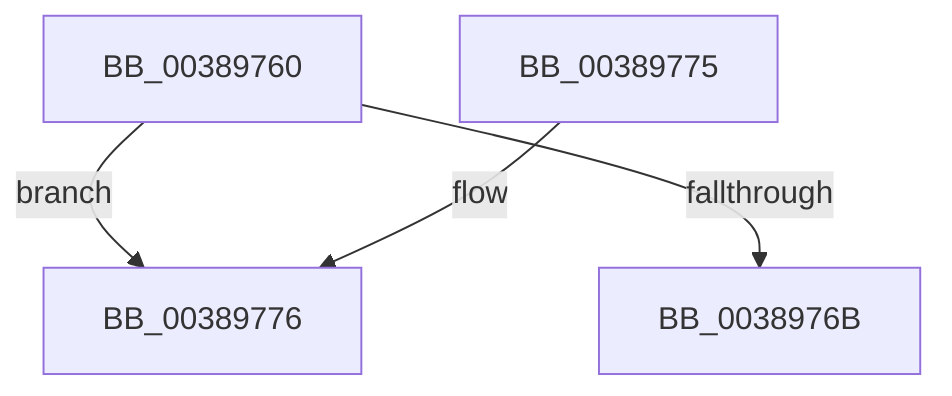

# CcDecrementPrivateVolumeUseCount

- RVA: `0x00389760`–`0x00389795` (길이 `53` bytes)
- VA: `0x0000000140389760`
- 실행 섹션: `.text`
- PDB 이름 있음: `예`; PDB Function 태그: `아니요`
- unwind 정보 RVA: `0x0007D698`
- 디코드: `16`개 명령, `53/53` bytes 표시
- 미해석 바이트: `0` (있으면 어셈블리에 `.byte`로 보존)

> 이 문서는 커널 이미지의 기계어와 PDB 기호를 분석해 생성했습니다. 4번과 5번은 함수 원형과 자료형을 바이너리 사용 방식에서 추정한 C 해석이며 원본 소스 복구 결과는 아닙니다.

## 1. Dependencies

- 직접 호출 지점: **1**; 고유 호출 대상: **1**
- 직접 호출자로 확인된 함수: **3**
- RIP 상대 이미지 참조: **0**

### Outgoing calls
- `0x0038978F` → [KeBugCheckEx](../4F/KeBugCheckEx_function_004FD660.md) (function, `0x004FD660`)

### Direct callers
- [CcForEachPrivateVolumeCacheMap](CcForEachPrivateVolumeCacheMap_function_0038967C.md) at `0x0038970D`
- [CcDeleteSharedCacheMap](CcDeleteSharedCacheMap_function_0038A804.md) at `0x0038AB43`
- [CcCreatePrivateVolumeCacheMap](../3C/CcCreatePrivateVolumeCacheMap_function_003CDB20.md) at `0x003CDC52`

### Static image references
- 디코드된 RIP-relative 메모리 참조가 없습니다.

## 2. Other-region calls and transfers

- 다른 실행 섹션으로 향하는 call: **0**
- 별도 외부 분기/꼬리 이동을 확인하지 못했습니다.

## 3. Assembly (complete function range)

```asm
00389760  48 83 EC 38                     sub rsp, 0x38
00389764  8B 41 04                        mov eax, dword ptr [rcx + 4]
00389767  85 C0                           test eax, eax
00389769  74 0B                           je 0x140389776
0038976B  FF C8                           dec eax
0038976D  89 41 04                        mov dword ptr [rcx + 4], eax
00389770  48 83 C4 38                     add rsp, 0x38
00389774  C3                              ret
00389775  CC                              int3
00389776  48 83 64 24 20 00               and qword ptr [rsp + 0x20], 0
0038977C  45 33 C9                        xor r9d, r9d
0038977F  BA 0F 1D 00 00                  mov edx, 0x1d0f
00389784  49 C7 C0 20 04 00 C0            mov r8, 0xffffffffc0000420
0038978B  41 8D 49 34                     lea ecx, [r9 + 0x34]
0038978F  E8 CC 3E 17 00                  call 0x1404fd660
00389794  CC                              int3
```

## 4. C-style interpretation (structured pseudocode)

```c
__int64 __fastcall CcDecrementPrivateVolumeUseCount(__int64 a1, __int64 a2, __int64 a3, int a4)
{
    __int64 result;
    __int64 v_rsp;
    unsigned __int64 v_stack_p20;

    v_rsp = (v_rsp) - (56);
    if ((unsigned int)((unsigned int)(*(unsigned int *)(a1 + 4))) == 0) goto loc_00389776;
    result = (unsigned int)(((unsigned int)(*(unsigned int *)(a1 + 4))) - 1);
    *(unsigned int *)(a1 + 4) = (unsigned int)(result);
    v_rsp = (v_rsp) + (56);
    return result;
loc_00389776:
    a4 = 0;
    result = KeBugCheckEx(a4 + 52, (unsigned int)(0x1D0FULL), 0xFFFFFFFFC0000420ULL, a4);
    return result;
}
```

## 5. (Beta) C Style

```c
int64_t CcDecrementPrivateVolumeUseCount(void *Arg1, int64_t Arg2, int64_t Arg3, int32_t Arg4)
{
    uint8_t *arg1 = (uint8_t *)Arg1;

    int64_t result;
    int64_t local_rsp;
    uint64_t v_stack_p20;

    local_rsp = (local_rsp) - (56);
    if ((uint32_t)((uint32_t)(*(uint32_t *)(arg1 + 0x4))) == 0) goto loc_00389776;
    result = (uint32_t)(((uint32_t)(*(uint32_t *)(arg1 + 0x4))) - 1);
    *(uint32_t *)(arg1 + 0x4) = (uint32_t)(result);
    local_rsp = (local_rsp) + (56);
    return result;
loc_00389776:
    Arg4 = 0;
    result = KeBugCheckEx(Arg4 + 52, (uint32_t)(0x1D0FULL), 0xFFFFFFFFC0000420ULL, Arg4);
    return result;
}
```

### 관측된 메모리 오프셋

구조체 형식이 확인되지 않은 접근은 인자 기준의 오프셋으로만 기록했습니다.

| 기준 인자 | 오프셋 표현 | 폭 (bit) | 접근 |
|---|---:|---:|---|
| `Arg1` | `+ 0x4` | `32` | `R` |
| `Arg1` | `+ 0x4` | `32` | `W` |

## 6. Execution-region graph

[열기: 2D/3D 그래프와 함수 탐색 컨트롤 패널](../../../control-panel.html?section=text&rva=0x00389760&view=graph)

- 2D 그래프는 위에서 아래로 흐르고, 3D 그래프는 빈 공간을 드래그해 회전합니다. Shift+드래그는 이동, 휠은 확대·축소, 함수 노드 선택은 대상 보고서 이동입니다.

### Static fallback


