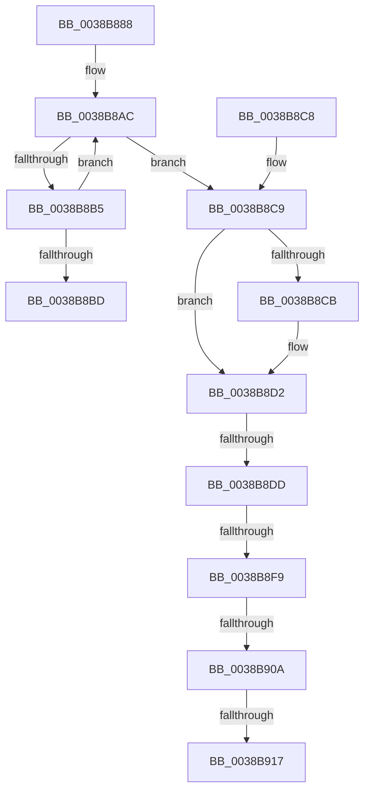

# CcDecrementVolumeUseCountWithDelete

- RVA: `0x0038B888`–`0x0038B928` (길이 `160` bytes)
- VA: `0x000000014038B888`
- 실행 섹션: `.text`
- PDB 이름 있음: `예`; PDB Function 태그: `예`
- unwind 정보 RVA: `0x00080114`
- 디코드: `41`개 명령, `160/160` bytes 표시
- 미해석 바이트: `0` (있으면 어셈블리에 `.byte`로 보존)

> 이 문서는 커널 이미지의 기계어와 PDB 기호를 분석해 생성했습니다. 4번과 5번은 함수 원형과 자료형을 바이너리 사용 방식에서 추정한 C 해석이며 원본 소스 복구 결과는 아닙니다.

## 1. Dependencies

- 직접 호출 지점: **1**; 고유 호출 대상: **1**
- 직접 호출자로 확인된 함수: **6**
- RIP 상대 이미지 참조: **1**

### Outgoing calls
- `0x0038B8E9` → [KeAcquireInStackQueuedSpinLock](../27/KeAcquireInStackQueuedSpinLock_function_002757A0.md) (function, `0x002757A0`)

### Direct callers
- [CcCanIWrite](CcCanIWrite_function_00388250.md) at `0x0038844A`
- [CcScanLogHandleList](CcScanLogHandleList_function_0038A26C.md) at `0x0038A33B`
- [CcDeleteSharedCacheMap](CcDeleteSharedCacheMap_function_0038A804.md) at `0x0038AA02`
- [CcDeletePrivateVolumeCacheMap](../3C/CcDeletePrivateVolumeCacheMap_function_003CE950.md) at `0x003CEA3C`
- [CcGetDeviceGuidAsync](../57/CcGetDeviceGuidAsync_function_0057ED70.md) at `0x0057EE30`
- [CcQueueAsyncGetDeviceGuid](../57/CcQueueAsyncGetDeviceGuid_function_0057EE74.md) at `0x0057EEE2`

### Static image references
- `0x0038B8E2` → RVA `0x00E11CC0` (`.data`; read)

## 2. Other-region calls and transfers

- 다른 실행 섹션으로 향하는 call: **0**
- call이 아닌 외부 분기/꼬리 이동: **5**
  - `0x0038B8D7` → [sub_006E53AC + 0x11](../6E/Unknown_function_006E53AC.md) (`tail-transfer`)
  - `0x0038B8F3` → [sub_006E53AC + 0x7](../6E/Unknown_function_006E53AC.md) (`tail-transfer`)
  - `0x0038B904` → [sub_006E53AC](../6E/Unknown_function_006E53AC.md) (`tail-transfer`)
  - `0x0038B911` → [sub_006E53AC](../6E/Unknown_function_006E53AC.md) (`tail-transfer`)
  - `0x0038B923` → [sub_006E53AC + 0x7](../6E/Unknown_function_006E53AC.md) (`tail-transfer`)

## 3. Assembly (complete function range)

```asm
0038B888  48 89 5C 24 08                  mov qword ptr [rsp + 8], rbx
0038B88D  57                              push rdi
0038B88E  48 83 EC 60                     sub rsp, 0x60
0038B892  0F 57 C0                        xorps xmm0, xmm0
0038B895  33 C0                           xor eax, eax
0038B897  0F 11 44 24 40                  movups xmmword ptr [rsp + 0x40], xmm0
0038B89C  48 89 44 24 50                  mov qword ptr [rsp + 0x50], rax
0038B8A1  48 8B F9                        mov rdi, rcx
0038B8A4  0F 0D 49 08                     prefetchw byte ptr [rcx + 8]
0038B8A8  48 8B 41 08                     mov rax, qword ptr [rcx + 8]
0038B8AC  48 8D 48 FF                     lea rcx, [rax - 1]
0038B8B0  48 85 C9                        test rcx, rcx
0038B8B3  7E 14                           jle 0x14038b8c9
0038B8B5  F0 48 0F B1 4F 08               lock cmpxchg qword ptr [rdi + 8], rcx
0038B8BB  75 EF                           jne 0x14038b8ac
0038B8BD  48 8B 5C 24 70                  mov rbx, qword ptr [rsp + 0x70]
0038B8C2  48 83 C4 60                     add rsp, 0x60
0038B8C6  5F                              pop rdi
0038B8C7  C3                              ret
0038B8C8  CC                              int3
0038B8C9  74 07                           je 0x14038b8d2
0038B8CB  B9 0E 00 00 00                  mov ecx, 0xe
0038B8D0  CD 29                           int 0x29
0038B8D2  48 83 7F 20 00                  cmp qword ptr [rdi + 0x20], 0
0038B8D7  0F 84 E0 9A 35 00               je 0x1406e53bd
0038B8DD  48 8D 54 24 40                  lea rdx, [rsp + 0x40]
0038B8E2  48 8D 0D D7 63 A8 00            lea rcx, [rip + 0xa863d7]
0038B8E9  E8 B2 9E EE FF                  call 0x1402757a0
0038B8EE  48 83 7F 20 00                  cmp qword ptr [rdi + 0x20], 0
0038B8F3  0F 84 BA 9A 35 00               je 0x1406e53b3
0038B8F9  48 8D 47 18                     lea rax, [rdi + 0x18]
0038B8FD  48 8B 08                        mov rcx, qword ptr [rax]
0038B900  48 39 41 08                     cmp qword ptr [rcx + 8], rax
0038B904  0F 85 A2 9A 35 00               jne 0x1406e53ac
0038B90A  48 8B 50 08                     mov rdx, qword ptr [rax + 8]
0038B90E  48 39 02                        cmp qword ptr [rdx], rax
0038B911  0F 85 95 9A 35 00               jne 0x1406e53ac
0038B917  48 89 0A                        mov qword ptr [rdx], rcx
0038B91A  48 89 51 08                     mov qword ptr [rcx + 8], rdx
0038B91E  48 83 60 08 00                  and qword ptr [rax + 8], 0
0038B923  E9 8B 9A 35 00                  jmp 0x1406e53b3
```

## 4. C-style interpretation (structured pseudocode)

```c
__int64 __fastcall CcDecrementVolumeUseCountWithDelete(__int64 a1)
{
    __int64 result;
    __int64 v_rsp;
    unsigned __int64 v_stack_m18;
    unsigned __int64 v_stack_m28;
    unsigned __int64 v_stack_p40;
    unsigned __int64 v_stack_p8;

    v_stack_p8 = v_rbx;
    v_rsp = (v_rsp) - (96);
    result = 0;
    v_stack_m28 = v_xmm0;
    v_stack_m18 = 0;
loc_0038B8AC:
    if (condition_is_less_or_equal) goto loc_0038B8C9;
    if (*(unsigned __int64 *)(a1 + 8) - 1 != 0) goto loc_0038B8AC;
    v_rsp = (v_rsp) + (96);
    return *(unsigned __int64 *)(a1 + 8);
loc_0038B8C9:
    if (!(condition_is_equal)) {
        a1 = 14;
    }
    result = KeAcquireInStackQueuedSpinLock(v_rip + 11035607, v_stack_p40, a3, a4);
    *(unsigned __int64 *)(*(unsigned __int64 *)(a1 + 24 + 8)) = *(unsigned __int64 *)(a1 + 24);
    *(unsigned __int64 *)(*(unsigned __int64 *)(a1 + 24) + 8) = *(unsigned __int64 *)(a1 + 24 + 8);
}
```

## 5. (Beta) C Style

```c
int64_t CcDecrementVolumeUseCountWithDelete(void *Arg1)
{
    uint8_t *arg1 = (uint8_t *)Arg1;

    int64_t result;
    int64_t local_rsp;
    uint64_t v_stack_m18;
    uint64_t v_stack_m28;
    uint64_t v_stack_p40;
    uint64_t v_stack_p8;

    v_stack_p8 = local_rbx;
    local_rsp = (local_rsp) - (96);
    result = 0;
    v_stack_m28 = v_xmm0;
    v_stack_m18 = 0;
loc_0038B8AC:
    if (condition_is_less_or_equal) goto loc_0038B8C9;
    if (*(uint64_t *)(arg1 + 0x8) - 1 != 0) goto loc_0038B8AC;
    local_rsp = (local_rsp) + (96);
    return *(uint64_t *)(arg1 + 0x8);
loc_0038B8C9:
    if (!(condition_is_equal)) {
        Arg1 = 14;
    }
    result = KeAcquireInStackQueuedSpinLock(v_rip + 11035607, v_stack_p40, a3, a4);
    *(uint64_t *)(*(uint64_t *)(arg1 + 0x18 + 0x8)) = *(uint64_t *)(arg1 + 0x18);
    *(uint64_t *)(*(uint64_t *)(arg1 + 0x18) + 0x8) = *(uint64_t *)(arg1 + 0x18 + 0x8);
}
```

### 관측된 메모리 오프셋

구조체 형식이 확인되지 않은 접근은 인자 기준의 오프셋으로만 기록했습니다.

| 기준 인자 | 오프셋 표현 | 폭 (bit) | 접근 |
|---|---:|---:|---|
| `Arg1` | `+ 0x0` | `64` | `R` |
| `Arg1` | `+ 0x8` | `8` | `R` |
| `Arg1` | `+ 0x8` | `64` | `R` |
| `Arg1` | `+ 0x8` | `64` | `R/W` |
| `Arg1` | `+ 0x18` | `64` | `R` |
| `Arg1` | `+ 0x20` | `64` | `R` |

## 6. Execution-region graph

[열기: 2D/3D 그래프와 함수 탐색 컨트롤 패널](../../../control-panel.html?section=text&rva=0x0038B888&view=graph)

- 2D 그래프는 위에서 아래로 흐르고, 3D 그래프는 빈 공간을 드래그해 회전합니다. Shift+드래그는 이동, 휠은 확대·축소, 함수 노드 선택은 대상 보고서 이동입니다.

### Static fallback


