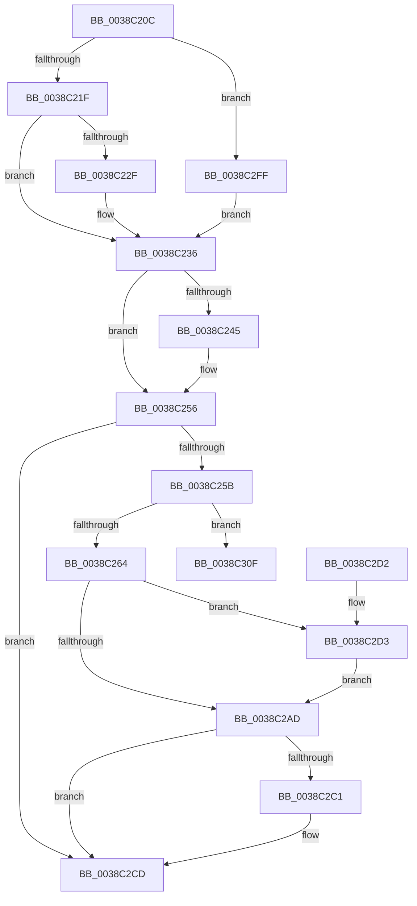

# CcDeductDirtyPages

- RVA: `0x0038C20C`–`0x0038C32E` (길이 `290` bytes)
- VA: `0x000000014038C20C`
- 실행 섹션: `.text`
- PDB 이름 있음: `예`; PDB Function 태그: `아니요`
- unwind 정보 RVA: `0x00080274`
- 디코드: `60`개 명령, `290/290` bytes 표시
- 미해석 바이트: `0` (있으면 어셈블리에 `.byte`로 보존)

> 이 문서는 커널 이미지의 기계어와 PDB 기호를 분석해 생성했습니다. 4번과 5번은 함수 원형과 자료형을 바이너리 사용 방식에서 추정한 C 해석이며 원본 소스 복구 결과는 아닙니다.

## 1. Dependencies

- 직접 호출 지점: **1**; 고유 호출 대상: **1**
- 직접 호출자로 확인된 함수: **4**
- RIP 상대 이미지 참조: **2**

### Outgoing calls
- `0x0038C328` → [KeBugCheckEx](../4F/KeBugCheckEx_function_004FD660.md) (function, `0x004FD660`)

### Direct callers
- [CcUnpinFileDataEx](../35/CcUnpinFileDataEx_function_00359DEC.md) at `0x00359F1D`
- [CcDeleteBcbs](CcDeleteBcbs_function_00389BF0.md) at `0x00389CF7`
- [CcDeleteMbcb](CcDeleteMbcb_function_0038C088.md) at `0x0038C0FF`
- [CcAcquireByteRangeForWrite](../40/CcAcquireByteRangeForWrite_function_00401E74.md) at `0x004020CD`

### Static image references
- `0x0038C21F` → RVA `0x00E65B88` (`.data`; read)
- `0x0038C2FF` → RVA `0x00FC6EA0` (`ALMOSTRO`; read)

## 2. Other-region calls and transfers

- 다른 실행 섹션으로 향하는 call: **0**
- 별도 외부 분기/꼬리 이동을 확인하지 못했습니다.

## 3. Assembly (complete function range)

```asm
0038C20C  48 83 EC 38                     sub rsp, 0x38
0038C210  45 33 C0                        xor r8d, r8d
0038C213  4C 8B C9                        mov r9, rcx
0038C216  48 85 C9                        test rcx, rcx
0038C219  0F 84 E0 00 00 00               je 0x14038c2ff
0038C21F  44 38 05 62 99 AD 00            cmp byte ptr [rip + 0xad9962], r8b
0038C226  48 8B 81 18 02 00 00            mov rax, qword ptr [rcx + 0x218]
0038C22D  74 07                           je 0x14038c236
0038C22F  4C 8B 81 58 02 00 00            mov r8, qword ptr [rcx + 0x258]
0038C236  44 8B DA                        mov r11d, edx
0038C239  4C 29 98 20 04 00 00            sub qword ptr [rax + 0x420], r11
0038C240  4D 85 C0                        test r8, r8
0038C243  74 11                           je 0x14038c256
0038C245  49 8B 80 E0 03 00 00            mov rax, qword ptr [r8 + 0x3e0]
0038C24C  49 2B C3                        sub rax, r11
0038C24F  49 89 80 E0 03 00 00            mov qword ptr [r8 + 0x3e0], rax
0038C256  4D 85 C9                        test r9, r9
0038C259  74 72                           je 0x14038c2cd
0038C25B  83 FA FF                        cmp edx, -1
0038C25E  0F 83 AB 00 00 00               jae 0x14038c30f
0038C264  29 51 70                        sub dword ptr [rcx + 0x70], edx
0038C267  48 8B 81 00 02 00 00            mov rax, qword ptr [rcx + 0x200]
0038C26E  49 F7 DB                        neg r11
0038C271  F0 4C 01 58 28                  lock add qword ptr [rax + 0x28], r11
0038C276  4C 8B 91 00 02 00 00            mov r10, qword ptr [rcx + 0x200]
0038C27D  49 8B 42 28                     mov rax, qword ptr [r10 + 0x28]
0038C281  49 01 82 F8 00 00 00            add qword ptr [r10 + 0xf8], rax
0038C288  49 8B 92 00 01 00 00            mov rdx, qword ptr [r10 + 0x100]
0038C28F  48 8B 81 00 02 00 00            mov rax, qword ptr [rcx + 0x200]
0038C296  48 8B 48 28                     mov rcx, qword ptr [rax + 0x28]
0038C29A  48 3B D1                        cmp rdx, rcx
0038C29D  48 0F 46 D1                     cmovbe rdx, rcx
0038C2A1  49 89 92 00 01 00 00            mov qword ptr [r10 + 0x100], rdx
0038C2A8  4D 85 C0                        test r8, r8
0038C2AB  75 26                           jne 0x14038c2d3
0038C2AD  49 FF 82 20 01 00 00            inc qword ptr [r10 + 0x120]
0038C2B4  41 F7 81 98 00 00 00 00 00 00 01  test dword ptr [r9 + 0x98], 0x1000000
0038C2BF  74 0C                           je 0x14038c2cd
0038C2C1  49 8B 81 F8 00 00 00            mov rax, qword ptr [r9 + 0xf8]
0038C2C8  F0 4C 01 58 18                  lock add qword ptr [rax + 0x18], r11
0038C2CD  48 83 C4 38                     add rsp, 0x38
0038C2D1  C3                              ret
0038C2D2  CC                              int3
0038C2D3  49 8B 80 F8 03 00 00            mov rax, qword ptr [r8 + 0x3f8]
0038C2DA  49 01 82 08 01 00 00            add qword ptr [r10 + 0x108], rax
0038C2E1  49 8B 80 00 04 00 00            mov rax, qword ptr [r8 + 0x400]
0038C2E8  49 89 82 10 01 00 00            mov qword ptr [r10 + 0x110], rax
0038C2EF  49 8B 80 08 04 00 00            mov rax, qword ptr [r8 + 0x408]
0038C2F6  49 89 82 18 01 00 00            mov qword ptr [r10 + 0x118], rax
0038C2FD  EB AE                           jmp 0x14038c2ad
0038C2FF  48 8B 05 9A AB C3 00            mov rax, qword ptr [rip + 0xc3ab9a]
0038C306  48 8B 40 08                     mov rax, qword ptr [rax + 8]
0038C30A  E9 27 FF FF FF                  jmp 0x14038c236
0038C30F  48 83 64 24 20 00               and qword ptr [rsp + 0x20], 0
0038C315  45 33 C9                        xor r9d, r9d
0038C318  BA B1 35 00 00                  mov edx, 0x35b1
0038C31D  49 C7 C0 20 04 00 C0            mov r8, 0xffffffffc0000420
0038C324  41 8D 49 34                     lea ecx, [r9 + 0x34]
0038C328  E8 33 13 17 00                  call 0x1404fd660
0038C32D  CC                              int3
```

## 4. C-style interpretation (structured pseudocode)

```c
__int64 __fastcall CcDeductDirtyPages(__int64 a1, int a2, int a3)
{
    __int64 result;
    __int64 v_r11;
    __int64 v_rsp;
    unsigned __int64 v_stack_p20;

    v_rsp = (v_rsp) - (56);
    a3 = 0;
    if (a1 == 0) goto loc_0038C2FF;
    if ((*(unsigned __int8 *)(v_rip + 11376994)) != 0) {
        a3 = *(unsigned __int64 *)(a1 + 600);
    }
    result = *(unsigned __int64 *)(a1 + 536);
    if (a3 != 0) {
        result = *(unsigned __int64 *)(a3 + 992);
        result = (result) - ((unsigned int)(a2));
        *(unsigned __int64 *)(a3 + 992) = result;
    }
    if (a1 == 0) goto loc_0038C2CD;
    if (a2 >= -1) goto loc_0038C30F;
    v_r11 = -((unsigned int)(a2));
    a2 = *(unsigned __int64 *)(*(unsigned __int64 *)(a1 + 512) + 256);
    if ((*(unsigned __int64 *)(*(unsigned __int64 *)(a1 + 512) + 256)) <= (*(unsigned __int64 *)(*(unsigned __int64 *)(a1 + 512) + 40))) { a2 = *(unsigned __int64 *)(*(unsigned __int64 *)(a1 + 512) + 40); }
    *(unsigned __int64 *)(*(unsigned __int64 *)(a1 + 512) + 256) = a2;
    if (a3 != 0) goto loc_0038C2D3;
loc_0038C2AD:
    result = *(unsigned __int64 *)(a1 + 512);
    if (((*(unsigned int *)(a1 + 152)) & (0x1000000ULL)) != 0) {
        result = *(unsigned __int64 *)(a1 + 248);
    }
    v_rsp = (v_rsp) + (56);
    return result;
loc_0038C2D3:
    *(unsigned __int64 *)(*(unsigned __int64 *)(a1 + 512) + 272) = *(unsigned __int64 *)(a3 + 1024);
    *(unsigned __int64 *)(*(unsigned __int64 *)(a1 + 512) + 280) = *(unsigned __int64 *)(a3 + 1032);
    goto loc_0038C2AD;
loc_0038C2FF:
    goto loc_0038C236;
loc_0038C30F:
    a4 = 0;
    result = KeBugCheckEx(a4 + 52, (unsigned int)(0x35B1ULL), 0xFFFFFFFFC0000420ULL, a4);
    return result;
}
```

## 5. (Beta) C Style

```c
int64_t CcDeductDirtyPages(int64_t Arg1, int32_t Arg2, int32_t Arg3)
{
    int64_t result;
    int64_t local_r11;
    int64_t local_rsp;
    uint64_t v_stack_p20;

    local_rsp = (local_rsp) - (56);
    Arg3 = 0;
    if (Arg1 == 0) goto loc_0038C2FF;
    if ((*(uint8_t *)(v_rip + 0xAD9962)) != 0) {
        Arg3 = *(uint64_t *)(Arg1 + 0x258);
    }
    result = *(uint64_t *)(Arg1 + 0x218);
    if (Arg3 != 0) {
        result = *(uint64_t *)(Arg3 + 0x3E0);
        result = (result) - ((uint32_t)(Arg2));
        *(uint64_t *)(Arg3 + 0x3E0) = result;
    }
    if (Arg1 == 0) goto loc_0038C2CD;
    if (Arg2 >= -1) goto loc_0038C30F;
    local_r11 = -((uint32_t)(Arg2));
    Arg2 = *(uint64_t *)(*(uint64_t *)(Arg1 + 0x200) + 0x100);
    if ((*(uint64_t *)(*(uint64_t *)(Arg1 + 0x200) + 0x100)) <= (*(uint64_t *)(*(uint64_t *)(Arg1 + 0x200) + 0x28))) { Arg2 = *(uint64_t *)(*(uint64_t *)(Arg1 + 0x200) + 0x28); }
    *(uint64_t *)(*(uint64_t *)(Arg1 + 0x200) + 0x100) = Arg2;
    if (Arg3 != 0) goto loc_0038C2D3;
loc_0038C2AD:
    result = *(uint64_t *)(Arg1 + 0x200);
    if (((*(uint32_t *)(Arg1 + 0x98)) & (0x1000000ULL)) != 0) {
        result = *(uint64_t *)(Arg1 + 0xF8);
    }
    local_rsp = (local_rsp) + (56);
    return result;
loc_0038C2D3:
    *(uint64_t *)(*(uint64_t *)(Arg1 + 0x200) + 0x110) = *(uint64_t *)(Arg3 + 0x400);
    *(uint64_t *)(*(uint64_t *)(Arg1 + 0x200) + 0x118) = *(uint64_t *)(Arg3 + 0x408);
    goto loc_0038C2AD;
loc_0038C2FF:
    goto loc_0038C236;
loc_0038C30F:
    a4 = 0;
    result = KeBugCheckEx(a4 + 52, (uint32_t)(0x35B1ULL), 0xFFFFFFFFC0000420ULL, a4);
    return result;
}
```

## 6. Execution-region graph

[열기: 2D/3D 그래프와 함수 탐색 컨트롤 패널](../../../control-panel.html?section=text&rva=0x0038C20C&view=graph)

- 2D 그래프는 위에서 아래로 흐르고, 3D 그래프는 빈 공간을 드래그해 회전합니다. Shift+드래그는 이동, 휠은 확대·축소, 함수 노드 선택은 대상 보고서 이동입니다.

### Static fallback


