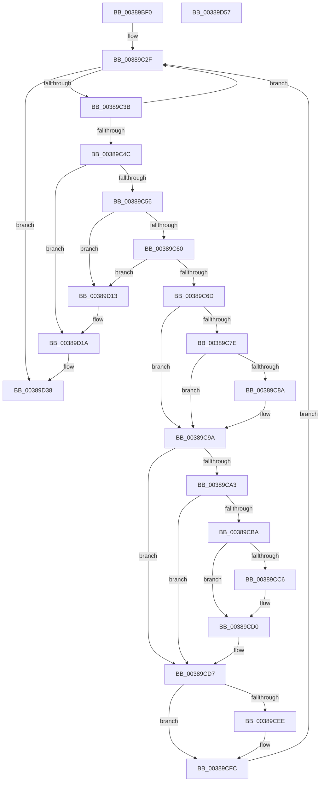

# CcDeleteBcbs

- RVA: `0x00389BF0`–`0x00389D58` (길이 `360` bytes)
- VA: `0x0000000140389BF0`
- 실행 섹션: `.text`
- PDB 이름 있음: `예`; PDB Function 태그: `아니요`
- unwind 정보 RVA: `0x0007FF48`
- 디코드: `93`개 명령, `360/360` bytes 표시
- 미해석 바이트: `0` (있으면 어셈블리에 `.byte`로 보존)

> 이 문서는 커널 이미지의 기계어와 PDB 기호를 분석해 생성했습니다. 4번과 5번은 함수 원형과 자료형을 바이너리 사용 방식에서 추정한 C 해석이며 원본 소스 복구 결과는 아닙니다.

## 1. Dependencies

- 직접 호출 지점: **7**; 고유 호출 대상: **7**
- 직접 호출자로 확인된 함수: **2**
- RIP 상대 이미지 참조: **0**

### Outgoing calls
- `0x00389C95` → [CcAdjustVacbLevelLockCount](../41/CcAdjustVacbLevelLockCount_function_0041F8A4.md) (function, `0x0041F8A4`)
- `0x00389CCB` → [KeSetEvent](../33/KeSetEvent_function_0033F310.md) (function, `0x0033F310`)
- `0x00389CE3` → [KeAcquireInStackQueuedSpinLock](../27/KeAcquireInStackQueuedSpinLock_function_002757A0.md) (function, `0x002757A0`)
- `0x00389CF7` → [CcDeductDirtyPages](CcDeductDirtyPages_function_0038C20C.md) (function, `0x0038C20C`)
- `0x00389D01` → [KeReleaseInStackQueuedSpinLock](../34/KeReleaseInStackQueuedSpinLock_function_00342CE0.md) (function, `0x00342CE0`)
- `0x00389D09` → [CcDeallocateBcb](CcDeallocateBcb_function_0038BA24.md) (function, `0x0038BA24`)
- `0x00389D32` → [KeBugCheckEx](../4F/KeBugCheckEx_function_004FD660.md) (function, `0x004FD660`)

### Direct callers
- [CcDeleteSharedCacheMap](CcDeleteSharedCacheMap_function_0038A804.md) at `0x0038A987`
- [sub_006D9D44](../6D/Unknown_function_006D9D44.md) at `0x006D9D54`

### Static image references
- 디코드된 RIP-relative 메모리 참조가 없습니다.

## 2. Other-region calls and transfers

- 다른 실행 섹션으로 향하는 call: **0**
- 별도 외부 분기/꼬리 이동을 확인하지 못했습니다.

## 3. Assembly (complete function range)

```asm
00389BF0  4C 8B DC                        mov r11, rsp
00389BF3  49 89 5B 08                     mov qword ptr [r11 + 8], rbx
00389BF7  49 89 6B 10                     mov qword ptr [r11 + 0x10], rbp
00389BFB  49 89 73 18                     mov qword ptr [r11 + 0x18], rsi
00389BFF  49 89 7B 20                     mov qword ptr [r11 + 0x20], rdi
00389C03  41 54                           push r12
00389C05  41 56                           push r14
00389C07  41 57                           push r15
00389C09  48 83 EC 50                     sub rsp, 0x50
00389C0D  4C 8B B9 18 02 00 00            mov r15, qword ptr [rcx + 0x218]
00389C14  4C 8D 71 10                     lea r14, [rcx + 0x10]
00389C18  49 8B 3E                        mov rdi, qword ptr [r14]
00389C1B  33 C0                           xor eax, eax
00389C1D  0F 57 C0                        xorps xmm0, xmm0
00389C20  48 8B F1                        mov rsi, rcx
00389C23  0F 11 44 24 30                  movups xmmword ptr [rsp + 0x30], xmm0
00389C28  49 89 43 D8                     mov qword ptr [r11 - 0x28], rax
00389C2C  45 33 E4                        xor r12d, r12d
00389C2F  48 8B CF                        mov rcx, rdi
00389C32  49 3B FE                        cmp rdi, r14
00389C35  0F 84 FD 00 00 00               je 0x140389d38
00389C3B  48 8D 5F F0                     lea rbx, [rdi - 0x10]
00389C3F  B8 FD 02 00 00                  mov eax, 0x2fd
00389C44  48 8B 3F                        mov rdi, qword ptr [rdi]
00389C47  66 39 03                        cmp word ptr [rbx], ax
00389C4A  75 E3                           jne 0x140389c2f
00389C4C  44 39 63 40                     cmp dword ptr [rbx + 0x40], r12d
00389C50  0F 85 C4 00 00 00               jne 0x140389d1a
00389C56  48 39 4F 08                     cmp qword ptr [rdi + 8], rcx
00389C5A  0F 85 B3 00 00 00               jne 0x140389d13
00389C60  48 8B 41 08                     mov rax, qword ptr [rcx + 8]
00389C64  48 39 08                        cmp qword ptr [rax], rcx
00389C67  0F 85 A6 00 00 00               jne 0x140389d13
00389C6D  48 89 38                        mov qword ptr [rax], rdi
00389C70  48 89 47 08                     mov qword ptr [rdi + 8], rax
00389C74  48 81 7E 20 00 00 00 02         cmp qword ptr [rsi + 0x20], 0x2000000
00389C7C  7E 1C                           jle 0x140389c9a
00389C7E  F7 86 98 00 00 00 00 02 00 00   test dword ptr [rsi + 0x98], 0x200
00389C88  74 10                           je 0x140389c9a
00389C8A  48 8B 53 08                     mov rdx, qword ptr [rbx + 8]
00389C8E  41 83 C8 FF                     or r8d, 0xffffffff
00389C92  48 8B CE                        mov rcx, rsi
00389C95  E8 0A 5C 09 00                  call 0x14041f8a4
00389C9A  4C 39 A3 B8 00 00 00            cmp qword ptr [rbx + 0xb8], r12
00389CA1  74 34                           je 0x140389cd7
00389CA3  48 8B 43 38                     mov rax, qword ptr [rbx + 0x38]
00389CA7  83 C9 FF                        or ecx, 0xffffffff
00389CAA  48 8B 68 08                     mov rbp, qword ptr [rax + 8]
00389CAE  F0 0F C1 48 10                  lock xadd dword ptr [rax + 0x10], ecx
00389CB3  FF C9                           dec ecx
00389CB5  66 85 C9                        test cx, cx
00389CB8  75 1D                           jne 0x140389cd7
00389CBA  48 8B 8D C0 00 00 00            mov rcx, qword ptr [rbp + 0xc0]
00389CC1  48 85 C9                        test rcx, rcx
00389CC4  74 0A                           je 0x140389cd0
00389CC6  45 33 C0                        xor r8d, r8d
00389CC9  33 D2                           xor edx, edx
00389CCB  E8 40 56 FB FF                  call 0x14033f310
00389CD0  F0 FF 8D 28 02 00 00            lock dec dword ptr [rbp + 0x228]
00389CD7  49 8D 8F 00 03 00 00            lea rcx, [r15 + 0x300]
00389CDE  48 8D 54 24 30                  lea rdx, [rsp + 0x30]
00389CE3  E8 B8 BA EE FF                  call 0x1402757a0
00389CE8  44 38 63 02                     cmp byte ptr [rbx + 2], r12b
00389CEC  74 0E                           je 0x140389cfc
00389CEE  8B 53 04                        mov edx, dword ptr [rbx + 4]
00389CF1  48 8B CE                        mov rcx, rsi
00389CF4  C1 EA 0C                        shr edx, 0xc
00389CF7  E8 10 25 00 00                  call 0x14038c20c
00389CFC  48 8D 4C 24 30                  lea rcx, [rsp + 0x30]
00389D01  E8 DA 8F FB FF                  call 0x140342ce0
00389D06  48 8B CB                        mov rcx, rbx
00389D09  E8 16 1D 00 00                  call 0x14038ba24
00389D0E  E9 1C FF FF FF                  jmp 0x140389c2f
00389D13  B9 03 00 00 00                  mov ecx, 3
00389D18  CD 29                           int 0x29
00389D1A  45 33 C9                        xor r9d, r9d
00389D1D  4C 89 64 24 20                  mov qword ptr [rsp + 0x20], r12
00389D22  BA E3 0F 00 00                  mov edx, 0xfe3
00389D27  49 C7 C0 20 04 00 C0            mov r8, 0xffffffffc0000420
00389D2E  41 8D 49 34                     lea ecx, [r9 + 0x34]
00389D32  E8 29 39 17 00                  call 0x1404fd660
00389D37  CC                              int3
00389D38  4C 8D 5C 24 50                  lea r11, [rsp + 0x50]
00389D3D  49 8B 5B 20                     mov rbx, qword ptr [r11 + 0x20]
00389D41  49 8B 6B 28                     mov rbp, qword ptr [r11 + 0x28]
00389D45  49 8B 73 30                     mov rsi, qword ptr [r11 + 0x30]
00389D49  49 8B 7B 38                     mov rdi, qword ptr [r11 + 0x38]
00389D4D  49 8B E3                        mov rsp, r11
00389D50  41 5F                           pop r15
00389D52  41 5E                           pop r14
00389D54  41 5C                           pop r12
00389D56  C3                              ret
00389D57  CC                              int3
```

## 4. C-style interpretation (structured pseudocode)

```c
__int64 __fastcall CcDeleteBcbs(__int64 a1, __int64 a2, int a3, int a4)
{
    __int64 result;
    __int64 v_r12;
    __int64 v_rsp;
    unsigned __int64 v_stack_m18;
    unsigned __int64 v_stack_m38;
    unsigned __int64 v_stack_m48;

    *(unsigned __int64 *)(v_rsp + 8) = v_rbx;
    *(unsigned __int64 *)(v_rsp + 16) = v_rbp;
    *(unsigned __int64 *)(v_rsp + 24) = v_rsi;
    *(unsigned __int64 *)(v_rsp + 32) = v_rdi;
    v_rsp = (v_rsp) - (80);
    result = 0;
    v_stack_m38 = v_xmm0;
    *(unsigned __int64 *)(v_rsp - 40) = 0;
    v_r12 = 0;
loc_00389C2F:
    if ((*(unsigned __int64 *)(a1 + 16)) == (a1 + 16)) goto loc_00389D38;
    if ((*(unsigned __int16 *)(*(unsigned __int64 *)(a1 + 16) - 16)) != 765) goto loc_00389C2F;
    if ((*(unsigned int *)(*(unsigned __int64 *)(a1 + 16) - 16 + 64)) != 0) goto loc_00389D1A;
    if ((*(unsigned __int64 *)(*(unsigned __int64 *)(*(unsigned __int64 *)(a1 + 16)) + 8)) != (*(unsigned __int64 *)(a1 + 16))) goto loc_00389D13;
    if ((*(unsigned __int64 *)(*(unsigned __int64 *)(*(unsigned __int64 *)(a1 + 16) + 8))) != (*(unsigned __int64 *)(a1 + 16))) goto loc_00389D13;
    *(unsigned __int64 *)(*(unsigned __int64 *)(*(unsigned __int64 *)(a1 + 16) + 8)) = *(unsigned __int64 *)(*(unsigned __int64 *)(a1 + 16));
    *(unsigned __int64 *)(*(unsigned __int64 *)(*(unsigned __int64 *)(a1 + 16)) + 8) = *(unsigned __int64 *)(*(unsigned __int64 *)(a1 + 16) + 8);
    if ((*(unsigned __int64 *)(a1 + 32)) <= 0x2000000ULL) goto loc_00389C9A;
    result = *(unsigned __int64 *)(*(unsigned __int64 *)(a1 + 16) + 8);
    if (((*(unsigned int *)(a1 + 152)) & (512)) != 0) {
        a2 = *(unsigned __int64 *)(*(unsigned __int64 *)(a1 + 16) - 16 + 8);
        a3 = (unsigned int)((a3) | (0xFFFFFFFFULL));
        a1 = a1;
        result = CcAdjustVacbLevelLockCount(a1, a2, a3, a4);
    }
    if ((*(unsigned __int64 *)(*(unsigned __int64 *)(a1 + 16) - 16 + 184)) == 0) goto loc_00389CD7;
    a1 = (unsigned int)((a1) | (0xFFFFFFFFULL));
    a1 = (unsigned int)((a1) - 1);
    if ((unsigned __int16)(a1) != 0) goto loc_00389CD7;
    result = *(unsigned __int64 *)(*(unsigned __int64 *)(a1 + 16) - 16 + 56);
    if (*(unsigned __int64 *)(*(unsigned __int64 *)(*(unsigned __int64 *)(*(unsigned __int64 *)(a1 + 16) - 16 + 56) + 8) + 192) != 0) {
        a3 = 0;
        a2 = 0;
        result = KeSetEvent(*(unsigned __int64 *)(*(unsigned __int64 *)(*(unsigned __int64 *)(*(unsigned __int64 *)(a1 + 16) - 16 + 56) + 8) + 192), a2, a3, a4);
    }
loc_00389CD7:
    result = KeAcquireInStackQueuedSpinLock(*(unsigned __int64 *)(a1 + 536) + 768, v_stack_m38, a3, a4);
    if ((*(unsigned __int8 *)(*(unsigned __int64 *)(a1 + 16) - 16 + 2)) != 0) {
        a2 = *(unsigned int *)(*(unsigned __int64 *)(a1 + 16) - 16 + 4);
        a1 = a1;
        a2 = (unsigned int)((a2) >> (12));
        result = CcDeductDirtyPages(a1, a2, a3, a4);
    }
    result = KeReleaseInStackQueuedSpinLock(v_stack_m38, a2, a3, a4);
    result = CcDeallocateBcb(*(unsigned __int64 *)(a1 + 16) - 16, a2, a3, a4);
    goto loc_00389C2F;
loc_00389D13:
loc_00389D1A:
    a4 = 0;
    v_stack_m48 = 0;
    result = KeBugCheckEx(a4 + 52, (unsigned int)(0xFE3ULL), 0xFFFFFFFFC0000420ULL, a4);
loc_00389D38:
    return result;
}
```

## 5. (Beta) C Style

```c
int64_t CcDeleteBcbs(void *Arg1, int64_t Arg2, int32_t Arg3, int32_t Arg4)
{
    uint8_t *arg1 = (uint8_t *)Arg1;

    int64_t result;
    int64_t local_r12;
    int64_t local_rsp;
    uint64_t v_stack_m18;
    uint64_t v_stack_m38;
    uint64_t v_stack_m48;

    *(uint64_t *)(local_rsp + 0x8) = local_rbx;
    *(uint64_t *)(local_rsp + 0x10) = local_rbp;
    *(uint64_t *)(local_rsp + 0x18) = local_rsi;
    *(uint64_t *)(local_rsp + 0x20) = local_rdi;
    local_rsp = (local_rsp) - (80);
    result = 0;
    v_stack_m38 = v_xmm0;
    *(uint64_t *)(local_rsp - 0x28) = 0;
    local_r12 = 0;
loc_00389C2F:
    if ((*(uint64_t *)(arg1 + 0x10)) == (Arg1 + 16)) goto loc_00389D38;
    if ((*(uint16_t *)(*(uint64_t *)(arg1 + 0x10) - 0x10)) != 765) goto loc_00389C2F;
    if ((*(uint32_t *)(*(uint64_t *)(arg1 + 0x10) - 0x10 + 0x40)) != 0) goto loc_00389D1A;
    if ((*(uint64_t *)(*(uint64_t *)(*(uint64_t *)(arg1 + 0x10)) + 0x8)) != (*(uint64_t *)(arg1 + 0x10))) goto loc_00389D13;
    if ((*(uint64_t *)(*(uint64_t *)(*(uint64_t *)(arg1 + 0x10) + 0x8))) != (*(uint64_t *)(arg1 + 0x10))) goto loc_00389D13;
    *(uint64_t *)(*(uint64_t *)(*(uint64_t *)(arg1 + 0x10) + 0x8)) = *(uint64_t *)(*(uint64_t *)(arg1 + 0x10));
    *(uint64_t *)(*(uint64_t *)(*(uint64_t *)(arg1 + 0x10)) + 0x8) = *(uint64_t *)(*(uint64_t *)(arg1 + 0x10) + 0x8);
    if ((*(uint64_t *)(arg1 + 0x20)) <= 0x2000000ULL) goto loc_00389C9A;
    result = *(uint64_t *)(*(uint64_t *)(arg1 + 0x10) + 0x8);
    if (((*(uint32_t *)(arg1 + 0x98)) & (512)) != 0) {
        Arg2 = *(uint64_t *)(*(uint64_t *)(arg1 + 0x10) - 0x10 + 0x8);
        Arg3 = (uint32_t)((Arg3) | (0xFFFFFFFFULL));
        Arg1 = Arg1;
        result = CcAdjustVacbLevelLockCount(Arg1, Arg2, Arg3, Arg4);
    }
    if ((*(uint64_t *)(*(uint64_t *)(arg1 + 0x10) - 0x10 + 0xB8)) == 0) goto loc_00389CD7;
    Arg1 = (uint32_t)((Arg1) | (0xFFFFFFFFULL));
    Arg1 = (uint32_t)((Arg1) - 1);
    if ((uint16_t)(Arg1) != 0) goto loc_00389CD7;
    result = *(uint64_t *)(*(uint64_t *)(arg1 + 0x10) - 0x10 + 0x38);
    if (*(uint64_t *)(*(uint64_t *)(*(uint64_t *)(*(uint64_t *)(arg1 + 0x10) - 0x10 + 0x38) + 0x8) + 0xC0) != 0) {
        Arg3 = 0;
        Arg2 = 0;
        result = KeSetEvent(*(uint64_t *)(*(uint64_t *)(*(uint64_t *)(*(uint64_t *)(arg1 + 0x10) - 0x10 + 0x38) + 0x8) + 0xC0), Arg2, Arg3, Arg4);
    }
loc_00389CD7:
    result = KeAcquireInStackQueuedSpinLock(*(uint64_t *)(arg1 + 0x218) + 768, v_stack_m38, Arg3, Arg4);
    if ((*(uint8_t *)(*(uint64_t *)(arg1 + 0x10) - 0x10 + 0x2)) != 0) {
        Arg2 = *(uint32_t *)(*(uint64_t *)(arg1 + 0x10) - 0x10 + 0x4);
        Arg1 = Arg1;
        Arg2 = (uint32_t)((Arg2) >> (12));
        result = CcDeductDirtyPages(Arg1, Arg2, Arg3, Arg4);
    }
    result = KeReleaseInStackQueuedSpinLock(v_stack_m38, Arg2, Arg3, Arg4);
    result = CcDeallocateBcb(*(uint64_t *)(arg1 + 0x10) - 16, Arg2, Arg3, Arg4);
    goto loc_00389C2F;
loc_00389D13:
loc_00389D1A:
    Arg4 = 0;
    v_stack_m48 = 0;
    result = KeBugCheckEx(Arg4 + 52, (uint32_t)(0xFE3ULL), 0xFFFFFFFFC0000420ULL, Arg4);
loc_00389D38:
    return result;
}
```

### 관측된 메모리 오프셋

구조체 형식이 확인되지 않은 접근은 인자 기준의 오프셋으로만 기록했습니다.

| 기준 인자 | 오프셋 표현 | 폭 (bit) | 접근 |
|---|---:|---:|---|
| `Arg1` | `+ 0x0` | `64` | `R` |
| `Arg1` | `+ 0x10` | `64` | `R` |
| `Arg1` | `+ 0x20` | `64` | `R` |
| `Arg1` | `+ 0x98` | `32` | `R` |
| `Arg1` | `+ 0x218` | `64` | `R` |

## 6. Execution-region graph

[열기: 2D/3D 그래프와 함수 탐색 컨트롤 패널](../../../control-panel.html?section=text&rva=0x00389BF0&view=graph)

- 2D 그래프는 위에서 아래로 흐르고, 3D 그래프는 빈 공간을 드래그해 회전합니다. Shift+드래그는 이동, 휠은 확대·축소, 함수 노드 선택은 대상 보고서 이동입니다.

### Static fallback


