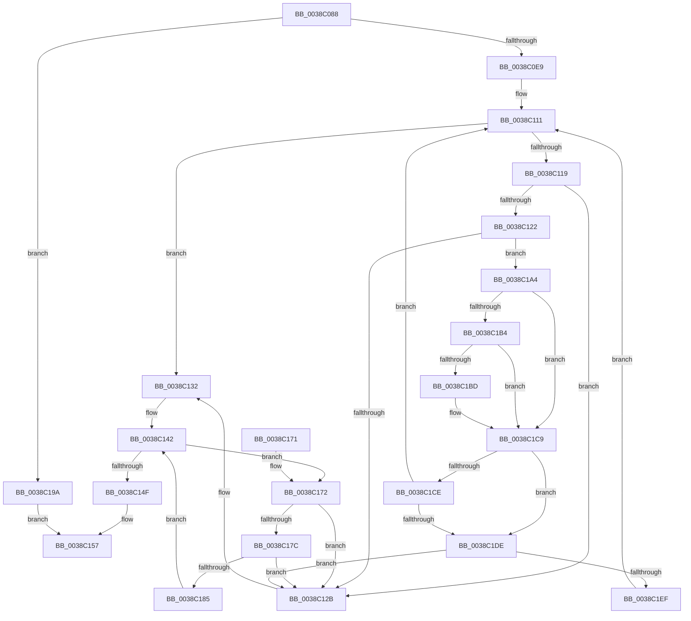

# CcDeleteMbcb

- RVA: `0x0038C088`–`0x0038C206` (길이 `382` bytes)
- VA: `0x000000014038C088`
- 실행 섹션: `.text`
- PDB 이름 있음: `예`; PDB Function 태그: `아니요`
- unwind 정보 RVA: `0x00080258`
- 디코드: `103`개 명령, `382/382` bytes 표시
- 미해석 바이트: `0` (있으면 어셈블리에 `.byte`로 보존)

> 이 문서는 커널 이미지의 기계어와 PDB 기호를 분석해 생성했습니다. 4번과 5번은 함수 원형과 자료형을 바이너리 사용 방식에서 추정한 C 해석이며 원본 소스 복구 결과는 아닙니다.

## 1. Dependencies

- 직접 호출 지점: **9**; 고유 호출 대상: **8**
- 직접 호출자로 확인된 함수: **2**
- RIP 상대 이미지 참조: **1**

### Outgoing calls
- `0x0038C0D4` → [ExAcquireFastMutex](../20/ExAcquireFastMutex_function_0020E5A0.md) (function, `0x0020E5A0`)
- `0x0038C0F4` → [KeAcquireInStackQueuedSpinLock](../27/KeAcquireInStackQueuedSpinLock_function_002757A0.md) (function, `0x002757A0`)
- `0x0038C0FF` → [CcDeductDirtyPages](CcDeductDirtyPages_function_0038C20C.md) (function, `0x0038C20C`)
- `0x0038C108` → [KeReleaseInStackQueuedSpinLock](../34/KeReleaseInStackQueuedSpinLock_function_00342CE0.md) (function, `0x00342CE0`)
- `0x0038C13D` → [ExReleaseFastMutex](../25/ExReleaseFastMutex_function_002519C0.md) (function, `0x002519C0`)
- `0x0038C152` → [CcDeallocateBcb](CcDeallocateBcb_function_0038BA24.md) (function, `0x0038BA24`)
- `0x0038C193` → [ExFreePoolWithTag](../../poolcode/B8/ExFreePoolWithTag_function_00B82870.md) (function, `0x00B82870`)
- `0x0038C19D` → [ExReleaseFastMutex](../25/ExReleaseFastMutex_function_002519C0.md) (function, `0x002519C0`)
- `0x0038C1C4` → [ExFreeToNPagedLookasideList](ExFreeToNPagedLookasideList_function_0038D9D0.md) (function, `0x0038D9D0`)

### Direct callers
- [CcSetFileSizesEx](../26/CcSetFileSizesEx_function_0026D070.md) at `0x0026D347`
- [CcDeleteSharedCacheMap](CcDeleteSharedCacheMap_function_0038A804.md) at `0x0038A9F6`

### Static image references
- `0x0038C1BD` → RVA `0x00E11A00` (`.data`; read)

## 2. Other-region calls and transfers

- 다른 실행 섹션으로 향하는 call: **1**
  - `0x0038C193` → [ExFreePoolWithTag](../../poolcode/B8/ExFreePoolWithTag_function_00B82870.md) (`.text` → `POOLCODE`)
- 별도 외부 분기/꼬리 이동을 확인하지 못했습니다.

## 3. Assembly (complete function range)

```asm
0038C088  48 89 5C 24 08                  mov qword ptr [rsp + 8], rbx
0038C08D  48 89 74 24 10                  mov qword ptr [rsp + 0x10], rsi
0038C092  48 89 7C 24 18                  mov qword ptr [rsp + 0x18], rdi
0038C097  55                              push rbp
0038C098  41 56                           push r14
0038C09A  41 57                           push r15
0038C09C  48 8B EC                        mov rbp, rsp
0038C09F  48 83 EC 50                     sub rsp, 0x50
0038C0A3  48 8B 99 18 02 00 00            mov rbx, qword ptr [rcx + 0x218]
0038C0AA  48 8D B1 20 01 00 00            lea rsi, [rcx + 0x120]
0038C0B1  33 C0                           xor eax, eax
0038C0B3  4C 8B F1                        mov r14, rcx
0038C0B6  48 89 45 F0                     mov qword ptr [rbp - 0x10], rax
0038C0BA  0F 57 C0                        xorps xmm0, xmm0
0038C0BD  48 8D 45 D0                     lea rax, [rbp - 0x30]
0038C0C1  48 8B CE                        mov rcx, rsi
0038C0C4  48 89 45 D8                     mov qword ptr [rbp - 0x28], rax
0038C0C8  48 8D 45 D0                     lea rax, [rbp - 0x30]
0038C0CC  48 89 45 D0                     mov qword ptr [rbp - 0x30], rax
0038C0D0  0F 11 45 E0                     movups xmmword ptr [rbp - 0x20], xmm0
0038C0D4  E8 C7 24 E8 FF                  call 0x14020e5a0
0038C0D9  49 8B BE A8 00 00 00            mov rdi, qword ptr [r14 + 0xa8]
0038C0E0  48 85 FF                        test rdi, rdi
0038C0E3  0F 84 B1 00 00 00               je 0x14038c19a
0038C0E9  48 8D 8B 00 03 00 00            lea rcx, [rbx + 0x300]
0038C0F0  48 8D 55 E0                     lea rdx, [rbp - 0x20]
0038C0F4  E8 A7 96 EE FF                  call 0x1402757a0
0038C0F9  8B 57 08                        mov edx, dword ptr [rdi + 8]
0038C0FC  49 8B CE                        mov rcx, r14
0038C0FF  E8 08 01 00 00                  call 0x14038c20c
0038C104  48 8D 4D E0                     lea rcx, [rbp - 0x20]
0038C108  E8 D3 6B FB FF                  call 0x140342ce0
0038C10D  4C 8D 7F 10                     lea r15, [rdi + 0x10]
0038C111  49 8B 1F                        mov rbx, qword ptr [r15]
0038C114  49 3B DF                        cmp rbx, r15
0038C117  74 19                           je 0x14038c132
0038C119  48 8B 03                        mov rax, qword ptr [rbx]
0038C11C  48 39 58 08                     cmp qword ptr [rax + 8], rbx
0038C120  75 09                           jne 0x14038c12b
0038C122  48 8B 4B 08                     mov rcx, qword ptr [rbx + 8]
0038C126  48 39 19                        cmp qword ptr [rcx], rbx
0038C129  74 79                           je 0x14038c1a4
0038C12B  B9 03 00 00 00                  mov ecx, 3
0038C130  CD 29                           int 0x29
0038C132  49 83 A6 A8 00 00 00 00         and qword ptr [r14 + 0xa8], 0
0038C13A  48 8B CE                        mov rcx, rsi
0038C13D  E8 7E 58 EC FF                  call 0x1402519c0
0038C142  48 8B 4D D0                     mov rcx, qword ptr [rbp - 0x30]
0038C146  48 8D 45 D0                     lea rax, [rbp - 0x30]
0038C14A  48 3B C8                        cmp rcx, rax
0038C14D  75 23                           jne 0x14038c172
0038C14F  48 8B CF                        mov rcx, rdi
0038C152  E8 CD F8 FF FF                  call 0x14038ba24
0038C157  4C 8D 5C 24 50                  lea r11, [rsp + 0x50]
0038C15C  49 8B 5B 20                     mov rbx, qword ptr [r11 + 0x20]
0038C160  49 8B 73 28                     mov rsi, qword ptr [r11 + 0x28]
0038C164  49 8B 7B 30                     mov rdi, qword ptr [r11 + 0x30]
0038C168  49 8B E3                        mov rsp, r11
0038C16B  41 5F                           pop r15
0038C16D  41 5E                           pop r14
0038C16F  5D                              pop rbp
0038C170  C3                              ret
0038C171  CC                              int3
0038C172  48 8D 45 D0                     lea rax, [rbp - 0x30]
0038C176  48 39 41 08                     cmp qword ptr [rcx + 8], rax
0038C17A  75 AF                           jne 0x14038c12b
0038C17C  48 8B 01                        mov rax, qword ptr [rcx]
0038C17F  48 39 48 08                     cmp qword ptr [rax + 8], rcx
0038C183  75 A6                           jne 0x14038c12b
0038C185  48 8D 55 D0                     lea rdx, [rbp - 0x30]
0038C189  48 89 45 D0                     mov qword ptr [rbp - 0x30], rax
0038C18D  48 89 50 08                     mov qword ptr [rax + 8], rdx
0038C191  33 D2                           xor edx, edx
0038C193  E8 D8 66 7F 00                  call 0x140b82870
0038C198  EB A8                           jmp 0x14038c142
0038C19A  48 8B CE                        mov rcx, rsi
0038C19D  E8 1E 58 EC FF                  call 0x1402519c0
0038C1A2  EB B3                           jmp 0x14038c157
0038C1A4  48 89 01                        mov qword ptr [rcx], rax
0038C1A7  48 89 48 08                     mov qword ptr [rax + 8], rcx
0038C1AB  48 8B 53 28                     mov rdx, qword ptr [rbx + 0x28]
0038C1AF  48 85 D2                        test rdx, rdx
0038C1B2  74 15                           je 0x14038c1c9
0038C1B4  48 8D 47 60                     lea rax, [rdi + 0x60]
0038C1B8  48 3B D0                        cmp rdx, rax
0038C1BB  74 0C                           je 0x14038c1c9
0038C1BD  48 8D 0D 3C 58 A8 00            lea rcx, [rip + 0xa8583c]
0038C1C4  E8 07 18 00 00                  call 0x14038d9d0
0038C1C9  48 3B DF                        cmp rbx, rdi
0038C1CC  72 10                           jb 0x14038c1de
0038C1CE  48 8D 87 C0 00 00 00            lea rax, [rdi + 0xc0]
0038C1D5  48 3B D8                        cmp rbx, rax
0038C1D8  0F 82 33 FF FF FF               jb 0x14038c111
0038C1DE  48 8B 45 D8                     mov rax, qword ptr [rbp - 0x28]
0038C1E2  48 8D 4D D0                     lea rcx, [rbp - 0x30]
0038C1E6  48 39 08                        cmp qword ptr [rax], rcx
0038C1E9  0F 85 3C FF FF FF               jne 0x14038c12b
0038C1EF  48 89 43 08                     mov qword ptr [rbx + 8], rax
0038C1F3  48 8D 4D D0                     lea rcx, [rbp - 0x30]
0038C1F7  48 89 0B                        mov qword ptr [rbx], rcx
0038C1FA  48 89 18                        mov qword ptr [rax], rbx
0038C1FD  48 89 5D D8                     mov qword ptr [rbp - 0x28], rbx
0038C201  E9 0B FF FF FF                  jmp 0x14038c111
```

## 4. C-style interpretation (structured pseudocode)

```c
__int64 __fastcall CcDeleteMbcb(__int64 a1)
{
    __int64 result;
    __int64 v_rsp;
    unsigned __int64 v_stack_m18;
    unsigned __int64 v_stack_m28;
    unsigned __int64 v_stack_m38;
    unsigned __int64 v_stack_m40;
    unsigned __int64 v_stack_m48;
    unsigned __int64 v_stack_p10;
    unsigned __int64 v_stack_p18;
    unsigned __int64 v_stack_p8;

    v_stack_p8 = v_rbx;
    v_stack_p10 = v_rsi;
    v_stack_p18 = v_rdi;
    v_rsp = (v_rsp) - (80);
    result = 0;
    v_stack_m28 = 0;
    v_stack_m40 = v_stack_m48;
    v_stack_m48 = v_stack_m48;
    v_stack_m38 = v_xmm0;
    result = ExAcquireFastMutex(a1 + 288, a2, a3, a4);
    if (*(unsigned __int64 *)(a1 + 168) == 0) goto loc_0038C19A;
    result = KeAcquireInStackQueuedSpinLock(*(unsigned __int64 *)(a1 + 536) + 768, v_stack_m38, a3, a4);
    result = CcDeductDirtyPages(a1, (unsigned int)(*(unsigned int *)(*(unsigned __int64 *)(a1 + 168) + 8)), a3, a4);
    result = KeReleaseInStackQueuedSpinLock(v_stack_m38, (unsigned int)(*(unsigned int *)(*(unsigned __int64 *)(a1 + 168) + 8)), a3, a4);
loc_0038C111:
    if ((*(unsigned __int64 *)(*(unsigned __int64 *)(a1 + 168) + 16)) == (*(unsigned __int64 *)(a1 + 168) + 16)) goto loc_0038C132;
    if ((*(unsigned __int64 *)(*(unsigned __int64 *)(*(unsigned __int64 *)(*(unsigned __int64 *)(a1 + 168) + 16)) + 8)) != (*(unsigned __int64 *)(*(unsigned __int64 *)(a1 + 168) + 16))) goto loc_0038C12B;
    if ((*(unsigned __int64 *)(*(unsigned __int64 *)(*(unsigned __int64 *)(*(unsigned __int64 *)(a1 + 168) + 16) + 8))) == (*(unsigned __int64 *)(*(unsigned __int64 *)(a1 + 168) + 16))) goto loc_0038C1A4;
loc_0038C12B:
loc_0038C132:
    result = ExReleaseFastMutex(a1 + 288, (unsigned int)(*(unsigned int *)(*(unsigned __int64 *)(a1 + 168) + 8)), a3, a4);
loc_0038C142:
    if (v_stack_m48 != v_stack_m48) goto loc_0038C172;
    result = CcDeallocateBcb(*(unsigned __int64 *)(a1 + 168), (unsigned int)(*(unsigned int *)(*(unsigned __int64 *)(a1 + 168) + 8)), a3, a4);
loc_0038C157:
    return result;
loc_0038C172:
    if ((*(unsigned __int64 *)(*(unsigned __int64 *)(a1 + 168) + 8)) != v_stack_m48) goto loc_0038C12B;
    if ((*(unsigned __int64 *)(*(unsigned __int64 *)(*(unsigned __int64 *)(a1 + 168)) + 8)) != (*(unsigned __int64 *)(a1 + 168))) goto loc_0038C12B;
    v_stack_m48 = *(unsigned __int64 *)(*(unsigned __int64 *)(a1 + 168));
    *(unsigned __int64 *)(*(unsigned __int64 *)(*(unsigned __int64 *)(a1 + 168)) + 8) = v_stack_m48;
    a2 = 0;
    result = ExFreePoolWithTag(*(unsigned __int64 *)(a1 + 168), a2, a3, a4);
    goto loc_0038C142;
loc_0038C19A:
    result = ExReleaseFastMutex(*(unsigned __int64 *)(v_stack_m18 + 40), a2, a3, a4);
    goto loc_0038C157;
loc_0038C1A4:
    *(unsigned __int64 *)(*(unsigned __int64 *)(v_stack_m18 + 40)) = result;
    *(unsigned __int64 *)(result + 8) = *(unsigned __int64 *)(v_stack_m18 + 40);
    if (*(unsigned __int64 *)(*(unsigned __int64 *)(v_stack_m18 + 32) + 40) == 0) goto loc_0038C1C9;
    result = *(unsigned __int64 *)(v_stack_m18 + 48) + 96;
    if ((*(unsigned __int64 *)(*(unsigned __int64 *)(v_stack_m18 + 32) + 40)) != (*(unsigned __int64 *)(v_stack_m18 + 48) + 96)) {
        a1 = v_rip + 11032636;
        result = ExFreeToNPagedLookasideList(a1, *(unsigned __int64 *)(*(unsigned __int64 *)(v_stack_m18 + 32) + 40), a3, a4);
    }
    if ((*(unsigned __int64 *)(v_stack_m18 + 32)) < (*(unsigned __int64 *)(v_stack_m18 + 48))) goto loc_0038C1DE;
    if ((*(unsigned __int64 *)(v_stack_m18 + 32)) < (*(unsigned __int64 *)(v_stack_m18 + 48) + 192)) goto loc_0038C111;
loc_0038C1DE:
    if ((*(unsigned __int64 *)(v_stack_m40)) != v_stack_m48) goto loc_0038C12B;
    *(unsigned __int64 *)(*(unsigned __int64 *)(v_stack_m18 + 32) + 8) = v_stack_m40;
    *(unsigned __int64 *)(*(unsigned __int64 *)(v_stack_m18 + 32)) = v_stack_m48;
    *(unsigned __int64 *)(v_stack_m40) = *(unsigned __int64 *)(v_stack_m18 + 32);
    v_stack_m40 = *(unsigned __int64 *)(v_stack_m18 + 32);
    goto loc_0038C111;
}
```

## 5. (Beta) C Style

```c
int64_t CcDeleteMbcb(void *Arg1)
{
    uint8_t *arg1 = (uint8_t *)Arg1;

    int64_t result;
    int64_t local_rsp;
    uint64_t v_stack_m18;
    uint64_t v_stack_m28;
    uint64_t v_stack_m38;
    uint64_t v_stack_m40;
    uint64_t v_stack_m48;
    uint64_t v_stack_p10;
    uint64_t v_stack_p18;
    uint64_t v_stack_p8;

    v_stack_p8 = local_rbx;
    v_stack_p10 = local_rsi;
    v_stack_p18 = local_rdi;
    local_rsp = (local_rsp) - (80);
    result = 0;
    v_stack_m28 = 0;
    v_stack_m40 = v_stack_m48;
    v_stack_m48 = v_stack_m48;
    v_stack_m38 = v_xmm0;
    result = ExAcquireFastMutex(Arg1 + 288, a2, a3, a4);
    if (*(uint64_t *)(arg1 + 0xA8) == 0) goto loc_0038C19A;
    result = KeAcquireInStackQueuedSpinLock(*(uint64_t *)(arg1 + 0x218) + 768, v_stack_m38, a3, a4);
    result = CcDeductDirtyPages(Arg1, (uint32_t)(*(uint32_t *)(*(uint64_t *)(arg1 + 0xA8) + 0x8)), a3, a4);
    result = KeReleaseInStackQueuedSpinLock(v_stack_m38, (uint32_t)(*(uint32_t *)(*(uint64_t *)(arg1 + 0xA8) + 0x8)), a3, a4);
loc_0038C111:
    if ((*(uint64_t *)(*(uint64_t *)(arg1 + 0xA8) + 0x10)) == (*(uint64_t *)(arg1 + 0xA8) + 16)) goto loc_0038C132;
    if ((*(uint64_t *)(*(uint64_t *)(*(uint64_t *)(*(uint64_t *)(arg1 + 0xA8) + 0x10)) + 0x8)) != (*(uint64_t *)(*(uint64_t *)(arg1 + 0xA8) + 0x10))) goto loc_0038C12B;
    if ((*(uint64_t *)(*(uint64_t *)(*(uint64_t *)(*(uint64_t *)(arg1 + 0xA8) + 0x10) + 0x8))) == (*(uint64_t *)(*(uint64_t *)(arg1 + 0xA8) + 0x10))) goto loc_0038C1A4;
loc_0038C12B:
loc_0038C132:
    result = ExReleaseFastMutex(Arg1 + 288, (uint32_t)(*(uint32_t *)(*(uint64_t *)(arg1 + 0xA8) + 0x8)), a3, a4);
loc_0038C142:
    if (v_stack_m48 != v_stack_m48) goto loc_0038C172;
    result = CcDeallocateBcb(*(uint64_t *)(arg1 + 0xA8), (uint32_t)(*(uint32_t *)(*(uint64_t *)(arg1 + 0xA8) + 0x8)), a3, a4);
loc_0038C157:
    return result;
loc_0038C172:
    if ((*(uint64_t *)(*(uint64_t *)(arg1 + 0xA8) + 0x8)) != v_stack_m48) goto loc_0038C12B;
    if ((*(uint64_t *)(*(uint64_t *)(*(uint64_t *)(arg1 + 0xA8)) + 0x8)) != (*(uint64_t *)(arg1 + 0xA8))) goto loc_0038C12B;
    v_stack_m48 = *(uint64_t *)(*(uint64_t *)(arg1 + 0xA8));
    *(uint64_t *)(*(uint64_t *)(*(uint64_t *)(arg1 + 0xA8)) + 0x8) = v_stack_m48;
    a2 = 0;
    result = ExFreePoolWithTag(*(uint64_t *)(arg1 + 0xA8), a2, a3, a4);
    goto loc_0038C142;
loc_0038C19A:
    result = ExReleaseFastMutex(*(uint64_t *)(v_stack_m18 + 0x28), a2, a3, a4);
    goto loc_0038C157;
loc_0038C1A4:
    *(uint64_t *)(*(uint64_t *)(v_stack_m18 + 0x28)) = result;
    *(uint64_t *)(result + 0x8) = *(uint64_t *)(v_stack_m18 + 0x28);
    if (*(uint64_t *)(*(uint64_t *)(v_stack_m18 + 0x20) + 0x28) == 0) goto loc_0038C1C9;
    result = *(uint64_t *)(v_stack_m18 + 0x30) + 96;
    if ((*(uint64_t *)(*(uint64_t *)(v_stack_m18 + 0x20) + 0x28)) != (*(uint64_t *)(v_stack_m18 + 0x30) + 96)) {
        Arg1 = v_rip + 11032636;
        result = ExFreeToNPagedLookasideList(Arg1, *(uint64_t *)(*(uint64_t *)(v_stack_m18 + 0x20) + 0x28), a3, a4);
    }
    if ((*(uint64_t *)(v_stack_m18 + 0x20)) < (*(uint64_t *)(v_stack_m18 + 0x30))) goto loc_0038C1DE;
    if ((*(uint64_t *)(v_stack_m18 + 0x20)) < (*(uint64_t *)(v_stack_m18 + 0x30) + 192)) goto loc_0038C111;
loc_0038C1DE:
    if ((*(uint64_t *)(v_stack_m40)) != v_stack_m48) goto loc_0038C12B;
    *(uint64_t *)(*(uint64_t *)(v_stack_m18 + 0x20) + 0x8) = v_stack_m40;
    *(uint64_t *)(*(uint64_t *)(v_stack_m18 + 0x20)) = v_stack_m48;
    *(uint64_t *)(v_stack_m40) = *(uint64_t *)(v_stack_m18 + 0x20);
    v_stack_m40 = *(uint64_t *)(v_stack_m18 + 0x20);
    goto loc_0038C111;
}
```

### 관측된 메모리 오프셋

구조체 형식이 확인되지 않은 접근은 인자 기준의 오프셋으로만 기록했습니다.

| 기준 인자 | 오프셋 표현 | 폭 (bit) | 접근 |
|---|---:|---:|---|
| `Arg1` | `+ 0xA8` | `64` | `R` |
| `Arg1` | `+ 0xA8` | `64` | `R/W` |
| `Arg1` | `+ 0x120` | `64` | `R` |
| `Arg1` | `+ 0x218` | `64` | `R` |

## 6. Execution-region graph

[열기: 2D/3D 그래프와 함수 탐색 컨트롤 패널](../../../control-panel.html?section=text&rva=0x0038C088&view=graph)

- 2D 그래프는 위에서 아래로 흐르고, 3D 그래프는 빈 공간을 드래그해 회전합니다. Shift+드래그는 이동, 휠은 확대·축소, 함수 노드 선택은 대상 보고서 이동입니다.

### Static fallback


