# CcDeleteSharedCacheMap

- RVA: `0x0038A804`–`0x0038AC5C` (길이 `1,112` bytes)
- VA: `0x000000014038A804`
- 실행 섹션: `.text`
- PDB 이름 있음: `예`; PDB Function 태그: `아니요`
- unwind 정보 RVA: `0x00080030`
- 디코드: `267`개 명령, `1,112/1,112` bytes 표시
- 미해석 바이트: `0` (있으면 어셈블리에 `.byte`로 보존)

> 이 문서는 커널 이미지의 기계어와 PDB 기호를 분석해 생성했습니다. 4번과 5번은 함수 원형과 자료형을 바이너리 사용 방식에서 추정한 C 해석이며 원본 소스 복구 결과는 아닙니다.

## 1. Dependencies

- 직접 호출 지점: **25**; 고유 호출 대상: **19**
- 직접 호출자로 확인된 함수: **4**
- RIP 상대 이미지 참조: **5**

### Outgoing calls
- `0x0038A85E` → [CcGetPrivateVolumeCacheMap](CcGetPrivateVolumeCacheMap_function_0038B930.md) (function, `0x0038B930`)
- `0x0038A86C` → [CcReferencePartitionAndPrivateVolumeCacheMap](CcReferencePartitionAndPrivateVolumeCacheMap_function_0038B9E0.md) (function, `0x0038B9E0`)
- `0x0038A969` → [KeReleaseInStackQueuedSpinLock](../34/KeReleaseInStackQueuedSpinLock_function_00342CE0.md) (function, `0x00342CE0`)
- `0x0038A976` → [KeReleaseInStackQueuedSpinLock](../34/KeReleaseInStackQueuedSpinLock_function_00342CE0.md) (function, `0x00342CE0`)
- `0x0038A987` → [CcDeleteBcbs](CcDeleteBcbs_function_00389BF0.md) (function, `0x00389BF0`)
- `0x0038A99A` → [CcUnmapAndPurge](CcUnmapAndPurge_function_0038ADF0.md) (function, `0x0038ADF0`)
- `0x0038A9AC` → [FsRtlReleaseFile](../../page/98/FsRtlReleaseFile_function_00985B70.md) (function, `0x00985B70`)
- `0x0038A9C2` → [ObFastDereferenceObjectDeferDelete](../23/ObFastDereferenceObjectDeferDelete_function_002378C0.md) (function, `0x002378C0`)
- `0x0038A9DC` → [ObfDereferenceObjectWithTag](../2F/ObfDereferenceObjectWithTag_function_002F78E0.md) (function, `0x002F78E0`)
- `0x0038A9F6` → [CcDeleteMbcb](CcDeleteMbcb_function_0038C088.md) (function, `0x0038C088`)
- `0x0038AA02` → [CcDecrementVolumeUseCountWithDelete](CcDecrementVolumeUseCountWithDelete_function_0038B888.md) (function, `0x0038B888`)
- `0x0038AA27` → [ObfDereferenceObjectWithTag](../2F/ObfDereferenceObjectWithTag_function_002F78E0.md) (function, `0x002F78E0`)
- `0x0038AA4B` → [KeAcquireInStackQueuedSpinLock](../27/KeAcquireInStackQueuedSpinLock_function_002757A0.md) (function, `0x002757A0`)
- `0x0038AA5A` → [KeReleaseInStackQueuedSpinLock](../34/KeReleaseInStackQueuedSpinLock_function_00342CE0.md) (function, `0x00342CE0`)
- `0x0038AA9B` → [CcDereferencePartitionAndPrivateVolumeCacheMap](CcDereferencePartitionAndPrivateVolumeCacheMap_function_0038B94C.md) (function, `0x0038B94C`)
- `0x0038AAA8` → [CcFreeSharedCacheMapIgnoreNull](CcFreeSharedCacheMapIgnoreNull_function_0038AC8C.md) (function, `0x0038AC8C`)
- `0x0038AB2C` → [DbgPrintEx](../35/DbgPrintEx_function_00359290.md) (function, `0x00359290`)
- `0x0038AB39` → [CcPostPVCMForDeleteToPartition](../4C/CcPostPVCMForDeleteToPartition_function_004C2DBC.md) (function, `0x004C2DBC`)
- `0x0038AB43` → [CcDecrementPrivateVolumeUseCount](CcDecrementPrivateVolumeUseCount_function_00389760.md) (function, `0x00389760`)
- `0x0038ABB8` → [KeSetEvent](../33/KeSetEvent_function_0033F310.md) (function, `0x0033F310`)
- `0x0038ABCD` → [ExFreePoolWithTag](../../poolcode/B8/ExFreePoolWithTag_function_00B82870.md) (function, `0x00B82870`)
- `0x0038ABE7` → [KeSetEvent](../33/KeSetEvent_function_0033F310.md) (function, `0x0033F310`)
- `0x0038AC1E` → [KeBugCheckEx](../4F/KeBugCheckEx_function_004FD660.md) (function, `0x004FD660`)
- `0x0038AC36` → [ExFreePoolWithTag](../../poolcode/B8/ExFreePoolWithTag_function_00B82870.md) (function, `0x00B82870`)
- `0x0038AC52` → [ExFreePoolWithTag](../../poolcode/B8/ExFreePoolWithTag_function_00B82870.md) (function, `0x00B82870`)

### Direct callers
- [CcWriteBehindPostProcess](../35/CcWriteBehindPostProcess_function_00357BB4.md) at `0x00357D42`
- [CcUninitializeCacheMap](../3C/CcUninitializeCacheMap_function_003CD520.md) at `0x003CD6B2`
- [CcDeleteSectionsForPartition](../57/CcDeleteSectionsForPartition_function_0057E0F8.md) at `0x0057E256`
- [sub_006E86B0](../6E/Unknown_function_006E86B0.md) at `0x006E8764`

### Static image references
- `0x0038A891` → RVA `0x00E65B88` (`.data`; read)
- `0x0038A94F` → RVA `0x00E65B40` (`.data`; read/write)
- `0x0038AA44` → RVA `0x00E11CC0` (`.data`; read)
- `0x0038AA50` → RVA `0x00E65B28` (`.data`; read/write)
- `0x0038AADD` → RVA `0x006C7B70` (` ?? ::FNODOBFM::`string'`; read)

## 2. Other-region calls and transfers

- 다른 실행 섹션으로 향하는 call: **4**
  - `0x0038A9AC` → [FsRtlReleaseFile](../../page/98/FsRtlReleaseFile_function_00985B70.md) (`.text` → `PAGE`)
  - `0x0038ABCD` → [ExFreePoolWithTag](../../poolcode/B8/ExFreePoolWithTag_function_00B82870.md) (`.text` → `POOLCODE`)
  - `0x0038AC36` → [ExFreePoolWithTag](../../poolcode/B8/ExFreePoolWithTag_function_00B82870.md) (`.text` → `POOLCODE`)
  - `0x0038AC52` → [ExFreePoolWithTag](../../poolcode/B8/ExFreePoolWithTag_function_00B82870.md) (`.text` → `POOLCODE`)
- 별도 외부 분기/꼬리 이동을 확인하지 못했습니다.

## 3. Assembly (complete function range)

```asm
0038A804  4C 8B DC                        mov r11, rsp
0038A807  49 89 5B 10                     mov qword ptr [r11 + 0x10], rbx
0038A80B  49 89 6B 18                     mov qword ptr [r11 + 0x18], rbp
0038A80F  49 89 73 20                     mov qword ptr [r11 + 0x20], rsi
0038A813  57                              push rdi
0038A814  41 54                           push r12
0038A816  41 55                           push r13
0038A818  41 56                           push r14
0038A81A  41 57                           push r15
0038A81C  48 81 EC 80 00 00 00            sub rsp, 0x80
0038A823  33 C0                           xor eax, eax
0038A825  0F 57 C0                        xorps xmm0, xmm0
0038A828  45 33 D2                        xor r10d, r10d
0038A82B  45 8B E1                        mov r12d, r9d
0038A82E  4C 8B 89 18 02 00 00            mov r9, qword ptr [rcx + 0x218]
0038A835  4D 8B F8                        mov r15, r8
0038A838  0F 11 44 24 50                  movups xmmword ptr [rsp + 0x50], xmm0
0038A83D  48 8B EA                        mov rbp, rdx
0038A840  48 8B F9                        mov rdi, rcx
0038A843  0F 11 44 24 60                  movups xmmword ptr [rsp + 0x60], xmm0
0038A848  49 89 43 C8                     mov qword ptr [r11 - 0x38], rax
0038A84C  45 8B EA                        mov r13d, r10d
0038A84F  89 44 24 78                     mov dword ptr [rsp + 0x78], eax
0038A853  45 8A F2                        mov r14b, r10b
0038A856  4C 89 8C 24 B0 00 00 00         mov qword ptr [rsp + 0xb0], r9
0038A85E  E8 CD 10 00 00                  call 0x14038b930
0038A863  48 8B D0                        mov rdx, rax
0038A866  49 8B C9                        mov rcx, r9
0038A869  48 8B F0                        mov rsi, rax
0038A86C  E8 6F 11 00 00                  call 0x14038b9e0
0038A871  48 8D 97 88 00 00 00            lea rdx, [rdi + 0x88]
0038A878  48 8B 0A                        mov rcx, qword ptr [rdx]
0038A87B  48 39 51 08                     cmp qword ptr [rcx + 8], rdx
0038A87F  75 09                           jne 0x14038a88a
0038A881  48 8B 42 08                     mov rax, qword ptr [rdx + 8]
0038A885  48 39 10                        cmp qword ptr [rax], rdx
0038A888  74 07                           je 0x14038a891
0038A88A  B9 03 00 00 00                  mov ecx, 3
0038A88F  CD 29                           int 0x29
0038A891  44 8A 05 F0 B2 AD 00            mov r8b, byte ptr [rip + 0xadb2f0]
0038A898  48 89 08                        mov qword ptr [rax], rcx
0038A89B  48 89 41 08                     mov qword ptr [rcx + 8], rax
0038A89F  45 84 C0                        test r8b, r8b
0038A8A2  74 2F                           je 0x14038a8d3
0038A8A4  48 8D 87 38 02 00 00            lea rax, [rdi + 0x238]
0038A8AB  48 8B 10                        mov rdx, qword ptr [rax]
0038A8AE  48 39 42 08                     cmp qword ptr [rdx + 8], rax
0038A8B2  75 D6                           jne 0x14038a88a
0038A8B4  48 8B 48 08                     mov rcx, qword ptr [rax + 8]
0038A8B8  48 39 01                        cmp qword ptr [rcx], rax
0038A8BB  75 CD                           jne 0x14038a88a
0038A8BD  48 89 11                        mov qword ptr [rcx], rdx
0038A8C0  48 89 4A 08                     mov qword ptr [rdx + 8], rcx
0038A8C4  44 8A B6 50 06 00 00            mov r14b, byte ptr [rsi + 0x650]
0038A8CB  41 C0 EE 03                     shr r14b, 3
0038A8CF  41 80 E6 01                     and r14b, 1
0038A8D3  F7 87 98 00 00 00 00 00 00 03   test dword ptr [rdi + 0x98], 0x3000000
0038A8DD  74 4A                           je 0x14038a929
0038A8DF  48 8D 47 78                     lea rax, [rdi + 0x78]
0038A8E3  48 8B 10                        mov rdx, qword ptr [rax]
0038A8E6  48 39 42 08                     cmp qword ptr [rdx + 8], rax
0038A8EA  75 9E                           jne 0x14038a88a
0038A8EC  48 8B 48 08                     mov rcx, qword ptr [rax + 8]
0038A8F0  48 39 01                        cmp qword ptr [rcx], rax
0038A8F3  75 95                           jne 0x14038a88a
0038A8F5  48 89 11                        mov qword ptr [rcx], rdx
0038A8F8  48 89 4A 08                     mov qword ptr [rdx + 8], rcx
0038A8FC  45 84 C0                        test r8b, r8b
0038A8FF  74 28                           je 0x14038a929
0038A901  48 8D 87 48 02 00 00            lea rax, [rdi + 0x248]
0038A908  48 8B 10                        mov rdx, qword ptr [rax]
0038A90B  48 39 42 08                     cmp qword ptr [rdx + 8], rax
0038A90F  0F 85 75 FF FF FF               jne 0x14038a88a
0038A915  48 8B 48 08                     mov rcx, qword ptr [rax + 8]
0038A919  48 39 01                        cmp qword ptr [rcx], rax
0038A91C  0F 85 68 FF FF FF               jne 0x14038a88a
0038A922  48 89 11                        mov qword ptr [rcx], rdx
0038A925  48 89 4A 08                     mov qword ptr [rdx + 8], rcx
0038A929  48 8D 5F 60                     lea rbx, [rdi + 0x60]
0038A92D  48 8B 03                        mov rax, qword ptr [rbx]
0038A930  48 83 E0 F0                     and rax, 0xfffffffffffffff0
0038A934  48 8B 40 28                     mov rax, qword ptr [rax + 0x28]
0038A938  4C 89 50 08                     mov qword ptr [rax + 8], r10
0038A93C  81 8F 98 00 00 00 20 00 08 00   or dword ptr [rdi + 0x98], 0x80020
0038A946  48 85 ED                        test rbp, rbp
0038A949  0F 84 AA 02 00 00               je 0x14038abf9
0038A94F  48 FF 05 EA B1 AD 00            inc qword ptr [rip + 0xadb1ea]
0038A956  48 8B 8F 58 02 00 00            mov rcx, qword ptr [rdi + 0x258]
0038A95D  48 85 C9                        test rcx, rcx
0038A960  0F 85 DD 01 00 00               jne 0x14038ab43
0038A966  49 8B CF                        mov rcx, r15
0038A969  E8 72 83 FB FF                  call 0x140342ce0
0038A96E  48 85 ED                        test rbp, rbp
0038A971  74 08                           je 0x14038a97b
0038A973  48 8B CD                        mov rcx, rbp
0038A976  E8 65 83 FB FF                  call 0x140342ce0
0038A97B  48 8D 47 10                     lea rax, [rdi + 0x10]
0038A97F  48 39 00                        cmp qword ptr [rax], rax
0038A982  74 08                           je 0x14038a98c
0038A984  48 8B CF                        mov rcx, rdi
0038A987  E8 64 F2 FF FF                  call 0x140389bf0
0038A98C  48 81 7F 08 00 00 10 00         cmp qword ptr [rdi + 8], 0x100000
0038A994  48 8B CF                        mov rcx, rdi
0038A997  0F 9D C2                        setge dl
0038A99A  E8 51 04 00 00                  call 0x14038adf0
0038A99F  45 85 E4                        test r12d, r12d
0038A9A2  74 23                           je 0x14038a9c7
0038A9A4  48 8B 8C 24 D0 00 00 00         mov rcx, qword ptr [rsp + 0xd0]
0038A9AC  E8 BF B1 5F 00                  call 0x140985b70
0038A9B1  48 8B 94 24 D0 00 00 00         mov rdx, qword ptr [rsp + 0xd0]
0038A9B9  41 B8 43 63 53 63               mov r8d, 0x63536343
0038A9BF  48 8B CB                        mov rcx, rbx
0038A9C2  E8 F9 CE EA FF                  call 0x1402378c0
0038A9C7  48 8B 8F B0 00 00 00            mov rcx, qword ptr [rdi + 0xb0]
0038A9CE  41 BF 44 66 6C 74               mov r15d, 0x746c6644
0038A9D4  48 85 C9                        test rcx, rcx
0038A9D7  74 10                           je 0x14038a9e9
0038A9D9  41 8B D7                        mov edx, r15d
0038A9DC  E8 FF CE F6 FF                  call 0x1402f78e0
0038A9E1  48 83 A7 B0 00 00 00 00         and qword ptr [rdi + 0xb0], 0
0038A9E9  48 83 BF A8 00 00 00 00         cmp qword ptr [rdi + 0xa8], 0
0038A9F1  74 08                           je 0x14038a9fb
0038A9F3  48 8B CF                        mov rcx, rdi
0038A9F6  E8 8D 16 00 00                  call 0x14038c088
0038A9FB  48 8B 8F 00 02 00 00            mov rcx, qword ptr [rdi + 0x200]
0038AA02  E8 81 0E 00 00                  call 0x14038b888
0038AA07  33 C0                           xor eax, eax
0038AA09  48 87 03                        xchg qword ptr [rbx], rax
0038AA0C  48 8B C8                        mov rcx, rax
0038AA0F  48 83 E1 F0                     and rcx, 0xfffffffffffffff0
0038AA13  74 0F                           je 0x14038aa24
0038AA15  83 E0 0F                        and eax, 0xf
0038AA18  76 0A                           jbe 0x14038aa24
0038AA1A  F7 D8                           neg eax
0038AA1C  4C 63 C0                        movsxd r8, eax
0038AA1F  F0 4C 01 41 D0                  lock add qword ptr [rcx - 0x30], r8
0038AA24  41 8B D7                        mov edx, r15d
0038AA27  E8 B4 CE F6 FF                  call 0x1402f78e0
0038AA2C  48 8B 8F 18 01 00 00            mov rcx, qword ptr [rdi + 0x118]
0038AA33  48 85 C9                        test rcx, rcx
0038AA36  0F 85 9B 01 00 00               jne 0x14038abd7
0038AA3C  48 85 ED                        test rbp, rbp
0038AA3F  74 1E                           je 0x14038aa5f
0038AA41  48 8B D5                        mov rdx, rbp
0038AA44  48 8D 0D 75 72 A8 00            lea rcx, [rip + 0xa87275]
0038AA4B  E8 50 AD EE FF                  call 0x1402757a0
0038AA50  48 FF 05 D1 B0 AD 00            inc qword ptr [rip + 0xadb0d1]
0038AA57  48 8B CD                        mov rcx, rbp
0038AA5A  E8 81 82 FB FF                  call 0x140342ce0
0038AA5F  48 8B 4F 58                     mov rcx, qword ptr [rdi + 0x58]
0038AA63  48 8D 47 38                     lea rax, [rdi + 0x38]
0038AA67  48 3B C8                        cmp rcx, rax
0038AA6A  0F 85 52 01 00 00               jne 0x14038abc2
0038AA70  48 8B 8F B8 00 00 00            mov rcx, qword ptr [rdi + 0xb8]
0038AA77  48 85 C9                        test rcx, rcx
0038AA7A  0F 85 A4 01 00 00               jne 0x14038ac24
0038AA80  48 8B 8F C0 00 00 00            mov rcx, qword ptr [rdi + 0xc0]
0038AA87  48 85 C9                        test rcx, rcx
0038AA8A  0F 85 B0 01 00 00               jne 0x14038ac40
0038AA90  48 8B 8C 24 B0 00 00 00         mov rcx, qword ptr [rsp + 0xb0]
0038AA98  48 8B D6                        mov rdx, rsi
0038AA9B  E8 AC 0E 00 00                  call 0x14038b94c
0038AAA0  48 85 F6                        test rsi, rsi
0038AAA3  75 2A                           jne 0x14038aacf
0038AAA5  48 8B CF                        mov rcx, rdi
0038AAA8  E8 DF 01 00 00                  call 0x14038ac8c
0038AAAD  4C 8D 9C 24 80 00 00 00         lea r11, [rsp + 0x80]
0038AAB5  49 8B 5B 38                     mov rbx, qword ptr [r11 + 0x38]
0038AAB9  49 8B 6B 40                     mov rbp, qword ptr [r11 + 0x40]
0038AABD  49 8B 73 48                     mov rsi, qword ptr [r11 + 0x48]
0038AAC1  49 8B E3                        mov rsp, r11
0038AAC4  41 5F                           pop r15
0038AAC6  41 5E                           pop r14
0038AAC8  41 5D                           pop r13
0038AACA  41 5C                           pop r12
0038AACC  5F                              pop rdi
0038AACD  C3                              ret
0038AACE  CC                              int3
0038AACF  45 85 ED                        test r13d, r13d
0038AAD2  75 D1                           jne 0x14038aaa5
0038AAD4  65 48 8B 14 25 88 01 00 00      mov rdx, qword ptr gs:[0x188]
0038AADD  4C 8D 05 8C D0 33 00            lea r8, [rip + 0x33d08c]
0038AAE4  65 4C 8B 0C 25 88 01 00 00      mov r9, qword ptr gs:[0x188]
0038AAED  48 8B 8F 00 02 00 00            mov rcx, qword ptr [rdi + 0x200]
0038AAF4  8B 46 18                        mov eax, dword ptr [rsi + 0x18]
0038AAF7  89 44 24 48                     mov dword ptr [rsp + 0x48], eax
0038AAFB  45 8B 89 08 05 00 00            mov r9d, dword ptr [r9 + 0x508]
0038AB02  8B 81 D4 00 00 00               mov eax, dword ptr [rcx + 0xd4]
0038AB08  48 89 74 24 40                  mov qword ptr [rsp + 0x40], rsi
0038AB0D  89 44 24 38                     mov dword ptr [rsp + 0x38], eax
0038AB11  8B 82 10 05 00 00               mov eax, dword ptr [rdx + 0x510]
0038AB17  41 8D 55 02                     lea edx, [r13 + 2]
0038AB1B  48 89 4C 24 30                  mov qword ptr [rsp + 0x30], rcx
0038AB20  8D 4A 7D                        lea ecx, [rdx + 0x7d]
0038AB23  48 89 7C 24 28                  mov qword ptr [rsp + 0x28], rdi
0038AB28  89 44 24 20                     mov dword ptr [rsp + 0x20], eax
0038AB2C  E8 5F E7 FC FF                  call 0x140359290
0038AB31  45 8A C6                        mov r8b, r14b
0038AB34  33 D2                           xor edx, edx
0038AB36  48 8B CE                        mov rcx, rsi
0038AB39  E8 7E 82 13 00                  call 0x1404c2dbc
0038AB3E  E9 62 FF FF FF                  jmp 0x14038aaa5
0038AB43  E8 18 EC FF FF                  call 0x140389760
0038AB48  44 8B E8                        mov r13d, eax
0038AB4B  85 C0                           test eax, eax
0038AB4D  0F 85 13 FE FF FF               jne 0x14038a966
0038AB53  48 8D 8E 50 02 00 00            lea rcx, [rsi + 0x250]
0038AB5A  4C 8B 01                        mov r8, qword ptr [rcx]
0038AB5D  49 39 48 08                     cmp qword ptr [r8 + 8], rcx
0038AB61  0F 85 23 FD FF FF               jne 0x14038a88a
0038AB67  48 8B 51 08                     mov rdx, qword ptr [rcx + 8]
0038AB6B  48 39 0A                        cmp qword ptr [rdx], rcx
0038AB6E  0F 85 16 FD FF FF               jne 0x14038a88a
0038AB74  4C 89 02                        mov qword ptr [rdx], r8
0038AB77  48 8D 86 40 02 00 00            lea rax, [rsi + 0x240]
0038AB7E  49 89 50 08                     mov qword ptr [r8 + 8], rdx
0038AB82  48 8B 10                        mov rdx, qword ptr [rax]
0038AB85  48 39 42 08                     cmp qword ptr [rdx + 8], rax
0038AB89  0F 85 FB FC FF FF               jne 0x14038a88a
0038AB8F  48 8B 48 08                     mov rcx, qword ptr [rax + 8]
0038AB93  48 39 01                        cmp qword ptr [rcx], rax
0038AB96  0F 85 EE FC FF FF               jne 0x14038a88a
0038AB9C  48 89 11                        mov qword ptr [rcx], rdx
0038AB9F  48 89 4A 08                     mov qword ptr [rdx + 8], rcx
0038ABA3  45 84 F6                        test r14b, r14b
0038ABA6  0F 85 BA FD FF FF               jne 0x14038a966
0038ABAC  48 8D 8E 98 04 00 00            lea rcx, [rsi + 0x498]
0038ABB3  45 33 C0                        xor r8d, r8d
0038ABB6  33 D2                           xor edx, edx
0038ABB8  E8 53 47 FB FF                  call 0x14033f310
0038ABBD  E9 A4 FD FF FF                  jmp 0x14038a966
0038ABC2  48 85 C9                        test rcx, rcx
0038ABC5  0F 84 A5 FE FF FF               je 0x14038aa70
0038ABCB  33 D2                           xor edx, edx
0038ABCD  E8 9E 7C 7F 00                  call 0x140b82870
0038ABD2  E9 99 FE FF FF                  jmp 0x14038aa70
0038ABD7  48 83 E1 FE                     and rcx, 0xfffffffffffffffe
0038ABDB  45 33 C0                        xor r8d, r8d
0038ABDE  33 D2                           xor edx, edx
0038ABE0  48 8B 19                        mov rbx, qword ptr [rcx]
0038ABE3  48 83 C1 08                     add rcx, 8
0038ABE7  E8 24 47 FB FF                  call 0x14033f310
0038ABEC  48 8B CB                        mov rcx, rbx
0038ABEF  48 85 DB                        test rbx, rbx
0038ABF2  75 E3                           jne 0x14038abd7
0038ABF4  E9 43 FE FF FF                  jmp 0x14038aa3c
0038ABF9  45 38 91 0E 05 00 00            cmp byte ptr [r9 + 0x50e], r10b
0038AC00  0F 85 50 FD FF FF               jne 0x14038a956
0038AC06  45 33 C9                        xor r9d, r9d
0038AC09  4C 89 54 24 20                  mov qword ptr [rsp + 0x20], r10
0038AC0E  BA CE 10 00 00                  mov edx, 0x10ce
0038AC13  49 C7 C0 20 04 00 C0            mov r8, 0xffffffffc0000420
0038AC1A  41 8D 49 34                     lea ecx, [r9 + 0x34]
0038AC1E  E8 3D 2A 17 00                  call 0x1404fd660
0038AC23  CC                              int3
0038AC24  48 8D 87 60 01 00 00            lea rax, [rdi + 0x160]
0038AC2B  48 3B C8                        cmp rcx, rax
0038AC2E  0F 84 4C FE FF FF               je 0x14038aa80
0038AC34  33 D2                           xor edx, edx
0038AC36  E8 35 7C 7F 00                  call 0x140b82870
0038AC3B  E9 40 FE FF FF                  jmp 0x14038aa80
0038AC40  48 8D 87 60 01 00 00            lea rax, [rdi + 0x160]
0038AC47  48 3B C8                        cmp rcx, rax
0038AC4A  0F 84 40 FE FF FF               je 0x14038aa90
0038AC50  33 D2                           xor edx, edx
0038AC52  E8 19 7C 7F 00                  call 0x140b82870
0038AC57  E9 34 FE FF FF                  jmp 0x14038aa90
```

## 4. C-style interpretation (structured pseudocode)

```c
__int64 __fastcall CcDeleteSharedCacheMap(__int64 a1, __int64 a2, __int64 a3, int a4, __int64 a5)
{
    __int64 result;
    __int64 v_r10;
    __int64 v_r14;
    __int64 v_rsp;
    unsigned __int64 v_stack_m28;
    unsigned int v_stack_m30;
    unsigned int v_stack_m38;
    unsigned __int64 v_stack_m40;
    unsigned __int64 v_stack_m48;
    unsigned __int64 v_stack_m50;
    unsigned __int64 v_stack_m58;
    unsigned int v_stack_m60;
    unsigned __int64 v_stack_p8;

    *(unsigned __int64 *)(v_rsp + 16) = v_rbx;
    *(unsigned __int64 *)(v_rsp + 24) = v_rbp;
    *(unsigned __int64 *)(v_rsp + 32) = v_rsi;
    v_rsp = (v_rsp) - (128);
    result = 0;
    v_r10 = 0;
    v_stack_m58 = v_xmm0;
    v_stack_m48 = v_xmm0;
    *(unsigned __int64 *)(v_rsp - 56) = 0;
    v_stack_m30 = 0;
    v_stack_p8 = *(unsigned __int64 *)(a1 + 536);
    result = CcGetPrivateVolumeCacheMap(a1, a2, a3, *(unsigned __int64 *)(a1 + 536));
    result = CcReferencePartitionAndPrivateVolumeCacheMap(*(unsigned __int64 *)(a1 + 536), result, a3, *(unsigned __int64 *)(a1 + 536));
    if ((*(unsigned __int64 *)(*(unsigned __int64 *)(a1 + 136) + 8)) != (a1 + 136)) goto loc_0038A88A;
    if ((*(unsigned __int64 *)(*(unsigned __int64 *)(a1 + 136 + 8))) != (a1 + 136)) {
        a1 = 3;
    }
    *(unsigned __int64 *)(*(unsigned __int64 *)(a1 + 136 + 8)) = a1;
    *(unsigned __int64 *)(a1 + 8) = *(unsigned __int64 *)(a1 + 136 + 8);
    if ((unsigned __int8)(*(unsigned __int8 *)(v_rip + 11383536)) == 0) goto loc_0038A8D3;
    if ((*(unsigned __int64 *)(*(unsigned __int64 *)(a1 + 568) + 8)) != (a1 + 568)) goto loc_0038A88A;
    if ((*(unsigned __int64 *)(*(unsigned __int64 *)(a1 + 568 + 8))) != (a1 + 568)) goto loc_0038A88A;
    *(unsigned __int64 *)(*(unsigned __int64 *)(a1 + 568 + 8)) = *(unsigned __int64 *)(a1 + 568);
    *(unsigned __int64 *)(*(unsigned __int64 *)(a1 + 568) + 8) = *(unsigned __int64 *)(a1 + 568 + 8);
    v_r14 = (unsigned __int8)((*(unsigned __int8 *)(result + 1616)) >> (3));
    v_r14 = (unsigned __int8)((v_r14) & (1));
loc_0038A8D3:
    if (((*(unsigned int *)(a1 + 152)) & (0x3000000ULL)) == 0) goto loc_0038A929;
    if ((*(unsigned __int64 *)(*(unsigned __int64 *)(a1 + 120) + 8)) != (a1 + 120)) goto loc_0038A88A;
    if ((*(unsigned __int64 *)(*(unsigned __int64 *)(a1 + 120 + 8))) != (a1 + 120)) goto loc_0038A88A;
    *(unsigned __int64 *)(*(unsigned __int64 *)(a1 + 120 + 8)) = *(unsigned __int64 *)(a1 + 120);
    *(unsigned __int64 *)(*(unsigned __int64 *)(a1 + 120) + 8) = *(unsigned __int64 *)(a1 + 120 + 8);
    if ((unsigned __int8)(*(unsigned __int8 *)(v_rip + 11383536)) == 0) goto loc_0038A929;
    if ((*(unsigned __int64 *)(*(unsigned __int64 *)(a1 + 584) + 8)) != (a1 + 584)) goto loc_0038A88A;
    if ((*(unsigned __int64 *)(*(unsigned __int64 *)(a1 + 584 + 8))) != (a1 + 584)) goto loc_0038A88A;
    *(unsigned __int64 *)(*(unsigned __int64 *)(a1 + 584 + 8)) = *(unsigned __int64 *)(a1 + 584);
    *(unsigned __int64 *)(*(unsigned __int64 *)(a1 + 584) + 8) = *(unsigned __int64 *)(a1 + 584 + 8);
loc_0038A929:
    result = (*(unsigned __int64 *)(a1 + 96)) & (-16);
    *(unsigned __int64 *)(*(unsigned __int64 *)(result + 40) + 8) = 0;
    if (a2 == 0) goto loc_0038ABF9;
loc_0038A956:
    if (*(unsigned __int64 *)(a1 + 600) != 0) goto loc_0038AB43;
loc_0038A966:
    result = KeReleaseInStackQueuedSpinLock(a3, *(unsigned __int64 *)(a1 + 584), *(unsigned __int8 *)(v_rip + 11383536), *(unsigned __int64 *)(a1 + 536));
    if (a2 != 0) {
        a1 = a2;
        result = KeReleaseInStackQueuedSpinLock(a1, *(unsigned __int64 *)(a1 + 584), *(unsigned __int8 *)(v_rip + 11383536), *(unsigned __int64 *)(a1 + 536));
    }
    result = a1 + 16;
    if ((*(unsigned __int64 *)(a1 + 16)) != (a1 + 16)) {
        a1 = a1;
        result = CcDeleteBcbs(a1, *(unsigned __int64 *)(a1 + 584), *(unsigned __int8 *)(v_rip + 11383536), *(unsigned __int64 *)(a1 + 536));
    }
    a2 = ((*(unsigned __int64 *)(a1 + 8)) >= 0x100000ULL) ? 1 : 0;
    result = CcUnmapAndPurge(a1, a2, *(unsigned __int8 *)(v_rip + 11383536), *(unsigned __int64 *)(a1 + 536));
    if ((unsigned int)((unsigned int)(a4)) != 0) {
        a1 = a5;
        result = FsRtlReleaseFile(a1, a2, *(unsigned __int8 *)(v_rip + 11383536), *(unsigned __int64 *)(a1 + 536));
        a2 = a5;
        a3 = 0x63536343ULL;
        a1 = a1 + 96;
        result = ObFastDereferenceObjectDeferDelete(a1, a2, a3, *(unsigned __int64 *)(a1 + 536));
    }
    if (*(unsigned __int64 *)(a1 + 176) != 0) {
        a2 = (unsigned int)((unsigned int)(0x746C6644ULL));
        result = ObfDereferenceObjectWithTag(*(unsigned __int64 *)(a1 + 176), a2, a3, *(unsigned __int64 *)(a1 + 536));
    }
    if ((*(unsigned __int64 *)(a1 + 168)) != 0) {
        a1 = a1;
        result = CcDeleteMbcb(a1, a2, a3, *(unsigned __int64 *)(a1 + 536));
    }
    result = CcDecrementVolumeUseCountWithDelete(*(unsigned __int64 *)(a1 + 512), a2, a3, *(unsigned __int64 *)(a1 + 536));
    result = 0;
    a1 = (0) & (-16);
    if (condition_is_equal) goto loc_0038AA24;
    result = (unsigned int)((result) & (15));
    if (!(condition_is_below_or_equal)) {
        result = (unsigned int)(-(result));
        a3 = (int)((unsigned int)(result));
    }
    result = ObfDereferenceObjectWithTag(a1, (unsigned int)((unsigned int)((unsigned int)(0x746C6644ULL))), a3, *(unsigned __int64 *)(a1 + 536));
    if (*(unsigned __int64 *)(a1 + 280) != 0) goto loc_0038ABD7;
loc_0038AA3C:
    if (a2 != 0) {
        a2 = a2;
        a1 = v_rip + 11039349;
        result = KeAcquireInStackQueuedSpinLock(a1, a2, a3, *(unsigned __int64 *)(a1 + 536));
        a1 = a2;
        result = KeReleaseInStackQueuedSpinLock(a1, a2, a3, *(unsigned __int64 *)(a1 + 536));
    }
    if ((*(unsigned __int64 *)(a1 + 88)) != (a1 + 56)) goto loc_0038ABC2;
loc_0038AA70:
    if (*(unsigned __int64 *)(a1 + 184) != 0) goto loc_0038AC24;
loc_0038AA80:
    if (*(unsigned __int64 *)(a1 + 192) != 0) goto loc_0038AC40;
loc_0038AA90:
    result = CcDereferencePartitionAndPrivateVolumeCacheMap(v_stack_p8, result, a3, *(unsigned __int64 *)(a1 + 536));
    if (result != 0) goto loc_0038AACF;
loc_0038AAA5:
    result = CcFreeSharedCacheMapIgnoreNull(a1, result, a3, *(unsigned __int64 *)(a1 + 536));
    return result;
loc_0038AACF:
    if (0 != 0) goto loc_0038AAA5;
    v_stack_m38 = (unsigned int)((unsigned int)(*(unsigned int *)(*(unsigned __int64 *)(v_stack_m28 + 72) + 24)));
    v_stack_m40 = *(unsigned __int64 *)(v_stack_m28 + 72);
    v_stack_m48 = (unsigned int)((unsigned int)(*(unsigned int *)(*(unsigned __int64 *)(a1 + 512) + 212)));
    v_stack_m50 = *(unsigned __int64 *)(a1 + 512);
    v_stack_m58 = a1;
    v_stack_m60 = (unsigned int)((unsigned int)(*(unsigned int *)(*(unsigned __int64 *)(gs_base + (0 + 392)) + 1296)));
    result = DbgPrintEx(0 + 2 + 125, 0 + 2, v_rip + 3395724, (unsigned int)(*(unsigned int *)(*(unsigned __int64 *)(gs_base + (0 + 392)) + 1288)));
    a2 = 0;
    result = CcPostPVCMForDeleteToPartition(*(unsigned __int64 *)(v_stack_m28 + 72), a2, (unsigned __int8)(v_r14), (unsigned int)(*(unsigned int *)(*(unsigned __int64 *)(gs_base + (0 + 392)) + 1288)));
    goto loc_0038AAA5;
loc_0038AB43:
    result = CcDecrementPrivateVolumeUseCount(*(unsigned __int64 *)(v_stack_m28 + 72), a2, (unsigned __int8)(v_r14), (unsigned int)(*(unsigned int *)(*(unsigned __int64 *)(gs_base + (0 + 392)) + 1288)));
    if ((unsigned int)(result) != 0) goto loc_0038A966;
    if ((*(unsigned __int64 *)(*(unsigned __int64 *)(*(unsigned __int64 *)(v_stack_m28 + 72) + 592) + 8)) != (*(unsigned __int64 *)(v_stack_m28 + 72) + 592)) goto loc_0038A88A;
    if ((*(unsigned __int64 *)(*(unsigned __int64 *)(*(unsigned __int64 *)(v_stack_m28 + 72) + 592 + 8))) != (*(unsigned __int64 *)(v_stack_m28 + 72) + 592)) goto loc_0038A88A;
    *(unsigned __int64 *)(*(unsigned __int64 *)(*(unsigned __int64 *)(v_stack_m28 + 72) + 592 + 8)) = *(unsigned __int64 *)(*(unsigned __int64 *)(v_stack_m28 + 72) + 592);
    *(unsigned __int64 *)(*(unsigned __int64 *)(*(unsigned __int64 *)(v_stack_m28 + 72) + 592) + 8) = *(unsigned __int64 *)(*(unsigned __int64 *)(v_stack_m28 + 72) + 592 + 8);
    if ((*(unsigned __int64 *)(*(unsigned __int64 *)(*(unsigned __int64 *)(v_stack_m28 + 72) + 576) + 8)) != (*(unsigned __int64 *)(v_stack_m28 + 72) + 576)) goto loc_0038A88A;
    if ((*(unsigned __int64 *)(*(unsigned __int64 *)(*(unsigned __int64 *)(v_stack_m28 + 72) + 576 + 8))) != (*(unsigned __int64 *)(v_stack_m28 + 72) + 576)) goto loc_0038A88A;
    *(unsigned __int64 *)(*(unsigned __int64 *)(*(unsigned __int64 *)(v_stack_m28 + 72) + 576 + 8)) = *(unsigned __int64 *)(*(unsigned __int64 *)(v_stack_m28 + 72) + 576);
    *(unsigned __int64 *)(*(unsigned __int64 *)(*(unsigned __int64 *)(v_stack_m28 + 72) + 576) + 8) = *(unsigned __int64 *)(*(unsigned __int64 *)(v_stack_m28 + 72) + 576 + 8);
    if ((unsigned __int8)(v_r14) != 0) goto loc_0038A966;
    a3 = 0;
    a2 = 0;
    result = KeSetEvent(*(unsigned __int64 *)(v_stack_m28 + 72) + 1176, a2, a3, (unsigned int)(*(unsigned int *)(*(unsigned __int64 *)(gs_base + (0 + 392)) + 1288)));
    goto loc_0038A966;
loc_0038ABC2:
    if (*(unsigned __int64 *)(v_stack_m28 + 72) + 1176 == 0) goto loc_0038AA70;
    a2 = 0;
    result = ExFreePoolWithTag(*(unsigned __int64 *)(v_stack_m28 + 72) + 1176, a2, a3, (unsigned int)(*(unsigned int *)(*(unsigned __int64 *)(gs_base + (0 + 392)) + 1288)));
    goto loc_0038AA70;
loc_0038ABD7:
    a1 = (*(unsigned __int64 *)(v_stack_m28 + 72) + 1176) & (-2);
    a3 = 0;
    a2 = 0;
    a1 = (a1) + (8);
    result = KeSetEvent(a1, a2, a3, (unsigned int)(*(unsigned int *)(*(unsigned __int64 *)(gs_base + (0 + 392)) + 1288)));
    if (*(unsigned __int64 *)(a1) != 0) goto loc_0038ABD7;
    goto loc_0038AA3C;
loc_0038ABF9:
    if ((*(unsigned __int8 *)((unsigned int)(*(unsigned int *)(*(unsigned __int64 *)(gs_base + (0 + 392)) + 1288)) + 1294)) != 0) goto loc_0038A956;
    a4 = 0;
    v_stack_m60 = 0;
    result = KeBugCheckEx(a4 + 52, (unsigned int)(0x10CEULL), 0xFFFFFFFFC0000420ULL, a4);
loc_0038AC24:
    if ((a4 + 52) == (a1 + 352)) goto loc_0038AA80;
    a2 = 0;
    result = ExFreePoolWithTag(a4 + 52, a2, 0xFFFFFFFFC0000420ULL, a4);
    goto loc_0038AA80;
loc_0038AC40:
    if ((a4 + 52) == (a1 + 352)) goto loc_0038AA90;
    a2 = 0;
    result = ExFreePoolWithTag(a4 + 52, a2, 0xFFFFFFFFC0000420ULL, a4);
    goto loc_0038AA90;
}
```

## 5. (Beta) C Style

```c
int64_t CcDeleteSharedCacheMap(void *Arg1, int64_t Arg2, int64_t Arg3, int32_t Arg4, int64_t Arg5)
{
    uint8_t *arg1 = (uint8_t *)Arg1;

    int64_t result;
    int64_t local_r10;
    int64_t local_r14;
    int64_t local_rsp;
    uint64_t v_stack_m28;
    uint32_t v_stack_m30;
    uint32_t v_stack_m38;
    uint64_t v_stack_m40;
    uint64_t v_stack_m48;
    uint64_t v_stack_m50;
    uint64_t v_stack_m58;
    uint32_t v_stack_m60;
    uint64_t v_stack_p8;

    *(uint64_t *)(local_rsp + 0x10) = local_rbx;
    *(uint64_t *)(local_rsp + 0x18) = local_rbp;
    *(uint64_t *)(local_rsp + 0x20) = local_rsi;
    local_rsp = (local_rsp) - (128);
    result = 0;
    local_r10 = 0;
    v_stack_m58 = v_xmm0;
    v_stack_m48 = v_xmm0;
    *(uint64_t *)(local_rsp - 0x38) = 0;
    v_stack_m30 = 0;
    v_stack_p8 = *(uint64_t *)(arg1 + 0x218);
    result = CcGetPrivateVolumeCacheMap(Arg1, Arg2, Arg3, *(uint64_t *)(arg1 + 0x218));
    result = CcReferencePartitionAndPrivateVolumeCacheMap(*(uint64_t *)(arg1 + 0x218), result, Arg3, *(uint64_t *)(arg1 + 0x218));
    if ((*(uint64_t *)(*(uint64_t *)(arg1 + 0x88) + 0x8)) != (Arg1 + 136)) goto loc_0038A88A;
    if ((*(uint64_t *)(*(uint64_t *)(arg1 + 0x88 + 0x8))) != (Arg1 + 136)) {
        Arg1 = 3;
    }
    *(void **)(*(uint64_t *)(arg1 + 0x88 + 0x8)) = Arg1;
    *(uint64_t *)(arg1 + 0x8) = *(uint64_t *)(arg1 + 0x88 + 0x8);
    if ((uint8_t)(*(uint8_t *)(v_rip + 0xADB2F0)) == 0) goto loc_0038A8D3;
    if ((*(uint64_t *)(*(uint64_t *)(arg1 + 0x238) + 0x8)) != (Arg1 + 568)) goto loc_0038A88A;
    if ((*(uint64_t *)(*(uint64_t *)(arg1 + 0x238 + 0x8))) != (Arg1 + 568)) goto loc_0038A88A;
    *(uint64_t *)(*(uint64_t *)(arg1 + 0x238 + 0x8)) = *(uint64_t *)(arg1 + 0x238);
    *(uint64_t *)(*(uint64_t *)(arg1 + 0x238) + 0x8) = *(uint64_t *)(arg1 + 0x238 + 0x8);
    local_r14 = (uint8_t)((*(uint8_t *)(result + 0x650)) >> (3));
    local_r14 = (uint8_t)((local_r14) & (1));
loc_0038A8D3:
    if (((*(uint32_t *)(arg1 + 0x98)) & (0x3000000ULL)) == 0) goto loc_0038A929;
    if ((*(uint64_t *)(*(uint64_t *)(arg1 + 0x78) + 0x8)) != (Arg1 + 120)) goto loc_0038A88A;
    if ((*(uint64_t *)(*(uint64_t *)(arg1 + 0x78 + 0x8))) != (Arg1 + 120)) goto loc_0038A88A;
    *(uint64_t *)(*(uint64_t *)(arg1 + 0x78 + 0x8)) = *(uint64_t *)(arg1 + 0x78);
    *(uint64_t *)(*(uint64_t *)(arg1 + 0x78) + 0x8) = *(uint64_t *)(arg1 + 0x78 + 0x8);
    if ((uint8_t)(*(uint8_t *)(v_rip + 0xADB2F0)) == 0) goto loc_0038A929;
    if ((*(uint64_t *)(*(uint64_t *)(arg1 + 0x248) + 0x8)) != (Arg1 + 584)) goto loc_0038A88A;
    if ((*(uint64_t *)(*(uint64_t *)(arg1 + 0x248 + 0x8))) != (Arg1 + 584)) goto loc_0038A88A;
    *(uint64_t *)(*(uint64_t *)(arg1 + 0x248 + 0x8)) = *(uint64_t *)(arg1 + 0x248);
    *(uint64_t *)(*(uint64_t *)(arg1 + 0x248) + 0x8) = *(uint64_t *)(arg1 + 0x248 + 0x8);
loc_0038A929:
    result = (*(uint64_t *)(arg1 + 0x60)) & (-16);
    *(uint64_t *)(*(uint64_t *)(result + 0x28) + 0x8) = 0;
    if (Arg2 == 0) goto loc_0038ABF9;
loc_0038A956:
    if (*(uint64_t *)(arg1 + 0x258) != 0) goto loc_0038AB43;
loc_0038A966:
    result = KeReleaseInStackQueuedSpinLock(Arg3, *(uint64_t *)(arg1 + 0x248), *(uint8_t *)(v_rip + 0xADB2F0), *(uint64_t *)(arg1 + 0x218));
    if (Arg2 != 0) {
        Arg1 = Arg2;
        result = KeReleaseInStackQueuedSpinLock(Arg1, *(uint64_t *)(arg1 + 0x248), *(uint8_t *)(v_rip + 0xADB2F0), *(uint64_t *)(arg1 + 0x218));
    }
    result = Arg1 + 16;
    if ((*(uint64_t *)(arg1 + 0x10)) != (Arg1 + 16)) {
        Arg1 = Arg1;
        result = CcDeleteBcbs(Arg1, *(uint64_t *)(arg1 + 0x248), *(uint8_t *)(v_rip + 0xADB2F0), *(uint64_t *)(arg1 + 0x218));
    }
    Arg2 = ((*(uint64_t *)(arg1 + 0x8)) >= 0x100000ULL) ? 1 : 0;
    result = CcUnmapAndPurge(Arg1, Arg2, *(uint8_t *)(v_rip + 0xADB2F0), *(uint64_t *)(arg1 + 0x218));
    if ((uint32_t)((uint32_t)(Arg4)) != 0) {
        Arg1 = Arg5;
        result = FsRtlReleaseFile(Arg1, Arg2, *(uint8_t *)(v_rip + 0xADB2F0), *(uint64_t *)(arg1 + 0x218));
        Arg2 = Arg5;
        Arg3 = 0x63536343ULL;
        Arg1 = Arg1 + 96;
        result = ObFastDereferenceObjectDeferDelete(Arg1, Arg2, Arg3, *(uint64_t *)(arg1 + 0x218));
    }
    if (*(uint64_t *)(arg1 + 0xB0) != 0) {
        Arg2 = (uint32_t)((uint32_t)(0x746C6644ULL));
        result = ObfDereferenceObjectWithTag(*(uint64_t *)(arg1 + 0xB0), Arg2, Arg3, *(uint64_t *)(arg1 + 0x218));
    }
    if ((*(uint64_t *)(arg1 + 0xA8)) != 0) {
        Arg1 = Arg1;
        result = CcDeleteMbcb(Arg1, Arg2, Arg3, *(uint64_t *)(arg1 + 0x218));
    }
    result = CcDecrementVolumeUseCountWithDelete(*(uint64_t *)(arg1 + 0x200), Arg2, Arg3, *(uint64_t *)(arg1 + 0x218));
    result = 0;
    Arg1 = (0) & (-16);
    if (condition_is_equal) goto loc_0038AA24;
    result = (uint32_t)((result) & (15));
    if (!(condition_is_below_or_equal)) {
        result = (uint32_t)(-(result));
        Arg3 = (int32_t)((uint32_t)(result));
    }
    result = ObfDereferenceObjectWithTag(Arg1, (uint32_t)((uint32_t)((uint32_t)(0x746C6644ULL))), Arg3, *(uint64_t *)(arg1 + 0x218));
    if (*(uint64_t *)(arg1 + 0x118) != 0) goto loc_0038ABD7;
loc_0038AA3C:
    if (Arg2 != 0) {
        Arg2 = Arg2;
        Arg1 = v_rip + 11039349;
        result = KeAcquireInStackQueuedSpinLock(Arg1, Arg2, Arg3, *(uint64_t *)(arg1 + 0x218));
        Arg1 = Arg2;
        result = KeReleaseInStackQueuedSpinLock(Arg1, Arg2, Arg3, *(uint64_t *)(arg1 + 0x218));
    }
    if ((*(uint64_t *)(arg1 + 0x58)) != (Arg1 + 56)) goto loc_0038ABC2;
loc_0038AA70:
    if (*(uint64_t *)(arg1 + 0xB8) != 0) goto loc_0038AC24;
loc_0038AA80:
    if (*(uint64_t *)(arg1 + 0xC0) != 0) goto loc_0038AC40;
loc_0038AA90:
    result = CcDereferencePartitionAndPrivateVolumeCacheMap(v_stack_p8, result, Arg3, *(uint64_t *)(arg1 + 0x218));
    if (result != 0) goto loc_0038AACF;
loc_0038AAA5:
    result = CcFreeSharedCacheMapIgnoreNull(Arg1, result, Arg3, *(uint64_t *)(arg1 + 0x218));
    return result;
loc_0038AACF:
    if (0 != 0) goto loc_0038AAA5;
    v_stack_m38 = (uint32_t)((uint32_t)(*(uint32_t *)(*(uint64_t *)(v_stack_m28 + 0x48) + 0x18)));
    v_stack_m40 = *(uint64_t *)(v_stack_m28 + 0x48);
    v_stack_m48 = (uint32_t)((uint32_t)(*(uint32_t *)(*(uint64_t *)(arg1 + 0x200) + 0xD4)));
    v_stack_m50 = *(uint64_t *)(arg1 + 0x200);
    v_stack_m58 = Arg1;
    v_stack_m60 = (uint32_t)((uint32_t)(*(uint32_t *)(*(uint64_t *)(gs_base + (0 + 0x188)) + 0x510)));
    result = DbgPrintEx(0 + 2 + 125, 0 + 2, v_rip + 3395724, (uint32_t)(*(uint32_t *)(*(uint64_t *)(gs_base + (0 + 0x188)) + 0x508)));
    Arg2 = 0;
    result = CcPostPVCMForDeleteToPartition(*(uint64_t *)(v_stack_m28 + 0x48), Arg2, (uint8_t)(local_r14), (uint32_t)(*(uint32_t *)(*(uint64_t *)(gs_base + (0 + 0x188)) + 0x508)));
    goto loc_0038AAA5;
loc_0038AB43:
    result = CcDecrementPrivateVolumeUseCount(*(uint64_t *)(v_stack_m28 + 0x48), Arg2, (uint8_t)(local_r14), (uint32_t)(*(uint32_t *)(*(uint64_t *)(gs_base + (0 + 0x188)) + 0x508)));
    if ((uint32_t)(result) != 0) goto loc_0038A966;
    if ((*(uint64_t *)(*(uint64_t *)(*(uint64_t *)(v_stack_m28 + 0x48) + 0x250) + 0x8)) != (*(uint64_t *)(v_stack_m28 + 0x48) + 592)) goto loc_0038A88A;
    if ((*(uint64_t *)(*(uint64_t *)(*(uint64_t *)(v_stack_m28 + 0x48) + 0x250 + 0x8))) != (*(uint64_t *)(v_stack_m28 + 0x48) + 592)) goto loc_0038A88A;
    *(uint64_t *)(*(uint64_t *)(*(uint64_t *)(v_stack_m28 + 0x48) + 0x250 + 0x8)) = *(uint64_t *)(*(uint64_t *)(v_stack_m28 + 0x48) + 0x250);
    *(uint64_t *)(*(uint64_t *)(*(uint64_t *)(v_stack_m28 + 0x48) + 0x250) + 0x8) = *(uint64_t *)(*(uint64_t *)(v_stack_m28 + 0x48) + 0x250 + 0x8);
    if ((*(uint64_t *)(*(uint64_t *)(*(uint64_t *)(v_stack_m28 + 0x48) + 0x240) + 0x8)) != (*(uint64_t *)(v_stack_m28 + 0x48) + 576)) goto loc_0038A88A;
    if ((*(uint64_t *)(*(uint64_t *)(*(uint64_t *)(v_stack_m28 + 0x48) + 0x240 + 0x8))) != (*(uint64_t *)(v_stack_m28 + 0x48) + 576)) goto loc_0038A88A;
    *(uint64_t *)(*(uint64_t *)(*(uint64_t *)(v_stack_m28 + 0x48) + 0x240 + 0x8)) = *(uint64_t *)(*(uint64_t *)(v_stack_m28 + 0x48) + 0x240);
    *(uint64_t *)(*(uint64_t *)(*(uint64_t *)(v_stack_m28 + 0x48) + 0x240) + 0x8) = *(uint64_t *)(*(uint64_t *)(v_stack_m28 + 0x48) + 0x240 + 0x8);
    if ((uint8_t)(local_r14) != 0) goto loc_0038A966;
    Arg3 = 0;
    Arg2 = 0;
    result = KeSetEvent(*(uint64_t *)(v_stack_m28 + 0x48) + 1176, Arg2, Arg3, (uint32_t)(*(uint32_t *)(*(uint64_t *)(gs_base + (0 + 0x188)) + 0x508)));
    goto loc_0038A966;
loc_0038ABC2:
    if (*(uint64_t *)(v_stack_m28 + 0x48) + 1176 == 0) goto loc_0038AA70;
    Arg2 = 0;
    result = ExFreePoolWithTag(*(uint64_t *)(v_stack_m28 + 0x48) + 1176, Arg2, Arg3, (uint32_t)(*(uint32_t *)(*(uint64_t *)(gs_base + (0 + 0x188)) + 0x508)));
    goto loc_0038AA70;
loc_0038ABD7:
    Arg1 = (*(uint64_t *)(v_stack_m28 + 0x48) + 1176) & (-2);
    Arg3 = 0;
    Arg2 = 0;
    Arg1 = (Arg1) + (8);
    result = KeSetEvent(Arg1, Arg2, Arg3, (uint32_t)(*(uint32_t *)(*(uint64_t *)(gs_base + (0 + 0x188)) + 0x508)));
    if (*(uint64_t *)(arg1) != 0) goto loc_0038ABD7;
    goto loc_0038AA3C;
loc_0038ABF9:
    if ((*(uint8_t *)((uint32_t)(*(uint32_t *)(*(uint64_t *)(gs_base + (0 + 0x188)) + 0x508)) + 0x50E)) != 0) goto loc_0038A956;
    Arg4 = 0;
    v_stack_m60 = 0;
    result = KeBugCheckEx(Arg4 + 52, (uint32_t)(0x10CEULL), 0xFFFFFFFFC0000420ULL, Arg4);
loc_0038AC24:
    if ((Arg4 + 52) == (Arg1 + 352)) goto loc_0038AA80;
    Arg2 = 0;
    result = ExFreePoolWithTag(Arg4 + 52, Arg2, 0xFFFFFFFFC0000420ULL, Arg4);
    goto loc_0038AA80;
loc_0038AC40:
    if ((Arg4 + 52) == (Arg1 + 352)) goto loc_0038AA90;
    Arg2 = 0;
    result = ExFreePoolWithTag(Arg4 + 52, Arg2, 0xFFFFFFFFC0000420ULL, Arg4);
    goto loc_0038AA90;
}
```

### 관측된 메모리 오프셋

구조체 형식이 확인되지 않은 접근은 인자 기준의 오프셋으로만 기록했습니다.

| 기준 인자 | 오프셋 표현 | 폭 (bit) | 접근 |
|---|---:|---:|---|
| `Arg1` | `+ 0x0` | `64` | `R` |
| `Arg1` | `+ 0x0` | `64` | `R/W` |
| `Arg1` | `+ 0x8` | `64` | `R` |
| `Arg1` | `+ 0x10` | `64` | `R` |
| `Arg1` | `+ 0x38` | `64` | `R` |
| `Arg1` | `+ 0x58` | `64` | `R` |
| `Arg1` | `+ 0x60` | `64` | `R` |
| `Arg1` | `+ 0x78` | `64` | `R` |
| `Arg1` | `+ 0x88` | `64` | `R` |
| `Arg1` | `+ 0x98` | `32` | `R` |
| `Arg1` | `+ 0x98` | `32` | `R/W` |
| `Arg1` | `+ 0xA8` | `64` | `R` |
| `Arg1` | `+ 0xB0` | `64` | `R` |
| `Arg1` | `+ 0xB0` | `64` | `R/W` |
| `Arg1` | `+ 0xB8` | `64` | `R` |
| `Arg1` | `+ 0xC0` | `64` | `R` |
| `Arg1` | `+ 0x118` | `64` | `R` |
| `Arg1` | `+ 0x160` | `64` | `R` |
| `Arg1` | `+ 0x200` | `64` | `R` |
| `Arg1` | `+ 0x218` | `64` | `R` |
| `Arg1` | `+ 0x238` | `64` | `R` |
| `Arg1` | `+ 0x248` | `64` | `R` |
| `Arg1` | `+ 0x258` | `64` | `R` |

## 6. Execution-region graph

[열기: 2D/3D 그래프와 함수 탐색 컨트롤 패널](../../../control-panel.html?section=text&rva=0x0038A804&view=graph)

- 2D 그래프는 위에서 아래로 흐르고, 3D 그래프는 빈 공간을 드래그해 회전합니다. Shift+드래그는 이동, 휠은 확대·축소, 함수 노드 선택은 대상 보고서 이동입니다.

### Static fallback

```mermaid
flowchart TD
  bb_0038A804[BB_0038A804]
  bb_0038A881[BB_0038A881]
  bb_0038A88A[BB_0038A88A]
  bb_0038A891[BB_0038A891]
  bb_0038A8A4[BB_0038A8A4]
  bb_0038A8B4[BB_0038A8B4]
  bb_0038A8BD[BB_0038A8BD]
  bb_0038A8D3[BB_0038A8D3]
  bb_0038A8DF[BB_0038A8DF]
  bb_0038A8EC[BB_0038A8EC]
  bb_0038A8F5[BB_0038A8F5]
  bb_0038A901[BB_0038A901]
  bb_0038A915[BB_0038A915]
  bb_0038A922[BB_0038A922]
  bb_0038A929[BB_0038A929]
  bb_0038A94F[BB_0038A94F]
  bb_0038A956[BB_0038A956]
  bb_0038A966[BB_0038A966]
  bb_0038A973[BB_0038A973]
  bb_0038A97B[BB_0038A97B]
  bb_0038A984[BB_0038A984]
  bb_0038A98C[BB_0038A98C]
  bb_0038A9A4[BB_0038A9A4]
  bb_0038A9C7[BB_0038A9C7]
  bb_0038A9D9[BB_0038A9D9]
  bb_0038A9E9[BB_0038A9E9]
  bb_0038A9F3[BB_0038A9F3]
  bb_0038A9FB[BB_0038A9FB]
  bb_0038AA15[BB_0038AA15]
  bb_0038AA1A[BB_0038AA1A]
  bb_0038AA24[BB_0038AA24]
  bb_0038AA3C[BB_0038AA3C]
  bb_0038AA41[BB_0038AA41]
  bb_0038AA5F[BB_0038AA5F]
  bb_0038AA70[BB_0038AA70]
  bb_0038AA80[BB_0038AA80]
  bb_0038AA90[BB_0038AA90]
  bb_0038AAA5[BB_0038AAA5]
  bb_0038AACE[BB_0038AACE]
  bb_0038AACF[BB_0038AACF]
  bb_0038AAD4[BB_0038AAD4]
  bb_0038AB43[BB_0038AB43]
  bb_0038AB53[BB_0038AB53]
  bb_0038AB67[BB_0038AB67]
  bb_0038AB74[BB_0038AB74]
  bb_0038AB8F[BB_0038AB8F]
  bb_0038AB9C[BB_0038AB9C]
  bb_0038ABAC[BB_0038ABAC]
  bb_0038ABC2[BB_0038ABC2]
  bb_0038ABCB[BB_0038ABCB]
  bb_0038ABD7[BB_0038ABD7]
  bb_0038ABF4[BB_0038ABF4]
  bb_0038ABF9[BB_0038ABF9]
  bb_0038AC06[BB_0038AC06]
  bb_0038AC24[BB_0038AC24]
  bb_0038AC34[BB_0038AC34]
  bb_0038AC40[BB_0038AC40]
  bb_0038AC50[BB_0038AC50]
  bb_0038A804 -->|branch| bb_0038A88A
  bb_0038A804 -->|fallthrough| bb_0038A881
  bb_0038A881 -->|branch| bb_0038A891
  bb_0038A881 -->|fallthrough| bb_0038A88A
  bb_0038A88A -->|flow| bb_0038A891
  bb_0038A891 -->|branch| bb_0038A8D3
  bb_0038A891 -->|fallthrough| bb_0038A8A4
  bb_0038A8A4 -->|branch| bb_0038A88A
  bb_0038A8A4 -->|fallthrough| bb_0038A8B4
  bb_0038A8B4 -->|branch| bb_0038A88A
  bb_0038A8B4 -->|fallthrough| bb_0038A8BD
  bb_0038A8BD -->|flow| bb_0038A8D3
  bb_0038A8D3 -->|branch| bb_0038A929
  bb_0038A8D3 -->|fallthrough| bb_0038A8DF
  bb_0038A8DF -->|branch| bb_0038A88A
  bb_0038A8DF -->|fallthrough| bb_0038A8EC
  bb_0038A8EC -->|branch| bb_0038A88A
  bb_0038A8EC -->|fallthrough| bb_0038A8F5
  bb_0038A8F5 -->|branch| bb_0038A929
  bb_0038A8F5 -->|fallthrough| bb_0038A901
  bb_0038A901 -->|branch| bb_0038A88A
  bb_0038A901 -->|fallthrough| bb_0038A915
  bb_0038A915 -->|branch| bb_0038A88A
  bb_0038A915 -->|fallthrough| bb_0038A922
  bb_0038A922 -->|flow| bb_0038A929
  bb_0038A929 -->|branch| bb_0038ABF9
  bb_0038A929 -->|fallthrough| bb_0038A94F
  bb_0038A94F -->|flow| bb_0038A956
  bb_0038A956 -->|branch| bb_0038AB43
  bb_0038A956 -->|fallthrough| bb_0038A966
  bb_0038A966 -->|branch| bb_0038A97B
  bb_0038A966 -->|fallthrough| bb_0038A973
  bb_0038A973 -->|flow| bb_0038A97B
  bb_0038A97B -->|branch| bb_0038A98C
  bb_0038A97B -->|fallthrough| bb_0038A984
  bb_0038A984 -->|flow| bb_0038A98C
  bb_0038A98C -->|branch| bb_0038A9C7
  bb_0038A98C -->|fallthrough| bb_0038A9A4
  bb_0038A9A4 -->|flow| bb_0038A9C7
  bb_0038A9C7 -->|branch| bb_0038A9E9
  bb_0038A9C7 -->|fallthrough| bb_0038A9D9
  bb_0038A9D9 -->|flow| bb_0038A9E9
  bb_0038A9E9 -->|branch| bb_0038A9FB
  bb_0038A9E9 -->|fallthrough| bb_0038A9F3
  bb_0038A9F3 -->|flow| bb_0038A9FB
  bb_0038A9FB -->|branch| bb_0038AA24
  bb_0038A9FB -->|fallthrough| bb_0038AA15
  bb_0038AA15 -->|branch| bb_0038AA24
  bb_0038AA15 -->|fallthrough| bb_0038AA1A
  bb_0038AA1A -->|flow| bb_0038AA24
  bb_0038AA24 -->|branch| bb_0038ABD7
  bb_0038AA24 -->|fallthrough| bb_0038AA3C
  bb_0038AA3C -->|branch| bb_0038AA5F
  bb_0038AA3C -->|fallthrough| bb_0038AA41
  bb_0038AA41 -->|flow| bb_0038AA5F
  bb_0038AA5F -->|branch| bb_0038ABC2
  bb_0038AA5F -->|fallthrough| bb_0038AA70
  bb_0038AA70 -->|branch| bb_0038AC24
  bb_0038AA70 -->|fallthrough| bb_0038AA80
  bb_0038AA80 -->|branch| bb_0038AC40
  bb_0038AA80 -->|fallthrough| bb_0038AA90
  bb_0038AA90 -->|branch| bb_0038AACF
  bb_0038AA90 -->|fallthrough| bb_0038AAA5
  bb_0038AACE -->|flow| bb_0038AACF
  bb_0038AACF -->|branch| bb_0038AAA5
  bb_0038AACF -->|fallthrough| bb_0038AAD4
  bb_0038AAD4 -->|branch| bb_0038AAA5
  bb_0038AB43 -->|branch| bb_0038A966
  bb_0038AB43 -->|fallthrough| bb_0038AB53
  bb_0038AB53 -->|branch| bb_0038A88A
  bb_0038AB53 -->|fallthrough| bb_0038AB67
  bb_0038AB67 -->|branch| bb_0038A88A
  bb_0038AB67 -->|fallthrough| bb_0038AB74
  bb_0038AB74 -->|branch| bb_0038A88A
  bb_0038AB74 -->|fallthrough| bb_0038AB8F
  bb_0038AB8F -->|branch| bb_0038A88A
  bb_0038AB8F -->|fallthrough| bb_0038AB9C
  bb_0038AB9C -->|branch| bb_0038A966
  bb_0038AB9C -->|fallthrough| bb_0038ABAC
  bb_0038ABAC -->|branch| bb_0038A966
  bb_0038ABC2 -->|branch| bb_0038AA70
  bb_0038ABC2 -->|fallthrough| bb_0038ABCB
  bb_0038ABCB -->|branch| bb_0038AA70
  bb_0038ABD7 -->|branch| bb_0038ABD7
  bb_0038ABD7 -->|fallthrough| bb_0038ABF4
  bb_0038ABF4 -->|branch| bb_0038AA3C
  bb_0038ABF9 -->|branch| bb_0038A956
  bb_0038ABF9 -->|fallthrough| bb_0038AC06
  bb_0038AC06 -->|flow| bb_0038AC24
  bb_0038AC24 -->|branch| bb_0038AA80
  bb_0038AC24 -->|fallthrough| bb_0038AC34
  bb_0038AC34 -->|branch| bb_0038AA80
  bb_0038AC40 -->|branch| bb_0038AA90
  bb_0038AC40 -->|fallthrough| bb_0038AC50
  bb_0038AC50 -->|branch| bb_0038AA90
```


