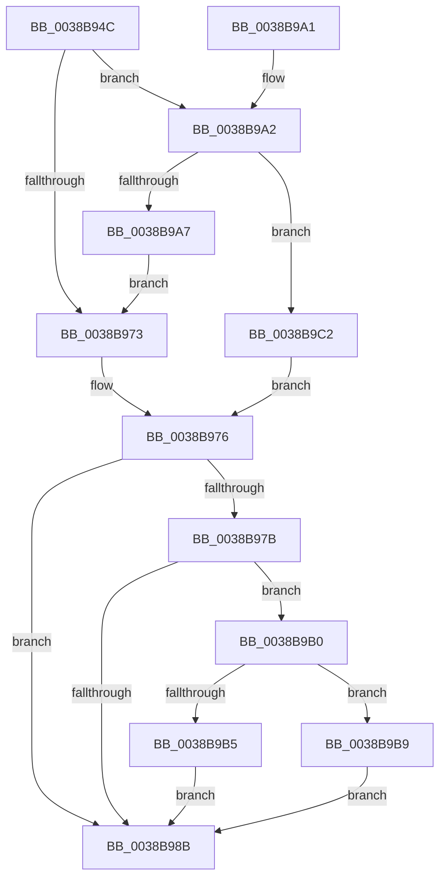

# CcDereferencePartitionAndPrivateVolumeCacheMap

- RVA: `0x0038B94C`–`0x0038B9D8` (길이 `140` bytes)
- VA: `0x000000014038B94C`
- 실행 섹션: `.text`
- PDB 이름 있음: `예`; PDB Function 태그: `아니요`
- unwind 정보 RVA: `0x00078384`
- 디코드: `43`개 명령, `140/140` bytes 표시
- 미해석 바이트: `0` (있으면 어셈블리에 `.byte`로 보존)

> 이 문서는 커널 이미지의 기계어와 PDB 기호를 분석해 생성했습니다. 4번과 5번은 함수 원형과 자료형을 바이너리 사용 방식에서 추정한 C 해석이며 원본 소스 복구 결과는 아닙니다.

## 1. Dependencies

- 직접 호출 지점: **1**; 고유 호출 대상: **1**
- 직접 호출자로 확인된 함수: **16**
- RIP 상대 이미지 참조: **0**

### Outgoing calls
- `0x0038B9D1` → [KeSetEvent](../33/KeSetEvent_function_0033F310.md) (function, `0x0033F310`)

### Direct callers
- [CcCachemapUninitWorkerThread](../35/CcCachemapUninitWorkerThread_function_003569D0.md) at `0x00356BBD`
- [CcPostDeferredWrites](../35/CcPostDeferredWrites_function_003590FC.md) at `0x00359203`
- [CcCanIWrite](CcCanIWrite_function_00388250.md) at `0x0038845C`
- [CcDeleteSharedCacheMap](CcDeleteSharedCacheMap_function_0038A804.md) at `0x0038AA9B`
- [CcUninitializeCacheMap](../3C/CcUninitializeCacheMap_function_003CD520.md) at `0x003CD6E8`
- [CcDeletePrivateVolumeCacheMap](../3C/CcDeletePrivateVolumeCacheMap_function_003CE950.md) at `0x003CEA60`
- [CcCompleteAsyncReadWorker](../45/CcCompleteAsyncReadWorker_function_0045D9C0.md) at `0x0045DADA`
- [CcAsyncReadWorker](../45/CcAsyncReadWorker_function_0045DB10.md) at `0x0045E150`
- [CcWorkerThread](../48/CcWorkerThread_function_0048F0F0.md) at `0x0048F534`
- [CcInitializeAsyncReadForNodeHelper](../49/CcInitializeAsyncReadForNodeHelper_function_00498CD0.md) at `0x004990DC`
- [CcAsyncLazywriteWorkerThread](../4B/CcAsyncLazywriteWorkerThread_function_004B2130.md) at `0x004B221A`
- [CcQuickLazyWriteScanForVolume](../4B/CcQuickLazyWriteScanForVolume_function_004BFEE0.md) at `0x004BFF7D`
- [CcRemoveExternalCache](../57/CcRemoveExternalCache_function_0057C228.md) at `0x0057C285`
- [CcRemoveExternalCacheEx](../57/CcRemoveExternalCacheEx_function_0057C2D4.md) at `0x0057C331`
- [CcAsyncReadWorkerThread](../57/CcAsyncReadWorkerThread_function_0057F560.md) at `0x0057F683`
- [CcCompleteAsyncLazywriteWorkerThread](../57/CcCompleteAsyncLazywriteWorkerThread_function_0057F770.md) at `0x0057F7FD`

### Static image references
- 디코드된 RIP-relative 메모리 참조가 없습니다.

## 2. Other-region calls and transfers

- 다른 실행 섹션으로 향하는 call: **0**
- 별도 외부 분기/꼬리 이동을 확인하지 못했습니다.

## 3. Assembly (complete function range)

```asm
0038B94C  48 89 5C 24 08                  mov qword ptr [rsp + 8], rbx
0038B951  48 89 74 24 10                  mov qword ptr [rsp + 0x10], rsi
0038B956  57                              push rdi
0038B957  48 83 EC 20                     sub rsp, 0x20
0038B95B  48 8B F2                        mov rsi, rdx
0038B95E  48 83 C8 FF                     or rax, 0xffffffffffffffff
0038B962  F0 48 0F C1 81 10 05 00 00      lock xadd qword ptr [rcx + 0x510], rax
0038B96B  33 DB                           xor ebx, ebx
0038B96D  48 83 E8 01                     sub rax, 1
0038B971  7E 2F                           jle 0x14038b9a2
0038B973  40 8A FB                        mov dil, bl
0038B976  48 85 F6                        test rsi, rsi
0038B979  74 10                           je 0x14038b98b
0038B97B  48 83 C8 FF                     or rax, 0xffffffffffffffff
0038B97F  F0 48 0F C1 46 08               lock xadd qword ptr [rsi + 8], rax
0038B985  48 83 E8 01                     sub rax, 1
0038B989  7E 25                           jle 0x14038b9b0
0038B98B  48 8B 74 24 38                  mov rsi, qword ptr [rsp + 0x38]
0038B990  40 22 FB                        and dil, bl
0038B993  48 8B 5C 24 30                  mov rbx, qword ptr [rsp + 0x30]
0038B998  40 8A C7                        mov al, dil
0038B99B  48 83 C4 20                     add rsp, 0x20
0038B99F  5F                              pop rdi
0038B9A0  C3                              ret
0038B9A1  CC                              int3
0038B9A2  48 85 C0                        test rax, rax
0038B9A5  74 1B                           je 0x14038b9c2
0038B9A7  B9 0E 00 00 00                  mov ecx, 0xe
0038B9AC  CD 29                           int 0x29
0038B9AE  EB C3                           jmp 0x14038b973
0038B9B0  48 85 C0                        test rax, rax
0038B9B3  75 04                           jne 0x14038b9b9
0038B9B5  B3 01                           mov bl, 1
0038B9B7  EB D2                           jmp 0x14038b98b
0038B9B9  B9 0E 00 00 00                  mov ecx, 0xe
0038B9BE  CD 29                           int 0x29
0038B9C0  EB C9                           jmp 0x14038b98b
0038B9C2  48 81 C1 30 05 00 00            add rcx, 0x530
0038B9C9  45 33 C0                        xor r8d, r8d
0038B9CC  33 D2                           xor edx, edx
0038B9CE  40 B7 01                        mov dil, 1
0038B9D1  E8 3A 39 FB FF                  call 0x14033f310
0038B9D6  EB 9E                           jmp 0x14038b976
```

## 4. C-style interpretation (structured pseudocode)

```c
__int64 __fastcall CcDereferencePartitionAndPrivateVolumeCacheMap(__int64 a1, __int64 a2, int a3)
{
    __int64 result;
    __int64 v_rbx;
    __int64 v_rdi;
    __int64 v_rsp;
    unsigned __int64 v_stack_p10;
    unsigned __int64 v_stack_p8;

    v_stack_p8 = v_rbx;
    v_stack_p10 = v_rsi;
    v_rsp = (v_rsp) - (32);
    result = (result) | (-1);
    v_rbx = 0;
    result = (result) - (1);
    if (condition_is_less_or_equal) goto loc_0038B9A2;
loc_0038B973:
loc_0038B976:
    if (a2 == 0) goto loc_0038B98B;
    result = (result) | (-1);
    result = (result) - (1);
    if (condition_is_less_or_equal) goto loc_0038B9B0;
loc_0038B98B:
    v_rdi = (unsigned __int8)((0) & (0));
    v_rsp = (v_rsp) + (32);
    return (unsigned __int8)(v_rdi);
loc_0038B9A2:
    if ((unsigned __int8)(v_rdi) == 0) goto loc_0038B9C2;
    goto loc_0038B973;
loc_0038B9B0:
    if ((unsigned __int8)(v_rdi) != 0) goto loc_0038B9B9;
    goto loc_0038B98B;
loc_0038B9B9:
    goto loc_0038B98B;
loc_0038B9C2:
    a1 = (14) + (0x530ULL);
    a3 = 0;
    a2 = 0;
    result = KeSetEvent(a1, a2, a3, a4);
    goto loc_0038B976;
}
```

## 5. (Beta) C Style

```c
int64_t CcDereferencePartitionAndPrivateVolumeCacheMap(void *Arg1, int64_t Arg2, int32_t Arg3)
{
    uint8_t *arg1 = (uint8_t *)Arg1;

    int64_t result;
    int64_t local_rbx;
    int64_t local_rdi;
    int64_t local_rsp;
    uint64_t v_stack_p10;
    uint64_t v_stack_p8;

    v_stack_p8 = local_rbx;
    v_stack_p10 = local_rsi;
    local_rsp = (local_rsp) - (32);
    result = (result) | (-1);
    local_rbx = 0;
    result = (result) - (1);
    if (condition_is_less_or_equal) goto loc_0038B9A2;
loc_0038B973:
loc_0038B976:
    if (Arg2 == 0) goto loc_0038B98B;
    result = (result) | (-1);
    result = (result) - (1);
    if (condition_is_less_or_equal) goto loc_0038B9B0;
loc_0038B98B:
    local_rdi = (uint8_t)((0) & (0));
    local_rsp = (local_rsp) + (32);
    return (uint8_t)(local_rdi);
loc_0038B9A2:
    if ((uint8_t)(local_rdi) == 0) goto loc_0038B9C2;
    goto loc_0038B973;
loc_0038B9B0:
    if ((uint8_t)(local_rdi) != 0) goto loc_0038B9B9;
    goto loc_0038B98B;
loc_0038B9B9:
    goto loc_0038B98B;
loc_0038B9C2:
    Arg1 = (14) + (0x530ULL);
    Arg3 = 0;
    Arg2 = 0;
    result = KeSetEvent(Arg1, Arg2, Arg3, a4);
    goto loc_0038B976;
}
```

### 관측된 메모리 오프셋

구조체 형식이 확인되지 않은 접근은 인자 기준의 오프셋으로만 기록했습니다.

| 기준 인자 | 오프셋 표현 | 폭 (bit) | 접근 |
|---|---:|---:|---|
| `Arg1` | `+ 0x510` | `64` | `R/W` |

## 6. Execution-region graph

[열기: 2D/3D 그래프와 함수 탐색 컨트롤 패널](../../../control-panel.html?section=text&rva=0x0038B94C&view=graph)

- 2D 그래프는 위에서 아래로 흐르고, 3D 그래프는 빈 공간을 드래그해 회전합니다. Shift+드래그는 이동, 휠은 확대·축소, 함수 노드 선택은 대상 보고서 이동입니다.

### Static fallback


