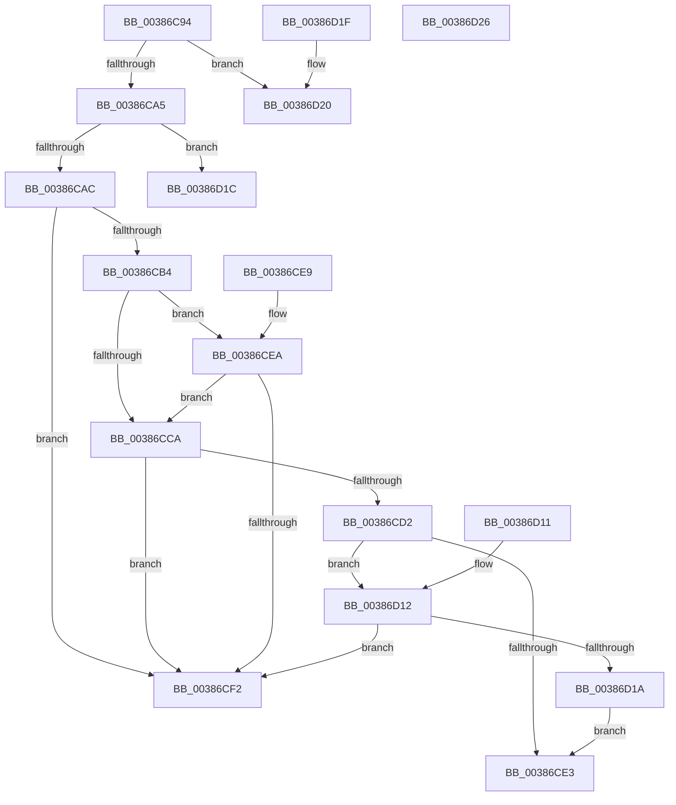

# CcDetermineReadPattern

- RVA: `0x00386C94`–`0x00386D27` (길이 `147` bytes)
- VA: `0x0000000140386C94`
- 실행 섹션: `.text`
- PDB 이름 있음: `예`; PDB Function 태그: `아니요`
- unwind 정보 RVA: `0x000DB714`
- 디코드: `53`개 명령, `147/147` bytes 표시
- 미해석 바이트: `0` (있으면 어셈블리에 `.byte`로 보존)

> 이 문서는 커널 이미지의 기계어와 PDB 기호를 분석해 생성했습니다. 4번과 5번은 함수 원형과 자료형을 바이너리 사용 방식에서 추정한 C 해석이며 원본 소스 복구 결과는 아닙니다.

## 1. Dependencies

- 직접 호출 지점: **0**; 고유 호출 대상: **0**
- 직접 호출자로 확인된 함수: **1**
- RIP 상대 이미지 참조: **0**

### Outgoing calls
- 직접 디코드된 call 명령이 없습니다.

### Direct callers
- [CcScheduleReadAheadNuma](CcScheduleReadAheadNuma_function_0038883C.md) at `0x0038897D`

### Static image references
- 디코드된 RIP-relative 메모리 참조가 없습니다.

## 2. Other-region calls and transfers

- 다른 실행 섹션으로 향하는 call: **0**
- 별도 외부 분기/꼬리 이동을 확인하지 못했습니다.

## 3. Assembly (complete function range)

```asm
00386C94  48 8B 41 08                     mov rax, qword ptr [rcx + 8]
00386C98  4C 8B CA                        mov r9, rdx
00386C9B  44 8B 40 50                     mov r8d, dword ptr [rax + 0x50]
00386C9F  41 F6 C0 20                     test r8b, 0x20
00386CA3  75 7B                           jne 0x140386d20
00386CA5  41 0F BA E0 14                  bt r8d, 0x14
00386CAA  72 70                           jb 0x140386d1c
00386CAC  8B 41 2C                        mov eax, dword ptr [rcx + 0x2c]
00386CAF  39 42 04                        cmp dword ptr [rdx + 4], eax
00386CB2  75 3E                           jne 0x140386cf2
00386CB4  44 8B 02                        mov r8d, dword ptr [rdx]
00386CB7  41 BA 00 02 00 00               mov r10d, 0x200
00386CBD  8B 51 28                        mov edx, dword ptr [rcx + 0x28]
00386CC0  41 8B C0                        mov eax, r8d
00386CC3  2B C2                           sub eax, edx
00386CC5  41 3B C2                        cmp eax, r10d
00386CC8  77 20                           ja 0x140386cea
00386CCA  8B 41 24                        mov eax, dword ptr [rcx + 0x24]
00386CCD  39 41 1C                        cmp dword ptr [rcx + 0x1c], eax
00386CD0  75 20                           jne 0x140386cf2
00386CD2  44 8B 41 18                     mov r8d, dword ptr [rcx + 0x18]
00386CD6  41 8B C0                        mov eax, r8d
00386CD9  8B 51 20                        mov edx, dword ptr [rcx + 0x20]
00386CDC  2B C2                           sub eax, edx
00386CDE  41 3B C2                        cmp eax, r10d
00386CE1  77 2F                           ja 0x140386d12
00386CE3  B8 02 00 00 00                  mov eax, 2
00386CE8  C3                              ret
00386CE9  CC                              int3
00386CEA  41 2B D0                        sub edx, r8d
00386CED  41 3B D2                        cmp edx, r10d
00386CF0  76 D8                           jbe 0x140386cca
00386CF2  48 8B 41 20                     mov rax, qword ptr [rcx + 0x20]
00386CF6  48 8B D0                        mov rdx, rax
00386CF9  48 2B 51 10                     sub rdx, qword ptr [rcx + 0x10]
00386CFD  49 8B 09                        mov rcx, qword ptr [r9]
00386D00  48 2B C8                        sub rcx, rax
00386D03  33 C0                           xor eax, eax
00386D05  48 3B CA                        cmp rcx, rdx
00386D08  44 8D 40 03                     lea r8d, [rax + 3]
00386D0C  41 0F 44 C0                     cmove eax, r8d
00386D10  C3                              ret
00386D11  CC                              int3
00386D12  41 2B D0                        sub edx, r8d
00386D15  41 3B D2                        cmp edx, r10d
00386D18  77 D8                           ja 0x140386cf2
00386D1A  EB C7                           jmp 0x140386ce3
00386D1C  33 C0                           xor eax, eax
00386D1E  C3                              ret
00386D1F  CC                              int3
00386D20  B8 01 00 00 00                  mov eax, 1
00386D25  C3                              ret
00386D26  CC                              int3
```

## 4. C-style interpretation (structured pseudocode)

```c
__int64 __fastcall CcDetermineReadPattern(__int64 a1, __int64 a2)
{
    __int64 result;

    if ((((unsigned __int8)((unsigned int)(*(unsigned int *)(*(unsigned __int64 *)(a1 + 8) + 80)))) & (32)) != 0) goto loc_00386D20;
    if (condition_is_below) goto loc_00386D1C;
    if ((*(unsigned int *)(a2 + 4)) != ((unsigned int)((unsigned int)(*(unsigned int *)(a1 + 44))))) goto loc_00386CF2;
    result = (unsigned int)(((unsigned int)((unsigned int)((unsigned int)(*(unsigned int *)(a2))))) - ((unsigned int)((unsigned int)(*(unsigned int *)(a1 + 40)))));
    if (((unsigned int)(result)) > 512) goto loc_00386CEA;
loc_00386CCA:
    if ((*(unsigned int *)(a1 + 28)) != ((unsigned int)((unsigned int)(*(unsigned int *)(a1 + 36))))) goto loc_00386CF2;
    result = (unsigned int)(((unsigned int)((unsigned int)((unsigned int)(*(unsigned int *)(a1 + 24))))) - ((unsigned int)((unsigned int)(*(unsigned int *)(a1 + 32)))));
    if (((unsigned int)(result)) > 512) goto loc_00386D12;
loc_00386CE3:
    return 2;
loc_00386CEA:
    a2 = (unsigned int)(((unsigned int)(*(unsigned int *)(a1 + 32))) - ((unsigned int)((unsigned int)(*(unsigned int *)(a1 + 24)))));
    if (((unsigned int)(a2)) <= 512) goto loc_00386CCA;
loc_00386CF2:
    a2 = (*(unsigned __int64 *)(a1 + 32)) - (*(unsigned __int64 *)(a1 + 16));
    a1 = (*(unsigned __int64 *)(a2)) - (*(unsigned __int64 *)(a1 + 32));
    result = 0;
    if (a1 == a2) { result = (unsigned int)(result + 3); }
    return result;
loc_00386D12:
    a2 = (unsigned int)((a2) - ((unsigned int)(result + 3)));
    if (((unsigned int)(a2)) > 512) goto loc_00386CF2;
    goto loc_00386CE3;
loc_00386D1C:
    result = 0;
    return result;
loc_00386D20:
    return 1;
}
```

## 5. (Beta) C Style

```c
int64_t CcDetermineReadPattern(void *Arg1, void *Arg2)
{
    uint8_t *arg1 = (uint8_t *)Arg1;
    uint8_t *arg2 = (uint8_t *)Arg2;

    int64_t result;

    if ((((uint8_t)((uint32_t)(*(uint32_t *)(*(uint64_t *)(arg1 + 0x8) + 0x50)))) & (32)) != 0) goto loc_00386D20;
    if (condition_is_below) goto loc_00386D1C;
    if ((*(uint32_t *)(arg2 + 0x4)) != ((uint32_t)((uint32_t)(*(uint32_t *)(arg1 + 0x2C))))) goto loc_00386CF2;
    result = (uint32_t)(((uint32_t)((uint32_t)((uint32_t)(*(uint32_t *)(arg2))))) - ((uint32_t)((uint32_t)(*(uint32_t *)(arg1 + 0x28)))));
    if (((uint32_t)(result)) > 512) goto loc_00386CEA;
loc_00386CCA:
    if ((*(uint32_t *)(arg1 + 0x1C)) != ((uint32_t)((uint32_t)(*(uint32_t *)(arg1 + 0x24))))) goto loc_00386CF2;
    result = (uint32_t)(((uint32_t)((uint32_t)((uint32_t)(*(uint32_t *)(arg1 + 0x18))))) - ((uint32_t)((uint32_t)(*(uint32_t *)(arg1 + 0x20)))));
    if (((uint32_t)(result)) > 512) goto loc_00386D12;
loc_00386CE3:
    return 2;
loc_00386CEA:
    Arg2 = (uint32_t)(((uint32_t)(*(uint32_t *)(arg1 + 0x20))) - ((uint32_t)((uint32_t)(*(uint32_t *)(arg1 + 0x18)))));
    if (((uint32_t)(Arg2)) <= 512) goto loc_00386CCA;
loc_00386CF2:
    Arg2 = (*(uint64_t *)(arg1 + 0x20)) - (*(uint64_t *)(arg1 + 0x10));
    Arg1 = (*(uint64_t *)(arg2)) - (*(uint64_t *)(arg1 + 0x20));
    result = 0;
    if (Arg1 == Arg2) { result = (uint32_t)(result + 3); }
    return result;
loc_00386D12:
    Arg2 = (uint32_t)((Arg2) - ((uint32_t)(result + 3)));
    if (((uint32_t)(Arg2)) > 512) goto loc_00386CF2;
    goto loc_00386CE3;
loc_00386D1C:
    result = 0;
    return result;
loc_00386D20:
    return 1;
}
```

### 관측된 메모리 오프셋

구조체 형식이 확인되지 않은 접근은 인자 기준의 오프셋으로만 기록했습니다.

| 기준 인자 | 오프셋 표현 | 폭 (bit) | 접근 |
|---|---:|---:|---|
| `Arg1` | `+ 0x8` | `64` | `R` |
| `Arg1` | `+ 0x10` | `64` | `R` |
| `Arg1` | `+ 0x18` | `32` | `R` |
| `Arg1` | `+ 0x1C` | `32` | `R` |
| `Arg1` | `+ 0x20` | `32` | `R` |
| `Arg1` | `+ 0x20` | `64` | `R` |
| `Arg1` | `+ 0x24` | `32` | `R` |
| `Arg1` | `+ 0x28` | `32` | `R` |
| `Arg1` | `+ 0x2C` | `32` | `R` |
| `Arg2` | `+ 0x0` | `32` | `R` |
| `Arg2` | `+ 0x0` | `64` | `R` |
| `Arg2` | `+ 0x4` | `32` | `R` |

## 6. Execution-region graph

[열기: 2D/3D 그래프와 함수 탐색 컨트롤 패널](../../../control-panel.html?section=text&rva=0x00386C94&view=graph)

- 2D 그래프는 위에서 아래로 흐르고, 3D 그래프는 빈 공간을 드래그해 회전합니다. Shift+드래그는 이동, 휠은 확대·축소, 함수 노드 선택은 대상 보고서 이동입니다.

### Static fallback


