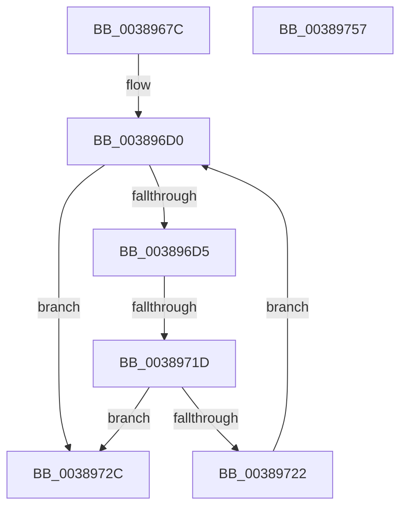

# CcForEachPrivateVolumeCacheMap

- RVA: `0x0038967C`–`0x00389758` (길이 `220` bytes)
- VA: `0x000000014038967C`
- 실행 섹션: `.text`
- PDB 이름 있음: `예`; PDB Function 태그: `예`
- unwind 정보 RVA: `0x0007FEE0`
- 디코드: `65`개 명령, `220/220` bytes 표시
- 미해석 바이트: `0` (있으면 어셈블리에 `.byte`로 보존)

> 이 문서는 커널 이미지의 기계어와 PDB 기호를 분석해 생성했습니다. 4번과 5번은 함수 원형과 자료형을 바이너리 사용 방식에서 추정한 C 해석이며 원본 소스 복구 결과는 아닙니다.

## 1. Dependencies

- 직접 호출 지점: **6**; 고유 호출 대상: **4**
- 직접 호출자로 확인된 함수: **5**
- RIP 상대 이미지 참조: **0**

### Outgoing calls
- `0x003896C4` → [KeAcquireInStackQueuedSpinLock](../27/KeAcquireInStackQueuedSpinLock_function_002757A0.md) (function, `0x002757A0`)
- `0x003896E4` → [KeReleaseInStackQueuedSpinLock](../34/KeReleaseInStackQueuedSpinLock_function_00342CE0.md) (function, `0x00342CE0`)
- `0x003896F5` → [guard_dispatch_icall](../6B/guard_dispatch_icall_function_006BAAD0.md) (function, `0x006BAAD0`)
- `0x00389705` → [KeAcquireInStackQueuedSpinLock](../27/KeAcquireInStackQueuedSpinLock_function_002757A0.md) (function, `0x002757A0`)
- `0x0038970D` → [CcDecrementPrivateVolumeUseCount](CcDecrementPrivateVolumeUseCount_function_00389760.md) (function, `0x00389760`)
- `0x00389731` → [KeReleaseInStackQueuedSpinLock](../34/KeReleaseInStackQueuedSpinLock_function_00342CE0.md) (function, `0x00342CE0`)

### Direct callers
- [CcForEachPartition](../2F/CcForEachPartition_function_002F0828.md) at `0x002F094F`
- [CcCoalescingCallBack](../3C/CcCoalescingCallBack_function_003CA040.md) at `0x003CA0D5`
- [CcNotifyWriteBehindInternal](../3C/CcNotifyWriteBehindInternal_function_003CC224.md) at `0x003CC257`
- [CcExitPartition](../57/CcExitPartition_function_0057E340.md) at `0x0057E3B0`
- [CcExitPartition](../57/CcExitPartition_function_0057E340.md) at `0x0057E491`
- [CcPartitionTelemetryCallback](../../page/A9/CcPartitionTelemetryCallback_function_00A95010.md) at `0x00A95054`

### Static image references
- 디코드된 RIP-relative 메모리 참조가 없습니다.

## 2. Other-region calls and transfers

- 다른 실행 섹션으로 향하는 call: **0**
- call이 아닌 외부 분기/꼬리 이동: **1**
  - `0x00389717` → [sub_006E5062](../6E/Unknown_function_006E5062.md) (`tail-transfer`)

## 3. Assembly (complete function range)

```asm
0038967C  4C 8B DC                        mov r11, rsp
0038967F  49 89 5B 08                     mov qword ptr [r11 + 8], rbx
00389683  49 89 6B 18                     mov qword ptr [r11 + 0x18], rbp
00389687  49 89 73 20                     mov qword ptr [r11 + 0x20], rsi
0038968B  49 89 53 10                     mov qword ptr [r11 + 0x10], rdx
0038968F  57                              push rdi
00389690  41 54                           push r12
00389692  41 55                           push r13
00389694  41 56                           push r14
00389696  41 57                           push r15
00389698  48 83 EC 40                     sub rsp, 0x40
0038969C  0F 57 C0                        xorps xmm0, xmm0
0038969F  4C 8D B9 00 03 00 00            lea r15, [rcx + 0x300]
003896A6  4C 8B E2                        mov r12, rdx
003896A9  48 8B E9                        mov rbp, rcx
003896AC  33 C0                           xor eax, eax
003896AE  49 8D 53 B8                     lea rdx, [r11 - 0x48]
003896B2  0F 11 44 24 20                  movups xmmword ptr [rsp + 0x20], xmm0
003896B7  49 8B CF                        mov rcx, r15
003896BA  49 89 43 C8                     mov qword ptr [r11 - 0x38], rax
003896BE  40 32 FF                        xor dil, dil
003896C1  4D 8B E8                        mov r13, r8
003896C4  E8 D7 C0 EE FF                  call 0x1402757a0
003896C9  4C 8D 75 20                     lea r14, [rbp + 0x20]
003896CD  49 8B 1E                        mov rbx, qword ptr [r14]
003896D0  49 3B DE                        cmp rbx, r14
003896D3  74 57                           je 0x14038972c
003896D5  48 8D B3 C0 FD FF FF            lea rsi, [rbx - 0x240]
003896DC  FF 46 04                        inc dword ptr [rsi + 4]
003896DF  48 8D 4C 24 20                  lea rcx, [rsp + 0x20]
003896E4  E8 F7 95 FB FF                  call 0x140342ce0
003896E9  4D 8B C5                        mov r8, r13
003896EC  48 8B D6                        mov rdx, rsi
003896EF  48 8B CD                        mov rcx, rbp
003896F2  49 8B C4                        mov rax, r12
003896F5  E8 D6 13 33 00                  call 0x1406baad0
003896FA  48 8D 54 24 20                  lea rdx, [rsp + 0x20]
003896FF  49 8B CF                        mov rcx, r15
00389702  40 8A F8                        mov dil, al
00389705  E8 96 C0 EE FF                  call 0x1402757a0
0038970A  48 8B CE                        mov rcx, rsi
0038970D  E8 4E 00 00 00                  call 0x140389760
00389712  4C 8B 23                        mov r12, qword ptr [rbx]
00389715  85 C0                           test eax, eax
00389717  0F 84 45 B9 35 00               je 0x1406e5062
0038971D  40 84 FF                        test dil, dil
00389720  74 0A                           je 0x14038972c
00389722  49 8B DC                        mov rbx, r12
00389725  4C 8B 64 24 78                  mov r12, qword ptr [rsp + 0x78]
0038972A  EB A4                           jmp 0x1403896d0
0038972C  48 8D 4C 24 20                  lea rcx, [rsp + 0x20]
00389731  E8 AA 95 FB FF                  call 0x140342ce0
00389736  4C 8D 5C 24 40                  lea r11, [rsp + 0x40]
0038973B  40 8A C7                        mov al, dil
0038973E  49 8B 5B 30                     mov rbx, qword ptr [r11 + 0x30]
00389742  49 8B 6B 40                     mov rbp, qword ptr [r11 + 0x40]
00389746  49 8B 73 48                     mov rsi, qword ptr [r11 + 0x48]
0038974A  49 8B E3                        mov rsp, r11
0038974D  41 5F                           pop r15
0038974F  41 5E                           pop r14
00389751  41 5D                           pop r13
00389753  41 5C                           pop r12
00389755  5F                              pop rdi
00389756  C3                              ret
00389757  CC                              int3
```

## 4. C-style interpretation (structured pseudocode)

```c
__int64 __fastcall CcForEachPrivateVolumeCacheMap(__int64 a1, __int64 a2, __int64 a3)
{
    __int64 result;
    __int64 v_rdi;
    __int64 v_rsp;
    unsigned __int64 v_stack_m28;
    unsigned __int64 v_stack_m48;
    unsigned __int64 v_stack_p10;

    *(unsigned __int64 *)(v_rsp + 8) = v_rbx;
    *(unsigned __int64 *)(v_rsp + 24) = v_rbp;
    *(unsigned __int64 *)(v_rsp + 32) = v_rsi;
    *(unsigned __int64 *)(v_rsp + 16) = a2;
    v_rsp = (v_rsp) - (64);
    result = 0;
    v_stack_m48 = v_xmm0;
    *(unsigned __int64 *)(v_rsp - 56) = 0;
    v_rdi = 0;
    result = KeAcquireInStackQueuedSpinLock(a1 + 768, v_rsp - 72, a3, a4);
loc_003896D0:
    if ((*(unsigned __int64 *)(a1 + 32)) == (a1 + 32)) goto loc_0038972C;
    result = KeReleaseInStackQueuedSpinLock(v_stack_m48, v_rsp - 72, a3, a4);
    result = guard_dispatch_icall(a1, *(unsigned __int64 *)(a1 + 32) - 576, a3, a4);
    result = KeAcquireInStackQueuedSpinLock(a1 + 768, v_stack_m48, a3, a4);
    result = CcDecrementPrivateVolumeUseCount(*(unsigned __int64 *)(a1 + 32) - 576, v_stack_m48, a3, a4);
    if ((unsigned __int8)((unsigned __int8)(result)) == 0) goto loc_0038972C;
    goto loc_003896D0;
loc_0038972C:
    result = KeReleaseInStackQueuedSpinLock(v_stack_m48, v_stack_m48, a3, a4);
    return (unsigned __int8)((unsigned __int8)(result));
}
```

## 5. (Beta) C Style

```c
int64_t CcForEachPrivateVolumeCacheMap(void *Arg1, int64_t Arg2, int64_t Arg3)
{
    uint8_t *arg1 = (uint8_t *)Arg1;

    int64_t result;
    int64_t local_rdi;
    int64_t local_rsp;
    uint64_t v_stack_m28;
    uint64_t v_stack_m48;
    uint64_t v_stack_p10;

    *(uint64_t *)(local_rsp + 0x8) = local_rbx;
    *(uint64_t *)(local_rsp + 0x18) = local_rbp;
    *(uint64_t *)(local_rsp + 0x20) = local_rsi;
    *(uint64_t *)(local_rsp + 0x10) = Arg2;
    local_rsp = (local_rsp) - (64);
    result = 0;
    v_stack_m48 = v_xmm0;
    *(uint64_t *)(local_rsp - 0x38) = 0;
    local_rdi = 0;
    result = KeAcquireInStackQueuedSpinLock(Arg1 + 768, local_rsp - 72, Arg3, a4);
loc_003896D0:
    if ((*(uint64_t *)(arg1 + 0x20)) == (Arg1 + 32)) goto loc_0038972C;
    result = KeReleaseInStackQueuedSpinLock(v_stack_m48, local_rsp - 72, Arg3, a4);
    result = guard_dispatch_icall(Arg1, *(uint64_t *)(arg1 + 0x20) - 576, Arg3, a4);
    result = KeAcquireInStackQueuedSpinLock(Arg1 + 768, v_stack_m48, Arg3, a4);
    result = CcDecrementPrivateVolumeUseCount(*(uint64_t *)(arg1 + 0x20) - 576, v_stack_m48, Arg3, a4);
    if ((uint8_t)((uint8_t)(result)) == 0) goto loc_0038972C;
    goto loc_003896D0;
loc_0038972C:
    result = KeReleaseInStackQueuedSpinLock(v_stack_m48, v_stack_m48, Arg3, a4);
    return (uint8_t)((uint8_t)(result));
}
```

### 관측된 메모리 오프셋

구조체 형식이 확인되지 않은 접근은 인자 기준의 오프셋으로만 기록했습니다.

| 기준 인자 | 오프셋 표현 | 폭 (bit) | 접근 |
|---|---:|---:|---|
| `Arg1` | `+ 0x0` | `64` | `R` |
| `Arg1` | `+ 0x20` | `64` | `R` |
| `Arg1` | `+ 0x300` | `64` | `R` |

## 6. Execution-region graph

[열기: 2D/3D 그래프와 함수 탐색 컨트롤 패널](../../../control-panel.html?section=text&rva=0x0038967C&view=graph)

- 2D 그래프는 위에서 아래로 흐르고, 3D 그래프는 빈 공간을 드래그해 회전합니다. Shift+드래그는 이동, 휠은 확대·축소, 함수 노드 선택은 대상 보고서 이동입니다.

### Static fallback


