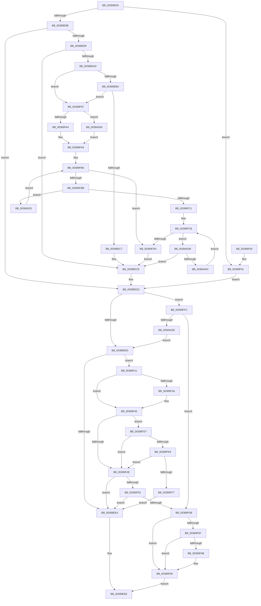

# CcForceWriteThrough

- RVA: `0x00389E50`–`0x0038A05D` (길이 `525` bytes)
- VA: `0x0000000140389E50`
- 실행 섹션: `.text`
- PDB 이름 있음: `예`; PDB Function 태그: `아니요`
- unwind 정보 RVA: `0x0007FF98`
- 디코드: `122`개 명령, `525/525` bytes 표시
- 미해석 바이트: `0` (있으면 어셈블리에 `.byte`로 보존)

> 이 문서는 커널 이미지의 기계어와 PDB 기호를 분석해 생성했습니다. 4번과 5번은 함수 원형과 자료형을 바이너리 사용 방식에서 추정한 C 해석이며 원본 소스 복구 결과는 아닙니다.

## 1. Dependencies

- 직접 호출 지점: **5**; 고유 호출 대상: **5**
- 직접 호출자로 확인된 함수: **3**
- RIP 상대 이미지 참조: **3**

### Outgoing calls
- `0x00389E9F` → [KeRcuReadLock](KeRcuReadLock_function_0038A1A0.md) (function, `0x0038A1A0`)
- `0x00389ECE` → [KeRcuReadUnlock](KeRcuReadUnlock_function_0038A070.md) (function, `0x0038A070`)
- `0x00389F77` → [KeAcquireInStackQueuedSpinLock](../27/KeAcquireInStackQueuedSpinLock_function_002757A0.md) (function, `0x002757A0`)
- `0x00389F8B` → [KeReleaseInStackQueuedSpinLock](../34/KeReleaseInStackQueuedSpinLock_function_00342CE0.md) (function, `0x00342CE0`)
- `0x0038A021` → [CcCanIWriteStreamEx](CcCanIWriteStreamEx_function_0038993C.md) (function, `0x0038993C`)

### Direct callers
- [CcCopyWriteWontFlush](CcCopyWriteWontFlush_function_00386E40.md) at `0x00386E8E`
- [CcMapAndCopyInToCache](../3C/CcMapAndCopyInToCache_function_003CA7F0.md) at `0x003CA921`
- [CcPrepareMdlWrite](../49/CcPrepareMdlWrite_function_004996D0.md) at `0x00499743`

### Static image references
- `0x00389E8B` → RVA `0x00E65B88` (`.data`; read)
- `0x00389E92` → RVA `0x00FC6EA0` (`ALMOSTRO`; read)
- `0x00389FA8` → RVA `0x00F8F560` (`.data`; read)

## 2. Other-region calls and transfers

- 다른 실행 섹션으로 향하는 call: **0**
- 별도 외부 분기/꼬리 이동을 확인하지 못했습니다.

## 3. Assembly (complete function range)

```asm
00389E50  48 89 5C 24 08                  mov qword ptr [rsp + 8], rbx
00389E55  48 89 6C 24 10                  mov qword ptr [rsp + 0x10], rbp
00389E5A  48 89 74 24 18                  mov qword ptr [rsp + 0x18], rsi
00389E5F  57                              push rdi
00389E60  41 56                           push r14
00389E62  41 57                           push r15
00389E64  48 83 EC 60                     sub rsp, 0x60
00389E68  33 C0                           xor eax, eax
00389E6A  33 ED                           xor ebp, ebp
00389E6C  48 89 44 24 50                  mov qword ptr [rsp + 0x50], rax
00389E71  0F 57 C0                        xorps xmm0, xmm0
00389E74  41 0F B6 D9                     movzx ebx, r9b
00389E78  49 8B F0                        mov rsi, r8
00389E7B  44 8B F2                        mov r14d, edx
00389E7E  48 8B F9                        mov rdi, rcx
00389E81  0F 11 44 24 40                  movups xmmword ptr [rsp + 0x40], xmm0
00389E86  4D 85 C0                        test r8, r8
00389E89  75 76                           jne 0x140389f01
00389E8B  40 38 2D F6 BC AD 00            cmp byte ptr [rip + 0xadbcf6], bpl
00389E92  48 8B 05 07 D0 C3 00            mov rax, qword ptr [rip + 0xc3d007]
00389E99  4C 8B 78 08                     mov r15, qword ptr [rax + 8]
00389E9D  74 34                           je 0x140389ed3
00389E9F  E8 FC 02 00 00                  call 0x14038a1a0
00389EA4  40 38 2D DD BC AD 00            cmp byte ptr [rip + 0xadbcdd], bpl
00389EAB  74 21                           je 0x140389ece
00389EAD  48 8B 47 28                     mov rax, qword ptr [rdi + 0x28]
00389EB1  48 85 C0                        test rax, rax
00389EB4  0F 84 DD 00 00 00               je 0x140389f97
00389EBA  48 8B 68 08                     mov rbp, qword ptr [rax + 8]
00389EBE  48 85 ED                        test rbp, rbp
00389EC1  0F 84 D0 00 00 00               je 0x140389f97
00389EC7  48 8B AD 58 02 00 00            mov rbp, qword ptr [rbp + 0x258]
00389ECE  E8 9D 01 00 00                  call 0x14038a070
00389ED3  F7 47 50 00 00 00 01            test dword ptr [rdi + 0x50], 0x1000000
00389EDA  0F 85 1C 01 00 00               jne 0x140389ffc
00389EE0  84 DB                           test bl, bl
00389EE2  75 2D                           jne 0x140389f11
00389EE4  32 C0                           xor al, al
00389EE6  4C 8D 5C 24 60                  lea r11, [rsp + 0x60]
00389EEB  49 8B 5B 20                     mov rbx, qword ptr [r11 + 0x20]
00389EEF  49 8B 6B 28                     mov rbp, qword ptr [r11 + 0x28]
00389EF3  49 8B 73 30                     mov rsi, qword ptr [r11 + 0x30]
00389EF7  49 8B E3                        mov rsp, r11
00389EFA  41 5F                           pop r15
00389EFC  41 5E                           pop r14
00389EFE  5F                              pop rdi
00389EFF  C3                              ret
00389F00  CC                              int3
00389F01  4D 8B B8 18 02 00 00            mov r15, qword ptr [r8 + 0x218]
00389F08  49 8B A8 58 02 00 00            mov rbp, qword ptr [r8 + 0x258]
00389F0F  EB C2                           jmp 0x140389ed3
00389F11  65 4C 8B 04 25 88 01 00 00      mov r8, qword ptr gs:[0x188]
00389F1A  49 8B 80 20 02 00 00            mov rax, qword ptr [r8 + 0x220]
00389F21  41 8B 88 A0 05 00 00            mov ecx, dword ptr [r8 + 0x5a0]
00389F28  C1 E9 09                        shr ecx, 9
00389F2B  83 E1 07                        and ecx, 7
00389F2E  48 8B 90 A0 02 00 00            mov rdx, qword ptr [rax + 0x2a0]
00389F35  48 85 D2                        test rdx, rdx
00389F38  74 0B                           je 0x140389f45
00389F3A  8B 92 3C 04 00 00               mov edx, dword ptr [rdx + 0x43c]
00389F40  3B CA                           cmp ecx, edx
00389F42  0F 4D CA                        cmovge ecx, edx
00389F45  83 F9 02                        cmp ecx, 2
00389F48  0F 8C 89 00 00 00               jl 0x140389fd7
00389F4E  85 C9                           test ecx, ecx
00389F50  7F 92                           jg 0x140389ee4
00389F52  F7 47 50 00 80 00 00            test dword ptr [rdi + 0x50], 0x8000
00389F59  75 89                           jne 0x140389ee4
00389F5B  84 DB                           test bl, bl
00389F5D  74 31                           je 0x140389f90
00389F5F  F7 86 98 00 00 00 00 04 00 00   test dword ptr [rsi + 0x98], 0x400
00389F69  75 25                           jne 0x140389f90
00389F6B  49 8D 8F 00 03 00 00            lea rcx, [r15 + 0x300]
00389F72  48 8D 54 24 40                  lea rdx, [rsp + 0x40]
00389F77  E8 24 B8 EE FF                  call 0x1402757a0
00389F7C  81 8E 98 00 00 00 00 04 00 00   or dword ptr [rsi + 0x98], 0x400
00389F86  48 8D 4C 24 40                  lea rcx, [rsp + 0x40]
00389F8B  E8 50 8D FB FF                  call 0x140342ce0
00389F90  B0 01                           mov al, 1
00389F92  E9 4F FF FF FF                  jmp 0x140389ee6
00389F97  48 8B 47 10                     mov rax, qword ptr [rdi + 0x10]
00389F9B  48 85 C0                        test rax, rax
00389F9E  0F 84 B0 00 00 00               je 0x14038a054
00389FA4  48 8B 48 08                     mov rcx, qword ptr [rax + 8]
00389FA8  48 8B 05 B1 55 C0 00            mov rax, qword ptr [rip + 0xc055b1]
00389FAF  48 8D 15 AA 55 C0 00            lea rdx, [rip + 0xc055aa]
00389FB6  48 3B C2                        cmp rax, rdx
00389FB9  74 15                           je 0x140389fd0
00389FBB  48 39 48 F8                     cmp qword ptr [rax - 8], rcx
00389FBF  75 72                           jne 0x14038a033
00389FC1  48 8D 88 C0 00 00 00            lea rcx, [rax + 0xc0]
00389FC8  48 8B 01                        mov rax, qword ptr [rcx]
00389FCB  48 3B C1                        cmp rax, rcx
00389FCE  75 6B                           jne 0x14038a03b
00389FD0  33 ED                           xor ebp, ebp
00389FD2  E9 F7 FE FF FF                  jmp 0x140389ece
00389FD7  65 48 8B 14 25 88 01 00 00      mov rdx, qword ptr gs:[0x188]
00389FE0  4C 3B C2                        cmp r8, rdx
00389FE3  0F 85 65 FF FF FF               jne 0x140389f4e
00389FE9  41 83 B8 E0 05 00 00 00         cmp dword ptr [r8 + 0x5e0], 0
00389FF1  0F 84 57 FF FF FF               je 0x140389f4e
00389FF7  E9 E8 FE FF FF                  jmp 0x140389ee4
00389FFC  48 C7 44 24 30 00 00 00 00      mov qword ptr [rsp + 0x30], 0
0038A005  45 8B CE                        mov r9d, r14d
0038A008  C7 44 24 28 00 00 00 00         mov dword ptr [rsp + 0x28], 0
0038A010  4C 8B C7                        mov r8, rdi
0038A013  48 8B D5                        mov rdx, rbp
0038A016  C7 44 24 20 00 00 00 00         mov dword ptr [rsp + 0x20], 0
0038A01E  49 8B CF                        mov rcx, r15
0038A021  E8 16 F9 FF FF                  call 0x14038993c
0038A026  84 C0                           test al, al
0038A028  0F 84 2D FF FF FF               je 0x140389f5b
0038A02E  E9 AD FE FF FF                  jmp 0x140389ee0
0038A033  48 8B 00                        mov rax, qword ptr [rax]
0038A036  E9 7B FF FF FF                  jmp 0x140389fb6
0038A03B  48 8D A8 B0 FD FF FF            lea rbp, [rax - 0x250]
0038A042  4C 39 7D 20                     cmp qword ptr [rbp + 0x20], r15
0038A046  0F 84 82 FE FF FF               je 0x140389ece
0038A04C  48 8B 00                        mov rax, qword ptr [rax]
0038A04F  E9 77 FF FF FF                  jmp 0x140389fcb
0038A054  48 8B 4F 08                     mov rcx, qword ptr [rdi + 8]
0038A058  E9 4B FF FF FF                  jmp 0x140389fa8
```

## 4. C-style interpretation (structured pseudocode)

```c
__int64 __fastcall CcForceWriteThrough(__int64 a1, int a2, __int64 a3, unsigned __int8 a4)
{
    __int64 result;
    __int64 v_rbp;
    __int64 v_rsp;
    unsigned __int64 v_stack_m18;
    unsigned __int64 v_stack_m20;
    unsigned __int64 v_stack_m28;
    unsigned __int64 v_stack_m30;
    unsigned __int64 v_stack_m38;
    unsigned int v_stack_m40;
    unsigned __int64 v_stack_p10;
    unsigned __int64 v_stack_p18;
    unsigned __int64 v_stack_p8;

    v_stack_p8 = v_rbx;
    v_stack_p10 = v_rbp;
    v_stack_p18 = v_rsi;
    v_rsp = (v_rsp) - (96);
    result = 0;
    v_rbp = 0;
    v_stack_m28 = 0;
    v_stack_m38 = v_xmm0;
    if (a3 != 0) goto loc_00389F01;
    if ((*(unsigned __int8 *)(v_rip + 11386102)) == 0) goto loc_00389ED3;
    result = KeRcuReadLock(a1, a2, a3, a4);
    if ((*(unsigned __int8 *)(v_rip + 11386077)) == 0) goto loc_00389ECE;
    if (*(unsigned __int64 *)(a1 + 40) == 0) goto loc_00389F97;
    if (*(unsigned __int64 *)(*(unsigned __int64 *)(a1 + 40) + 8) == 0) goto loc_00389F97;
loc_00389ECE:
    result = KeRcuReadUnlock(a1, a2, a3, a4);
loc_00389ED3:
    if (((*(unsigned int *)(a1 + 80)) & (0x1000000ULL)) != 0) goto loc_00389FFC;
loc_00389EE0:
    if (a4 != 0) goto loc_00389F11;
loc_00389EE4:
    result = 0;
loc_00389EE6:
    return result;
loc_00389F01:
    goto loc_00389ED3;
loc_00389F11:
    a1 = (unsigned int)(((unsigned int)(*(unsigned int *)(*(unsigned __int64 *)(gs_base + (0 + 392)) + 1440))) >> (9));
    a1 = (unsigned int)((a1) & (7));
    if (*(unsigned __int64 *)(*(unsigned __int64 *)(*(unsigned __int64 *)(gs_base + (0 + 392)) + 544) + 672) != 0) {
        a2 = *(unsigned int *)(*(unsigned __int64 *)(*(unsigned __int64 *)(*(unsigned __int64 *)(gs_base + (0 + 392)) + 544) + 672) + 1084);
        if (((unsigned int)(a1)) >= a2) { a1 = a2; }
    }
    if (((unsigned int)(a1)) < 2) goto loc_00389FD7;
loc_00389F4E:
    if (condition_is_greater) goto loc_00389EE4;
    if (((*(unsigned int *)(a1 + 80)) & (0x8000ULL)) != 0) goto loc_00389EE4;
loc_00389F5B:
    if ((unsigned __int8)(*(unsigned __int64 *)(v_stack_m18 + 32)) == 0) goto loc_00389F90;
    result = *(unsigned __int64 *)(*(unsigned __int64 *)(gs_base + (0 + 392)) + 544);
    if (((*(unsigned int *)(*(unsigned __int64 *)(v_stack_m18 + 48) + 152)) & (0x400ULL)) == 0) {
        a1 = *(unsigned __int64 *)(a3 + 536) + 768;
        a2 = v_stack_m20;
        result = KeAcquireInStackQueuedSpinLock(a1, a2, *(unsigned __int64 *)(gs_base + (0 + 392)), a4);
        a1 = v_stack_m20;
        result = KeReleaseInStackQueuedSpinLock(a1, a2, *(unsigned __int64 *)(gs_base + (0 + 392)), a4);
    }
    goto loc_00389EE6;
loc_00389F97:
    if (*(unsigned __int64 *)(a1 + 16) == 0) goto loc_0038A054;
loc_00389FA8:
loc_00389FB6:
    if ((*(unsigned __int64 *)(v_rip + 12604849)) == (v_rip + 12604842)) goto loc_00389FD0;
    if ((*(unsigned __int64 *)(*(unsigned __int64 *)(v_rip + 12604849) - 8)) != (*(unsigned __int64 *)(*(unsigned __int64 *)(a1 + 16) + 8))) goto loc_0038A033;
loc_00389FCB:
    if ((*(unsigned __int64 *)(*(unsigned __int64 *)(v_rip + 12604849) + 192)) != (*(unsigned __int64 *)(v_rip + 12604849) + 192)) goto loc_0038A03B;
loc_00389FD0:
    v_rbp = 0;
    goto loc_00389ECE;
loc_00389FD7:
    if ((*(unsigned __int64 *)(gs_base + (0 + 392))) != (*(unsigned __int64 *)(gs_base + (0 + 392)))) goto loc_00389F4E;
    if ((*(unsigned int *)(*(unsigned __int64 *)(gs_base + (0 + 392)) + 1504)) == 0) goto loc_00389F4E;
    goto loc_00389EE4;
loc_00389FFC:
    v_stack_m30 = 0;
    v_stack_m38 = 0;
    v_stack_m40 = 0;
    result = CcCanIWriteStreamEx(*(unsigned __int64 *)(a3 + 536), 0, a1, (unsigned int)((unsigned int)((unsigned int)(a2))));
    if ((unsigned __int8)(result) == 0) goto loc_00389F5B;
    goto loc_00389EE0;
loc_0038A033:
    goto loc_00389FB6;
loc_0038A03B:
    if ((*(unsigned __int64 *)(*(unsigned __int64 *)(result) - 592 + 32)) == (*(unsigned __int64 *)(a3 + 536))) goto loc_00389ECE;
    goto loc_00389FCB;
loc_0038A054:
    goto loc_00389FA8;
}
```

## 5. (Beta) C Style

```c
int64_t CcForceWriteThrough(void *Arg1, int32_t Arg2, void *Arg3, uint8_t Arg4)
{
    uint8_t *arg1 = (uint8_t *)Arg1;
    uint8_t *arg3 = (uint8_t *)Arg3;

    int64_t result;
    int64_t local_rbp;
    int64_t local_rsp;
    uint64_t v_stack_m18;
    uint64_t v_stack_m20;
    uint64_t v_stack_m28;
    uint64_t v_stack_m30;
    uint64_t v_stack_m38;
    uint32_t v_stack_m40;
    uint64_t v_stack_p10;
    uint64_t v_stack_p18;
    uint64_t v_stack_p8;

    v_stack_p8 = local_rbx;
    v_stack_p10 = local_rbp;
    v_stack_p18 = local_rsi;
    local_rsp = (local_rsp) - (96);
    result = 0;
    local_rbp = 0;
    v_stack_m28 = 0;
    v_stack_m38 = v_xmm0;
    if (Arg3 != NULL) goto loc_00389F01;
    if ((*(uint8_t *)(v_rip + 0xADBCF6)) == 0) goto loc_00389ED3;
    result = KeRcuReadLock(Arg1, Arg2, Arg3, Arg4);
    if ((*(uint8_t *)(v_rip + 0xADBCDD)) == 0) goto loc_00389ECE;
    if (*(uint64_t *)(arg1 + 0x28) == 0) goto loc_00389F97;
    if (*(uint64_t *)(*(uint64_t *)(arg1 + 0x28) + 0x8) == 0) goto loc_00389F97;
loc_00389ECE:
    result = KeRcuReadUnlock(Arg1, Arg2, Arg3, Arg4);
loc_00389ED3:
    if (((*(uint32_t *)(arg1 + 0x50)) & (0x1000000ULL)) != 0) goto loc_00389FFC;
loc_00389EE0:
    if (Arg4 != 0) goto loc_00389F11;
loc_00389EE4:
    result = 0;
loc_00389EE6:
    return result;
loc_00389F01:
    goto loc_00389ED3;
loc_00389F11:
    Arg1 = (uint32_t)(((uint32_t)(*(uint32_t *)(*(uint64_t *)(gs_base + (0 + 0x188)) + 0x5A0))) >> (9));
    Arg1 = (uint32_t)((Arg1) & (7));
    if (*(uint64_t *)(*(uint64_t *)(*(uint64_t *)(gs_base + (0 + 0x188)) + 0x220) + 0x2A0) != 0) {
        Arg2 = *(uint32_t *)(*(uint64_t *)(*(uint64_t *)(*(uint64_t *)(gs_base + (0 + 0x188)) + 0x220) + 0x2A0) + 0x43C);
        if (((uint32_t)(Arg1)) >= Arg2) { Arg1 = Arg2; }
    }
    if (((uint32_t)(Arg1)) < 2) goto loc_00389FD7;
loc_00389F4E:
    if (condition_is_greater) goto loc_00389EE4;
    if (((*(uint32_t *)(arg1 + 0x50)) & (0x8000ULL)) != 0) goto loc_00389EE4;
loc_00389F5B:
    if ((uint8_t)(*(uint64_t *)(v_stack_m18 + 0x20)) == 0) goto loc_00389F90;
    result = *(uint64_t *)(*(uint64_t *)(gs_base + (0 + 0x188)) + 0x220);
    if (((*(uint32_t *)(*(uint64_t *)(v_stack_m18 + 0x30) + 0x98)) & (0x400ULL)) == 0) {
        Arg1 = *(uint64_t *)(arg3 + 0x218) + 768;
        Arg2 = v_stack_m20;
        result = KeAcquireInStackQueuedSpinLock(Arg1, Arg2, *(uint64_t *)(gs_base + (0 + 0x188)), Arg4);
        Arg1 = v_stack_m20;
        result = KeReleaseInStackQueuedSpinLock(Arg1, Arg2, *(uint64_t *)(gs_base + (0 + 0x188)), Arg4);
    }
    goto loc_00389EE6;
loc_00389F97:
    if (*(uint64_t *)(arg1 + 0x10) == 0) goto loc_0038A054;
loc_00389FA8:
loc_00389FB6:
    if ((*(uint64_t *)(v_rip + 0xC055B1)) == (v_rip + 12604842)) goto loc_00389FD0;
    if ((*(uint64_t *)(*(uint64_t *)(v_rip + 0xC055B1) - 0x8)) != (*(uint64_t *)(*(uint64_t *)(arg1 + 0x10) + 0x8))) goto loc_0038A033;
loc_00389FCB:
    if ((*(uint64_t *)(*(uint64_t *)(v_rip + 0xC055B1) + 0xC0)) != (*(uint64_t *)(v_rip + 0xC055B1) + 192)) goto loc_0038A03B;
loc_00389FD0:
    local_rbp = 0;
    goto loc_00389ECE;
loc_00389FD7:
    if ((*(uint64_t *)(gs_base + (0 + 0x188))) != (*(uint64_t *)(gs_base + (0 + 0x188)))) goto loc_00389F4E;
    if ((*(uint32_t *)(*(uint64_t *)(gs_base + (0 + 0x188)) + 0x5E0)) == 0) goto loc_00389F4E;
    goto loc_00389EE4;
loc_00389FFC:
    v_stack_m30 = 0;
    v_stack_m38 = 0;
    v_stack_m40 = 0;
    result = CcCanIWriteStreamEx(*(uint64_t *)(arg3 + 0x218), 0, Arg1, (uint32_t)((uint32_t)((uint32_t)(Arg2))));
    if ((uint8_t)(result) == 0) goto loc_00389F5B;
    goto loc_00389EE0;
loc_0038A033:
    goto loc_00389FB6;
loc_0038A03B:
    if ((*(uint64_t *)(*(uint64_t *)(result) - 0x250 + 0x20)) == (*(uint64_t *)(arg3 + 0x218))) goto loc_00389ECE;
    goto loc_00389FCB;
loc_0038A054:
    goto loc_00389FA8;
}
```

### 관측된 메모리 오프셋

구조체 형식이 확인되지 않은 접근은 인자 기준의 오프셋으로만 기록했습니다.

| 기준 인자 | 오프셋 표현 | 폭 (bit) | 접근 |
|---|---:|---:|---|
| `Arg1` | `+ 0x8` | `64` | `R` |
| `Arg1` | `+ 0x10` | `64` | `R` |
| `Arg1` | `+ 0x28` | `64` | `R` |
| `Arg1` | `+ 0x50` | `32` | `R` |
| `Arg3` | `+ 0x98` | `32` | `R` |
| `Arg3` | `+ 0x98` | `32` | `R/W` |

## 6. Execution-region graph

[열기: 2D/3D 그래프와 함수 탐색 컨트롤 패널](../../../control-panel.html?section=text&rva=0x00389E50&view=graph)

- 2D 그래프는 위에서 아래로 흐르고, 3D 그래프는 빈 공간을 드래그해 회전합니다. Shift+드래그는 이동, 휠은 확대·축소, 함수 노드 선택은 대상 보고서 이동입니다.

### Static fallback


