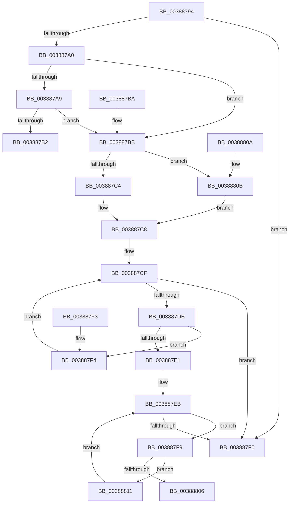

# CcGetPrivateVolumeCacheMapFromFileObject

- RVA: `0x00388794`–`0x00388816` (길이 `130` bytes)
- VA: `0x0000000140388794`
- 실행 섹션: `.text`
- PDB 이름 있음: `예`; PDB Function 태그: `아니요`
- unwind 정보 RVA: `0x000DB714`
- 디코드: `41`개 명령, `130/130` bytes 표시
- 미해석 바이트: `0` (있으면 어셈블리에 `.byte`로 보존)

> 이 문서는 커널 이미지의 기계어와 PDB 기호를 분석해 생성했습니다. 4번과 5번은 함수 원형과 자료형을 바이너리 사용 방식에서 추정한 C 해석이며 원본 소스 복구 결과는 아닙니다.

## 1. Dependencies

- 직접 호출 지점: **0**; 고유 호출 대상: **0**
- 직접 호출자로 확인된 함수: **2**
- RIP 상대 이미지 참조: **2**

### Outgoing calls
- 직접 디코드된 call 명령이 없습니다.

### Direct callers
- [CcCanIWrite](CcCanIWrite_function_00388250.md) at `0x003882F6`
- [CcDeferWrite](../57/CcDeferWrite_function_0057C860.md) at `0x0057C8DB`

### Static image references
- `0x00388794` → RVA `0x00E65B88` (`.data`; read)
- `0x003887C8` → RVA `0x00F8F560` (`.data`; read)

## 2. Other-region calls and transfers

- 다른 실행 섹션으로 향하는 call: **0**
- 별도 외부 분기/꼬리 이동을 확인하지 못했습니다.

## 3. Assembly (complete function range)

```asm
00388794  80 3D ED D3 AD 00 00            cmp byte ptr [rip + 0xadd3ed], 0
0038879B  4C 8B C2                        mov r8, rdx
0038879E  74 50                           je 0x1403887f0
003887A0  48 8B 41 28                     mov rax, qword ptr [rcx + 0x28]
003887A4  48 85 C0                        test rax, rax
003887A7  74 12                           je 0x1403887bb
003887A9  48 8B 40 08                     mov rax, qword ptr [rax + 8]
003887AD  48 85 C0                        test rax, rax
003887B0  74 09                           je 0x1403887bb
003887B2  48 8B 80 58 02 00 00            mov rax, qword ptr [rax + 0x258]
003887B9  C3                              ret
003887BA  CC                              int3
003887BB  48 8B 41 10                     mov rax, qword ptr [rcx + 0x10]
003887BF  48 85 C0                        test rax, rax
003887C2  74 47                           je 0x14038880b
003887C4  48 8B 48 08                     mov rcx, qword ptr [rax + 8]
003887C8  48 8B 05 91 6D C0 00            mov rax, qword ptr [rip + 0xc06d91]
003887CF  48 8D 15 8A 6D C0 00            lea rdx, [rip + 0xc06d8a]
003887D6  48 3B C2                        cmp rax, rdx
003887D9  74 15                           je 0x1403887f0
003887DB  48 39 48 F8                     cmp qword ptr [rax - 8], rcx
003887DF  75 13                           jne 0x1403887f4
003887E1  48 8D 90 C0 00 00 00            lea rdx, [rax + 0xc0]
003887E8  48 8B 02                        mov rax, qword ptr [rdx]
003887EB  48 3B C2                        cmp rax, rdx
003887EE  75 09                           jne 0x1403887f9
003887F0  33 C0                           xor eax, eax
003887F2  C3                              ret
003887F3  CC                              int3
003887F4  48 8B 00                        mov rax, qword ptr [rax]
003887F7  EB D6                           jmp 0x1403887cf
003887F9  48 8D 88 B0 FD FF FF            lea rcx, [rax - 0x250]
00388800  4C 39 41 20                     cmp qword ptr [rcx + 0x20], r8
00388804  75 0B                           jne 0x140388811
00388806  48 8B C1                        mov rax, rcx
00388809  C3                              ret
0038880A  CC                              int3
0038880B  48 8B 49 08                     mov rcx, qword ptr [rcx + 8]
0038880F  EB B7                           jmp 0x1403887c8
00388811  48 8B 00                        mov rax, qword ptr [rax]
00388814  EB D5                           jmp 0x1403887eb
```

## 4. C-style interpretation (structured pseudocode)

```c
__int64 __fastcall CcGetPrivateVolumeCacheMapFromFileObject(__int64 a1, __int64 a2)
{
    __int64 result;

    if ((*(unsigned __int8 *)(v_rip + 11391981)) == 0) goto loc_003887F0;
    if (*(unsigned __int64 *)(a1 + 40) == 0) goto loc_003887BB;
    if (*(unsigned __int64 *)(*(unsigned __int64 *)(a1 + 40) + 8) == 0) goto loc_003887BB;
    return *(unsigned __int64 *)(*(unsigned __int64 *)(*(unsigned __int64 *)(a1 + 40) + 8) + 600);
loc_003887BB:
    if (*(unsigned __int64 *)(a1 + 16) == 0) goto loc_0038880B;
loc_003887C8:
loc_003887CF:
    if ((*(unsigned __int64 *)(v_rip + 12610961)) == (v_rip + 12610954)) goto loc_003887F0;
    if ((*(unsigned __int64 *)(*(unsigned __int64 *)(v_rip + 12610961) - 8)) != (*(unsigned __int64 *)(*(unsigned __int64 *)(a1 + 16) + 8))) goto loc_003887F4;
loc_003887EB:
    if ((*(unsigned __int64 *)(*(unsigned __int64 *)(v_rip + 12610961) + 192)) != (*(unsigned __int64 *)(v_rip + 12610961) + 192)) goto loc_003887F9;
loc_003887F0:
    result = 0;
    return result;
loc_003887F4:
    goto loc_003887CF;
loc_003887F9:
    if ((*(unsigned __int64 *)(*(unsigned __int64 *)(result) - 592 + 32)) != a2) goto loc_00388811;
    return *(unsigned __int64 *)(result) - 592;
loc_0038880B:
    goto loc_003887C8;
loc_00388811:
    goto loc_003887EB;
}
```

## 5. (Beta) C Style

```c
int64_t CcGetPrivateVolumeCacheMapFromFileObject(void *Arg1, int64_t Arg2)
{
    uint8_t *arg1 = (uint8_t *)Arg1;

    int64_t result;

    if ((*(uint8_t *)(v_rip + 0xADD3ED)) == 0) goto loc_003887F0;
    if (*(uint64_t *)(arg1 + 0x28) == 0) goto loc_003887BB;
    if (*(uint64_t *)(*(uint64_t *)(arg1 + 0x28) + 0x8) == 0) goto loc_003887BB;
    return *(uint64_t *)(*(uint64_t *)(*(uint64_t *)(arg1 + 0x28) + 0x8) + 0x258);
loc_003887BB:
    if (*(uint64_t *)(arg1 + 0x10) == 0) goto loc_0038880B;
loc_003887C8:
loc_003887CF:
    if ((*(uint64_t *)(v_rip + 0xC06D91)) == (v_rip + 12610954)) goto loc_003887F0;
    if ((*(uint64_t *)(*(uint64_t *)(v_rip + 0xC06D91) - 0x8)) != (*(uint64_t *)(*(uint64_t *)(arg1 + 0x10) + 0x8))) goto loc_003887F4;
loc_003887EB:
    if ((*(uint64_t *)(*(uint64_t *)(v_rip + 0xC06D91) + 0xC0)) != (*(uint64_t *)(v_rip + 0xC06D91) + 192)) goto loc_003887F9;
loc_003887F0:
    result = 0;
    return result;
loc_003887F4:
    goto loc_003887CF;
loc_003887F9:
    if ((*(uint64_t *)(*(uint64_t *)(result) - 0x250 + 0x20)) != Arg2) goto loc_00388811;
    return *(uint64_t *)(result) - 592;
loc_0038880B:
    goto loc_003887C8;
loc_00388811:
    goto loc_003887EB;
}
```

### 관측된 메모리 오프셋

구조체 형식이 확인되지 않은 접근은 인자 기준의 오프셋으로만 기록했습니다.

| 기준 인자 | 오프셋 표현 | 폭 (bit) | 접근 |
|---|---:|---:|---|
| `Arg1` | `+ 0x8` | `64` | `R` |
| `Arg1` | `+ 0x10` | `64` | `R` |
| `Arg1` | `+ 0x28` | `64` | `R` |

## 6. Execution-region graph

[열기: 2D/3D 그래프와 함수 탐색 컨트롤 패널](../../../control-panel.html?section=text&rva=0x00388794&view=graph)

- 2D 그래프는 위에서 아래로 흐르고, 3D 그래프는 빈 공간을 드래그해 회전합니다. Shift+드래그는 이동, 휠은 확대·축소, 함수 노드 선택은 대상 보고서 이동입니다.

### Static fallback


