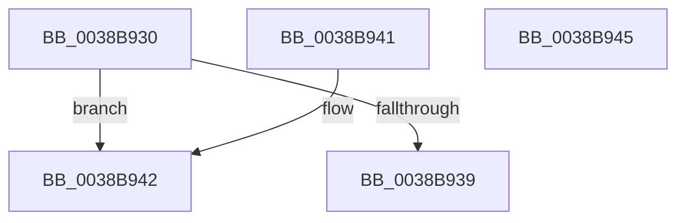

# CcGetPrivateVolumeCacheMap

- RVA: `0x0038B930`–`0x0038B946` (길이 `22` bytes)
- VA: `0x000000014038B930`
- 실행 섹션: `.text`
- PDB 이름 있음: `예`; PDB Function 태그: `아니요`
- unwind 정보 RVA: `0x000DB714`
- 디코드: `8`개 명령, `22/22` bytes 표시
- 미해석 바이트: `0` (있으면 어셈블리에 `.byte`로 보존)

> 이 문서는 커널 이미지의 기계어와 PDB 기호를 분석해 생성했습니다. 4번과 5번은 함수 원형과 자료형을 바이너리 사용 방식에서 추정한 C 해석이며 원본 소스 복구 결과는 아닙니다.

## 1. Dependencies

- 직접 호출 지점: **0**; 고유 호출 대상: **0**
- 직접 호출자로 확인된 함수: **9**
- RIP 상대 이미지 참조: **1**

### Outgoing calls
- 직접 디코드된 call 명령이 없습니다.

### Direct callers
- [CcWriteBehindPostProcess](../35/CcWriteBehindPostProcess_function_00357BB4.md) at `0x00357DB4`
- [CcSetDirtyPinnedData](../35/CcSetDirtyPinnedData_function_0035A120.md) at `0x0035A18D`
- [CcDeleteSharedCacheMap](CcDeleteSharedCacheMap_function_0038A804.md) at `0x0038A85E`
- [CcDecrementOpenCount](CcDecrementOpenCount_function_0038B75C.md) at `0x0038B77B`
- [CcSetDirtyInMask](../3C/CcSetDirtyInMask_function_003CB688.md) at `0x003CB755`
- [CcInitializeCacheMapInternal](../3C/CcInitializeCacheMapInternal_function_003CC720.md) at `0x003CCA76`
- [CcUninitializeCacheMap](../3C/CcUninitializeCacheMap_function_003CD520.md) at `0x003CD5A4`
- [CcNotifyOfMappedWrite](../40/CcNotifyOfMappedWrite_function_0040338C.md) at `0x00403483`
- [CcDeleteSectionsForPartition](../57/CcDeleteSectionsForPartition_function_0057E0F8.md) at `0x0057E295`

### Static image references
- `0x0038B930` → RVA `0x00E65B88` (`.data`; read)

## 2. Other-region calls and transfers

- 다른 실행 섹션으로 향하는 call: **0**
- 별도 외부 분기/꼬리 이동을 확인하지 못했습니다.

## 3. Assembly (complete function range)

```asm
0038B930  80 3D 51 A2 AD 00 00            cmp byte ptr [rip + 0xada251], 0
0038B937  74 09                           je 0x14038b942
0038B939  48 8B 81 58 02 00 00            mov rax, qword ptr [rcx + 0x258]
0038B940  C3                              ret
0038B941  CC                              int3
0038B942  33 C0                           xor eax, eax
0038B944  C3                              ret
0038B945  CC                              int3
```

## 4. C-style interpretation (structured pseudocode)

```c
__int64 __fastcall CcGetPrivateVolumeCacheMap(__int64 a1)
{
    __int64 result;

    if ((*(unsigned __int8 *)(v_rip + 11379281)) == 0) goto loc_0038B942;
    return *(unsigned __int64 *)(a1 + 600);
loc_0038B942:
    result = 0;
    return result;
}
```

## 5. (Beta) C Style

```c
int64_t CcGetPrivateVolumeCacheMap(void *Arg1)
{
    uint8_t *arg1 = (uint8_t *)Arg1;

    int64_t result;

    if ((*(uint8_t *)(v_rip + 0xADA251)) == 0) goto loc_0038B942;
    return *(uint64_t *)(arg1 + 0x258);
loc_0038B942:
    result = 0;
    return result;
}
```

### 관측된 메모리 오프셋

구조체 형식이 확인되지 않은 접근은 인자 기준의 오프셋으로만 기록했습니다.

| 기준 인자 | 오프셋 표현 | 폭 (bit) | 접근 |
|---|---:|---:|---|
| `Arg1` | `+ 0x258` | `64` | `R` |

## 6. Execution-region graph

[열기: 2D/3D 그래프와 함수 탐색 컨트롤 패널](../../../control-panel.html?section=text&rva=0x0038B930&view=graph)

- 2D 그래프는 위에서 아래로 흐르고, 3D 그래프는 빈 공간을 드래그해 회전합니다. Shift+드래그는 이동, 휠은 확대·축소, 함수 노드 선택은 대상 보고서 이동입니다.

### Static fallback


