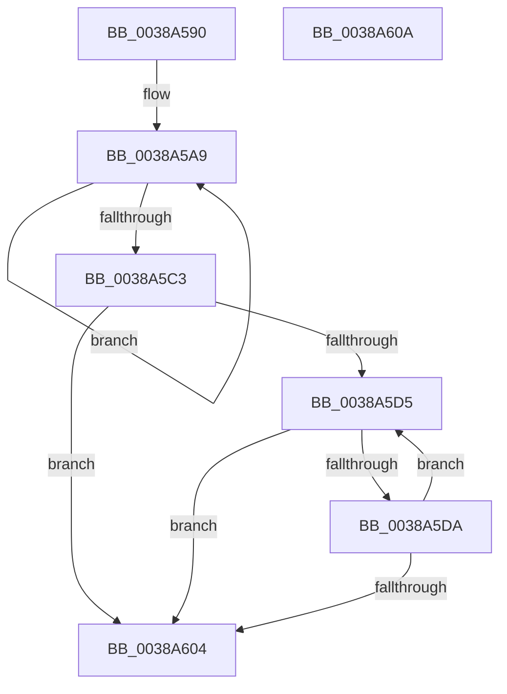

# CcGetVacbLargeOffset

- RVA: `0x0038A590`–`0x0038A60B` (길이 `123` bytes)
- VA: `0x000000014038A590`
- 실행 섹션: `.text`
- PDB 이름 있음: `예`; PDB Function 태그: `아니요`
- unwind 정보 RVA: `0x00071750`
- 디코드: `38`개 명령, `123/123` bytes 표시
- 미해석 바이트: `0` (있으면 어셈블리에 `.byte`로 보존)

> 이 문서는 커널 이미지의 기계어와 PDB 기호를 분석해 생성했습니다. 4번과 5번은 함수 원형과 자료형을 바이너리 사용 방식에서 추정한 C 해석이며 원본 소스 복구 결과는 아닙니다.

## 1. Dependencies

- 직접 호출 지점: **0**; 고유 호출 대상: **0**
- 직접 호출자로 확인된 함수: **3**
- RIP 상대 이미지 참조: **0**

### Outgoing calls
- 직접 디코드된 call 명령이 없습니다.

### Direct callers
- [CcUnmapInactiveViewsInternal](../27/CcUnmapInactiveViewsInternal_function_0027174C.md) at `0x002719E8`
- [CcGetVirtualAddress](../34/CcGetVirtualAddress_function_00340C9C.md) at `0x00340DC0`
- [CcUnmapVacbArray](CcUnmapVacbArray_function_0038AEAC.md) at `0x0038AF54`

### Static image references
- 디코드된 RIP-relative 메모리 참조가 없습니다.

## 2. Other-region calls and transfers

- 다른 실행 섹션으로 향하는 call: **0**
- 별도 외부 분기/꼬리 이동을 확인하지 못했습니다.

## 3. Assembly (complete function range)

```asm
0038A590  48 89 5C 24 08                  mov qword ptr [rsp + 8], rbx
0038A595  48 8B 59 58                     mov rbx, qword ptr [rcx + 0x58]
0038A599  4C 8B DA                        mov r11, rdx
0038A59C  48 8B 51 20                     mov rdx, qword ptr [rcx + 0x20]
0038A5A0  45 33 C0                        xor r8d, r8d
0038A5A3  41 B9 19 00 00 00               mov r9d, 0x19
0038A5A9  45 8B D1                        mov r10d, r9d
0038A5AC  B8 01 00 00 00                  mov eax, 1
0038A5B1  41 83 C1 07                     add r9d, 7
0038A5B5  41 FF C0                        inc r8d
0038A5B8  41 8B C9                        mov ecx, r9d
0038A5BB  48 D3 E0                        shl rax, cl
0038A5BE  48 3B D0                        cmp rdx, rax
0038A5C1  7F E6                           jg 0x14038a5a9
0038A5C3  49 8B C3                        mov rax, r11
0038A5C6  41 8B CA                        mov ecx, r10d
0038A5C9  48 D3 F8                        sar rax, cl
0038A5CC  48 8B 04 C3                     mov rax, qword ptr [rbx + rax*8]
0038A5D0  48 85 C0                        test rax, rax
0038A5D3  74 2F                           je 0x14038a604
0038A5D5  45 85 C0                        test r8d, r8d
0038A5D8  74 2A                           je 0x14038a604
0038A5DA  41 8B CA                        mov ecx, r10d
0038A5DD  BA 01 00 00 00                  mov edx, 1
0038A5E2  48 D3 E2                        shl rdx, cl
0038A5E5  41 83 C2 F9                     add r10d, -7
0038A5E9  48 FF CA                        dec rdx
0038A5EC  41 8B CA                        mov ecx, r10d
0038A5EF  4C 23 DA                        and r11, rdx
0038A5F2  41 FF C8                        dec r8d
0038A5F5  49 8B D3                        mov rdx, r11
0038A5F8  48 D3 FA                        sar rdx, cl
0038A5FB  48 8B 04 D0                     mov rax, qword ptr [rax + rdx*8]
0038A5FF  48 85 C0                        test rax, rax
0038A602  75 D1                           jne 0x14038a5d5
0038A604  48 8B 5C 24 08                  mov rbx, qword ptr [rsp + 8]
0038A609  C3                              ret
0038A60A  CC                              int3
```

## 4. C-style interpretation (structured pseudocode)

```c
__int64 __fastcall CcGetVacbLargeOffset(__int64 a1, __int64 a2, int a3)
{
    __int64 result;
    __int64 v_r10;
    __int64 v_r11;
    unsigned __int64 v_stack_p8;

    v_stack_p8 = v_rbx;
    a3 = 0;
loc_0038A5A9:
    a4 = (unsigned int)((25) + (7));
    a3 = (unsigned int)((a3) + 1);
    result = (1) << ((unsigned __int8)((unsigned int)((unsigned int)(a4))));
    if ((*(unsigned __int64 *)(a1 + 32)) > result) goto loc_0038A5A9;
    result = (a2) >> (25);
    if (*(unsigned __int64 *)(*(unsigned __int64 *)(a1 + 88) + result * 8) == 0) goto loc_0038A604;
loc_0038A5D5:
    if (a3 == 0) goto loc_0038A604;
    a2 = (1) << (25);
    v_r10 = (unsigned int)((25) + (-7));
    a2 = (a2) - 1;
    v_r11 = (a2) & (a2);
    a3 = (unsigned int)((a3) - 1);
    a2 = (v_r11) >> ((unsigned __int8)((unsigned int)((unsigned int)(v_r10))));
    if (*(unsigned __int64 *)(*(unsigned __int64 *)(*(unsigned __int64 *)(a1 + 88) + result * 8) + a2 * 8) != 0) goto loc_0038A5D5;
loc_0038A604:
    return *(unsigned __int64 *)(*(unsigned __int64 *)(*(unsigned __int64 *)(a1 + 88) + result * 8) + a2 * 8);
}
```

## 5. (Beta) C Style

```c
int64_t CcGetVacbLargeOffset(void *Arg1, int64_t Arg2, int32_t Arg3)
{
    uint8_t *arg1 = (uint8_t *)Arg1;

    int64_t result;
    int64_t local_r10;
    int64_t local_r11;
    uint64_t v_stack_p8;

    v_stack_p8 = local_rbx;
    Arg3 = 0;
loc_0038A5A9:
    a4 = (uint32_t)((25) + (7));
    Arg3 = (uint32_t)((Arg3) + 1);
    result = (1) << ((uint8_t)((uint32_t)((uint32_t)(a4))));
    if ((*(uint64_t *)(arg1 + 0x20)) > result) goto loc_0038A5A9;
    result = (Arg2) >> (25);
    if (*(uint64_t *)(*(uint64_t *)(arg1 + 0x58) + result * 8) == 0) goto loc_0038A604;
loc_0038A5D5:
    if (Arg3 == 0) goto loc_0038A604;
    Arg2 = (1) << (25);
    local_r10 = (uint32_t)((25) + (-7));
    Arg2 = (Arg2) - 1;
    local_r11 = (Arg2) & (Arg2);
    Arg3 = (uint32_t)((Arg3) - 1);
    Arg2 = (local_r11) >> ((uint8_t)((uint32_t)((uint32_t)(local_r10))));
    if (*(uint64_t *)(*(uint64_t *)(*(uint64_t *)(arg1 + 0x58) + result * 8) + Arg2 * 8) != 0) goto loc_0038A5D5;
loc_0038A604:
    return *(uint64_t *)(*(uint64_t *)(*(uint64_t *)(arg1 + 0x58) + result * 8) + Arg2 * 8);
}
```

### 관측된 메모리 오프셋

구조체 형식이 확인되지 않은 접근은 인자 기준의 오프셋으로만 기록했습니다.

| 기준 인자 | 오프셋 표현 | 폭 (bit) | 접근 |
|---|---:|---:|---|
| `Arg1` | `+ 0x20` | `64` | `R` |
| `Arg1` | `+ 0x58` | `64` | `R` |

## 6. Execution-region graph

[열기: 2D/3D 그래프와 함수 탐색 컨트롤 패널](../../../control-panel.html?section=text&rva=0x0038A590&view=graph)

- 2D 그래프는 위에서 아래로 흐르고, 3D 그래프는 빈 공간을 드래그해 회전합니다. Shift+드래그는 이동, 휠은 확대·축소, 함수 노드 선택은 대상 보고서 이동입니다.

### Static fallback


