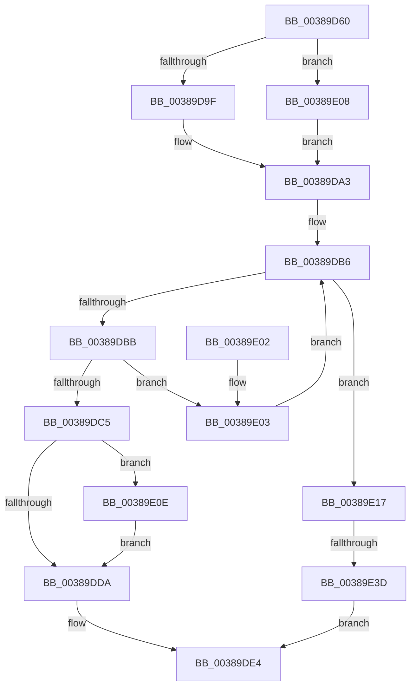

# CcInitializeVolumeCacheMap

- RVA: `0x00389D60`–`0x00389E44` (길이 `228` bytes)
- VA: `0x0000000140389D60`
- 실행 섹션: `.text`
- PDB 이름 있음: `예`; PDB Function 태그: `예`
- unwind 정보 RVA: `0x0007FF68`
- 디코드: `68`개 명령, `228/228` bytes 표시
- 미해석 바이트: `0` (있으면 어셈블리에 `.byte`로 보존)

> 이 문서는 커널 이미지의 기계어와 PDB 기호를 분석해 생성했습니다. 4번과 5번은 함수 원형과 자료형을 바이너리 사용 방식에서 추정한 C 해석이며 원본 소스 복구 결과는 아닙니다.

## 1. Dependencies

- 직접 호출 지점: **4**; 고유 호출 대상: **3**
- 직접 호출자로 확인된 함수: **1**
- RIP 상대 이미지 참조: **1**

### Outgoing calls
- `0x00389DA3` → [KeRcuReadLock](KeRcuReadLock_function_0038A1A0.md) (function, `0x0038A1A0`)
- `0x00389DDA` → [KeRcuReadUnlock](KeRcuReadUnlock_function_0038A070.md) (function, `0x0038A070`)
- `0x00389E17` → [KeRcuReadUnlock](KeRcuReadUnlock_function_0038A070.md) (function, `0x0038A070`)
- `0x00389E2C` → [ExAllocatePoolWithTag](../../poolcode/B8/ExAllocatePoolWithTag_function_00B82010.md) (function, `0x00B82010`)

### Direct callers
- [CcInitializeCacheMapInternal](../3C/CcInitializeCacheMapInternal_function_003CC720.md) at `0x003CC920`

### Static image references
- `0x00389DA8` → RVA `0x00F8F560` (`.data`; read)

## 2. Other-region calls and transfers

- 다른 실행 섹션으로 향하는 call: **1**
  - `0x00389E2C` → [ExAllocatePoolWithTag](../../poolcode/B8/ExAllocatePoolWithTag_function_00B82010.md) (`.text` → `POOLCODE`)
- call이 아닌 외부 분기/꼬리 이동: **1**
  - `0x00389E37` → [sub_006E5110](../6E/Unknown_function_006E5110.md) (`tail-transfer`)

## 3. Assembly (complete function range)

```asm
00389D60  4C 8B DC                        mov r11, rsp
00389D63  49 89 5B 08                     mov qword ptr [r11 + 8], rbx
00389D67  49 89 6B 10                     mov qword ptr [r11 + 0x10], rbp
00389D6B  49 89 73 18                     mov qword ptr [r11 + 0x18], rsi
00389D6F  57                              push rdi
00389D70  41 54                           push r12
00389D72  41 55                           push r13
00389D74  41 56                           push r14
00389D76  41 57                           push r15
00389D78  48 83 EC 40                     sub rsp, 0x40
00389D7C  48 8B 69 10                     mov rbp, qword ptr [rcx + 0x10]
00389D80  33 C0                           xor eax, eax
00389D82  0F 57 C0                        xorps xmm0, xmm0
00389D85  45 32 E4                        xor r12b, r12b
00389D88  45 32 ED                        xor r13b, r13b
00389D8B  4C 8B FA                        mov r15, rdx
00389D8E  4C 8B F1                        mov r14, rcx
00389D91  0F 11 44 24 20                  movups xmmword ptr [rsp + 0x20], xmm0
00389D96  49 89 43 C8                     mov qword ptr [r11 - 0x38], rax
00389D9A  48 85 ED                        test rbp, rbp
00389D9D  74 69                           je 0x140389e08
00389D9F  48 8B 6D 08                     mov rbp, qword ptr [rbp + 8]
00389DA3  E8 F8 03 00 00                  call 0x14038a1a0
00389DA8  48 8B 05 B1 57 C0 00            mov rax, qword ptr [rip + 0xc057b1]
00389DAF  48 8D 35 AA 57 C0 00            lea rsi, [rip + 0xc057aa]
00389DB6  48 3B C6                        cmp rax, rsi
00389DB9  74 5C                           je 0x140389e17
00389DBB  48 8D 78 E8                     lea rdi, [rax - 0x18]
00389DBF  48 39 6F 10                     cmp qword ptr [rdi + 0x10], rbp
00389DC3  75 3E                           jne 0x140389e03
00389DC5  BB 01 00 00 00                  mov ebx, 1
00389DCA  8B C3                           mov eax, ebx
00389DCC  F0 48 0F C1 47 08               lock xadd qword ptr [rdi + 8], rax
00389DD2  48 03 C3                        add rax, rbx
00389DD5  48 3B C3                        cmp rax, rbx
00389DD8  7E 34                           jle 0x140389e0e
00389DDA  E8 91 02 00 00                  call 0x14038a070
00389DDF  49 89 3F                        mov qword ptr [r15], rdi
00389DE2  33 C0                           xor eax, eax
00389DE4  4C 8D 5C 24 40                  lea r11, [rsp + 0x40]
00389DE9  49 8B 5B 30                     mov rbx, qword ptr [r11 + 0x30]
00389DED  49 8B 6B 38                     mov rbp, qword ptr [r11 + 0x38]
00389DF1  49 8B 73 40                     mov rsi, qword ptr [r11 + 0x40]
00389DF5  49 8B E3                        mov rsp, r11
00389DF8  41 5F                           pop r15
00389DFA  41 5E                           pop r14
00389DFC  41 5D                           pop r13
00389DFE  41 5C                           pop r12
00389E00  5F                              pop rdi
00389E01  C3                              ret
00389E02  CC                              int3
00389E03  48 8B 00                        mov rax, qword ptr [rax]
00389E06  EB AE                           jmp 0x140389db6
00389E08  48 8B 69 08                     mov rbp, qword ptr [rcx + 8]
00389E0C  EB 95                           jmp 0x140389da3
00389E0E  B9 0E 00 00 00                  mov ecx, 0xe
00389E13  CD 29                           int 0x29
00389E15  EB C3                           jmp 0x140389dda
00389E17  E8 54 02 00 00                  call 0x14038a070
00389E1C  BA C8 0A 00 00                  mov edx, 0xac8
00389E21  B9 00 06 00 00                  mov ecx, 0x600
00389E26  41 B8 43 63 56 6D               mov r8d, 0x6d566343
00389E2C  E8 DF 81 7F 00                  call 0x140b82010
00389E31  48 8B F8                        mov rdi, rax
00389E34  48 85 C0                        test rax, rax
00389E37  0F 85 D3 B2 35 00               jne 0x1406e5110
00389E3D  B8 9A 00 00 C0                  mov eax, 0xc000009a
00389E42  EB A0                           jmp 0x140389de4
```

## 4. C-style interpretation (structured pseudocode)

```c
__int64 __fastcall CcInitializeVolumeCacheMap(__int64 a1, __int64 a2)
{
    __int64 result;
    __int64 v_r12;
    __int64 v_r13;
    __int64 v_rsp;
    unsigned __int64 v_stack_m28;
    unsigned __int64 v_stack_m48;

    *(unsigned __int64 *)(v_rsp + 8) = v_rbx;
    *(unsigned __int64 *)(v_rsp + 16) = v_rbp;
    *(unsigned __int64 *)(v_rsp + 24) = v_rsi;
    v_rsp = (v_rsp) - (64);
    result = 0;
    v_r12 = 0;
    v_r13 = 0;
    v_stack_m48 = v_xmm0;
    *(unsigned __int64 *)(v_rsp - 56) = 0;
    if (*(unsigned __int64 *)(a1 + 16) == 0) goto loc_00389E08;
loc_00389DA3:
    result = KeRcuReadLock(a1, a2, a3, a4);
loc_00389DB6:
    if ((*(unsigned __int64 *)(v_rip + 12605361)) == (v_rip + 12605354)) goto loc_00389E17;
    if ((*(unsigned __int64 *)(*(unsigned __int64 *)(v_rip + 12605361) - 24 + 16)) != (*(unsigned __int64 *)(*(unsigned __int64 *)(a1 + 16) + 8))) goto loc_00389E03;
    result = (1) + (1);
    if (result <= 1) goto loc_00389E0E;
loc_00389DDA:
    result = KeRcuReadUnlock(a1, a2, a3, a4);
    *(unsigned __int64 *)(a2) = *(unsigned __int64 *)(v_rip + 12605361) - 24;
    result = 0;
loc_00389DE4:
    return result;
loc_00389E03:
    goto loc_00389DB6;
loc_00389E08:
    goto loc_00389DA3;
loc_00389E0E:
    goto loc_00389DDA;
loc_00389E17:
    result = KeRcuReadUnlock(14, a2, a3, a4);
    result = ExAllocatePoolWithTag((unsigned int)(0x600ULL), (unsigned int)(0xAC8ULL), (unsigned int)(0x6D566343ULL), a4);
    goto loc_00389DE4;
}
```

## 5. (Beta) C Style

```c
int64_t CcInitializeVolumeCacheMap(void *Arg1, void *Arg2)
{
    uint8_t *arg1 = (uint8_t *)Arg1;
    uint8_t *arg2 = (uint8_t *)Arg2;

    int64_t result;
    int64_t local_r12;
    int64_t local_r13;
    int64_t local_rsp;
    uint64_t v_stack_m28;
    uint64_t v_stack_m48;

    *(uint64_t *)(local_rsp + 0x8) = local_rbx;
    *(uint64_t *)(local_rsp + 0x10) = local_rbp;
    *(uint64_t *)(local_rsp + 0x18) = local_rsi;
    local_rsp = (local_rsp) - (64);
    result = 0;
    local_r12 = 0;
    local_r13 = 0;
    v_stack_m48 = v_xmm0;
    *(uint64_t *)(local_rsp - 0x38) = 0;
    if (*(uint64_t *)(arg1 + 0x10) == 0) goto loc_00389E08;
loc_00389DA3:
    result = KeRcuReadLock(Arg1, Arg2, a3, a4);
loc_00389DB6:
    if ((*(uint64_t *)(v_rip + 0xC057B1)) == (v_rip + 12605354)) goto loc_00389E17;
    if ((*(uint64_t *)(*(uint64_t *)(v_rip + 0xC057B1) - 0x18 + 0x10)) != (*(uint64_t *)(*(uint64_t *)(arg1 + 0x10) + 0x8))) goto loc_00389E03;
    result = (1) + (1);
    if (result <= 1) goto loc_00389E0E;
loc_00389DDA:
    result = KeRcuReadUnlock(Arg1, Arg2, a3, a4);
    *(uint64_t *)(arg2) = *(uint64_t *)(v_rip + 0xC057B1) - 24;
    result = 0;
loc_00389DE4:
    return result;
loc_00389E03:
    goto loc_00389DB6;
loc_00389E08:
    goto loc_00389DA3;
loc_00389E0E:
    goto loc_00389DDA;
loc_00389E17:
    result = KeRcuReadUnlock(14, Arg2, a3, a4);
    result = ExAllocatePoolWithTag((uint32_t)(0x600ULL), (uint32_t)(0xAC8ULL), (uint32_t)(0x6D566343ULL), a4);
    goto loc_00389DE4;
}
```

### 관측된 메모리 오프셋

구조체 형식이 확인되지 않은 접근은 인자 기준의 오프셋으로만 기록했습니다.

| 기준 인자 | 오프셋 표현 | 폭 (bit) | 접근 |
|---|---:|---:|---|
| `Arg1` | `+ 0x8` | `64` | `R` |
| `Arg1` | `+ 0x10` | `64` | `R` |
| `Arg2` | `+ 0x0` | `64` | `W` |

## 6. Execution-region graph

[열기: 2D/3D 그래프와 함수 탐색 컨트롤 패널](../../../control-panel.html?section=text&rva=0x00389D60&view=graph)

- 2D 그래프는 위에서 아래로 흐르고, 3D 그래프는 빈 공간을 드래그해 회전합니다. Shift+드래그는 이동, 휠은 확대·축소, 함수 노드 선택은 대상 보고서 이동입니다.

### Static fallback


