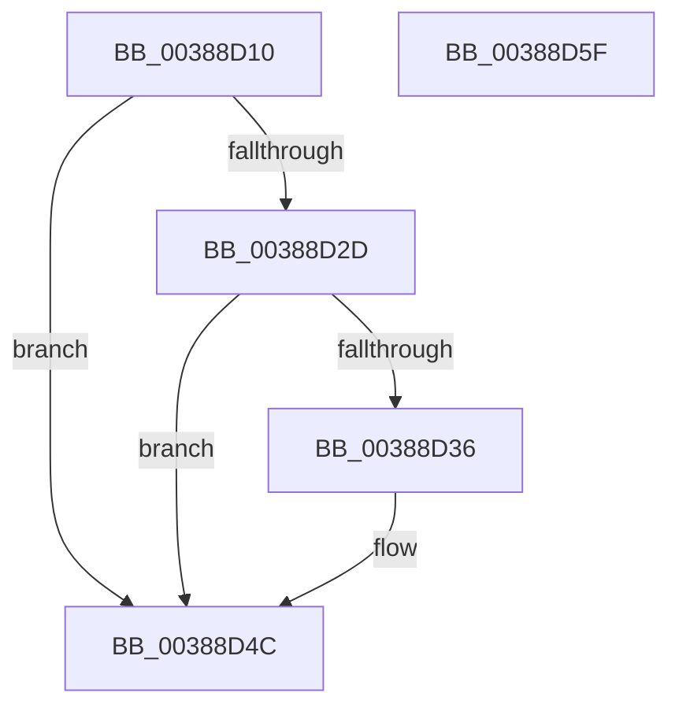

# CcIsFileObjectDirectMapped

- RVA: `0x00388D10`–`0x00388D60` (길이 `80` bytes)
- VA: `0x0000000140388D10`
- 실행 섹션: `.text`
- PDB 이름 있음: `예`; PDB Function 태그: `아니요`
- unwind 정보 RVA: `0x0005CAAC`
- 디코드: `23`개 명령, `80/80` bytes 표시
- 미해석 바이트: `0` (있으면 어셈블리에 `.byte`로 보존)

> 이 문서는 커널 이미지의 기계어와 PDB 기호를 분석해 생성했습니다. 4번과 5번은 함수 원형과 자료형을 바이너리 사용 방식에서 추정한 C 해석이며 원본 소스 복구 결과는 아닙니다.

## 1. Dependencies

- 직접 호출 지점: **2**; 고유 호출 대상: **2**
- 직접 호출자로 확인된 함수: **3**
- RIP 상대 이미지 참조: **0**

### Outgoing calls
- `0x00388D1F` → [KeRcuReadLock](KeRcuReadLock_function_0038A1A0.md) (function, `0x0038A1A0`)
- `0x00388D4C` → [KeRcuReadUnlock](KeRcuReadUnlock_function_0038A070.md) (function, `0x0038A070`)

### Direct callers
- [CcCopyWriteWontFlush](CcCopyWriteWontFlush_function_00386E40.md) at `0x00386E71`
- [CcCanIWrite](CcCanIWrite_function_00388250.md) at `0x00388352`
- [CcCanIWriteStreamEx](CcCanIWriteStreamEx_function_0038993C.md) at `0x00389B76`

### Static image references
- 디코드된 RIP-relative 메모리 참조가 없습니다.

## 2. Other-region calls and transfers

- 다른 실행 섹션으로 향하는 call: **0**
- 별도 외부 분기/꼬리 이동을 확인하지 못했습니다.

## 3. Assembly (complete function range)

```asm
00388D10  48 89 5C 24 08                  mov qword ptr [rsp + 8], rbx
00388D15  57                              push rdi
00388D16  48 83 EC 20                     sub rsp, 0x20
00388D1A  48 8B D9                        mov rbx, rcx
00388D1D  33 FF                           xor edi, edi
00388D1F  E8 7C 14 00 00                  call 0x14038a1a0
00388D24  48 8B 43 28                     mov rax, qword ptr [rbx + 0x28]
00388D28  48 85 C0                        test rax, rax
00388D2B  74 1F                           je 0x140388d4c
00388D2D  48 8B 40 08                     mov rax, qword ptr [rax + 8]
00388D31  48 85 C0                        test rax, rax
00388D34  74 16                           je 0x140388d4c
00388D36  F7 80 98 00 00 00 00 00 00 40   test dword ptr [rax + 0x98], 0x40000000
00388D40  B9 01 00 00 00                  mov ecx, 1
00388D45  40 0F B6 FF                     movzx edi, dil
00388D49  0F 45 F9                        cmovne edi, ecx
00388D4C  E8 1F 13 00 00                  call 0x14038a070
00388D51  48 8B 5C 24 30                  mov rbx, qword ptr [rsp + 0x30]
00388D56  40 8A C7                        mov al, dil
00388D59  48 83 C4 20                     add rsp, 0x20
00388D5D  5F                              pop rdi
00388D5E  C3                              ret
00388D5F  CC                              int3
```

## 4. C-style interpretation (structured pseudocode)

```c
__int64 __fastcall CcIsFileObjectDirectMapped(__int64 a1)
{
    __int64 result;
    __int64 v_rdi;
    __int64 v_rsp;
    unsigned __int64 v_stack_p8;

    v_stack_p8 = v_rbx;
    v_rsp = (v_rsp) - (32);
    v_rdi = 0;
    result = KeRcuReadLock(a1, a2, a3, a4);
    if (*(unsigned __int64 *)(a1 + 40) == 0) goto loc_00388D4C;
    if (*(unsigned __int64 *)(*(unsigned __int64 *)(a1 + 40) + 8) != 0) {
        a1 = 1;
        v_rdi = 0;
        if (((*(unsigned int *)(*(unsigned __int64 *)(*(unsigned __int64 *)(a1 + 40) + 8) + 152)) & (0x40000000ULL)) != 0) { v_rdi = (unsigned int)(a1); }
    }
    result = KeRcuReadUnlock(a1, a2, a3, a4);
    v_rsp = (v_rsp) + (32);
    return (unsigned __int8)(v_rdi);
}
```

## 5. (Beta) C Style

```c
int64_t CcIsFileObjectDirectMapped(void *Arg1)
{
    uint8_t *arg1 = (uint8_t *)Arg1;

    int64_t result;
    int64_t local_rdi;
    int64_t local_rsp;
    uint64_t v_stack_p8;

    v_stack_p8 = local_rbx;
    local_rsp = (local_rsp) - (32);
    local_rdi = 0;
    result = KeRcuReadLock(Arg1, a2, a3, a4);
    if (*(uint64_t *)(arg1 + 0x28) == 0) goto loc_00388D4C;
    if (*(uint64_t *)(*(uint64_t *)(arg1 + 0x28) + 0x8) != 0) {
        Arg1 = 1;
        local_rdi = 0;
        if (((*(uint32_t *)(*(uint64_t *)(*(uint64_t *)(arg1 + 0x28) + 0x8) + 0x98)) & (0x40000000ULL)) != 0) { local_rdi = (uint32_t)(Arg1); }
    }
    result = KeRcuReadUnlock(Arg1, a2, a3, a4);
    local_rsp = (local_rsp) + (32);
    return (uint8_t)(local_rdi);
}
```

### 관측된 메모리 오프셋

구조체 형식이 확인되지 않은 접근은 인자 기준의 오프셋으로만 기록했습니다.

| 기준 인자 | 오프셋 표현 | 폭 (bit) | 접근 |
|---|---:|---:|---|
| `Arg1` | `+ 0x28` | `64` | `R` |

## 6. Execution-region graph

[열기: 2D/3D 그래프와 함수 탐색 컨트롤 패널](../../../control-panel.html?section=text&rva=0x00388D10&view=graph)

- 2D 그래프는 위에서 아래로 흐르고, 3D 그래프는 빈 공간을 드래그해 회전합니다. Shift+드래그는 이동, 휠은 확대·축소, 함수 노드 선택은 대상 보고서 이동입니다.

### Static fallback


