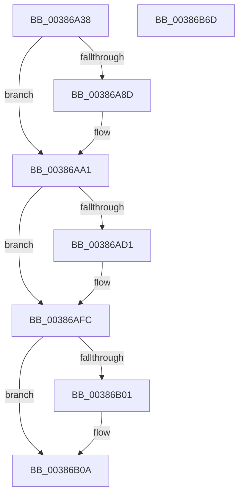

# CcPerfLogScheduleReadAhead

- RVA: `0x00386A38`–`0x00386B6E` (길이 `310` bytes)
- VA: `0x0000000140386A38`
- 실행 섹션: `.text`
- PDB 이름 있음: `예`; PDB Function 태그: `아니요`
- unwind 정보 RVA: `0x0007FBF4`
- 디코드: `89`개 명령, `310/310` bytes 표시
- 미해석 바이트: `0` (있으면 어셈블리에 `.byte`로 보존)

> 이 문서는 커널 이미지의 기계어와 PDB 기호를 분석해 생성했습니다. 4번과 5번은 함수 원형과 자료형을 바이너리 사용 방식에서 추정한 C 해석이며 원본 소스 복구 결과는 아닙니다.

## 1. Dependencies

- 직접 호출 지점: **3**; 고유 호출 대상: **3**
- 직접 호출자로 확인된 함수: **1**
- RIP 상대 이미지 참조: **1**

### Outgoing calls
- `0x00386A83` → [memset](../6C/memset_function_006C6C40.md) (function, `0x006C6C40`)
- `0x00386B3B` → [EtwTraceKernelEvent](../23/EtwTraceKernelEvent_function_00235350.md) (function, `0x00235350`)
- `0x00386B47` → [_security_check_cookie](../6A/_security_check_cookie_function_006AC640.md) (function, `0x006AC640`)

### Direct callers
- [CcScheduleReadAheadNuma](CcScheduleReadAheadNuma_function_0038883C.md) at `0x00388C79`
- [CcScheduleReadAheadNuma](CcScheduleReadAheadNuma_function_0038883C.md) at `0x00388CD3`

### Static image references
- `0x00386A5B` → RVA `0x00E0A740` (`.data`; read)

## 2. Other-region calls and transfers

- 다른 실행 섹션으로 향하는 call: **0**
- 별도 외부 분기/꼬리 이동을 확인하지 못했습니다.

## 3. Assembly (complete function range)

```asm
00386A38  48 8B C4                        mov rax, rsp
00386A3B  48 89 58 08                     mov qword ptr [rax + 8], rbx
00386A3F  48 89 70 10                     mov qword ptr [rax + 0x10], rsi
00386A43  48 89 78 18                     mov qword ptr [rax + 0x18], rdi
00386A47  4C 89 60 20                     mov qword ptr [rax + 0x20], r12
00386A4B  55                              push rbp
00386A4C  41 56                           push r14
00386A4E  41 57                           push r15
00386A50  48 8D 68 B9                     lea rbp, [rax - 0x47]
00386A54  48 81 EC A0 00 00 00            sub rsp, 0xa0
00386A5B  48 8B 05 DE 3C A8 00            mov rax, qword ptr [rip + 0xa83cde]
00386A62  48 33 C4                        xor rax, rsp
00386A65  48 89 45 1F                     mov qword ptr [rbp + 0x1f], rax
00386A69  4D 8B F8                        mov r15, r8
00386A6C  48 8B F2                        mov rsi, rdx
00386A6F  4C 8B E1                        mov r12, rcx
00386A72  33 DB                           xor ebx, ebx
00386A74  33 D2                           xor edx, edx
00386A76  48 8D 4D CF                     lea rcx, [rbp - 0x31]
00386A7A  45 8B F1                        mov r14d, r9d
00386A7D  33 FF                           xor edi, edi
00386A7F  44 8D 43 48                     lea r8d, [rbx + 0x48]
00386A83  E8 B8 01 34 00                  call 0x1406c6c40
00386A88  48 85 F6                        test rsi, rsi
00386A8B  74 14                           je 0x140386aa1
00386A8D  48 8B 46 28                     mov rax, qword ptr [rsi + 0x28]
00386A91  48 8B 5E 30                     mov rbx, qword ptr [rsi + 0x30]
00386A95  48 8B 78 08                     mov rdi, qword ptr [rax + 8]
00386A99  48 8B 46 18                     mov rax, qword ptr [rsi + 0x18]
00386A9D  48 89 45 D7                     mov qword ptr [rbp - 0x29], rax
00386AA1  49 8B 07                        mov rax, qword ptr [r15]
00386AA4  33 C9                           xor ecx, ecx
00386AA6  48 89 45 DF                     mov qword ptr [rbp - 0x21], rax
00386AAA  8B 45 6F                        mov eax, dword ptr [rbp + 0x6f]
00386AAD  89 45 EB                        mov dword ptr [rbp - 0x15], eax
00386AB0  8B 45 13                        mov eax, dword ptr [rbp + 0x13]
00386AB3  8D 51 01                        lea edx, [rcx + 1]
00386AB6  39 55 7F                        cmp dword ptr [rbp + 0x7f], edx
00386AB9  4C 89 65 CF                     mov qword ptr [rbp - 0x31], r12
00386ABD  0F 94 C1                        sete cl
00386AC0  44 89 75 E7                     mov dword ptr [rbp - 0x19], r14d
00386AC4  83 E0 FE                        and eax, 0xfffffffe
00386AC7  0B C8                           or ecx, eax
00386AC9  89 4D 13                        mov dword ptr [rbp + 0x13], ecx
00386ACC  48 85 DB                        test rbx, rbx
00386ACF  74 2B                           je 0x140386afc
00386AD1  8B 43 34                        mov eax, dword ptr [rbx + 0x34]
00386AD4  89 45 EF                        mov dword ptr [rbp - 0x11], eax
00386AD7  48 8B 43 38                     mov rax, qword ptr [rbx + 0x38]
00386ADB  48 89 45 F7                     mov qword ptr [rbp - 9], rax
00386ADF  48 8B 43 40                     mov rax, qword ptr [rbx + 0x40]
00386AE3  48 89 45 FF                     mov qword ptr [rbp - 1], rax
00386AE7  8B 03                           mov eax, dword ptr [rbx]
00386AE9  C1 E8 0F                        shr eax, 0xf
00386AEC  33 C1                           xor eax, ecx
00386AEE  83 E0 02                        and eax, 2
00386AF1  33 C1                           xor eax, ecx
00386AF3  89 45 13                        mov dword ptr [rbp + 0x13], eax
00386AF6  8B 43 30                        mov eax, dword ptr [rbx + 0x30]
00386AF9  89 45 0B                        mov dword ptr [rbp + 0xb], eax
00386AFC  48 85 FF                        test rdi, rdi
00386AFF  74 09                           je 0x140386b0a
00386B01  8B 87 98 00 00 00               mov eax, dword ptr [rdi + 0x98]
00386B07  89 45 0F                        mov dword ptr [rbp + 0xf], eax
00386B0A  8A 45 77                        mov al, byte ptr [rbp + 0x77]
00386B0D  48 8D 4D BF                     lea rcx, [rbp - 0x41]
00386B11  83 65 CB 00                     and dword ptr [rbp - 0x35], 0
00386B15  41 B9 0C 16 00 00               mov r9d, 0x160c
00386B1B  88 45 07                        mov byte ptr [rbp + 7], al
00386B1E  41 B8 00 00 02 80               mov r8d, 0x80020000
00386B24  48 8D 45 CF                     lea rax, [rbp - 0x31]
00386B28  C7 45 C7 48 00 00 00            mov dword ptr [rbp - 0x39], 0x48
00386B2F  48 89 45 BF                     mov qword ptr [rbp - 0x41], rax
00386B33  C7 44 24 20 02 19 50 00         mov dword ptr [rsp + 0x20], 0x501902
00386B3B  E8 10 E8 EA FF                  call 0x140235350
00386B40  48 8B 4D 1F                     mov rcx, qword ptr [rbp + 0x1f]
00386B44  48 33 CC                        xor rcx, rsp
00386B47  E8 F4 5A 32 00                  call 0x1406ac640
00386B4C  4C 8D 9C 24 A0 00 00 00         lea r11, [rsp + 0xa0]
00386B54  49 8B 5B 20                     mov rbx, qword ptr [r11 + 0x20]
00386B58  49 8B 73 28                     mov rsi, qword ptr [r11 + 0x28]
00386B5C  49 8B 7B 30                     mov rdi, qword ptr [r11 + 0x30]
00386B60  4D 8B 63 38                     mov r12, qword ptr [r11 + 0x38]
00386B64  49 8B E3                        mov rsp, r11
00386B67  41 5F                           pop r15
00386B69  41 5E                           pop r14
00386B6B  5D                              pop rbp
00386B6C  C3                              ret
00386B6D  CC                              int3
```

## 4. C-style interpretation (structured pseudocode)

```c
__int64 __fastcall CcPerfLogScheduleReadAhead(__int64 a1, __int64 a2, __int64 a3, int a4)
{
    __int64 result;
    __int64 v_rbx;
    __int64 v_rdi;
    __int64 v_rsp;
    unsigned __int64 v_stack_m18;
    unsigned int v_stack_m98;

    *(unsigned __int64 *)(v_rsp + 8) = v_rbx;
    *(unsigned __int64 *)(v_rsp + 16) = v_rsi;
    *(unsigned __int64 *)(v_rsp + 24) = v_rdi;
    *(unsigned __int64 *)(v_rsp + 32) = v_r12;
    v_rsp = (v_rsp) - (160);
    result = (*(unsigned __int64 *)(v_rip + 11025630)) ^ (v_rsp);
    *(unsigned __int64 *)(v_rsp - 71 + 31) = result;
    v_rbx = 0;
    a2 = 0;
    v_rdi = 0;
    result = memset(v_rsp - 71 - 49, a2, v_rbx + 72, a4);
    if (0 != 0) {
        result = *(unsigned __int64 *)(a2 + 40);
        v_rbx = *(unsigned __int64 *)(a2 + 48);
        v_rdi = *(unsigned __int64 *)(result + 8);
        result = *(unsigned __int64 *)(a2 + 24);
        *(unsigned __int64 *)(v_rsp - 71 - 41) = result;
    }
    a1 = 0;
    *(unsigned __int64 *)(v_rsp - 71 - 33) = *(unsigned __int64 *)(a3);
    *(unsigned int *)(v_rsp - 71 - 21) = (unsigned int)((unsigned int)(*(unsigned int *)(v_rsp - 71 + 111)));
    *(unsigned __int64 *)(v_rsp - 71 - 49) = 0;
    a1 = ((*(unsigned int *)(v_rsp - 71 + 127)) == ((unsigned int)(a1 + 1))) ? 1 : 0;
    *(unsigned int *)(v_rsp - 71 - 25) = (unsigned int)((unsigned int)(a4));
    result = (unsigned int)(((unsigned int)(*(unsigned int *)(v_rsp - 71 + 19))) & (0xFFFFFFFEULL));
    a1 = (unsigned int)((a1) | ((unsigned int)(result)));
    *(unsigned int *)(v_rsp - 71 + 19) = (unsigned int)(a1);
    if (v_rbx != 0) {
        result = *(unsigned int *)(v_rbx + 52);
        *(unsigned int *)(v_rsp - 71 - 17) = (unsigned int)(result);
        result = *(unsigned __int64 *)(v_rbx + 56);
        *(unsigned __int64 *)(v_rsp - 71 - 9) = result;
        result = *(unsigned __int64 *)(v_rbx + 64);
        *(unsigned __int64 *)(v_rsp - 71 - 1) = result;
        result = *(unsigned int *)(v_rbx);
        result = (unsigned int)((result) >> (15));
        result = (unsigned int)((result) ^ ((unsigned int)(a1)));
        result = (unsigned int)((result) & (2));
        result = (unsigned int)((result) ^ ((unsigned int)(a1)));
        *(unsigned int *)(v_rsp - 71 + 19) = (unsigned int)(result);
        result = *(unsigned int *)(v_rbx + 48);
        *(unsigned int *)(v_rsp - 71 + 11) = (unsigned int)(result);
    }
    if (v_rdi != 0) {
        result = *(unsigned int *)(v_rdi + 152);
        *(unsigned int *)(v_rsp - 71 + 15) = (unsigned int)(result);
    }
    *(unsigned __int8 *)(v_rsp - 71 + 7) = (unsigned __int8)(*(unsigned __int8 *)(v_rsp - 71 + 119));
    *(unsigned int *)(v_rsp - 71 - 57) = 72;
    *(unsigned __int64 *)(v_rsp - 71 - 65) = v_rsp - 71 - 49;
    v_stack_m98 = 0x501902ULL;
    result = EtwTraceKernelEvent(v_rsp - 71 - 65, a1 + 1, (unsigned int)(0x80020000ULL), (unsigned int)(0x160CULL));
    a1 = (*(unsigned __int64 *)(v_rsp - 71 + 31)) ^ (v_rsp);
    result = _security_check_cookie(a1, a1 + 1, (unsigned int)(0x80020000ULL), (unsigned int)(0x160CULL));
    return result;
}
```

## 5. (Beta) C Style

```c
int64_t CcPerfLogScheduleReadAhead(int64_t Arg1, int64_t Arg2, void *Arg3, int32_t Arg4)
{
    uint8_t *arg3 = (uint8_t *)Arg3;

    int64_t result;
    int64_t local_rbx;
    int64_t local_rdi;
    int64_t local_rsp;
    uint64_t v_stack_m18;
    uint32_t v_stack_m98;

    *(uint64_t *)(local_rsp + 0x8) = local_rbx;
    *(uint64_t *)(local_rsp + 0x10) = local_rsi;
    *(uint64_t *)(local_rsp + 0x18) = local_rdi;
    *(uint64_t *)(local_rsp + 0x20) = local_r12;
    local_rsp = (local_rsp) - (160);
    result = (*(uint64_t *)(v_rip + 0xA83CDE)) ^ (local_rsp);
    *(uint64_t *)(local_rsp - 0x47 + 0x1F) = result;
    local_rbx = 0;
    Arg2 = 0;
    local_rdi = 0;
    result = memset(local_rsp - 71 - 49, Arg2, local_rbx + 72, Arg4);
    if (0 != 0) {
        result = *(uint64_t *)(Arg2 + 0x28);
        local_rbx = *(uint64_t *)(Arg2 + 0x30);
        local_rdi = *(uint64_t *)(result + 0x8);
        result = *(uint64_t *)(Arg2 + 0x18);
        *(uint64_t *)(local_rsp - 0x47 - 0x29) = result;
    }
    Arg1 = 0;
    *(uint64_t *)(local_rsp - 0x47 - 0x21) = *(uint64_t *)(arg3);
    *(uint32_t *)(local_rsp - 0x47 - 0x15) = (uint32_t)((uint32_t)(*(uint32_t *)(local_rsp - 0x47 + 0x6F)));
    *(uint64_t *)(local_rsp - 0x47 - 0x31) = 0;
    Arg1 = ((*(uint32_t *)(local_rsp - 0x47 + 0x7F)) == ((uint32_t)(Arg1 + 1))) ? 1 : 0;
    *(uint32_t *)(local_rsp - 0x47 - 0x19) = (uint32_t)((uint32_t)(Arg4));
    result = (uint32_t)(((uint32_t)(*(uint32_t *)(local_rsp - 0x47 + 0x13))) & (0xFFFFFFFEULL));
    Arg1 = (uint32_t)((Arg1) | ((uint32_t)(result)));
    *(uint32_t *)(local_rsp - 0x47 + 0x13) = (uint32_t)(Arg1);
    if (local_rbx != 0) {
        result = *(uint32_t *)(local_rbx + 0x34);
        *(uint32_t *)(local_rsp - 0x47 - 0x11) = (uint32_t)(result);
        result = *(uint64_t *)(local_rbx + 0x38);
        *(uint64_t *)(local_rsp - 0x47 - 0x9) = result;
        result = *(uint64_t *)(local_rbx + 0x40);
        *(uint64_t *)(local_rsp - 0x47 - 0x1) = result;
        result = *(uint32_t *)(local_rbx);
        result = (uint32_t)((result) >> (15));
        result = (uint32_t)((result) ^ ((uint32_t)(Arg1)));
        result = (uint32_t)((result) & (2));
        result = (uint32_t)((result) ^ ((uint32_t)(Arg1)));
        *(uint32_t *)(local_rsp - 0x47 + 0x13) = (uint32_t)(result);
        result = *(uint32_t *)(local_rbx + 0x30);
        *(uint32_t *)(local_rsp - 0x47 + 0xB) = (uint32_t)(result);
    }
    if (local_rdi != 0) {
        result = *(uint32_t *)(local_rdi + 0x98);
        *(uint32_t *)(local_rsp - 0x47 + 0xF) = (uint32_t)(result);
    }
    *(uint8_t *)(local_rsp - 0x47 + 0x7) = (uint8_t)(*(uint8_t *)(local_rsp - 0x47 + 0x77));
    *(uint32_t *)(local_rsp - 0x47 - 0x39) = 72;
    *(uint64_t *)(local_rsp - 0x47 - 0x41) = local_rsp - 71 - 49;
    v_stack_m98 = 0x501902ULL;
    result = EtwTraceKernelEvent(local_rsp - 71 - 65, Arg1 + 1, (uint32_t)(0x80020000ULL), (uint32_t)(0x160CULL));
    Arg1 = (*(uint64_t *)(local_rsp - 0x47 + 0x1F)) ^ (local_rsp);
    result = _security_check_cookie(Arg1, Arg1 + 1, (uint32_t)(0x80020000ULL), (uint32_t)(0x160CULL));
    return result;
}
```

### 관측된 메모리 오프셋

구조체 형식이 확인되지 않은 접근은 인자 기준의 오프셋으로만 기록했습니다.

| 기준 인자 | 오프셋 표현 | 폭 (bit) | 접근 |
|---|---:|---:|---|
| `Arg3` | `+ 0x0` | `64` | `R` |

## 6. Execution-region graph

[열기: 2D/3D 그래프와 함수 탐색 컨트롤 패널](../../../control-panel.html?section=text&rva=0x00386A38&view=graph)

- 2D 그래프는 위에서 아래로 흐르고, 3D 그래프는 빈 공간을 드래그해 회전합니다. Shift+드래그는 이동, 휠은 확대·축소, 함수 노드 선택은 대상 보고서 이동입니다.

### Static fallback


