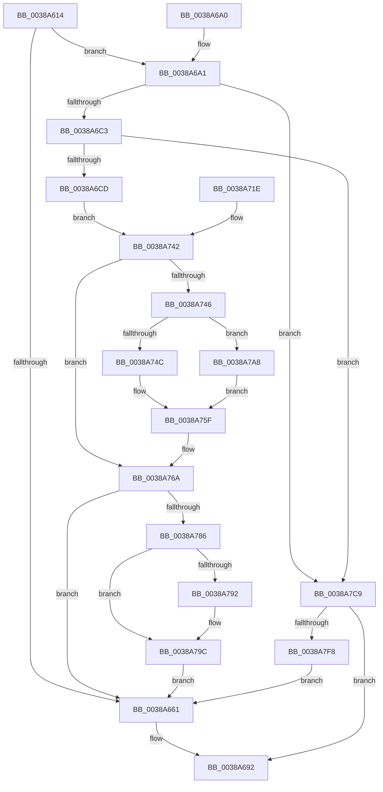

# CcPurgeAndClearCacheSection

- RVA: `0x0038A614`–`0x0038A7FD` (길이 `489` bytes)
- VA: `0x000000014038A614`
- 실행 섹션: `.text`
- PDB 이름 있음: `예`; PDB Function 태그: `아니요`
- unwind 정보 RVA: `0x00080000`
- 디코드: `126`개 명령, `489/489` bytes 표시
- 미해석 바이트: `0` (있으면 어셈블리에 `.byte`로 보존)

> 이 문서는 커널 이미지의 기계어와 PDB 기호를 분석해 생성했습니다. 4번과 5번은 함수 원형과 자료형을 바이너리 사용 방식에서 추정한 C 해석이며 원본 소스 복구 결과는 아닙니다.

## 1. Dependencies

- 직접 호출 지점: **10**; 고유 호출 대상: **10**
- 직접 호출자로 확인된 함수: **1**
- RIP 상대 이미지 참조: **0**

### Outgoing calls
- `0x0038A64A` → [CcReferenceSharedCacheMapFileObject](../23/CcReferenceSharedCacheMapFileObject_function_002379BC.md) (function, `0x002379BC`)
- `0x0038A66E` → [CcPurgeCacheSection](CcPurgeCacheSection_function_0038B130.md) (function, `0x0038B130`)
- `0x0038A682` → [ObFastDereferenceObjectDeferDelete](../23/ObFastDereferenceObjectDeferDelete_function_002378C0.md) (function, `0x002378C0`)
- `0x0038A6FE` → [CcGetVirtualAddress](../34/CcGetVirtualAddress_function_00340C9C.md) (function, `0x00340C9C`)
- `0x0038A710` → [memset](../6C/memset_function_006C6C40.md) (function, `0x006C6C40`)
- `0x0038A75A` → [CcSetDirtyInMask](../3C/CcSetDirtyInMask_function_003CB688.md) (function, `0x003CB688`)
- `0x0038A797` → [KeSetEvent](../33/KeSetEvent_function_0033F310.md) (function, `0x0033F310`)
- `0x0038A7B2` → [MmSetAddressRangeModifiedEx](../23/MmSetAddressRangeModifiedEx_function_00236F20.md) (function, `0x00236F20`)
- `0x0038A7C2` → [CcUpdateSharedCacheMapFlag](../45/CcUpdateSharedCacheMapFlag_function_0045EC14.md) (function, `0x0045EC14`)
- `0x0038A7E7` → [MmFlushSection](../23/MmFlushSection_function_002375E4.md) (function, `0x002375E4`)

### Direct callers
- [CcSetFileSizesEx](../26/CcSetFileSizesEx_function_0026D070.md) at `0x0026D245`

### Static image references
- 디코드된 RIP-relative 메모리 참조가 없습니다.

## 2. Other-region calls and transfers

- 다른 실행 섹션으로 향하는 call: **0**
- 별도 외부 분기/꼬리 이동을 확인하지 못했습니다.

## 3. Assembly (complete function range)

```asm
0038A614  48 8B C4                        mov rax, rsp
0038A617  48 89 48 08                     mov qword ptr [rax + 8], rcx
0038A61B  53                              push rbx
0038A61C  56                              push rsi
0038A61D  57                              push rdi
0038A61E  41 55                           push r13
0038A620  41 56                           push r14
0038A622  41 57                           push r15
0038A624  48 83 EC 78                     sub rsp, 0x78
0038A628  4C 8B FA                        mov r15, rdx
0038A62B  48 8B F1                        mov rsi, rcx
0038A62E  33 FF                           xor edi, edi
0038A630  48 89 78 90                     mov qword ptr [rax - 0x70], rdi
0038A634  0F 57 C0                        xorps xmm0, xmm0
0038A637  0F 11 40 B0                     movups xmmword ptr [rax - 0x50], xmm0
0038A63B  48 89 78 98                     mov qword ptr [rax - 0x68], rdi
0038A63F  C7 84 24 C0 00 00 00 01 00 00 00  mov dword ptr [rsp + 0xc0], 1
0038A64A  E8 6D D3 EA FF                  call 0x1402379bc
0038A64F  4C 8B E8                        mov r13, rax
0038A652  48 89 44 24 48                  mov qword ptr [rsp + 0x48], rax
0038A657  B9 FF 0F 00 00                  mov ecx, 0xfff
0038A65C  41 85 0F                        test dword ptr [r15], ecx
0038A65F  75 40                           jne 0x14038a6a1
0038A661  45 33 C9                        xor r9d, r9d
0038A664  45 33 C0                        xor r8d, r8d
0038A667  49 8B D7                        mov rdx, r15
0038A66A  49 8B 4D 28                     mov rcx, qword ptr [r13 + 0x28]
0038A66E  E8 BD 0A 00 00                  call 0x14038b130
0038A673  8A D8                           mov bl, al
0038A675  48 8D 4E 60                     lea rcx, [rsi + 0x60]
0038A679  41 B8 43 63 53 63               mov r8d, 0x63536343
0038A67F  49 8B D5                        mov rdx, r13
0038A682  E8 39 D2 EA FF                  call 0x1402378c0
0038A687  F6 DB                           neg bl
0038A689  1B C0                           sbb eax, eax
0038A68B  F7 D0                           not eax
0038A68D  25 35 04 00 C0                  and eax, 0xc0000435
0038A692  48 83 C4 78                     add rsp, 0x78
0038A696  41 5F                           pop r15
0038A698  41 5E                           pop r14
0038A69A  41 5D                           pop r13
0038A69C  5F                              pop rdi
0038A69D  5E                              pop rsi
0038A69E  5B                              pop rbx
0038A69F  C3                              ret
0038A6A0  CC                              int3
0038A6A1  49 8B 1F                        mov rbx, qword ptr [r15]
0038A6A4  48 89 5C 24 38                  mov qword ptr [rsp + 0x38], rbx
0038A6A9  4C 8D 7C 24 38                  lea r15, [rsp + 0x38]
0038A6AE  4C 89 BC 24 B8 00 00 00         mov qword ptr [rsp + 0xb8], r15
0038A6B6  48 39 BE B0 00 00 00            cmp qword ptr [rsi + 0xb0], rdi
0038A6BD  0F 84 06 01 00 00               je 0x14038a7c9
0038A6C3  48 39 7E 58                     cmp qword ptr [rsi + 0x58], rdi
0038A6C7  0F 84 FC 00 00 00               je 0x14038a7c9
0038A6CD  8B C3                           mov eax, ebx
0038A6CF  23 C1                           and eax, ecx
0038A6D1  41 BE 00 10 00 00               mov r14d, 0x1000
0038A6D7  44 2B F0                        sub r14d, eax
0038A6DA  44 89 B4 24 C8 00 00 00         mov dword ptr [rsp + 0xc8], r14d
0038A6E2  89 7C 24 28                     mov dword ptr [rsp + 0x28], edi
0038A6E6  C7 44 24 20 01 00 00 00         mov dword ptr [rsp + 0x20], 1
0038A6EE  4C 8D 4C 24 30                  lea r9, [rsp + 0x30]
0038A6F3  4C 8D 44 24 40                  lea r8, [rsp + 0x40]
0038A6F8  48 8B D3                        mov rdx, rbx
0038A6FB  48 8B CE                        mov rcx, rsi
0038A6FE  E8 99 65 FB FF                  call 0x140340c9c
0038A703  48 89 44 24 50                  mov qword ptr [rsp + 0x50], rax
0038A708  45 8B C6                        mov r8d, r14d
0038A70B  33 D2                           xor edx, edx
0038A70D  48 8B C8                        mov rcx, rax
0038A710  E8 2B C5 33 00                  call 0x1406c6c40
0038A715  8B 84 24 C0 00 00 00            mov eax, dword ptr [rsp + 0xc0]
0038A71C  EB 24                           jmp 0x14038a742
0038A71E  33 C0                           xor eax, eax
0038A720  4C 8B BC 24 B8 00 00 00         mov r15, qword ptr [rsp + 0xb8]
0038A728  48 8B B4 24 B0 00 00 00         mov rsi, qword ptr [rsp + 0xb0]
0038A730  44 8B B4 24 C8 00 00 00         mov r14d, dword ptr [rsp + 0xc8]
0038A738  48 8B 5C 24 38                  mov rbx, qword ptr [rsp + 0x38]
0038A73D  4C 8B 6C 24 48                  mov r13, qword ptr [rsp + 0x48]
0038A742  85 C0                           test eax, eax
0038A744  74 24                           je 0x14038a76a
0038A746  48 3B 5E 30                     cmp rbx, qword ptr [rsi + 0x30]
0038A74A  7F 5C                           jg 0x14038a7a8
0038A74C  45 33 C9                        xor r9d, r9d
0038A74F  45 8B C6                        mov r8d, r14d
0038A752  48 8D 54 24 38                  lea rdx, [rsp + 0x38]
0038A757  48 8B CE                        mov rcx, rsi
0038A75A  E8 29 0F 04 00                  call 0x1403cb688
0038A75F  41 8B C6                        mov eax, r14d
0038A762  48 03 D8                        add rbx, rax
0038A765  48 89 5C 24 38                  mov qword ptr [rsp + 0x38], rbx
0038A76A  48 8B 4C 24 40                  mov rcx, qword ptr [rsp + 0x40]
0038A76F  48 8B 59 08                     mov rbx, qword ptr [rcx + 8]
0038A773  83 C8 FF                        or eax, 0xffffffff
0038A776  F0 0F C1 41 10                  lock xadd dword ptr [rcx + 0x10], eax
0038A77B  FF C8                           dec eax
0038A77D  66 85 C0                        test ax, ax
0038A780  0F 85 DB FE FF FF               jne 0x14038a661
0038A786  48 8B 8B C0 00 00 00            mov rcx, qword ptr [rbx + 0xc0]
0038A78D  48 85 C9                        test rcx, rcx
0038A790  74 0A                           je 0x14038a79c
0038A792  45 33 C0                        xor r8d, r8d
0038A795  33 D2                           xor edx, edx
0038A797  E8 74 4B FB FF                  call 0x14033f310
0038A79C  F0 FF 8B 28 02 00 00            lock dec dword ptr [rbx + 0x228]
0038A7A3  E9 B9 FE FF FF                  jmp 0x14038a661
0038A7A8  BA 01 00 00 00                  mov edx, 1
0038A7AD  48 8B 4C 24 50                  mov rcx, qword ptr [rsp + 0x50]
0038A7B2  E8 69 C7 EA FF                  call 0x140236f20
0038A7B7  41 B0 01                        mov r8b, 1
0038A7BA  BA 00 00 02 00                  mov edx, 0x20000
0038A7BF  48 8B CE                        mov rcx, rsi
0038A7C2  E8 4D 44 0D 00                  call 0x14045ec14
0038A7C7  EB 96                           jmp 0x14038a75f
0038A7C9  89 7C 24 28                     mov dword ptr [rsp + 0x28], edi
0038A7CD  48 8D 44 24 58                  lea rax, [rsp + 0x58]
0038A7D2  48 89 44 24 20                  mov qword ptr [rsp + 0x20], rax
0038A7D7  45 33 C9                        xor r9d, r9d
0038A7DA  45 8D 41 01                     lea r8d, [r9 + 1]
0038A7DE  48 8D 54 24 38                  lea rdx, [rsp + 0x38]
0038A7E3  49 8B 4D 28                     mov rcx, qword ptr [r13 + 0x28]
0038A7E7  E8 F8 CD EA FF                  call 0x1402375e4
0038A7EC  8B 44 24 58                     mov eax, dword ptr [rsp + 0x58]
0038A7F0  85 C0                           test eax, eax
0038A7F2  0F 88 9A FE FF FF               js 0x14038a692
0038A7F8  E9 64 FE FF FF                  jmp 0x14038a661
```

## 4. C-style interpretation (structured pseudocode)

```c
__int64 __fastcall CcPurgeAndClearCacheSection(__int64 a1, __int64 a2, int a3, int a4)
{
    __int64 result;
    __int64 v_r14;
    __int64 v_rbx;
    __int64 v_rdi;
    __int64 v_rsp;
    unsigned __int64 v_stack_m60;
    unsigned int v_stack_p18;
    unsigned int v_stack_p20;
    unsigned int v_stack_p28;
    unsigned __int64 v_stack_p30;
    unsigned __int64 v_stack_p38;
    unsigned __int64 v_stack_p40;
    unsigned __int64 v_stack_p48;
    unsigned __int64 v_stack_p50;
    unsigned __int64 v_stack_p58;
    unsigned __int64 v_stack_pB0;
    unsigned __int64 v_stack_pB8;
    unsigned int v_stack_pC0;
    unsigned int v_stack_pC8;

    *(unsigned __int64 *)(v_rsp + 8) = a1;
    v_rsp = (v_rsp) - (120);
    v_rdi = 0;
    *(unsigned __int64 *)(v_rsp - 112) = 0;
    *(unsigned __int64 *)(v_rsp - 80) = v_xmm0;
    *(unsigned __int64 *)(v_rsp - 104) = 0;
    v_stack_p18 = 1;
    result = CcReferenceSharedCacheMapFileObject(a1, a2, a3, a4);
    v_stack_m60 = result;
    if (((*(unsigned int *)(a2)) & ((unsigned int)((unsigned int)(0xFFFULL)))) != 0) goto loc_0038A6A1;
loc_0038A661:
    a4 = 0;
    a3 = 0;
    result = CcPurgeCacheSection(*(unsigned __int64 *)(result + 40), a2, a3, a4);
    result = ObFastDereferenceObjectDeferDelete(a1 + 96, result, (unsigned int)(0x63536343ULL), a4);
    v_rbx = (unsigned __int8)(-((unsigned __int8)(result)));
    result = (unsigned int)(~(result));
    result = (unsigned int)((result) & (0xC0000435ULL));
loc_0038A692:
    v_rsp = (v_rsp) + (120);
    return result;
loc_0038A6A1:
    v_stack_p38 = *(unsigned __int64 *)(a2);
    v_stack_pB8 = v_stack_p38;
    if ((*(unsigned __int64 *)(a1 + 176)) == 0) goto loc_0038A7C9;
    if ((*(unsigned __int64 *)(a1 + 88)) == 0) goto loc_0038A7C9;
    result = (unsigned int)(((unsigned int)((unsigned int)(*(unsigned __int64 *)(a2)))) & ((unsigned int)(a1 + 96)));
    v_r14 = (unsigned int)(((unsigned int)(0x1000ULL)) - ((unsigned int)(result)));
    v_stack_pC8 = (unsigned int)(v_r14);
    v_stack_p28 = 0;
    v_stack_p20 = 1;
    result = CcGetVirtualAddress(a1, *(unsigned __int64 *)(a2), v_stack_p40, v_stack_p30);
    v_stack_p50 = result;
    a2 = 0;
    result = memset(result, a2, (unsigned int)((unsigned int)(v_r14)), v_stack_p30);
    goto loc_0038A742;
loc_0038A742:
    if ((unsigned int)((unsigned int)(v_stack_pC0)) == 0) goto loc_0038A76A;
    if ((*(unsigned __int64 *)(a2)) > (*(unsigned __int64 *)(a1 + 48))) goto loc_0038A7A8;
    a4 = 0;
    result = CcSetDirtyInMask(a1, v_stack_p38, (unsigned int)((unsigned int)(v_r14)), a4);
loc_0038A75F:
    v_rbx = (*(unsigned __int64 *)(a2)) + ((unsigned int)((unsigned int)(v_r14)));
    v_stack_p38 = v_rbx;
loc_0038A76A:
    result = (unsigned int)(((unsigned int)((unsigned int)(v_r14))) | (0xFFFFFFFFULL));
    result = (unsigned int)((result) - 1);
    if ((unsigned __int16)(result) != 0) goto loc_0038A661;
    if (*(unsigned __int64 *)(*(unsigned __int64 *)(v_stack_p40 + 8) + 192) != 0) {
        a3 = 0;
        a2 = 0;
        result = KeSetEvent(*(unsigned __int64 *)(*(unsigned __int64 *)(v_stack_p40 + 8) + 192), a2, a3, a4);
    }
    goto loc_0038A661;
loc_0038A7A8:
    result = MmSetAddressRangeModifiedEx(v_stack_p50, 1, a3, a4);
    result = CcUpdateSharedCacheMapFlag(a1, (unsigned int)(0x20000ULL), 1, a4);
    goto loc_0038A75F;
loc_0038A7C9:
    v_stack_p28 = 0;
    v_stack_p20 = v_stack_p58;
    a4 = 0;
    result = MmFlushSection(*(unsigned __int64 *)(result + 40), v_stack_p38, a4 + 1, a4);
    if (sign_flag) goto loc_0038A692;
    goto loc_0038A661;
}
```

## 5. (Beta) C Style

```c
int64_t CcPurgeAndClearCacheSection(void *Arg1, void *Arg2, int32_t Arg3, int32_t Arg4)
{
    uint8_t *arg1 = (uint8_t *)Arg1;
    uint8_t *arg2 = (uint8_t *)Arg2;

    int64_t result;
    int64_t local_r14;
    int64_t local_rbx;
    int64_t local_rdi;
    int64_t local_rsp;
    uint64_t v_stack_m60;
    uint32_t v_stack_p18;
    uint32_t v_stack_p20;
    uint32_t v_stack_p28;
    uint64_t v_stack_p30;
    uint64_t v_stack_p38;
    uint64_t v_stack_p40;
    uint64_t v_stack_p48;
    uint64_t v_stack_p50;
    uint64_t v_stack_p58;
    uint64_t v_stack_pB0;
    uint64_t v_stack_pB8;
    uint32_t v_stack_pC0;
    uint32_t v_stack_pC8;

    *(void **)(local_rsp + 0x8) = Arg1;
    local_rsp = (local_rsp) - (120);
    local_rdi = 0;
    *(uint64_t *)(local_rsp - 0x70) = 0;
    *(uint64_t *)(local_rsp - 0x50) = v_xmm0;
    *(uint64_t *)(local_rsp - 0x68) = 0;
    v_stack_p18 = 1;
    result = CcReferenceSharedCacheMapFileObject(Arg1, Arg2, Arg3, Arg4);
    v_stack_m60 = result;
    if (((*(uint32_t *)(arg2)) & ((uint32_t)((uint32_t)(0xFFFULL)))) != 0) goto loc_0038A6A1;
loc_0038A661:
    Arg4 = 0;
    Arg3 = 0;
    result = CcPurgeCacheSection(*(uint64_t *)(result + 0x28), Arg2, Arg3, Arg4);
    result = ObFastDereferenceObjectDeferDelete(Arg1 + 96, result, (uint32_t)(0x63536343ULL), Arg4);
    local_rbx = (uint8_t)(-((uint8_t)(result)));
    result = (uint32_t)(~(result));
    result = (uint32_t)((result) & (0xC0000435ULL));
loc_0038A692:
    local_rsp = (local_rsp) + (120);
    return result;
loc_0038A6A1:
    v_stack_p38 = *(uint64_t *)(arg2);
    v_stack_pB8 = v_stack_p38;
    if ((*(uint64_t *)(arg1 + 0xB0)) == 0) goto loc_0038A7C9;
    if ((*(uint64_t *)(arg1 + 0x58)) == 0) goto loc_0038A7C9;
    result = (uint32_t)(((uint32_t)((uint32_t)(*(uint64_t *)(arg2)))) & ((uint32_t)(Arg1 + 96)));
    local_r14 = (uint32_t)(((uint32_t)(0x1000ULL)) - ((uint32_t)(result)));
    v_stack_pC8 = (uint32_t)(local_r14);
    v_stack_p28 = 0;
    v_stack_p20 = 1;
    result = CcGetVirtualAddress(Arg1, *(uint64_t *)(arg2), v_stack_p40, v_stack_p30);
    v_stack_p50 = result;
    Arg2 = 0;
    result = memset(result, Arg2, (uint32_t)((uint32_t)(local_r14)), v_stack_p30);
    goto loc_0038A742;
loc_0038A742:
    if ((uint32_t)((uint32_t)(v_stack_pC0)) == 0) goto loc_0038A76A;
    if ((*(uint64_t *)(arg2)) > (*(uint64_t *)(arg1 + 0x30))) goto loc_0038A7A8;
    Arg4 = 0;
    result = CcSetDirtyInMask(Arg1, v_stack_p38, (uint32_t)((uint32_t)(local_r14)), Arg4);
loc_0038A75F:
    local_rbx = (*(uint64_t *)(arg2)) + ((uint32_t)((uint32_t)(local_r14)));
    v_stack_p38 = local_rbx;
loc_0038A76A:
    result = (uint32_t)(((uint32_t)((uint32_t)(local_r14))) | (0xFFFFFFFFULL));
    result = (uint32_t)((result) - 1);
    if ((uint16_t)(result) != 0) goto loc_0038A661;
    if (*(uint64_t *)(*(uint64_t *)(v_stack_p40 + 0x8) + 0xC0) != 0) {
        Arg3 = 0;
        Arg2 = 0;
        result = KeSetEvent(*(uint64_t *)(*(uint64_t *)(v_stack_p40 + 0x8) + 0xC0), Arg2, Arg3, Arg4);
    }
    goto loc_0038A661;
loc_0038A7A8:
    result = MmSetAddressRangeModifiedEx(v_stack_p50, 1, Arg3, Arg4);
    result = CcUpdateSharedCacheMapFlag(Arg1, (uint32_t)(0x20000ULL), 1, Arg4);
    goto loc_0038A75F;
loc_0038A7C9:
    v_stack_p28 = 0;
    v_stack_p20 = v_stack_p58;
    Arg4 = 0;
    result = MmFlushSection(*(uint64_t *)(result + 0x28), v_stack_p38, Arg4 + 1, Arg4);
    if (sign_flag) goto loc_0038A692;
    goto loc_0038A661;
}
```

### 관측된 메모리 오프셋

구조체 형식이 확인되지 않은 접근은 인자 기준의 오프셋으로만 기록했습니다.

| 기준 인자 | 오프셋 표현 | 폭 (bit) | 접근 |
|---|---:|---:|---|
| `Arg1` | `+ 0x30` | `64` | `R` |
| `Arg1` | `+ 0x58` | `64` | `R` |
| `Arg1` | `+ 0x60` | `64` | `R` |
| `Arg1` | `+ 0xB0` | `64` | `R` |
| `Arg2` | `+ 0x0` | `32` | `R` |
| `Arg2` | `+ 0x0` | `64` | `R` |

## 6. Execution-region graph

[열기: 2D/3D 그래프와 함수 탐색 컨트롤 패널](../../../control-panel.html?section=text&rva=0x0038A614&view=graph)

- 2D 그래프는 위에서 아래로 흐르고, 3D 그래프는 빈 공간을 드래그해 회전합니다. Shift+드래그는 이동, 휠은 확대·축소, 함수 노드 선택은 대상 보고서 이동입니다.

### Static fallback


