# CcPurgeCacheSection

- RVA: `0x0038B130`–`0x0038B449` (길이 `793` bytes)
- VA: `0x000000014038B130`
- 실행 섹션: `.text`
- PDB 이름 있음: `예`; PDB Function 태그: `예`
- unwind 정보 RVA: `0x000800A8`
- 디코드: `198`개 명령, `793/793` bytes 표시
- 미해석 바이트: `0` (있으면 어셈블리에 `.byte`로 보존)

> 이 문서는 커널 이미지의 기계어와 PDB 기호를 분석해 생성했습니다. 4번과 5번은 함수 원형과 자료형을 바이너리 사용 방식에서 추정한 C 해석이며 원본 소스 복구 결과는 아닙니다.

## 1. Dependencies

- 직접 호출 지점: **19**; 고유 호출 대상: **13**
- 직접 호출자로 확인된 함수: **6**
- RIP 상대 이미지 참조: **6**

### Outgoing calls
- `0x0038B1FA` → [KeAcquireInStackQueuedSpinLock](../27/KeAcquireInStackQueuedSpinLock_function_002757A0.md) (function, `0x002757A0`)
- `0x0038B211` → [KeReleaseInStackQueuedSpinLock](../34/KeReleaseInStackQueuedSpinLock_function_00342CE0.md) (function, `0x00342CE0`)
- `0x0038B21A` → [KeReleaseInStackQueuedSpinLock](../34/KeReleaseInStackQueuedSpinLock_function_00342CE0.md) (function, `0x00342CE0`)
- `0x0038B25C` → [MmPurgeSection](MmPurgeSection_function_0038B450.md) (function, `0x0038B450`)
- `0x0038B29F` → [CcGetPartitionForSectionObject](CcGetPartitionForSectionObject_function_0038B740.md) (function, `0x0038B740`)
- `0x0038B2D7` → [CcUnmapVacbArray](CcUnmapVacbArray_function_0038AEAC.md) (function, `0x0038AEAC`)
- `0x0038B309` → [KiAcquireQueuedSpinLockInstrumented](../27/KiAcquireQueuedSpinLockInstrumented_function_00275850.md) (function, `0x00275850`)
- `0x0038B32F` → [KeAcquireInStackQueuedSpinLock](../27/KeAcquireInStackQueuedSpinLock_function_002757A0.md) (function, `0x002757A0`)
- `0x0038B337` → [CcDecrementOpenCount](CcDecrementOpenCount_function_0038B75C.md) (function, `0x0038B75C`)
- `0x0038B340` → [KeReleaseInStackQueuedSpinLock](../34/KeReleaseInStackQueuedSpinLock_function_00342CE0.md) (function, `0x00342CE0`)
- `0x0038B34E` → [KiRaiseIrqlProcessIrqlFlags](../4F/KiRaiseIrqlProcessIrqlFlags_function_004F56FC.md) (function, `0x004F56FC`)
- `0x0038B395` → [MmTrimSection](MmTrimSection_function_0038A4EC.md) (function, `0x0038A4EC`)
- `0x0038B3AD` → [KeAcquireInStackQueuedSpinLock](../27/KeAcquireInStackQueuedSpinLock_function_002757A0.md) (function, `0x002757A0`)
- `0x0038B3B5` → [CcDecrementOpenCount](CcDecrementOpenCount_function_0038B75C.md) (function, `0x0038B75C`)
- `0x0038B3BE` → [KeReleaseInStackQueuedSpinLock](../34/KeReleaseInStackQueuedSpinLock_function_00342CE0.md) (function, `0x00342CE0`)
- `0x0038B3CE` → [KxWaitForLockOwnerShip](../25/KxWaitForLockOwnerShip_function_00257EB0.md) (function, `0x00257EB0`)
- `0x0038B3E7` → [MmCanFileBeTruncated](../2A/MmCanFileBeTruncated_function_002ACC50.md) (function, `0x002ACC50`)
- `0x0038B409` → [KeDelayExecutionThread](../20/KeDelayExecutionThread_function_00209550.md) (function, `0x00209550`)
- `0x0038B443` → [KeBugCheckEx](../4F/KeBugCheckEx_function_004FD660.md) (function, `0x004FD660`)

### Direct callers
- [CcSetFileSizesEx](../26/CcSetFileSizesEx_function_0026D070.md) at `0x0026D1DA`
- [CcPurgeAndClearCacheSection](CcPurgeAndClearCacheSection_function_0038A614.md) at `0x0038A66E`
- [CcUnmapAndPurge](CcUnmapAndPurge_function_0038ADF0.md) at `0x0038AE40`
- [CcUninitializeCacheMap](../3C/CcUninitializeCacheMap_function_003CD520.md) at `0x003CD827`
- [CcZeroEndOfLastPage](../45/CcZeroEndOfLastPage_function_00453584.md) at `0x00453663`
- [CcCoherencyFlushAndPurgeCache](../48/CcCoherencyFlushAndPurgeCache_function_0048E3D0.md) at `0x0048E4C9`

### Static image references
- `0x0038B17D` → RVA `0x00E11CC0` (`.data`; read)
- `0x0038B1A6` → RVA `0x00FC6D20` (`ALMOSTRO`; read)
- `0x0038B1B3` → RVA `0x00FC6B06` (`ALMOSTRO`; read)
- `0x0038B1C7` → RVA `0x00E11CC0` (`.data`; read/write)
- `0x0038B2F4` → RVA `0x00F0DE58` (`.data`; read)
- `0x0038B3FE` → RVA `0x00E0A860` (`.data`; read)

## 2. Other-region calls and transfers

- 다른 실행 섹션으로 향하는 call: **0**
- call이 아닌 외부 분기/꼬리 이동: **1**
  - `0x0038B426` → [sub_006E537E](../6E/Unknown_function_006E537E.md) (`tail-transfer`)

## 3. Assembly (complete function range)

```asm
0038B130  48 89 5C 24 10                  mov qword ptr [rsp + 0x10], rbx
0038B135  44 89 4C 24 20                  mov dword ptr [rsp + 0x20], r9d
0038B13A  48 89 4C 24 08                  mov qword ptr [rsp + 8], rcx
0038B13F  55                              push rbp
0038B140  56                              push rsi
0038B141  57                              push rdi
0038B142  41 54                           push r12
0038B144  41 55                           push r13
0038B146  41 56                           push r14
0038B148  41 57                           push r15
0038B14A  48 8B EC                        mov rbp, rsp
0038B14D  48 81 EC 80 00 00 00            sub rsp, 0x80
0038B154  33 C0                           xor eax, eax
0038B156  45 8B E0                        mov r12d, r8d
0038B159  45 33 ED                        xor r13d, r13d
0038B15C  48 89 45 D8                     mov qword ptr [rbp - 0x28], rax
0038B160  45 33 FF                        xor r15d, r15d
0038B163  48 89 45 F0                     mov qword ptr [rbp - 0x10], rax
0038B167  48 8B F1                        mov rsi, rcx
0038B16A  C6 45 B0 00                     mov byte ptr [rbp - 0x50], 0
0038B16E  0F 57 C0                        xorps xmm0, xmm0
0038B171  44 89 6D B4                     mov dword ptr [rbp - 0x4c], r13d
0038B175  0F 11 45 C8                     movups xmmword ptr [rbp - 0x38], xmm0
0038B179  48 21 45 C8                     and qword ptr [rbp - 0x38], rax
0038B17D  48 8D 0D 3C 6B A8 00            lea rcx, [rip + 0xa86b3c]
0038B184  0F 57 C9                        xorps xmm1, xmm1
0038B187  48 89 4D D0                     mov qword ptr [rbp - 0x30], rcx
0038B18B  0F 11 4D E0                     movups xmmword ptr [rbp - 0x20], xmm1
0038B18F  90                              nop
0038B190  4C 89 7D B8                     mov qword ptr [rbp - 0x48], r15
0038B194  45 8B F1                        mov r14d, r9d
0038B197  48 8B FA                        mov rdi, rdx
0038B19A  44 0F 20 C3                     mov rbx, cr8
0038B19E  41 8D 45 02                     lea eax, [r13 + 2]
0038B1A2  44 0F 22 C0                     mov cr8, rax
0038B1A6  44 39 2D 73 BB C3 00            cmp dword ptr [rip + 0xc3bb73], r13d
0038B1AD  0F 85 97 01 00 00               jne 0x14038b34a
0038B1B3  F6 05 4C B9 C3 00 21            test byte ptr [rip + 0xc3b94c], 0x21
0038B1BA  88 5D D8                        mov byte ptr [rbp - 0x28], bl
0038B1BD  0F 85 31 01 00 00               jne 0x14038b2f4
0038B1C3  48 8D 55 C8                     lea rdx, [rbp - 0x38]
0038B1C7  48 87 15 F2 6A A8 00            xchg qword ptr [rip + 0xa86af2], rdx
0038B1CE  48 85 D2                        test rdx, rdx
0038B1D1  0F 85 F3 01 00 00               jne 0x14038b3ca
0038B1D7  48 8B 5E 08                     mov rbx, qword ptr [rsi + 8]
0038B1DB  48 89 5D C0                     mov qword ptr [rbp - 0x40], rbx
0038B1DF  48 85 DB                        test rbx, rbx
0038B1E2  74 32                           je 0x14038b216
0038B1E4  4C 8B BB 18 02 00 00            mov r15, qword ptr [rbx + 0x218]
0038B1EB  48 8D 55 E0                     lea rdx, [rbp - 0x20]
0038B1EF  4C 89 7D B8                     mov qword ptr [rbp - 0x48], r15
0038B1F3  49 8D 8F 00 03 00 00            lea rcx, [r15 + 0x300]
0038B1FA  E8 A1 A5 EE FF                  call 0x1402757a0
0038B1FF  8B 43 04                        mov eax, dword ptr [rbx + 4]
0038B202  48 8D 4D E0                     lea rcx, [rbp - 0x20]
0038B206  FF C0                           inc eax
0038B208  89 43 04                        mov dword ptr [rbx + 4], eax
0038B20B  FF 83 20 02 00 00               inc dword ptr [rbx + 0x220]
0038B211  E8 CA 7A FB FF                  call 0x140342ce0
0038B216  48 8D 4D C8                     lea rcx, [rbp - 0x38]
0038B21A  E8 C1 7A FB FF                  call 0x140342ce0
0038B21F  48 85 DB                        test rbx, rbx
0038B222  75 78                           jne 0x14038b29c
0038B224  48 8B 5D 40                     mov rbx, qword ptr [rbp + 0x40]
0038B228  41 83 CD 02                     or r13d, 2
0038B22C  44 8B 7D 58                     mov r15d, dword ptr [rbp + 0x58]
0038B230  41 8B C6                        mov eax, r14d
0038B233  83 E0 04                        and eax, 4
0038B236  44 0F 44 6D B4                  cmove r13d, dword ptr [rbp - 0x4c]
0038B23B  F7 D8                           neg eax
0038B23D  49 8B C4                        mov rax, r12
0038B240  1B F6                           sbb esi, esi
0038B242  83 E6 06                        and esi, 6
0038B245  FF CE                           dec esi
0038B247  48 8D 4D B0                     lea rcx, [rbp - 0x50]
0038B24B  45 8B CD                        mov r9d, r13d
0038B24E  48 89 4C 24 20                  mov qword ptr [rsp + 0x20], rcx
0038B253  4C 8B C0                        mov r8, rax
0038B256  48 8B CB                        mov rcx, rbx
0038B259  48 8B D7                        mov rdx, rdi
0038B25C  E8 EF 01 00 00                  call 0x14038b450
0038B261  44 8A F0                        mov r14b, al
0038B264  84 C0                           test al, al
0038B266  0F 84 6C 01 00 00               je 0x14038b3d8
0038B26C  48 8B 5D C0                     mov rbx, qword ptr [rbp - 0x40]
0038B270  4C 8B 7D B8                     mov r15, qword ptr [rbp - 0x48]
0038B274  48 85 DB                        test rbx, rbx
0038B277  0F 85 96 00 00 00               jne 0x14038b313
0038B27D  41 8A C6                        mov al, r14b
0038B280  48 8B 9C 24 C8 00 00 00         mov rbx, qword ptr [rsp + 0xc8]
0038B288  48 81 C4 80 00 00 00            add rsp, 0x80
0038B28F  41 5F                           pop r15
0038B291  41 5E                           pop r14
0038B293  41 5D                           pop r13
0038B295  41 5C                           pop r12
0038B297  5F                              pop rdi
0038B298  5E                              pop rsi
0038B299  5D                              pop rbp
0038B29A  C3                              ret
0038B29B  CC                              int3
0038B29C  48 8B CE                        mov rcx, rsi
0038B29F  E8 9C 04 00 00                  call 0x14038b740
0038B2A4  4C 3B F8                        cmp r15, rax
0038B2A7  0F 85 7E 01 00 00               jne 0x14038b42b
0038B2AD  41 F6 C6 01                     test r14b, 1
0038B2B1  0F 85 68 01 00 00               jne 0x14038b41f
0038B2B7  45 33 C9                        xor r9d, r9d
0038B2BA  48 8B D7                        mov rdx, rdi
0038B2BD  41 F6 C6 08                     test r14b, 8
0038B2C1  0F 85 C8 00 00 00               jne 0x14038b38f
0038B2C7  44 88 6C 24 28                  mov byte ptr [rsp + 0x28], r13b
0038B2CC  45 8B C4                        mov r8d, r12d
0038B2CF  48 8B CB                        mov rcx, rbx
0038B2D2  C6 44 24 20 01                  mov byte ptr [rsp + 0x20], 1
0038B2D7  E8 D0 FB FF FF                  call 0x14038aeac
0038B2DC  48 85 FF                        test rdi, rdi
0038B2DF  0F 84 3F FF FF FF               je 0x14038b224
0038B2E5  41 BD 01 00 00 00               mov r13d, 1
0038B2EB  44 89 6D B4                     mov dword ptr [rbp - 0x4c], r13d
0038B2EF  E9 30 FF FF FF                  jmp 0x14038b224
0038B2F4  8B 05 5E 2B B8 00               mov eax, dword ptr [rip + 0xb82b5e]
0038B2FA  85 C0                           test eax, eax
0038B2FC  0F 85 C1 FE FF FF               jne 0x14038b1c3
0038B302  48 8B D1                        mov rdx, rcx
0038B305  48 8D 4D C8                     lea rcx, [rbp - 0x38]
0038B309  E8 42 A5 EE FF                  call 0x140275850
0038B30E  E9 C4 FE FF FF                  jmp 0x14038b1d7
0038B313  45 85 E4                        test r12d, r12d
0038B316  75 0C                           jne 0x14038b324
0038B318  48 85 FF                        test rdi, rdi
0038B31B  75 42                           jne 0x14038b35f
0038B31D  48 21 BB 78 01 00 00            and qword ptr [rbx + 0x178], rdi
0038B324  49 8D 8F 00 03 00 00            lea rcx, [r15 + 0x300]
0038B32B  48 8D 55 E0                     lea rdx, [rbp - 0x20]
0038B32F  E8 6C A4 EE FF                  call 0x1402757a0
0038B334  48 8B CB                        mov rcx, rbx
0038B337  E8 20 04 00 00                  call 0x14038b75c
0038B33C  48 8D 4D E0                     lea rcx, [rbp - 0x20]
0038B340  E8 9B 79 FB FF                  call 0x140342ce0
0038B345  E9 33 FF FF FF                  jmp 0x14038b27d
0038B34A  8A D0                           mov dl, al
0038B34C  8A CB                           mov cl, bl
0038B34E  E8 A9 A3 16 00                  call 0x1404f56fc
0038B353  48 8D 0D 66 69 A8 00            lea rcx, [rip + 0xa86966]
0038B35A  E9 54 FE FF FF                  jmp 0x14038b1b3
0038B35F  48 8B 07                        mov rax, qword ptr [rdi]
0038B362  48 3B 83 78 01 00 00            cmp rax, qword ptr [rbx + 0x178]
0038B369  7D B9                           jge 0x14038b324
0038B36B  48 05 FF FF 03 00               add rax, 0x3ffff
0038B371  48 89 45 40                     mov qword ptr [rbp + 0x40], rax
0038B375  81 65 40 00 00 FC FF            and dword ptr [rbp + 0x40], 0xfffc0000
0038B37C  48 8B 45 40                     mov rax, qword ptr [rbp + 0x40]
0038B380  48 05 00 00 04 00               add rax, 0x40000
0038B386  48 89 83 78 01 00 00            mov qword ptr [rbx + 0x178], rax
0038B38D  EB 95                           jmp 0x14038b324
0038B38F  4D 8B C4                        mov r8, r12
0038B392  48 8B CE                        mov rcx, rsi
0038B395  E8 52 F1 FF FF                  call 0x14038a4ec
0038B39A  85 C0                           test eax, eax
0038B39C  0F 89 3A FF FF FF               jns 0x14038b2dc
0038B3A2  49 8D 8F 00 03 00 00            lea rcx, [r15 + 0x300]
0038B3A9  48 8D 55 E0                     lea rdx, [rbp - 0x20]
0038B3AD  E8 EE A3 EE FF                  call 0x1402757a0
0038B3B2  48 8B CB                        mov rcx, rbx
0038B3B5  E8 A2 03 00 00                  call 0x14038b75c
0038B3BA  48 8D 4D E0                     lea rcx, [rbp - 0x20]
0038B3BE  E8 1D 79 FB FF                  call 0x140342ce0
0038B3C3  32 C0                           xor al, al
0038B3C5  E9 B6 FE FF FF                  jmp 0x14038b280
0038B3CA  48 8D 4D C8                     lea rcx, [rbp - 0x38]
0038B3CE  E8 DD CA EC FF                  call 0x140257eb0
0038B3D3  E9 FF FD FF FF                  jmp 0x14038b1d7
0038B3D8  45 85 E4                        test r12d, r12d
0038B3DB  0F 85 8B FE FF FF               jne 0x14038b26c
0038B3E1  48 8B D7                        mov rdx, rdi
0038B3E4  48 8B CB                        mov rcx, rbx
0038B3E7  E8 64 18 F2 FF                  call 0x1402acc50
0038B3EC  84 C0                           test al, al
0038B3EE  0F 84 78 FE FF FF               je 0x14038b26c
0038B3F4  41 F6 C7 02                     test r15b, 2
0038B3F8  0F 85 6E FE FF FF               jne 0x14038b26c
0038B3FE  4C 8D 05 5B F4 A7 00            lea r8, [rip + 0xa7f45b]
0038B405  33 D2                           xor edx, edx
0038B407  33 C9                           xor ecx, ecx
0038B409  E8 42 E1 E7 FF                  call 0x140209550
0038B40E  49 8B C4                        mov rax, r12
0038B411  83 C6 FF                        add esi, -1
0038B414  0F 84 52 FE FF FF               je 0x14038b26c
0038B41A  E9 28 FE FF FF                  jmp 0x14038b247
0038B41F  48 8D B3 E8 00 00 00            lea rsi, [rbx + 0xe8]
0038B426  E9 53 9F 35 00                  jmp 0x1406e537e
0038B42B  4C 21 6C 24 20                  and qword ptr [rsp + 0x20], r13
0038B430  45 33 C9                        xor r9d, r9d
0038B433  BA C6 14 00 00                  mov edx, 0x14c6
0038B438  49 C7 C0 20 04 00 C0            mov r8, 0xffffffffc0000420
0038B43F  41 8D 49 34                     lea ecx, [r9 + 0x34]
0038B443  E8 18 22 17 00                  call 0x1404fd660
0038B448  CC                              int3
```

## 4. C-style interpretation (structured pseudocode)

```c
__int64 __fastcall CcPurgeCacheSection(__int64 a1, __int64 a2, int a3, int a4)
{
    __int64 result;
    __int64 v_r13;
    __int64 v_r15;
    __int64 v_rsi;
    __int64 v_rsp;
    unsigned __int64 v_stack_m48;
    unsigned __int64 v_stack_m58;
    unsigned __int64 v_stack_m60;
    unsigned __int64 v_stack_m68;
    unsigned __int64 v_stack_m70;
    unsigned __int64 v_stack_m78;
    unsigned __int64 v_stack_m80;
    unsigned int v_stack_m84;
    unsigned __int8 v_stack_m88;
    unsigned __int64 v_stack_m98;
    unsigned __int64 v_stack_p10;
    unsigned int v_stack_p20;
    unsigned __int8 v_stack_p28;
    unsigned __int64 v_stack_p8;

    v_stack_p10 = v_rbx;
    v_stack_p20 = a4;
    v_stack_p8 = a1;
    v_rsp = (v_rsp) - (128);
    result = 0;
    v_r13 = 0;
    v_stack_m60 = 0;
    v_r15 = 0;
    v_stack_m48 = 0;
    v_stack_m88 = 0;
    v_stack_m84 = 0;
    v_stack_m70 = v_xmm0;
    v_stack_m68 = v_rip + 11037500;
    v_stack_m58 = v_xmm1;
    v_stack_m80 = 0;
    if ((*(unsigned int *)(v_rip + 12827507)) != 0) goto loc_0038B34A;
loc_0038B1B3:
    v_stack_m60 = (unsigned __int8)(v_cr8);
    if (((*(unsigned __int8 *)(v_rip + 12826956)) & (33)) != 0) goto loc_0038B2F4;
loc_0038B1C3:
    if (v_stack_m70 != 0) goto loc_0038B3CA;
loc_0038B1D7:
    v_stack_m78 = *(unsigned __int64 *)(a1 + 8);
    result = v_r13 + 2;
    if (*(unsigned __int64 *)(a1 + 8) != 0) {
        v_r15 = *(unsigned __int64 *)(*(unsigned __int64 *)(a1 + 8) + 536);
        a2 = v_stack_m58;
        v_stack_m80 = v_r15;
        a1 = v_r15 + 768;
        result = KeAcquireInStackQueuedSpinLock(a1, a2, a3, a4);
        result = *(unsigned int *)(*(unsigned __int64 *)(a1 + 8) + 4);
        a1 = v_stack_m58;
        result = (unsigned int)((result) + 1);
        *(unsigned int *)(*(unsigned __int64 *)(a1 + 8) + 4) = (unsigned int)(result);
        result = KeReleaseInStackQueuedSpinLock(a1, a2, a3, a4);
    }
    result = KeReleaseInStackQueuedSpinLock(v_stack_m70, a2, a3, a4);
    if (*(unsigned __int64 *)(a1 + 8) != 0) goto loc_0038B29C;
loc_0038B224:
    v_r13 = (unsigned int)((v_r13) | (2));
    result = (unsigned int)(((unsigned int)((unsigned int)((unsigned int)(a4)))) & (4));
    if (condition_is_equal) { v_r13 = v_stack_m84; }
    result = (unsigned int)(-(result));
    v_rsi = (unsigned int)((a1) & (6));
    v_rsi = (unsigned int)((v_rsi) - 1);
loc_0038B247:
    v_stack_m98 = v_stack_m88;
    result = MmPurgeSection(v_stack_p8, a2, (unsigned int)(a3), (unsigned int)((unsigned int)(v_r13)));
    if ((unsigned __int8)(result) == 0) goto loc_0038B3D8;
loc_0038B26C:
    if (v_stack_m78 != 0) goto loc_0038B313;
loc_0038B27D:
loc_0038B280:
    v_rsp = (v_rsp) + (128);
    return (unsigned __int8)((unsigned __int8)(result));
loc_0038B29C:
    result = CcGetPartitionForSectionObject(v_rsi, a2, (unsigned int)(a3), (unsigned int)((unsigned int)(v_r13)));
    if (v_stack_m80 != result) goto loc_0038B42B;
    if ((((unsigned __int8)((unsigned __int8)(result))) & (1)) != 0) goto loc_0038B41F;
    a4 = 0;
    if ((((unsigned __int8)((unsigned __int8)(result))) & (8)) != 0) goto loc_0038B38F;
    v_stack_p28 = (unsigned __int8)(v_r13);
    v_stack_p20 = 1;
    result = CcUnmapVacbArray(v_stack_p10, a2, (unsigned int)((unsigned int)((unsigned int)(a3))), a4);
loc_0038B2DC:
    if (a2 == 0) goto loc_0038B224;
    v_stack_m84 = 1;
    goto loc_0038B224;
loc_0038B2F4:
    if ((unsigned int)((unsigned int)(*(unsigned int *)(v_rip + 12069726))) != 0) goto loc_0038B1C3;
    result = KiAcquireQueuedSpinLockInstrumented(v_stack_m70, v_stack_p10, (unsigned int)((unsigned int)((unsigned int)(a3))), a4);
    goto loc_0038B1D7;
loc_0038B313:
    if ((unsigned int)((unsigned int)(a3)) != 0) goto loc_0038B324;
    if (a2 != 0) goto loc_0038B35F;
loc_0038B324:
    result = KeAcquireInStackQueuedSpinLock(v_stack_m80 + 768, v_stack_m58, (unsigned int)((unsigned int)((unsigned int)(a3))), a4);
    result = CcDecrementOpenCount(v_stack_p10, v_stack_m58, (unsigned int)((unsigned int)((unsigned int)(a3))), a4);
    result = KeReleaseInStackQueuedSpinLock(v_stack_m58, v_stack_m58, (unsigned int)((unsigned int)((unsigned int)(a3))), a4);
    goto loc_0038B27D;
loc_0038B34A:
    result = KiRaiseIrqlProcessIrqlFlags((unsigned __int8)(v_stack_p10), (unsigned __int8)(result), (unsigned int)((unsigned int)((unsigned int)(a3))), a4);
    goto loc_0038B1B3;
loc_0038B35F:
    if ((*(unsigned __int64 *)(a2)) >= (*(unsigned __int64 *)(v_stack_p10 + 376))) goto loc_0038B324;
    result = (*(unsigned __int64 *)(a2)) + (0x3FFFFULL);
    v_stack_p8 = result;
    result = (v_stack_p8) + (0x40000ULL);
    *(unsigned __int64 *)(v_stack_p10 + 376) = result;
    goto loc_0038B324;
loc_0038B38F:
    result = MmTrimSection(v_rsi, (unsigned __int8)(result), (unsigned int)(a3), a4);
    if (!sign_flag) goto loc_0038B2DC;
    result = KeAcquireInStackQueuedSpinLock(v_stack_m80 + 768, v_stack_m58, (unsigned int)(a3), a4);
    result = CcDecrementOpenCount(v_stack_p10, v_stack_m58, (unsigned int)(a3), a4);
    result = KeReleaseInStackQueuedSpinLock(v_stack_m58, v_stack_m58, (unsigned int)(a3), a4);
    result = 0;
    goto loc_0038B280;
loc_0038B3CA:
    result = KxWaitForLockOwnerShip(v_stack_m70, v_stack_m58, (unsigned int)(a3), a4);
    goto loc_0038B1D7;
loc_0038B3D8:
    if ((unsigned int)((unsigned int)(a3)) != 0) goto loc_0038B26C;
    result = MmCanFileBeTruncated(v_stack_p10, a2, (unsigned int)(a3), a4);
    if ((unsigned __int8)(result) == 0) goto loc_0038B26C;
    if ((((unsigned __int8)(v_stack_m80)) & (2)) != 0) goto loc_0038B26C;
    a2 = 0;
    a1 = 0;
    result = KeDelayExecutionThread(a1, a2, v_rip + 11007067, a4);
    v_rsi = (unsigned int)((v_rsi) + (-1));
    if (condition_is_equal) goto loc_0038B26C;
    goto loc_0038B247;
loc_0038B41F:
loc_0038B42B:
    a4 = 0;
    result = KeBugCheckEx(a4 + 52, (unsigned int)(0x14C6ULL), 0xFFFFFFFFC0000420ULL, a4);
    return result;
}
```

## 5. (Beta) C Style

```c
int64_t CcPurgeCacheSection(void *Arg1, int64_t Arg2, int32_t Arg3, int32_t Arg4)
{
    uint8_t *arg1 = (uint8_t *)Arg1;

    int64_t result;
    int64_t local_r13;
    int64_t local_r15;
    int64_t local_rsi;
    int64_t local_rsp;
    uint64_t v_stack_m48;
    uint64_t v_stack_m58;
    uint64_t v_stack_m60;
    uint64_t v_stack_m68;
    uint64_t v_stack_m70;
    uint64_t v_stack_m78;
    uint64_t v_stack_m80;
    uint32_t v_stack_m84;
    uint8_t v_stack_m88;
    uint64_t v_stack_m98;
    uint64_t v_stack_p10;
    uint32_t v_stack_p20;
    uint8_t v_stack_p28;
    uint64_t v_stack_p8;

    v_stack_p10 = local_rbx;
    v_stack_p20 = Arg4;
    v_stack_p8 = Arg1;
    local_rsp = (local_rsp) - (128);
    result = 0;
    local_r13 = 0;
    v_stack_m60 = 0;
    local_r15 = 0;
    v_stack_m48 = 0;
    v_stack_m88 = 0;
    v_stack_m84 = 0;
    v_stack_m70 = v_xmm0;
    v_stack_m68 = v_rip + 11037500;
    v_stack_m58 = v_xmm1;
    v_stack_m80 = 0;
    if ((*(uint32_t *)(v_rip + 0xC3BB73)) != 0) goto loc_0038B34A;
loc_0038B1B3:
    v_stack_m60 = (uint8_t)(v_cr8);
    if (((*(uint8_t *)(v_rip + 0xC3B94C)) & (33)) != 0) goto loc_0038B2F4;
loc_0038B1C3:
    if (v_stack_m70 != 0) goto loc_0038B3CA;
loc_0038B1D7:
    v_stack_m78 = *(uint64_t *)(arg1 + 0x8);
    result = local_r13 + 2;
    if (*(uint64_t *)(arg1 + 0x8) != 0) {
        local_r15 = *(uint64_t *)(*(uint64_t *)(arg1 + 0x8) + 0x218);
        Arg2 = v_stack_m58;
        v_stack_m80 = local_r15;
        Arg1 = local_r15 + 768;
        result = KeAcquireInStackQueuedSpinLock(Arg1, Arg2, Arg3, Arg4);
        result = *(uint32_t *)(*(uint64_t *)(arg1 + 0x8) + 0x4);
        Arg1 = v_stack_m58;
        result = (uint32_t)((result) + 1);
        *(uint32_t *)(*(uint64_t *)(arg1 + 0x8) + 0x4) = (uint32_t)(result);
        result = KeReleaseInStackQueuedSpinLock(Arg1, Arg2, Arg3, Arg4);
    }
    result = KeReleaseInStackQueuedSpinLock(v_stack_m70, Arg2, Arg3, Arg4);
    if (*(uint64_t *)(arg1 + 0x8) != 0) goto loc_0038B29C;
loc_0038B224:
    local_r13 = (uint32_t)((local_r13) | (2));
    result = (uint32_t)(((uint32_t)((uint32_t)((uint32_t)(Arg4)))) & (4));
    if (condition_is_equal) { local_r13 = v_stack_m84; }
    result = (uint32_t)(-(result));
    local_rsi = (uint32_t)((Arg1) & (6));
    local_rsi = (uint32_t)((local_rsi) - 1);
loc_0038B247:
    v_stack_m98 = v_stack_m88;
    result = MmPurgeSection(v_stack_p8, Arg2, (uint32_t)(Arg3), (uint32_t)((uint32_t)(local_r13)));
    if ((uint8_t)(result) == 0) goto loc_0038B3D8;
loc_0038B26C:
    if (v_stack_m78 != 0) goto loc_0038B313;
loc_0038B27D:
loc_0038B280:
    local_rsp = (local_rsp) + (128);
    return (uint8_t)((uint8_t)(result));
loc_0038B29C:
    result = CcGetPartitionForSectionObject(local_rsi, Arg2, (uint32_t)(Arg3), (uint32_t)((uint32_t)(local_r13)));
    if (v_stack_m80 != result) goto loc_0038B42B;
    if ((((uint8_t)((uint8_t)(result))) & (1)) != 0) goto loc_0038B41F;
    Arg4 = 0;
    if ((((uint8_t)((uint8_t)(result))) & (8)) != 0) goto loc_0038B38F;
    v_stack_p28 = (uint8_t)(local_r13);
    v_stack_p20 = 1;
    result = CcUnmapVacbArray(v_stack_p10, Arg2, (uint32_t)((uint32_t)((uint32_t)(Arg3))), Arg4);
loc_0038B2DC:
    if (Arg2 == 0) goto loc_0038B224;
    v_stack_m84 = 1;
    goto loc_0038B224;
loc_0038B2F4:
    if ((uint32_t)((uint32_t)(*(uint32_t *)(v_rip + 0xB82B5E))) != 0) goto loc_0038B1C3;
    result = KiAcquireQueuedSpinLockInstrumented(v_stack_m70, v_stack_p10, (uint32_t)((uint32_t)((uint32_t)(Arg3))), Arg4);
    goto loc_0038B1D7;
loc_0038B313:
    if ((uint32_t)((uint32_t)(Arg3)) != 0) goto loc_0038B324;
    if (Arg2 != 0) goto loc_0038B35F;
loc_0038B324:
    result = KeAcquireInStackQueuedSpinLock(v_stack_m80 + 768, v_stack_m58, (uint32_t)((uint32_t)((uint32_t)(Arg3))), Arg4);
    result = CcDecrementOpenCount(v_stack_p10, v_stack_m58, (uint32_t)((uint32_t)((uint32_t)(Arg3))), Arg4);
    result = KeReleaseInStackQueuedSpinLock(v_stack_m58, v_stack_m58, (uint32_t)((uint32_t)((uint32_t)(Arg3))), Arg4);
    goto loc_0038B27D;
loc_0038B34A:
    result = KiRaiseIrqlProcessIrqlFlags((uint8_t)(v_stack_p10), (uint8_t)(result), (uint32_t)((uint32_t)((uint32_t)(Arg3))), Arg4);
    goto loc_0038B1B3;
loc_0038B35F:
    if ((*(uint64_t *)(Arg2)) >= (*(uint64_t *)(v_stack_p10 + 0x178))) goto loc_0038B324;
    result = (*(uint64_t *)(Arg2)) + (0x3FFFFULL);
    v_stack_p8 = result;
    result = (v_stack_p8) + (0x40000ULL);
    *(uint64_t *)(v_stack_p10 + 0x178) = result;
    goto loc_0038B324;
loc_0038B38F:
    result = MmTrimSection(local_rsi, (uint8_t)(result), (uint32_t)(Arg3), Arg4);
    if (!sign_flag) goto loc_0038B2DC;
    result = KeAcquireInStackQueuedSpinLock(v_stack_m80 + 768, v_stack_m58, (uint32_t)(Arg3), Arg4);
    result = CcDecrementOpenCount(v_stack_p10, v_stack_m58, (uint32_t)(Arg3), Arg4);
    result = KeReleaseInStackQueuedSpinLock(v_stack_m58, v_stack_m58, (uint32_t)(Arg3), Arg4);
    result = 0;
    goto loc_0038B280;
loc_0038B3CA:
    result = KxWaitForLockOwnerShip(v_stack_m70, v_stack_m58, (uint32_t)(Arg3), Arg4);
    goto loc_0038B1D7;
loc_0038B3D8:
    if ((uint32_t)((uint32_t)(Arg3)) != 0) goto loc_0038B26C;
    result = MmCanFileBeTruncated(v_stack_p10, Arg2, (uint32_t)(Arg3), Arg4);
    if ((uint8_t)(result) == 0) goto loc_0038B26C;
    if ((((uint8_t)(v_stack_m80)) & (2)) != 0) goto loc_0038B26C;
    Arg2 = 0;
    Arg1 = 0;
    result = KeDelayExecutionThread(Arg1, Arg2, v_rip + 11007067, Arg4);
    local_rsi = (uint32_t)((local_rsi) + (-1));
    if (condition_is_equal) goto loc_0038B26C;
    goto loc_0038B247;
loc_0038B41F:
loc_0038B42B:
    Arg4 = 0;
    result = KeBugCheckEx(Arg4 + 52, (uint32_t)(0x14C6ULL), 0xFFFFFFFFC0000420ULL, Arg4);
    return result;
}
```

### 관측된 메모리 오프셋

구조체 형식이 확인되지 않은 접근은 인자 기준의 오프셋으로만 기록했습니다.

| 기준 인자 | 오프셋 표현 | 폭 (bit) | 접근 |
|---|---:|---:|---|
| `Arg1` | `+ 0x8` | `64` | `R` |

## 6. Execution-region graph

[열기: 2D/3D 그래프와 함수 탐색 컨트롤 패널](../../../control-panel.html?section=text&rva=0x0038B130&view=graph)

- 2D 그래프는 위에서 아래로 흐르고, 3D 그래프는 빈 공간을 드래그해 회전합니다. Shift+드래그는 이동, 휠은 확대·축소, 함수 노드 선택은 대상 보고서 이동입니다.

### Static fallback

```mermaid
flowchart TD
  bb_0038B130[BB_0038B130]
  bb_0038B1B3[BB_0038B1B3]
  bb_0038B1C3[BB_0038B1C3]
  bb_0038B1D7[BB_0038B1D7]
  bb_0038B1E4[BB_0038B1E4]
  bb_0038B216[BB_0038B216]
  bb_0038B224[BB_0038B224]
  bb_0038B247[BB_0038B247]
  bb_0038B26C[BB_0038B26C]
  bb_0038B27D[BB_0038B27D]
  bb_0038B280[BB_0038B280]
  bb_0038B29B[BB_0038B29B]
  bb_0038B29C[BB_0038B29C]
  bb_0038B2AD[BB_0038B2AD]
  bb_0038B2B7[BB_0038B2B7]
  bb_0038B2C7[BB_0038B2C7]
  bb_0038B2DC[BB_0038B2DC]
  bb_0038B2E5[BB_0038B2E5]
  bb_0038B2F4[BB_0038B2F4]
  bb_0038B302[BB_0038B302]
  bb_0038B313[BB_0038B313]
  bb_0038B318[BB_0038B318]
  bb_0038B31D[BB_0038B31D]
  bb_0038B324[BB_0038B324]
  bb_0038B34A[BB_0038B34A]
  bb_0038B35F[BB_0038B35F]
  bb_0038B36B[BB_0038B36B]
  bb_0038B38F[BB_0038B38F]
  bb_0038B3A2[BB_0038B3A2]
  bb_0038B3CA[BB_0038B3CA]
  bb_0038B3D8[BB_0038B3D8]
  bb_0038B3E1[BB_0038B3E1]
  bb_0038B3F4[BB_0038B3F4]
  bb_0038B3FE[BB_0038B3FE]
  bb_0038B41A[BB_0038B41A]
  bb_0038B41F[BB_0038B41F]
  bb_0038B42B[BB_0038B42B]
  bb_0038B130 -->|branch| bb_0038B34A
  bb_0038B130 -->|fallthrough| bb_0038B1B3
  bb_0038B1B3 -->|branch| bb_0038B2F4
  bb_0038B1B3 -->|fallthrough| bb_0038B1C3
  bb_0038B1C3 -->|branch| bb_0038B3CA
  bb_0038B1C3 -->|fallthrough| bb_0038B1D7
  bb_0038B1D7 -->|branch| bb_0038B216
  bb_0038B1D7 -->|fallthrough| bb_0038B1E4
  bb_0038B1E4 -->|flow| bb_0038B216
  bb_0038B216 -->|branch| bb_0038B29C
  bb_0038B216 -->|fallthrough| bb_0038B224
  bb_0038B224 -->|flow| bb_0038B247
  bb_0038B247 -->|branch| bb_0038B3D8
  bb_0038B247 -->|fallthrough| bb_0038B26C
  bb_0038B26C -->|branch| bb_0038B313
  bb_0038B26C -->|fallthrough| bb_0038B27D
  bb_0038B27D -->|flow| bb_0038B280
  bb_0038B29B -->|flow| bb_0038B29C
  bb_0038B29C -->|branch| bb_0038B42B
  bb_0038B29C -->|fallthrough| bb_0038B2AD
  bb_0038B2AD -->|branch| bb_0038B41F
  bb_0038B2AD -->|fallthrough| bb_0038B2B7
  bb_0038B2B7 -->|branch| bb_0038B38F
  bb_0038B2B7 -->|fallthrough| bb_0038B2C7
  bb_0038B2C7 -->|flow| bb_0038B2DC
  bb_0038B2DC -->|branch| bb_0038B224
  bb_0038B2DC -->|fallthrough| bb_0038B2E5
  bb_0038B2E5 -->|branch| bb_0038B224
  bb_0038B2F4 -->|branch| bb_0038B1C3
  bb_0038B2F4 -->|fallthrough| bb_0038B302
  bb_0038B302 -->|branch| bb_0038B1D7
  bb_0038B313 -->|branch| bb_0038B324
  bb_0038B313 -->|fallthrough| bb_0038B318
  bb_0038B318 -->|branch| bb_0038B35F
  bb_0038B318 -->|fallthrough| bb_0038B31D
  bb_0038B31D -->|flow| bb_0038B324
  bb_0038B324 -->|branch| bb_0038B27D
  bb_0038B34A -->|branch| bb_0038B1B3
  bb_0038B35F -->|branch| bb_0038B324
  bb_0038B35F -->|fallthrough| bb_0038B36B
  bb_0038B36B -->|branch| bb_0038B324
  bb_0038B38F -->|branch| bb_0038B2DC
  bb_0038B38F -->|fallthrough| bb_0038B3A2
  bb_0038B3A2 -->|branch| bb_0038B280
  bb_0038B3CA -->|branch| bb_0038B1D7
  bb_0038B3D8 -->|branch| bb_0038B26C
  bb_0038B3D8 -->|fallthrough| bb_0038B3E1
  bb_0038B3E1 -->|branch| bb_0038B26C
  bb_0038B3E1 -->|fallthrough| bb_0038B3F4
  bb_0038B3F4 -->|branch| bb_0038B26C
  bb_0038B3F4 -->|fallthrough| bb_0038B3FE
  bb_0038B3FE -->|branch| bb_0038B26C
  bb_0038B3FE -->|fallthrough| bb_0038B41A
  bb_0038B41A -->|branch| bb_0038B247
```


