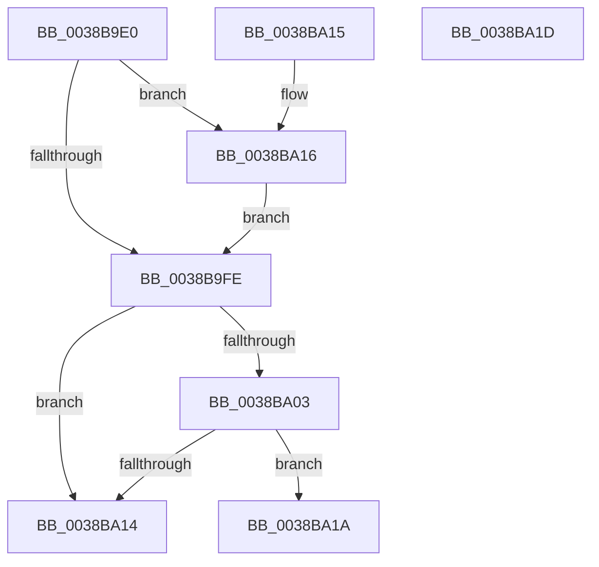

# CcReferencePartitionAndPrivateVolumeCacheMap

- RVA: `0x0038B9E0`–`0x0038BA1E` (길이 `62` bytes)
- VA: `0x000000014038B9E0`
- 실행 섹션: `.text`
- PDB 이름 있음: `예`; PDB Function 태그: `아니요`
- unwind 정보 RVA: `0x000DB714`
- 디코드: `21`개 명령, `62/62` bytes 표시
- 미해석 바이트: `0` (있으면 어셈블리에 `.byte`로 보존)

> 이 문서는 커널 이미지의 기계어와 PDB 기호를 분석해 생성했습니다. 4번과 5번은 함수 원형과 자료형을 바이너리 사용 방식에서 추정한 C 해석이며 원본 소스 복구 결과는 아닙니다.

## 1. Dependencies

- 직접 호출 지점: **0**; 고유 호출 대상: **0**
- 직접 호출자로 확인된 함수: **13**
- RIP 상대 이미지 참조: **0**

### Outgoing calls
- 직접 디코드된 call 명령이 없습니다.

### Direct callers
- [CcPostWorkQueueRegular](../35/CcPostWorkQueueRegular_function_00356834.md) at `0x00356949`
- [CcDeleteSharedCacheMap](CcDeleteSharedCacheMap_function_0038A804.md) at `0x0038A86C`
- [CcUninitializeCacheMap](../3C/CcUninitializeCacheMap_function_003CD520.md) at `0x003CD5B2`
- [CcPostWorkQueueAsyncRead](../45/CcPostWorkQueueAsyncRead_function_0045D624.md) at `0x0045D885`
- [CcInitializeAsyncReadForNodeHelper](../49/CcInitializeAsyncReadForNodeHelper_function_00498CD0.md) at `0x00499076`
- [CcPostWorkQueueAsyncLazywrite](../4B/CcPostWorkQueueAsyncLazywrite_function_004BA17C.md) at `0x004BA251`
- [CcPostWorkQueueSpecial](../4C/CcPostWorkQueueSpecial_function_004C046C.md) at `0x004C052F`
- [CcIncrementWriteBehindPriority](../57/CcIncrementWriteBehindPriority_function_0057B8AC.md) at `0x0057BA0A`
- [CcReEngageWorkerThreads](../57/CcReEngageWorkerThreads_function_0057BEB0.md) at `0x0057BF16`
- [CcReEngageWorkerThreads](../57/CcReEngageWorkerThreads_function_0057BEB0.md) at `0x0057BF6D`
- [CcDeferWrite](../57/CcDeferWrite_function_0057C860.md) at `0x0057C8EE`
- [sub_006F2098](../6F/Unknown_function_006F2098.md) at `0x006F20DB`
- [sub_006F6D7E](../6F/Unknown_function_006F6D7E.md) at `0x006F6E49`
- [sub_006F6D7E](../6F/Unknown_function_006F6D7E.md) at `0x006F6EDD`
- [sub_006FC492](../6F/Unknown_function_006FC492.md) at `0x006FC50E`

### Static image references
- 디코드된 RIP-relative 메모리 참조가 없습니다.

## 2. Other-region calls and transfers

- 다른 실행 섹션으로 향하는 call: **0**
- 별도 외부 분기/꼬리 이동을 확인하지 못했습니다.

## 3. Assembly (complete function range)

```asm
0038B9E0  41 B8 01 00 00 00               mov r8d, 1
0038B9E6  41 8B C0                        mov eax, r8d
0038B9E9  F0 48 0F C1 81 10 05 00 00      lock xadd qword ptr [rcx + 0x510], rax
0038B9F2  49 03 C0                        add rax, r8
0038B9F5  41 8D 48 0D                     lea ecx, [r8 + 0xd]
0038B9F9  49 3B C0                        cmp rax, r8
0038B9FC  7E 18                           jle 0x14038ba16
0038B9FE  48 85 D2                        test rdx, rdx
0038BA01  74 11                           je 0x14038ba14
0038BA03  49 8B C0                        mov rax, r8
0038BA06  F0 48 0F C1 42 08               lock xadd qword ptr [rdx + 8], rax
0038BA0C  49 03 C0                        add rax, r8
0038BA0F  49 3B C0                        cmp rax, r8
0038BA12  7E 06                           jle 0x14038ba1a
0038BA14  C3                              ret
0038BA15  CC                              int3
0038BA16  CD 29                           int 0x29
0038BA18  EB E4                           jmp 0x14038b9fe
0038BA1A  CD 29                           int 0x29
0038BA1C  C3                              ret
0038BA1D  CC                              int3
```

## 4. C-style interpretation (structured pseudocode)

```c
__int64 __fastcall CcReferencePartitionAndPrivateVolumeCacheMap(__int64 a1, __int64 a2)
{
    __int64 result;

    result = (1) + (1);
    if (result <= 1) goto loc_0038BA16;
loc_0038B9FE:
    if (a2 == 0) goto loc_0038BA14;
    result = (1) + (1);
    if (result <= 1) goto loc_0038BA1A;
loc_0038BA14:
    return result;
loc_0038BA16:
    goto loc_0038B9FE;
loc_0038BA1A:
    return result;
}
```

## 5. (Beta) C Style

```c
int64_t CcReferencePartitionAndPrivateVolumeCacheMap(void *Arg1, int64_t Arg2)
{
    uint8_t *arg1 = (uint8_t *)Arg1;

    int64_t result;

    result = (1) + (1);
    if (result <= 1) goto loc_0038BA16;
loc_0038B9FE:
    if (Arg2 == 0) goto loc_0038BA14;
    result = (1) + (1);
    if (result <= 1) goto loc_0038BA1A;
loc_0038BA14:
    return result;
loc_0038BA16:
    goto loc_0038B9FE;
loc_0038BA1A:
    return result;
}
```

### 관측된 메모리 오프셋

구조체 형식이 확인되지 않은 접근은 인자 기준의 오프셋으로만 기록했습니다.

| 기준 인자 | 오프셋 표현 | 폭 (bit) | 접근 |
|---|---:|---:|---|
| `Arg1` | `+ 0x510` | `64` | `R/W` |

## 6. Execution-region graph

[열기: 2D/3D 그래프와 함수 탐색 컨트롤 패널](../../../control-panel.html?section=text&rva=0x0038B9E0&view=graph)

- 2D 그래프는 위에서 아래로 흐르고, 3D 그래프는 빈 공간을 드래그해 회전합니다. Shift+드래그는 이동, 휠은 확대·축소, 함수 노드 선택은 대상 보고서 이동입니다.

### Static fallback


