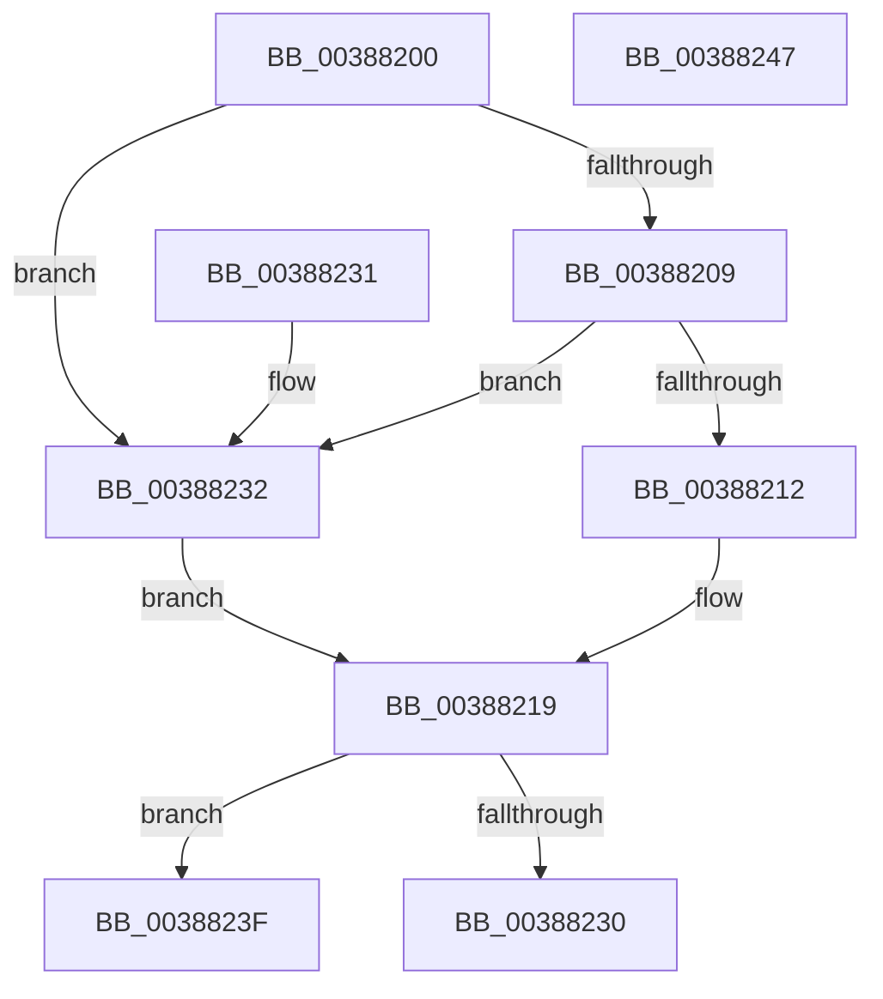

# CcReferencePartitionFromFileObject

- RVA: `0x00388200`–`0x00388248` (길이 `72` bytes)
- VA: `0x0000000140388200`
- 실행 섹션: `.text`
- PDB 이름 있음: `예`; PDB Function 태그: `아니요`
- unwind 정보 RVA: `0x000DB714`
- 디코드: `21`개 명령, `72/72` bytes 표시
- 미해석 바이트: `0` (있으면 어셈블리에 `.byte`로 보존)

> 이 문서는 커널 이미지의 기계어와 PDB 기호를 분석해 생성했습니다. 4번과 5번은 함수 원형과 자료형을 바이너리 사용 방식에서 추정한 C 해석이며 원본 소스 복구 결과는 아닙니다.

## 1. Dependencies

- 직접 호출 지점: **0**; 고유 호출 대상: **0**
- 직접 호출자로 확인된 함수: **3**
- RIP 상대 이미지 참조: **1**

### Outgoing calls
- 직접 디코드된 call 명령이 없습니다.

### Direct callers
- [CcZeroData](CcZeroData_function_00387F00.md) at `0x00387F51`
- [CcCanIWrite](CcCanIWrite_function_00388250.md) at `0x003882E8`
- [CcDeferWrite](../57/CcDeferWrite_function_0057C860.md) at `0x0057C8CD`

### Static image references
- `0x00388232` → RVA `0x00FC6EA0` (`ALMOSTRO`; read)

## 2. Other-region calls and transfers

- 다른 실행 섹션으로 향하는 call: **0**
- 별도 외부 분기/꼬리 이동을 확인하지 못했습니다.

## 3. Assembly (complete function range)

```asm
00388200  48 8B 41 28                     mov rax, qword ptr [rcx + 0x28]
00388204  48 85 C0                        test rax, rax
00388207  74 29                           je 0x140388232
00388209  48 8B 40 08                     mov rax, qword ptr [rax + 8]
0038820D  48 85 C0                        test rax, rax
00388210  74 20                           je 0x140388232
00388212  48 8B 80 18 02 00 00            mov rax, qword ptr [rax + 0x218]
00388219  B9 01 00 00 00                  mov ecx, 1
0038821E  F0 48 0F C1 88 10 05 00 00      lock xadd qword ptr [rax + 0x510], rcx
00388227  48 FF C1                        inc rcx
0038822A  48 83 F9 01                     cmp rcx, 1
0038822E  7E 0F                           jle 0x14038823f
00388230  C3                              ret
00388231  CC                              int3
00388232  48 8B 05 67 EC C3 00            mov rax, qword ptr [rip + 0xc3ec67]
00388239  48 8B 40 08                     mov rax, qword ptr [rax + 8]
0038823D  EB DA                           jmp 0x140388219
0038823F  B9 0E 00 00 00                  mov ecx, 0xe
00388244  CD 29                           int 0x29
00388246  C3                              ret
00388247  CC                              int3
```

## 4. C-style interpretation (structured pseudocode)

```c
__int64 __fastcall CcReferencePartitionFromFileObject(__int64 a1)
{
    if (*(unsigned __int64 *)(a1 + 40) == 0) goto loc_00388232;
    if (*(unsigned __int64 *)(*(unsigned __int64 *)(a1 + 40) + 8) == 0) goto loc_00388232;
loc_00388219:
    a1 = (1) + 1;
    if (a1 <= 1) goto loc_0038823F;
    return *(unsigned __int64 *)(*(unsigned __int64 *)(*(unsigned __int64 *)(a1 + 40) + 8) + 536);
loc_00388232:
    goto loc_00388219;
loc_0038823F:
    return *(unsigned __int64 *)(*(unsigned __int64 *)(v_rip + 12840039) + 8);
}
```

## 5. (Beta) C Style

```c
int64_t CcReferencePartitionFromFileObject(void *Arg1)
{
    uint8_t *arg1 = (uint8_t *)Arg1;

    if (*(uint64_t *)(arg1 + 0x28) == 0) goto loc_00388232;
    if (*(uint64_t *)(*(uint64_t *)(arg1 + 0x28) + 0x8) == 0) goto loc_00388232;
loc_00388219:
    Arg1 = (1) + 1;
    if (Arg1 <= 1) goto loc_0038823F;
    return *(uint64_t *)(*(uint64_t *)(*(uint64_t *)(arg1 + 0x28) + 0x8) + 0x218);
loc_00388232:
    goto loc_00388219;
loc_0038823F:
    return *(uint64_t *)(*(uint64_t *)(v_rip + 0xC3EC67) + 0x8);
}
```

### 관측된 메모리 오프셋

구조체 형식이 확인되지 않은 접근은 인자 기준의 오프셋으로만 기록했습니다.

| 기준 인자 | 오프셋 표현 | 폭 (bit) | 접근 |
|---|---:|---:|---|
| `Arg1` | `+ 0x28` | `64` | `R` |

## 6. Execution-region graph

[열기: 2D/3D 그래프와 함수 탐색 컨트롤 패널](../../../control-panel.html?section=text&rva=0x00388200&view=graph)

- 2D 그래프는 위에서 아래로 흐르고, 3D 그래프는 빈 공간을 드래그해 회전합니다. Shift+드래그는 이동, 휠은 확대·축소, 함수 노드 선택은 대상 보고서 이동입니다.

### Static fallback


