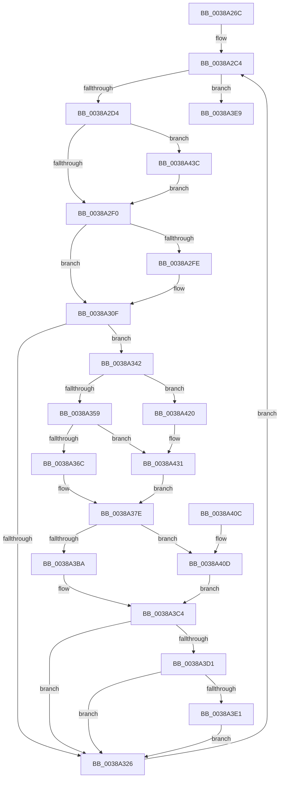

# CcScanLogHandleList

- RVA: `0x0038A26C`–`0x0038A448` (길이 `476` bytes)
- VA: `0x000000014038A26C`
- 실행 섹션: `.text`
- PDB 이름 있음: `예`; PDB Function 태그: `아니요`
- unwind 정보 RVA: `0x0007FFD4`
- 디코드: `122`개 명령, `476/476` bytes 표시
- 미해석 바이트: `0` (있으면 어셈블리에 `.byte`로 보존)

> 이 문서는 커널 이미지의 기계어와 PDB 기호를 분석해 생성했습니다. 4번과 5번은 함수 원형과 자료형을 바이너리 사용 방식에서 추정한 C 해석이며 원본 소스 복구 결과는 아닙니다.

## 1. Dependencies

- 직접 호출 지점: **9**; 고유 호출 대상: **7**
- 직접 호출자로 확인된 함수: **2**
- RIP 상대 이미지 참조: **3**

### Outgoing calls
- `0x0038A2B8` → [KeRcuReadLock](KeRcuReadLock_function_0038A1A0.md) (function, `0x0038A1A0`)
- `0x0038A2F0` → [KeRcuReadUnlock](KeRcuReadUnlock_function_0038A070.md) (function, `0x0038A070`)
- `0x0038A30A` → [guard_dispatch_icall](../6B/guard_dispatch_icall_function_006BAAD0.md) (function, `0x006BAAD0`)
- `0x0038A31B` → [KeAcquireInStackQueuedSpinLock](../27/KeAcquireInStackQueuedSpinLock_function_002757A0.md) (function, `0x002757A0`)
- `0x0038A32B` → [KeReleaseInStackQueuedSpinLock](../34/KeReleaseInStackQueuedSpinLock_function_00342CE0.md) (function, `0x00342CE0`)
- `0x0038A330` → [KeRcuReadLock](KeRcuReadLock_function_0038A1A0.md) (function, `0x0038A1A0`)
- `0x0038A33B` → [CcDecrementVolumeUseCountWithDelete](CcDecrementVolumeUseCountWithDelete_function_0038B888.md) (function, `0x0038B888`)
- `0x0038A3A6` → [CcCalculatePagesToWrite](CcCalculatePagesToWrite_function_003895AC.md) (function, `0x003895AC`)
- `0x0038A3E9` → [KeRcuReadUnlock](KeRcuReadUnlock_function_0038A070.md) (function, `0x0038A070`)

### Direct callers
- [CcLazyWriteScanVolume](CcLazyWriteScanVolume_function_00388DC0.md) at `0x003892C8`
- [CcLazyWriteScan](../3C/CcLazyWriteScan_function_003C9394.md) at `0x003C940C`

### Static image references
- `0x0038A2BD` → RVA `0x00F8F560` (`.data`; read)
- `0x0038A410` → RVA `0x00E65B1C` (`.data`; read/write)
- `0x0038A420` → RVA `0x00E65B18` (`.data`; read/write)

## 2. Other-region calls and transfers

- 다른 실행 섹션으로 향하는 call: **0**
- 별도 외부 분기/꼬리 이동을 확인하지 못했습니다.

## 3. Assembly (complete function range)

```asm
0038A26C  48 8B C4                        mov rax, rsp
0038A26F  48 89 58 08                     mov qword ptr [rax + 8], rbx
0038A273  48 89 68 18                     mov qword ptr [rax + 0x18], rbp
0038A277  48 89 70 20                     mov qword ptr [rax + 0x20], rsi
0038A27B  57                              push rdi
0038A27C  41 54                           push r12
0038A27E  41 55                           push r13
0038A280  41 56                           push r14
0038A282  41 57                           push r15
0038A284  48 83 EC 50                     sub rsp, 0x50
0038A288  33 F6                           xor esi, esi
0038A28A  0F 57 C0                        xorps xmm0, xmm0
0038A28D  66 89 70 10                     mov word ptr [rax + 0x10], si
0038A291  4D 8B F1                        mov r14, r9
0038A294  33 C0                           xor eax, eax
0038A296  89 32                           mov dword ptr [rdx], esi
0038A298  48 89 44 24 40                  mov qword ptr [rsp + 0x40], rax
0038A29D  45 8B E8                        mov r13d, r8d
0038A2A0  48 B8 FF FF FF FF FF FF FF 7F   movabs rax, 0x7fffffffffffffff
0038A2AA  4C 8B FA                        mov r15, rdx
0038A2AD  49 89 01                        mov qword ptr [r9], rax
0038A2B0  48 8B E9                        mov rbp, rcx
0038A2B3  0F 11 44 24 30                  movups xmmword ptr [rsp + 0x30], xmm0
0038A2B8  E8 E3 FE FF FF                  call 0x14038a1a0
0038A2BD  48 8B 3D 9C 52 C0 00            mov rdi, qword ptr [rip + 0xc0529c]
0038A2C4  48 8D 05 95 52 C0 00            lea rax, [rip + 0xc05295]
0038A2CB  48 3B F8                        cmp rdi, rax
0038A2CE  0F 84 15 01 00 00               je 0x14038a3e9
0038A2D4  48 8D 5F E8                     lea rbx, [rdi - 0x18]
0038A2D8  B8 01 00 00 00                  mov eax, 1
0038A2DD  F0 48 0F C1 43 08               lock xadd qword ptr [rbx + 8], rax
0038A2E3  48 FF C0                        inc rax
0038A2E6  48 83 F8 01                     cmp rax, 1
0038A2EA  0F 8E 4C 01 00 00               jle 0x14038a43c
0038A2F0  E8 7B FD FF FF                  call 0x14038a070
0038A2F5  48 8B 4B 30                     mov rcx, qword ptr [rbx + 0x30]
0038A2F9  48 85 C9                        test rcx, rcx
0038A2FC  74 11                           je 0x14038a30f
0038A2FE  48 8B 43 40                     mov rax, qword ptr [rbx + 0x40]
0038A302  48 8D 94 24 88 00 00 00         lea rdx, [rsp + 0x88]
0038A30A  E8 C1 07 33 00                  call 0x1406baad0
0038A30F  48 8D 54 24 30                  lea rdx, [rsp + 0x30]
0038A314  48 8D 8D 00 03 00 00            lea rcx, [rbp + 0x300]
0038A31B  E8 80 B4 EE FF                  call 0x1402757a0
0038A320  48 39 73 30                     cmp qword ptr [rbx + 0x30], rsi
0038A324  75 1C                           jne 0x14038a342
0038A326  48 8D 4C 24 30                  lea rcx, [rsp + 0x30]
0038A32B  E8 B0 89 FB FF                  call 0x140342ce0
0038A330  E8 6B FE FF FF                  call 0x14038a1a0
0038A335  48 8B 3F                        mov rdi, qword ptr [rdi]
0038A338  48 8B CB                        mov rcx, rbx
0038A33B  E8 48 15 00 00                  call 0x14038b888
0038A340  EB 82                           jmp 0x14038a2c4
0038A342  4C 8D 43 48                     lea r8, [rbx + 0x48]
0038A346  B8 FF FF FF FF                  mov eax, 0xffffffff
0038A34B  49 8B 30                        mov rsi, qword ptr [r8]
0038A34E  33 C9                           xor ecx, ecx
0038A350  48 3B F0                        cmp rsi, rax
0038A353  0F 83 C7 00 00 00               jae 0x14038a420
0038A359  8B C6                           mov eax, esi
0038A35B  89 43 78                        mov dword ptr [rbx + 0x78], eax
0038A35E  66 39 8C 24 88 00 00 00         cmp word ptr [rsp + 0x88], cx
0038A366  0F 84 C5 00 00 00               je 0x14038a431
0038A36C  6B C0 64                        imul eax, eax, 0x64
0038A36F  33 D2                           xor edx, edx
0038A371  89 43 78                        mov dword ptr [rbx + 0x78], eax
0038A374  0F B7 8C 24 88 00 00 00         movzx ecx, word ptr [rsp + 0x88]
0038A37C  F7 F1                           div ecx
0038A37E  8B C8                           mov ecx, eax
0038A380  4C 8D 4B 60                     lea r9, [rbx + 0x60]
0038A384  8D 04 40                        lea eax, [rax + rax*2]
0038A387  48 89 4B 70                     mov qword ptr [rbx + 0x70], rcx
0038A38B  C1 E8 02                        shr eax, 2
0038A38E  41 8B D5                        mov edx, r13d
0038A391  48 89 4B 68                     mov qword ptr [rbx + 0x68], rcx
0038A395  49 89 09                        mov qword ptr [r9], rcx
0038A398  48 8B CD                        mov rcx, rbp
0038A39B  89 43 78                        mov dword ptr [rbx + 0x78], eax
0038A39E  C7 44 24 20 01 00 00 00         mov dword ptr [rsp + 0x20], 1
0038A3A6  E8 01 F2 FF FF                  call 0x1403895ac
0038A3AB  48 89 73 50                     mov qword ptr [rbx + 0x50], rsi
0038A3AF  48 C1 EE 03                     shr rsi, 3
0038A3B3  8B C8                           mov ecx, eax
0038A3B5  48 3B CE                        cmp rcx, rsi
0038A3B8  77 53                           ja 0x14038a40d
0038A3BA  33 F6                           xor esi, esi
0038A3BC  89 B3 98 00 00 00               mov dword ptr [rbx + 0x98], esi
0038A3C2  8B C6                           mov eax, esi
0038A3C4  89 43 58                        mov dword ptr [rbx + 0x58], eax
0038A3C7  48 39 73 28                     cmp qword ptr [rbx + 0x28], rsi
0038A3CB  0F 84 55 FF FF FF               je 0x14038a326
0038A3D1  48 8B 83 B8 00 00 00            mov rax, qword ptr [rbx + 0xb8]
0038A3D8  49 3B 06                        cmp rax, qword ptr [r14]
0038A3DB  0F 8D 45 FF FF FF               jge 0x14038a326
0038A3E1  49 89 06                        mov qword ptr [r14], rax
0038A3E4  E9 3D FF FF FF                  jmp 0x14038a326
0038A3E9  E8 82 FC FF FF                  call 0x14038a070
0038A3EE  4C 8D 5C 24 50                  lea r11, [rsp + 0x50]
0038A3F3  49 8B 5B 30                     mov rbx, qword ptr [r11 + 0x30]
0038A3F7  49 8B 6B 40                     mov rbp, qword ptr [r11 + 0x40]
0038A3FB  49 8B 73 48                     mov rsi, qword ptr [r11 + 0x48]
0038A3FF  49 8B E3                        mov rsp, r11
0038A402  41 5F                           pop r15
0038A404  41 5E                           pop r14
0038A406  41 5D                           pop r13
0038A408  41 5C                           pop r12
0038A40A  5F                              pop rdi
0038A40B  C3                              ret
0038A40C  CC                              int3
0038A40D  41 01 07                        add dword ptr [r15], eax
0038A410  FF 05 06 B7 AD 00               inc dword ptr [rip + 0xadb706]
0038A416  33 F6                           xor esi, esi
0038A418  89 83 98 00 00 00               mov dword ptr [rbx + 0x98], eax
0038A41E  EB A4                           jmp 0x14038a3c4
0038A420  FF 05 F2 B6 AD 00               inc dword ptr [rip + 0xadb6f2]
0038A426  66 89 8C 24 88 00 00 00         mov word ptr [rsp + 0x88], cx
0038A42E  49 8B 30                        mov rsi, qword ptr [r8]
0038A431  8B 83 9C 00 00 00               mov eax, dword ptr [rbx + 0x9c]
0038A437  E9 42 FF FF FF                  jmp 0x14038a37e
0038A43C  B9 0E 00 00 00                  mov ecx, 0xe
0038A441  CD 29                           int 0x29
0038A443  E9 A8 FE FF FF                  jmp 0x14038a2f0
```

## 4. C-style interpretation (structured pseudocode)

```c
__int64 __fastcall CcScanLogHandleList(__int64 a1, __int64 a2, int a3, __int64 a4)
{
    __int64 result;
    __int64 v_rsi;
    __int64 v_rsp;
    unsigned __int64 v_stack_m28;
    unsigned __int64 v_stack_m38;
    unsigned __int64 v_stack_m48;
    unsigned int v_stack_m58;
    unsigned __int64 v_stack_p10;
    unsigned __int16 v_stack_p38;

    *(unsigned __int64 *)(v_rsp + 8) = v_rbx;
    *(unsigned __int64 *)(v_rsp + 24) = v_rbp;
    *(unsigned __int64 *)(v_rsp + 32) = v_rsi;
    v_rsp = (v_rsp) - (80);
    v_rsi = 0;
    *(unsigned __int16 *)(v_rsp + 16) = 0;
    result = 0;
    *(unsigned int *)(a2) = 0;
    v_stack_m38 = 0;
    *(unsigned __int64 *)(a4) = 0;
    v_stack_m48 = v_xmm0;
    result = KeRcuReadLock(a1, a2, a3, a4);
loc_0038A2C4:
    if ((*(unsigned __int64 *)(v_rip + 12604060)) == (v_rip + 12604053)) goto loc_0038A3E9;
    result = (1) + 1;
    if (result <= 1) goto loc_0038A43C;
loc_0038A2F0:
    result = KeRcuReadUnlock(a1, a2, a3, a4);
    if (*(unsigned __int64 *)(*(unsigned __int64 *)(v_rip + 12604060) - 24 + 48) != 0) {
        result = *(unsigned __int64 *)(*(unsigned __int64 *)(v_rip + 12604060) - 24 + 64);
        a2 = v_stack_p10;
        result = guard_dispatch_icall(*(unsigned __int64 *)(*(unsigned __int64 *)(v_rip + 12604060) - 24 + 48), a2, a3, a4);
    }
    result = KeAcquireInStackQueuedSpinLock(a1 + 768, v_stack_m48, a3, a4);
    if ((*(unsigned __int64 *)(*(unsigned __int64 *)(v_rip + 12604060) - 24 + 48)) != 0) goto loc_0038A342;
loc_0038A326:
    result = KeReleaseInStackQueuedSpinLock(v_stack_m48, v_stack_m48, a3, a4);
    result = KeRcuReadLock(v_stack_m48, v_stack_m48, a3, a4);
    result = CcDecrementVolumeUseCountWithDelete(*(unsigned __int64 *)(v_rip + 12604060) - 24, v_stack_m48, a3, a4);
    goto loc_0038A2C4;
loc_0038A342:
    a1 = 0;
    if ((*(unsigned __int64 *)(*(unsigned __int64 *)(v_rip + 12604060) - 24 + 72)) >= ((unsigned int)(0xFFFFFFFFULL))) goto loc_0038A420;
    *(unsigned int *)(*(unsigned __int64 *)(v_rip + 12604060) - 24 + 120) = (unsigned int)((unsigned int)((unsigned int)(*(unsigned __int64 *)(*(unsigned __int64 *)(v_rip + 12604060) - 24 + 72))));
    if (v_stack_p10 == 0) goto loc_0038A431;
    result = (unsigned int)(((unsigned int)((unsigned int)(*(unsigned __int64 *)(*(unsigned __int64 *)(v_rip + 12604060) - 24 + 72)))) * ((unsigned int)((unsigned int)((unsigned int)(*(unsigned __int64 *)(*(unsigned __int64 *)(v_rip + 12604060) - 24 + 72))))));
    a2 = 0;
    *(unsigned int *)(*(unsigned __int64 *)(v_rip + 12604060) - 24 + 120) = (unsigned int)(result);
loc_0038A37E:
    *(unsigned __int64 *)(*(unsigned __int64 *)(v_rip + 12604060) - 24 + 112) = (unsigned int)((unsigned int)(result));
    result = (unsigned int)((result + result * 2) >> (2));
    *(unsigned __int64 *)(*(unsigned __int64 *)(v_rip + 12604060) - 24 + 104) = (unsigned int)((unsigned int)(result));
    *(unsigned __int64 *)(*(unsigned __int64 *)(v_rip + 12604060) - 24 + 96) = (unsigned int)((unsigned int)(result));
    *(unsigned int *)(*(unsigned __int64 *)(v_rip + 12604060) - 24 + 120) = (unsigned int)(result);
    v_stack_m58 = 1;
    result = CcCalculatePagesToWrite(0, (unsigned int)((unsigned int)((unsigned int)(a3))), *(unsigned __int64 *)(v_rip + 12604060) - 24 + 72, *(unsigned __int64 *)(v_rip + 12604060) - 24 + 96);
    *(unsigned __int64 *)(*(unsigned __int64 *)(v_rip + 12604060) - 24 + 80) = *(unsigned __int64 *)(*(unsigned __int64 *)(v_rip + 12604060) - 24 + 72);
    v_rsi = (*(unsigned __int64 *)(*(unsigned __int64 *)(v_rip + 12604060) - 24 + 72)) >> (3);
    if (((unsigned int)((unsigned int)(result))) > v_rsi) goto loc_0038A40D;
    v_rsi = 0;
    *(unsigned int *)(*(unsigned __int64 *)(v_rip + 12604060) - 24 + 152) = 0;
loc_0038A3C4:
    *(unsigned int *)(*(unsigned __int64 *)(v_rip + 12604060) - 24 + 88) = 0;
    if ((*(unsigned __int64 *)(*(unsigned __int64 *)(v_rip + 12604060) - 24 + 40)) == 0) goto loc_0038A326;
    if ((*(unsigned __int64 *)(*(unsigned __int64 *)(v_rip + 12604060) - 24 + 184)) >= (*(unsigned __int64 *)(a4))) goto loc_0038A326;
    *(unsigned __int64 *)(a4) = *(unsigned __int64 *)(*(unsigned __int64 *)(v_rip + 12604060) - 24 + 184);
    goto loc_0038A326;
loc_0038A3E9:
    result = KeRcuReadUnlock((unsigned int)((unsigned int)(result)), (unsigned int)((unsigned int)((unsigned int)(a3))), *(unsigned __int64 *)(v_rip + 12604060) - 24 + 72, *(unsigned __int64 *)(v_rip + 12604060) - 24 + 96);
    return result;
loc_0038A40D:
    v_rsi = 0;
    *(unsigned int *)(*(unsigned __int64 *)(v_stack_m28 + 48) + 152) = (unsigned int)(result);
    goto loc_0038A3C4;
loc_0038A420:
    v_stack_p38 = (unsigned __int16)((unsigned int)((unsigned int)(result)));
loc_0038A431:
    goto loc_0038A37E;
loc_0038A43C:
    goto loc_0038A2F0;
}
```

## 5. (Beta) C Style

```c
int64_t CcScanLogHandleList(void *Arg1, void *Arg2, int32_t Arg3, void *Arg4)
{
    uint8_t *arg1 = (uint8_t *)Arg1;
    uint8_t *arg2 = (uint8_t *)Arg2;
    uint8_t *arg4 = (uint8_t *)Arg4;

    int64_t result;
    int64_t local_rsi;
    int64_t local_rsp;
    uint64_t v_stack_m28;
    uint64_t v_stack_m38;
    uint64_t v_stack_m48;
    uint32_t v_stack_m58;
    uint64_t v_stack_p10;
    uint16_t v_stack_p38;

    *(uint64_t *)(local_rsp + 0x8) = local_rbx;
    *(uint64_t *)(local_rsp + 0x18) = local_rbp;
    *(uint64_t *)(local_rsp + 0x20) = local_rsi;
    local_rsp = (local_rsp) - (80);
    local_rsi = 0;
    *(uint16_t *)(local_rsp + 0x10) = 0;
    result = 0;
    *(uint32_t *)(arg2) = 0;
    v_stack_m38 = 0;
    *(uint64_t *)(arg4) = 0;
    v_stack_m48 = v_xmm0;
    result = KeRcuReadLock(Arg1, Arg2, Arg3, Arg4);
loc_0038A2C4:
    if ((*(uint64_t *)(v_rip + 0xC0529C)) == (v_rip + 12604053)) goto loc_0038A3E9;
    result = (1) + 1;
    if (result <= 1) goto loc_0038A43C;
loc_0038A2F0:
    result = KeRcuReadUnlock(Arg1, Arg2, Arg3, Arg4);
    if (*(uint64_t *)(*(uint64_t *)(v_rip + 0xC0529C) - 0x18 + 0x30) != 0) {
        result = *(uint64_t *)(*(uint64_t *)(v_rip + 0xC0529C) - 0x18 + 0x40);
        Arg2 = v_stack_p10;
        result = guard_dispatch_icall(*(uint64_t *)(*(uint64_t *)(v_rip + 0xC0529C) - 0x18 + 0x30), Arg2, Arg3, Arg4);
    }
    result = KeAcquireInStackQueuedSpinLock(Arg1 + 768, v_stack_m48, Arg3, Arg4);
    if ((*(uint64_t *)(*(uint64_t *)(v_rip + 0xC0529C) - 0x18 + 0x30)) != 0) goto loc_0038A342;
loc_0038A326:
    result = KeReleaseInStackQueuedSpinLock(v_stack_m48, v_stack_m48, Arg3, Arg4);
    result = KeRcuReadLock(v_stack_m48, v_stack_m48, Arg3, Arg4);
    result = CcDecrementVolumeUseCountWithDelete(*(uint64_t *)(v_rip + 0xC0529C) - 24, v_stack_m48, Arg3, Arg4);
    goto loc_0038A2C4;
loc_0038A342:
    Arg1 = 0;
    if ((*(uint64_t *)(*(uint64_t *)(v_rip + 0xC0529C) - 0x18 + 0x48)) >= ((uint32_t)(0xFFFFFFFFULL))) goto loc_0038A420;
    *(uint32_t *)(*(uint64_t *)(v_rip + 0xC0529C) - 0x18 + 0x78) = (uint32_t)((uint32_t)((uint32_t)(*(uint64_t *)(*(uint64_t *)(v_rip + 0xC0529C) - 0x18 + 0x48))));
    if (v_stack_p10 == 0) goto loc_0038A431;
    result = (uint32_t)(((uint32_t)((uint32_t)(*(uint64_t *)(*(uint64_t *)(v_rip + 0xC0529C) - 0x18 + 0x48)))) * ((uint32_t)((uint32_t)((uint32_t)(*(uint64_t *)(*(uint64_t *)(v_rip + 0xC0529C) - 0x18 + 0x48))))));
    Arg2 = 0;
    *(uint32_t *)(*(uint64_t *)(v_rip + 0xC0529C) - 0x18 + 0x78) = (uint32_t)(result);
loc_0038A37E:
    *(uint64_t *)(*(uint64_t *)(v_rip + 0xC0529C) - 0x18 + 0x70) = (uint32_t)((uint32_t)(result));
    result = (uint32_t)((result + result * 2) >> (2));
    *(uint64_t *)(*(uint64_t *)(v_rip + 0xC0529C) - 0x18 + 0x68) = (uint32_t)((uint32_t)(result));
    *(uint64_t *)(*(uint64_t *)(v_rip + 0xC0529C) - 0x18 + 0x60) = (uint32_t)((uint32_t)(result));
    *(uint32_t *)(*(uint64_t *)(v_rip + 0xC0529C) - 0x18 + 0x78) = (uint32_t)(result);
    v_stack_m58 = 1;
    result = CcCalculatePagesToWrite(0, (uint32_t)((uint32_t)((uint32_t)(Arg3))), *(uint64_t *)(v_rip + 0xC0529C) - 24 + 72, *(uint64_t *)(v_rip + 0xC0529C) - 24 + 96);
    *(uint64_t *)(*(uint64_t *)(v_rip + 0xC0529C) - 0x18 + 0x50) = *(uint64_t *)(*(uint64_t *)(v_rip + 0xC0529C) - 0x18 + 0x48);
    local_rsi = (*(uint64_t *)(*(uint64_t *)(v_rip + 0xC0529C) - 0x18 + 0x48)) >> (3);
    if (((uint32_t)((uint32_t)(result))) > local_rsi) goto loc_0038A40D;
    local_rsi = 0;
    *(uint32_t *)(*(uint64_t *)(v_rip + 0xC0529C) - 0x18 + 0x98) = 0;
loc_0038A3C4:
    *(uint32_t *)(*(uint64_t *)(v_rip + 0xC0529C) - 0x18 + 0x58) = 0;
    if ((*(uint64_t *)(*(uint64_t *)(v_rip + 0xC0529C) - 0x18 + 0x28)) == 0) goto loc_0038A326;
    if ((*(uint64_t *)(*(uint64_t *)(v_rip + 0xC0529C) - 0x18 + 0xB8)) >= (*(uint64_t *)(arg4))) goto loc_0038A326;
    *(uint64_t *)(arg4) = *(uint64_t *)(*(uint64_t *)(v_rip + 0xC0529C) - 0x18 + 0xB8);
    goto loc_0038A326;
loc_0038A3E9:
    result = KeRcuReadUnlock((uint32_t)((uint32_t)(result)), (uint32_t)((uint32_t)((uint32_t)(Arg3))), *(uint64_t *)(v_rip + 0xC0529C) - 24 + 72, *(uint64_t *)(v_rip + 0xC0529C) - 24 + 96);
    return result;
loc_0038A40D:
    local_rsi = 0;
    *(uint32_t *)(*(uint64_t *)(v_stack_m28 + 0x30) + 0x98) = (uint32_t)(result);
    goto loc_0038A3C4;
loc_0038A420:
    v_stack_p38 = (uint16_t)((uint32_t)((uint32_t)(result)));
loc_0038A431:
    goto loc_0038A37E;
loc_0038A43C:
    goto loc_0038A2F0;
}
```

### 관측된 메모리 오프셋

구조체 형식이 확인되지 않은 접근은 인자 기준의 오프셋으로만 기록했습니다.

| 기준 인자 | 오프셋 표현 | 폭 (bit) | 접근 |
|---|---:|---:|---|
| `Arg1` | `+ 0x300` | `64` | `R` |
| `Arg2` | `+ 0x0` | `32` | `R/W` |
| `Arg2` | `+ 0x0` | `32` | `W` |
| `Arg4` | `+ 0x0` | `64` | `R` |
| `Arg4` | `+ 0x0` | `64` | `W` |

## 6. Execution-region graph

[열기: 2D/3D 그래프와 함수 탐색 컨트롤 패널](../../../control-panel.html?section=text&rva=0x0038A26C&view=graph)

- 2D 그래프는 위에서 아래로 흐르고, 3D 그래프는 빈 공간을 드래그해 회전합니다. Shift+드래그는 이동, 휠은 확대·축소, 함수 노드 선택은 대상 보고서 이동입니다.

### Static fallback


