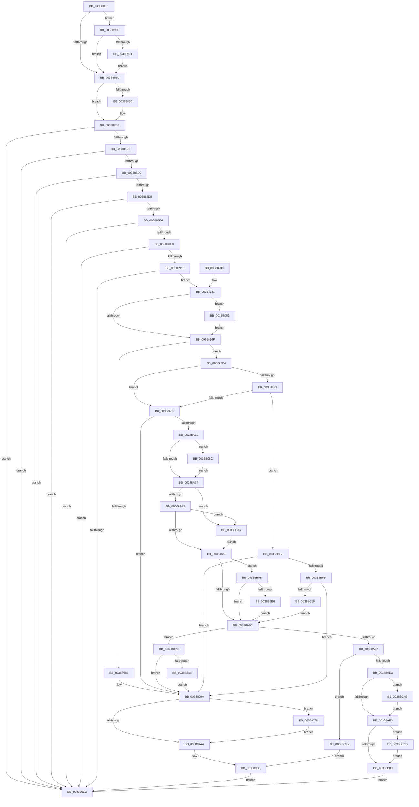

# CcScheduleReadAheadNuma

- RVA: `0x0038883C`–`0x00388D0A` (길이 `1,230` bytes)
- VA: `0x000000014038883C`
- 실행 섹션: `.text`
- PDB 이름 있음: `예`; PDB Function 태그: `아니요`
- unwind 정보 RVA: `0x0007FE80`
- 디코드: `297`개 명령, `1,230/1,230` bytes 표시
- 미해석 바이트: `0` (있으면 어셈블리에 `.byte`로 보존)

> 이 문서는 커널 이미지의 기계어와 PDB 기호를 분석해 생성했습니다. 4번과 5번은 함수 원형과 자료형을 바이너리 사용 방식에서 추정한 C 해석이며 원본 소스 복구 결과는 아닙니다.

## 1. Dependencies

- 직접 호출 지점: **19**; 고유 호출 대상: **15**
- 직접 호출자로 확인된 함수: **5**
- RIP 상대 이미지 참조: **1**

### Outgoing calls
- `0x003888C1` → [PsGetIoPriorityThread](../34/PsGetIoPriorityThread_function_00343930.md) (function, `0x00343930`)
- `0x0038890A` → [CcCanIWriteStreamEx](CcCanIWriteStreamEx_function_0038993C.md) (function, `0x0038993C`)
- `0x00388954` → [KeAcquireSpinLockRaiseToDpc](../20/KeAcquireSpinLockRaiseToDpc_function_00208470.md) (function, `0x00208470`)
- `0x0038897D` → [CcDetermineReadPattern](CcDetermineReadPattern_function_00386C94.md) (function, `0x00386C94`)
- `0x003889B6` → [KeReleaseSpinLock](../39/KeReleaseSpinLock_function_00392BA0.md) (function, `0x00392BA0`)
- `0x003889E7` → [CcGetCurrentNumaNode](../49/CcGetCurrentNumaNode_function_004967F0.md) (function, `0x004967F0`)
- `0x00388A9F` → [PsGetPagePriorityThread](../3C/PsGetPagePriorityThread_function_003C3E80.md) (function, `0x003C3E80`)
- `0x00388ABF` → [KeReleaseSpinLock](../39/KeReleaseSpinLock_function_00392BA0.md) (function, `0x00392BA0`)
- `0x00388AD6` → [CcAllocateWorkQueueEntry](../35/CcAllocateWorkQueueEntry_function_0035710C.md) (function, `0x0035710C`)
- `0x00388B0B` → [ObfReferenceObjectWithTag](../21/ObfReferenceObjectWithTag_function_00210710.md) (function, `0x00210710`)
- `0x00388B21` → [KeAcquireInStackQueuedSpinLock](../27/KeAcquireInStackQueuedSpinLock_function_002757A0.md) (function, `0x002757A0`)
- `0x00388B41` → [KeReleaseInStackQueuedSpinLock](../34/KeReleaseInStackQueuedSpinLock_function_00342CE0.md) (function, `0x00342CE0`)
- `0x00388B68` → [IoReferenceIoAttributionFromThread](../3C/IoReferenceIoAttributionFromThread_function_003CB490.md) (function, `0x003CB490`)
- `0x00388B74` → [CcPostWorkQueue](../35/CcPostWorkQueue_function_00356808.md) (function, `0x00356808`)
- `0x00388B99` → [CcChargeThreadForReadAhead](../4B/CcChargeThreadForReadAhead_function_004BE2BC.md) (function, `0x004BE2BC`)
- `0x00388C79` → [CcPerfLogScheduleReadAhead](CcPerfLogScheduleReadAhead_function_00386A38.md) (function, `0x00386A38`)
- `0x00388CD3` → [CcPerfLogScheduleReadAhead](CcPerfLogScheduleReadAhead_function_00386A38.md) (function, `0x00386A38`)
- `0x00388CE8` → [CcChargeThreadForReadAhead](../4B/CcChargeThreadForReadAhead_function_004BE2BC.md) (function, `0x004BE2BC`)
- `0x00388CF6` → [KeAcquireSpinLockRaiseToDpc](../20/KeAcquireSpinLockRaiseToDpc_function_00208470.md) (function, `0x00208470`)

### Direct callers
- [CcAsyncCopyRead](../35/CcAsyncCopyRead_function_00358880.md) at `0x00358B35`
- [CcScheduleReadAheadEx](CcScheduleReadAheadEx_function_00388820.md) at `0x0038882A`
- [CcCopyReadEx](../45/CcCopyReadEx_function_0045E160.md) at `0x0045E355`
- [CcCopyReadEx](../45/CcCopyReadEx_function_0045E160.md) at `0x0045E4B2`
- [CcAsyncReadPrefetch](../45/CcAsyncReadPrefetch_function_0045E540.md) at `0x0045E74A`
- [CcScheduleReadAhead](../57/CcScheduleReadAhead_function_0057CDF0.md) at `0x0057CDFD`

### Static image references
- `0x0038899A` → RVA `0x00FC6B10` (`ALMOSTRO`; read)

## 2. Other-region calls and transfers

- 다른 실행 섹션으로 향하는 call: **0**
- 별도 외부 분기/꼬리 이동을 확인하지 못했습니다.

## 3. Assembly (complete function range)

```asm
0038883C  4C 8B DC                        mov r11, rsp
0038883F  45 89 43 18                     mov dword ptr [r11 + 0x18], r8d
00388843  49 89 53 10                     mov qword ptr [r11 + 0x10], rdx
00388847  53                              push rbx
00388848  55                              push rbp
00388849  56                              push rsi
0038884A  57                              push rdi
0038884B  41 54                           push r12
0038884D  41 55                           push r13
0038884F  41 56                           push r14
00388851  41 57                           push r15
00388853  48 81 EC 88 00 00 00            sub rsp, 0x88
0038885A  48 8B 79 30                     mov rdi, qword ptr [rcx + 0x30]
0038885E  45 33 E4                        xor r12d, r12d
00388861  4C 8B AC 24 F0 00 00 00         mov r13, qword ptr [rsp + 0xf0]
00388869  33 C0                           xor eax, eax
0038886B  0F 57 C0                        xorps xmm0, xmm0
0038886E  4D 89 63 88                     mov qword ptr [r11 - 0x78], r12
00388872  0F 11 44 24 68                  movups xmmword ptr [rsp + 0x68], xmm0
00388877  49 89 43 B0                     mov qword ptr [r11 - 0x50], rax
0038887B  4D 8B F9                        mov r15, r9
0038887E  48 8B 41 28                     mov rax, qword ptr [rcx + 0x28]
00388882  48 8B DA                        mov rbx, rdx
00388885  45 8B F0                        mov r14d, r8d
00388888  48 8B E9                        mov rbp, rcx
0038888B  44 89 A4 24 E8 00 00 00         mov dword ptr [rsp + 0xe8], r12d
00388893  45 8B D4                        mov r10d, r12d
00388896  4C 89 64 24 48                  mov qword ptr [rsp + 0x48], r12
0038889B  45 8B DC                        mov r11d, r12d
0038889E  48 8B 70 08                     mov rsi, qword ptr [rax + 8]
003888A2  4C 89 64 24 58                  mov qword ptr [rsp + 0x58], r12
003888A7  48 85 F6                        test rsi, rsi
003888AA  0F 85 10 01 00 00               jne 0x1403889c0
003888B0  4D 85 C9                        test r9, r9
003888B3  75 09                           jne 0x1403888be
003888B5  65 4C 8B 3C 25 88 01 00 00      mov r15, qword ptr gs:[0x188]
003888BE  49 8B CF                        mov rcx, r15
003888C1  E8 6A B0 FB FF                  call 0x140343930
003888C6  48 85 FF                        test rdi, rdi
003888C9  74 51                           je 0x14038891c
003888CB  48 85 F6                        test rsi, rsi
003888CE  74 4C                           je 0x14038891c
003888D0  8B 8E 98 00 00 00               mov ecx, dword ptr [rsi + 0x98]
003888D6  F6 C1 01                        test cl, 1
003888D9  75 41                           jne 0x14038891c
003888DB  F7 45 50 00 00 10 00            test dword ptr [rbp + 0x50], 0x100000
003888E2  75 38                           jne 0x14038891c
003888E4  83 F8 02                        cmp eax, 2
003888E7  7C 33                           jl 0x14038891c
003888E9  4C 89 64 24 30                  mov qword ptr [rsp + 0x30], r12
003888EE  41 B9 00 00 00 01               mov r9d, 0x1000000
003888F4  C7 44 24 28 04 00 00 00         mov dword ptr [rsp + 0x28], 4
003888FC  4C 8B C5                        mov r8, rbp
003888FF  49 8B D3                        mov rdx, r11
00388902  44 89 64 24 20                  mov dword ptr [rsp + 0x20], r12d
00388907  49 8B CA                        mov rcx, r10
0038890A  E8 2D 10 00 00                  call 0x14038993c
0038890F  84 C0                           test al, al
00388911  74 09                           je 0x14038891c
00388913  45 38 A5 C4 00 00 00            cmp byte ptr [r13 + 0xc4], r12b
0038891A  74 15                           je 0x140388931
0038891C  48 81 C4 88 00 00 00            add rsp, 0x88
00388923  41 5F                           pop r15
00388925  41 5E                           pop r14
00388927  41 5D                           pop r13
00388929  41 5C                           pop r12
0038892B  5F                              pop rdi
0038892C  5E                              pop rsi
0038892D  5D                              pop rbp
0038892E  5B                              pop rbx
0038892F  C3                              ret
00388930  CC                              int3
00388931  8B 47 04                        mov eax, dword ptr [rdi + 4]
00388934  48 8B 1B                        mov rbx, qword ptr [rbx]
00388937  4C 89 74 24 40                  mov qword ptr [rsp + 0x40], r14
0038893C  49 03 DE                        add rbx, r14
0038893F  46 8D 24 30                     lea r12d, [rax + r14]
00388943  F7 D0                           not eax
00388945  44 23 E0                        and r12d, eax
00388948  48 8D 47 50                     lea rax, [rdi + 0x50]
0038894C  48 8B C8                        mov rcx, rax
0038894F  48 89 44 24 60                  mov qword ptr [rsp + 0x60], rax
00388954  E8 17 FB E7 FF                  call 0x140208470
00388959  8B 0F                           mov ecx, dword ptr [rdi]
0038895B  88 84 24 D0 00 00 00            mov byte ptr [rsp + 0xd0], al
00388962  B8 00 00 02 00                  mov eax, 0x20000
00388967  85 C8                           test eax, ecx
00388969  0F 84 14 03 00 00               je 0x140388c83
0038896F  4C 8B 9C 24 D8 00 00 00         mov r11, qword ptr [rsp + 0xd8]
00388977  48 8B CF                        mov rcx, rdi
0038897A  49 8B D3                        mov rdx, r11
0038897D  E8 12 E3 FF FF                  call 0x140386c94
00388982  45 33 C9                        xor r9d, r9d
00388985  44 8B F0                        mov r14d, eax
00388988  8B D0                           mov edx, eax
0038898A  85 C0                           test eax, eax
0038898C  75 66                           jne 0x1403889f4
0038898E  44 89 4F 30                     mov dword ptr [rdi + 0x30], r9d
00388992  4C 89 4F 40                     mov qword ptr [rdi + 0x40], r9
00388996  4C 89 4F 48                     mov qword ptr [rdi + 0x48], r9
0038899A  F7 05 6C E1 C3 00 00 00 02 00   test dword ptr [rip + 0xc3e16c], 0x20000
003889A4  0F 85 AA 02 00 00               jne 0x140388c54
003889AA  8A 94 24 D0 00 00 00            mov dl, byte ptr [rsp + 0xd0]
003889B1  48 8B 4C 24 60                  mov rcx, qword ptr [rsp + 0x60]
003889B6  E8 E5 A1 00 00                  call 0x140392ba0
003889BB  E9 5C FF FF FF                  jmp 0x14038891c
003889C0  4C 8B 96 18 02 00 00            mov r10, qword ptr [rsi + 0x218]
003889C7  4C 8B 9E 58 02 00 00            mov r11, qword ptr [rsi + 0x258]
003889CE  4C 89 54 24 48                  mov qword ptr [rsp + 0x48], r10
003889D3  4C 89 5C 24 58                  mov qword ptr [rsp + 0x58], r11
003889D8  4D 85 ED                        test r13, r13
003889DB  0F 85 CF FE FF FF               jne 0x1403888b0
003889E1  48 8B D6                        mov rdx, rsi
003889E4  49 8B CA                        mov rcx, r10
003889E7  E8 04 DE 10 00                  call 0x1404967f0
003889EC  4C 8B E8                        mov r13, rax
003889EF  E9 BC FE FF FF                  jmp 0x1403888b0
003889F4  83 EA 01                        sub edx, 1
003889F7  74 09                           je 0x140388a02
003889F9  83 EA 01                        sub edx, 1
003889FC  0F 85 F0 01 00 00               jne 0x140388bf2
00388A02  48 8B 4F 40                     mov rcx, qword ptr [rdi + 0x40]
00388A06  43 8D 14 24                     lea edx, [r12 + r12]
00388A0A  8B C2                           mov eax, edx
00388A0C  48 03 44 24 40                  add rax, qword ptr [rsp + 0x40]
00388A11  48 03 C3                        add rax, rbx
00388A14  48 3B C1                        cmp rax, rcx
00388A17  7C 81                           jl 0x14038899a
00388A19  48 8B C3                        mov rax, rbx
00388A1C  48 89 4C 24 40                  mov qword ptr [rsp + 0x40], rcx
00388A21  48 25 00 F0 FF FF               and rax, 0xfffffffffffff000
00388A27  48 89 47 38                     mov qword ptr [rdi + 0x38], rax
00388A2B  48 3B C1                        cmp rax, rcx
00388A2E  0F 8D 58 02 00 00               jge 0x140388c8c
00388A34  8B 4F 30                        mov ecx, dword ptr [rdi + 0x30]
00388A37  45 8B C4                        mov r8d, r12d
00388A3A  FF C1                           inc ecx
00388A3C  89 4F 30                        mov dword ptr [rdi + 0x30], ecx
00388A3F  41 83 FE 01                     cmp r14d, 1
00388A43  0F 84 5D 02 00 00               je 0x140388ca6
00388A49  83 F9 03                        cmp ecx, 3
00388A4C  0F 83 54 02 00 00               jae 0x140388ca6
00388A52  8B 44 24 40                     mov eax, dword ptr [rsp + 0x40]
00388A56  2B 47 38                        sub eax, dword ptr [rdi + 0x38]
00388A59  8B 9C 24 E0 00 00 00            mov ebx, dword ptr [rsp + 0xe0]
00388A60  44 03 C0                        add r8d, eax
00388A63  83 F9 03                        cmp ecx, 3
00388A66  0F 83 3F 01 00 00               jae 0x140388bab
00388A6C  B8 34 00 00 00                  mov eax, 0x34
00388A71  C7 84 24 E8 00 00 00 01 00 00 00  mov dword ptr [rsp + 0xe8], 1
00388A7C  48 8B CF                        mov rcx, rdi
00388A7F  44 89 04 01                     mov dword ptr [rcx + rax], r8d
00388A83  B9 00 00 01 00                  mov ecx, 0x10000
00388A88  8B 07                           mov eax, dword ptr [rdi]
00388A8A  85 C1                           test ecx, eax
00388A8C  0F 85 EC 00 00 00               jne 0x140388b7e
00388A92  0B C1                           or eax, ecx
00388A94  89 07                           mov dword ptr [rdi], eax
00388A96  65 48 8B 0C 25 88 01 00 00      mov rcx, qword ptr gs:[0x188]
00388A9F  E8 DC B3 03 00                  call 0x1403c3e80
00388AA4  8B 0F                           mov ecx, dword ptr [rdi]
00388AA6  8A 94 24 D0 00 00 00            mov dl, byte ptr [rsp + 0xd0]
00388AAD  C1 E0 12                        shl eax, 0x12
00388AB0  33 C1                           xor eax, ecx
00388AB2  25 00 00 1C 00                  and eax, 0x1c0000
00388AB7  33 C1                           xor eax, ecx
00388AB9  48 8D 4F 50                     lea rcx, [rdi + 0x50]
00388ABD  89 07                           mov dword ptr [rdi], eax
00388ABF  E8 DC A0 00 00                  call 0x140392ba0
00388AC4  48 8B 54 24 58                  mov rdx, qword ptr [rsp + 0x58]
00388AC9  4C 8D 4C 24 50                  lea r9, [rsp + 0x50]
00388ACE  48 8B 4C 24 48                  mov rcx, qword ptr [rsp + 0x48]
00388AD3  4D 8B C5                        mov r8, r13
00388AD6  E8 31 E6 FC FF                  call 0x14035710c
00388ADB  85 C0                           test eax, eax
00388ADD  0F 88 0F 02 00 00               js 0x140388cf2
00388AE3  F7 05 23 E0 C3 00 00 00 02 00   test dword ptr [rip + 0xc3e023], 0x20000
00388AED  0F 85 BB 01 00 00               jne 0x140388cae
00388AF3  F7 86 98 00 00 00 00 00 00 10   test dword ptr [rsi + 0x98], 0x10000000
00388AFD  0F 85 DA 01 00 00               jne 0x140388cdd
00388B03  BA 44 66 6C 74                  mov edx, 0x746c6644
00388B08  48 8B CD                        mov rcx, rbp
00388B0B  E8 00 7C E8 FF                  call 0x140210710
00388B10  48 8B 4C 24 48                  mov rcx, qword ptr [rsp + 0x48]
00388B15  48 8D 54 24 68                  lea rdx, [rsp + 0x68]
00388B1A  48 81 C1 00 03 00 00            add rcx, 0x300
00388B21  E8 7A CC EE FF                  call 0x1402757a0
00388B26  8B 46 04                        mov eax, dword ptr [rsi + 4]
00388B29  48 8D 4C 24 68                  lea rcx, [rsp + 0x68]
00388B2E  FF C0                           inc eax
00388B30  89 46 04                        mov dword ptr [rsi + 4], eax
00388B33  FF 86 20 02 00 00               inc dword ptr [rsi + 0x220]
00388B39  0F BA AE 98 00 00 00 0E         bts dword ptr [rsi + 0x98], 0xe
00388B41  E8 9A A1 FB FF                  call 0x140342ce0
00388B46  48 8B 5C 24 50                  mov rbx, qword ptr [rsp + 0x50]
00388B4B  49 8B CF                        mov rcx, r15
00388B4E  48 89 5F 70                     mov qword ptr [rdi + 0x70], rbx
00388B52  C7 83 80 00 00 00 01 00 00 00   mov dword ptr [rbx + 0x80], 1
00388B5C  48 8D 53 18                     lea rdx, [rbx + 0x18]
00388B60  48 89 6B 10                     mov qword ptr [rbx + 0x10], rbp
00388B64  48 83 22 00                     and qword ptr [rdx], 0
00388B68  E8 23 29 04 00                  call 0x1403cb490
00388B6D  49 8D 55 58                     lea rdx, [r13 + 0x58]
00388B71  48 8B CB                        mov rcx, rbx
00388B74  E8 8F DC FC FF                  call 0x140356808
00388B79  E9 9E FD FF FF                  jmp 0x14038891c
00388B7E  F7 86 98 00 00 00 00 00 00 10   test dword ptr [rsi + 0x98], 0x10000000
00388B88  0F 84 0C FE FF FF               je 0x14038899a
00388B8E  45 8B CE                        mov r9d, r14d
00388B91  4C 89 7C 24 20                  mov qword ptr [rsp + 0x20], r15
00388B96  48 8B CD                        mov rcx, rbp
00388B99  E8 1E 57 13 00                  call 0x1404be2bc
00388B9E  4C 8B 9C 24 D8 00 00 00         mov r11, qword ptr [rsp + 0xd8]
00388BA6  E9 EF FD FF FF                  jmp 0x14038899a
00388BAB  8B 47 5C                        mov eax, dword ptr [rdi + 0x5c]
00388BAE  85 C0                           test eax, eax
00388BB0  0F 84 B6 FE FF FF               je 0x140388a6c
00388BB6  0F AF CB                        imul ecx, ebx
00388BB9  48 0F AF C8                     imul rcx, rax
00388BBD  48 B8 15 AE 47 E1 7A 14 AE 47   movabs rax, 0x47ae147ae147ae15
00388BC7  48 F7 E1                        mul rcx
00388BCA  B8 FF FF FF FF                  mov eax, 0xffffffff
00388BCF  48 2B CA                        sub rcx, rdx
00388BD2  48 D1 E9                        shr rcx, 1
00388BD5  48 03 CA                        add rcx, rdx
00388BD8  48 C1 E9 06                     shr rcx, 6
00388BDC  48 3B C8                        cmp rcx, rax
00388BDF  48 0F 47 C8                     cmova rcx, rax
00388BE3  41 8B C0                        mov eax, r8d
00388BE6  48 3B C8                        cmp rcx, rax
00388BE9  44 0F 47 C1                     cmova r8d, ecx
00388BED  E9 7A FE FF FF                  jmp 0x140388a6c
00388BF2  83 FA 01                        cmp edx, 1
00388BF5  0F 85 9F FD FF FF               jne 0x14038899a
00388BFB  49 8B 03                        mov rax, qword ptr [r11]
00388BFE  48 03 C0                        add rax, rax
00388C01  48 2B 47 20                     sub rax, qword ptr [rdi + 0x20]
00388C05  48 89 44 24 40                  mov qword ptr [rsp + 0x40], rax
00388C0A  48 C1 E8 20                     shr rax, 0x20
00388C0E  85 C0                           test eax, eax
00388C10  0F 88 84 FD FF FF               js 0x14038899a
00388C16  8B 4C 24 40                     mov ecx, dword ptr [rsp + 0x40]
00388C1A  BA 00 F0 FF FF                  mov edx, 0xfffff000
00388C1F  8B 9C 24 E0 00 00 00            mov ebx, dword ptr [rsp + 0xe0]
00388C26  8B C1                           mov eax, ecx
00388C28  25 FF 0F 00 00                  and eax, 0xfff
00388C2D  23 CA                           and ecx, edx
00388C2F  03 D8                           add ebx, eax
00388C31  89 4C 24 40                     mov dword ptr [rsp + 0x40], ecx
00388C35  48 8B 44 24 40                  mov rax, qword ptr [rsp + 0x40]
00388C3A  89 9C 24 E0 00 00 00            mov dword ptr [rsp + 0xe0], ebx
00388C41  48 89 47 38                     mov qword ptr [rdi + 0x38], rax
00388C45  44 8D 83 FF 0F 00 00            lea r8d, [rbx + 0xfff]
00388C4C  44 23 C2                        and r8d, edx
00388C4F  E9 18 FE FF FF                  jmp 0x140388a6c
00388C54  8B 84 24 E8 00 00 00            mov eax, dword ptr [rsp + 0xe8]
00388C5B  4D 8B C3                        mov r8, r11
00388C5E  44 8B 8C 24 E0 00 00 00         mov r9d, dword ptr [rsp + 0xe0]
00388C66  48 8B D5                        mov rdx, rbp
00388C69  89 44 24 30                     mov dword ptr [rsp + 0x30], eax
00388C6D  33 C9                           xor ecx, ecx
00388C6F  44 88 74 24 28                  mov byte ptr [rsp + 0x28], r14b
00388C74  44 89 64 24 20                  mov dword ptr [rsp + 0x20], r12d
00388C79  E8 BA DD FF FF                  call 0x140386a38
00388C7E  E9 27 FD FF FF                  jmp 0x1403889aa
00388C83  0B C8                           or ecx, eax
00388C85  89 0F                           mov dword ptr [rdi], ecx
00388C87  E9 E3 FC FF FF                  jmp 0x14038896f
00388C8C  41 8B CC                        mov ecx, r12d
00388C8F  48 8D 43 FF                     lea rax, [rbx - 1]
00388C93  48 03 C1                        add rax, rcx
00388C96  48 F7 D9                        neg rcx
00388C99  48 23 C1                        and rax, rcx
00388C9C  48 89 44 24 40                  mov qword ptr [rsp + 0x40], rax
00388CA1  E9 8E FD FF FF                  jmp 0x140388a34
00388CA6  44 8B C2                        mov r8d, edx
00388CA9  E9 A4 FD FF FF                  jmp 0x140388a52
00388CAE  4C 8B 84 24 D8 00 00 00         mov r8, qword ptr [rsp + 0xd8]
00388CB6  44 8B CB                        mov r9d, ebx
00388CB9  48 8B 4C 24 50                  mov rcx, qword ptr [rsp + 0x50]
00388CBE  48 8B D5                        mov rdx, rbp
00388CC1  C7 44 24 30 01 00 00 00         mov dword ptr [rsp + 0x30], 1
00388CC9  44 88 74 24 28                  mov byte ptr [rsp + 0x28], r14b
00388CCE  44 89 64 24 20                  mov dword ptr [rsp + 0x20], r12d
00388CD3  E8 60 DD FF FF                  call 0x140386a38
00388CD8  E9 16 FE FF FF                  jmp 0x140388af3
00388CDD  45 8B CE                        mov r9d, r14d
00388CE0  4C 89 7C 24 20                  mov qword ptr [rsp + 0x20], r15
00388CE5  48 8B CD                        mov rcx, rbp
00388CE8  E8 CF 55 13 00                  call 0x1404be2bc
00388CED  E9 11 FE FF FF                  jmp 0x140388b03
00388CF2  48 8D 4F 50                     lea rcx, [rdi + 0x50]
00388CF6  E8 75 F7 E7 FF                  call 0x140208470
00388CFB  0F BA 37 10                     btr dword ptr [rdi], 0x10
00388CFF  48 8D 4F 50                     lea rcx, [rdi + 0x50]
00388D03  8A D0                           mov dl, al
00388D05  E9 AC FC FF FF                  jmp 0x1403889b6
```

## 4. C-style interpretation (structured pseudocode)

```c
__int64 __fastcall CcScheduleReadAheadNuma(__int64 a1, __int64 a2, int a3, __int64 a4, __int64 a5)
{
    __int64 result;
    __int64 v_r12;
    __int64 v_r15;
    __int64 v_rbx;
    __int64 v_rsp;
    unsigned __int64 v_stack_m60;
    unsigned __int64 v_stack_m70;
    unsigned __int64 v_stack_m80;
    unsigned __int64 v_stack_m98;
    unsigned int v_stack_mA0;
    unsigned int v_stack_mA8;
    unsigned int v_stack_p20;
    unsigned __int8 v_stack_p28;
    unsigned int v_stack_p30;
    unsigned __int64 v_stack_p40;
    unsigned __int64 v_stack_p48;
    unsigned __int64 v_stack_p50;
    unsigned __int64 v_stack_p58;
    unsigned __int64 v_stack_p60;
    unsigned __int64 v_stack_p68;
    unsigned __int8 v_stack_pD0;
    unsigned __int64 v_stack_pD8;
    unsigned int v_stack_pE0;
    unsigned int v_stack_pE8;

    *(unsigned int *)(v_rsp + 24) = a3;
    *(unsigned __int64 *)(v_rsp + 16) = a2;
    v_rsp = (v_rsp) - (136);
    v_r12 = 0;
    result = 0;
    *(unsigned __int64 *)(v_rsp - 120) = 0;
    v_stack_m60 = v_xmm0;
    *(unsigned __int64 *)(v_rsp - 80) = 0;
    v_stack_p20 = 0;
    v_stack_m80 = 0;
    v_stack_m70 = 0;
    if (*(unsigned __int64 *)(*(unsigned __int64 *)(a1 + 40) + 8) != 0) goto loc_003889C0;
loc_003888B0:
    v_r15 = a4;
    if (a4 == 0) {
        v_r15 = *(unsigned __int64 *)(gs_base + (0 + 392));
    }
    result = PsGetIoPriorityThread(v_r15, a2, a3, a4);
    if (*(unsigned __int64 *)(a1 + 48) == 0) goto loc_0038891C;
    if (*(unsigned __int64 *)(*(unsigned __int64 *)(a1 + 40) + 8) == 0) goto loc_0038891C;
    if ((((unsigned __int8)((unsigned int)(*(unsigned int *)(*(unsigned __int64 *)(*(unsigned __int64 *)(a1 + 40) + 8) + 152)))) & (1)) != 0) goto loc_0038891C;
    if (((*(unsigned int *)(a1 + 80)) & (0x100000ULL)) != 0) goto loc_0038891C;
    if (((unsigned int)(result)) < 2) goto loc_0038891C;
    v_stack_m98 = 0;
    v_stack_mA0 = 4;
    v_stack_mA8 = 0;
    result = CcCanIWriteStreamEx(0, 0, a1, (unsigned int)(0x1000000ULL));
    if ((unsigned __int8)(result) == 0) goto loc_0038891C;
    if ((*(unsigned __int8 *)(a5 + 196)) == 0) goto loc_00388931;
loc_0038891C:
    v_rsp = (v_rsp) + (136);
    return result;
loc_00388931:
    v_stack_p40 = (unsigned int)(a3);
    v_rbx = (*(unsigned __int64 *)(a2)) + ((unsigned int)(a3));
    result = (unsigned int)(~((unsigned int)(*(unsigned int *)(*(unsigned __int64 *)(a1 + 48) + 4))));
    v_r12 = (unsigned int)(((unsigned int)(*(unsigned int *)(*(unsigned __int64 *)(a1 + 48) + 4)) + (unsigned int)(a3) * 1) & ((unsigned int)(result)));
    v_stack_p60 = *(unsigned __int64 *)(a1 + 48) + 80;
    result = KeAcquireSpinLockRaiseToDpc(*(unsigned __int64 *)(a1 + 48) + 80, 0, a1, (unsigned int)(0x1000000ULL));
    v_stack_pD0 = (unsigned __int8)(result);
    if ((((unsigned int)((unsigned int)(0x20000ULL))) & ((unsigned int)((unsigned int)(*(unsigned int *)(*(unsigned __int64 *)(a1 + 48)))))) == 0) goto loc_00388C83;
loc_0038896F:
    result = CcDetermineReadPattern(*(unsigned __int64 *)(a1 + 48), v_stack_pD8, a1, (unsigned int)(0x1000000ULL));
    a4 = 0;
    if ((unsigned int)(result) != 0) goto loc_003889F4;
    *(unsigned int *)(*(unsigned __int64 *)(a1 + 48) + 48) = 0;
    *(unsigned __int64 *)(*(unsigned __int64 *)(a1 + 48) + 64) = 0;
    *(unsigned __int64 *)(*(unsigned __int64 *)(a1 + 48) + 72) = 0;
loc_0038899A:
    if (((*(unsigned int *)(v_rip + 12837228)) & (0x20000ULL)) != 0) goto loc_00388C54;
loc_003889AA:
loc_003889B6:
    result = KeReleaseSpinLock(v_stack_p60, v_stack_pD0, a1, a4);
    goto loc_0038891C;
loc_003889C0:
    v_stack_p48 = *(unsigned __int64 *)(*(unsigned __int64 *)(*(unsigned __int64 *)(a1 + 40) + 8) + 536);
    v_stack_p58 = *(unsigned __int64 *)(*(unsigned __int64 *)(*(unsigned __int64 *)(a1 + 40) + 8) + 600);
    if (a5 != 0) goto loc_003888B0;
    result = CcGetCurrentNumaNode(*(unsigned __int64 *)(*(unsigned __int64 *)(*(unsigned __int64 *)(a1 + 40) + 8) + 536), *(unsigned __int64 *)(*(unsigned __int64 *)(a1 + 40) + 8), a1, a4);
    goto loc_003888B0;
loc_003889F4:
    a2 = (unsigned int)((*(unsigned __int64 *)(*(unsigned __int64 *)(a1 + 40) + 8)) - (1));
    if (condition_is_equal) goto loc_00388A02;
    a2 = (unsigned int)((a2) - (1));
    if (condition_is_not_equal) goto loc_00388BF2;
loc_00388A02:
    result = ((unsigned int)((unsigned int)(v_r12 + v_r12 * 1))) + (v_stack_p40);
    result = (result) + (v_rbx);
    if (result < (*(unsigned __int64 *)(*(unsigned __int64 *)(a1 + 48) + 64))) goto loc_0038899A;
    v_stack_p40 = *(unsigned __int64 *)(*(unsigned __int64 *)(a1 + 48) + 64);
    result = (v_rbx) & (0xFFFFFFFFFFFFF000ULL);
    *(unsigned __int64 *)(*(unsigned __int64 *)(a1 + 48) + 56) = result;
    if (result >= (*(unsigned __int64 *)(*(unsigned __int64 *)(a1 + 48) + 64))) goto loc_00388C8C;
loc_00388A34:
    a1 = (unsigned int)(((unsigned int)(*(unsigned int *)(*(unsigned __int64 *)(a1 + 48) + 48))) + 1);
    *(unsigned int *)(*(unsigned __int64 *)(a1 + 48) + 48) = (unsigned int)(a1);
    if (((unsigned int)((unsigned int)((unsigned int)(result)))) == 1) goto loc_00388CA6;
    if (((unsigned int)(a1)) >= 3) goto loc_00388CA6;
loc_00388A52:
    result = (unsigned int)(((unsigned int)(v_stack_p40)) - (*(unsigned int *)(*(unsigned __int64 *)(a1 + 48) + 56)));
    a3 = (unsigned int)(((unsigned int)((unsigned int)(v_r12))) + ((unsigned int)(result)));
    if (((unsigned int)(a1)) >= 3) goto loc_00388BAB;
loc_00388A6C:
    v_stack_pE8 = 1;
    *(unsigned int *)(*(unsigned __int64 *)(a1 + 48) + 52 * 1) = a3;
    if ((((unsigned int)((unsigned int)(0x10000ULL))) & ((unsigned int)((unsigned int)(*(unsigned int *)(*(unsigned __int64 *)(a1 + 48)))))) != 0) goto loc_00388B7E;
    result = (unsigned int)(((unsigned int)(*(unsigned int *)(*(unsigned __int64 *)(a1 + 48)))) | ((unsigned int)((unsigned int)(0x10000ULL))));
    *(unsigned int *)(*(unsigned __int64 *)(a1 + 48)) = (unsigned int)(result);
    result = PsGetPagePriorityThread(*(unsigned __int64 *)(gs_base + (0 + 392)), v_r12 + v_r12 * 1, a3, a4);
    result = (unsigned int)((result) << (18));
    result = (unsigned int)((result) ^ ((unsigned int)((unsigned int)(*(unsigned int *)(*(unsigned __int64 *)(a1 + 48))))));
    result = (unsigned int)((result) & (0x1C0000ULL));
    result = (unsigned int)((result) ^ ((unsigned int)((unsigned int)(*(unsigned int *)(*(unsigned __int64 *)(a1 + 48))))));
    *(unsigned int *)(*(unsigned __int64 *)(a1 + 48)) = (unsigned int)(result);
    result = KeReleaseSpinLock(*(unsigned __int64 *)(a1 + 48) + 80, v_stack_pD0, a3, a4);
    result = CcAllocateWorkQueueEntry(v_stack_p48, v_stack_p58, result, v_stack_p50);
    if (sign_flag) goto loc_00388CF2;
    if (((*(unsigned int *)(v_rip + 12836899)) & (0x20000ULL)) != 0) goto loc_00388CAE;
loc_00388AF3:
    if (((*(unsigned int *)(*(unsigned __int64 *)(*(unsigned __int64 *)(a1 + 40) + 8) + 152)) & (0x10000000ULL)) != 0) goto loc_00388CDD;
loc_00388B03:
    result = ObfReferenceObjectWithTag(a1, (unsigned int)(0x746C6644ULL), result, v_stack_p50);
    a1 = (v_stack_p48) + (768);
    result = KeAcquireInStackQueuedSpinLock(a1, v_stack_p68, result, v_stack_p50);
    result = (unsigned int)(((unsigned int)(*(unsigned int *)(*(unsigned __int64 *)(*(unsigned __int64 *)(a1 + 40) + 8) + 4))) + 1);
    *(unsigned int *)(*(unsigned __int64 *)(*(unsigned __int64 *)(a1 + 40) + 8) + 4) = (unsigned int)(result);
    result = KeReleaseInStackQueuedSpinLock(v_stack_p68, v_stack_p68, result, v_stack_p50);
    *(unsigned __int64 *)(*(unsigned __int64 *)(a1 + 48) + 112) = v_stack_p50;
    *(unsigned int *)(v_stack_p50 + 128) = 1;
    *(unsigned __int64 *)(v_stack_p50 + 16) = a1;
    result = IoReferenceIoAttributionFromThread(v_r15, v_stack_p50 + 24, result, v_stack_p50);
    result = CcPostWorkQueue(v_stack_p50, result + 88, result, v_stack_p50);
    goto loc_0038891C;
loc_00388B7E:
    if (((*(unsigned int *)(*(unsigned __int64 *)(*(unsigned __int64 *)(a1 + 40) + 8) + 152)) & (0x10000000ULL)) == 0) goto loc_0038899A;
    v_stack_p20 = v_r15;
    result = CcChargeThreadForReadAhead(a1, result + 88, result, (unsigned int)((unsigned int)((unsigned int)((unsigned int)(result)))));
    goto loc_0038899A;
loc_00388BAB:
    if ((unsigned int)((unsigned int)(*(unsigned int *)(*(unsigned __int64 *)(a1 + 48) + 92))) == 0) goto loc_00388A6C;
    a1 = (unsigned int)((a1) * ((unsigned int)(v_stack_p50)));
    a1 = (a1) * ((unsigned int)(*(unsigned int *)(*(unsigned __int64 *)(a1 + 48) + 92)));
    a1 = (a1) - (result + 88);
    a1 = (a1) >> (1);
    a1 = (a1) + (result + 88);
    a1 = (a1) >> (6);
    if (a1 > ((unsigned int)(0xFFFFFFFFULL))) { a1 = (unsigned int)(0xFFFFFFFFULL); }
    a3 = result;
    if (a1 > ((unsigned int)((unsigned int)(result)))) { a3 = (unsigned int)(a1); }
    goto loc_00388A6C;
loc_00388BF2:
    if (((unsigned int)(result + 88)) != 1) goto loc_0038899A;
    result = (*(unsigned __int64 *)(v_stack_pD8)) + (*(unsigned __int64 *)(v_stack_pD8));
    result = (result) - (*(unsigned __int64 *)(*(unsigned __int64 *)(a1 + 48) + 32));
    v_stack_p40 = result;
    result = (result) >> (32);
    if (sign_flag) goto loc_0038899A;
    result = (unsigned int)(((unsigned int)((unsigned int)((unsigned int)(v_stack_p40)))) & (0xFFFULL));
    a1 = (unsigned int)(((unsigned int)(v_stack_p40)) & ((unsigned int)((unsigned int)(0xFFFFF000ULL))));
    v_rbx = (unsigned int)(((unsigned int)(v_stack_pE0)) + ((unsigned int)(result)));
    v_stack_p40 = (unsigned int)(a1);
    v_stack_pE0 = (unsigned int)(v_rbx);
    *(unsigned __int64 *)(*(unsigned __int64 *)(a1 + 48) + 56) = v_stack_p40;
    a3 = (unsigned int)((v_rbx + 4095) & ((unsigned int)((unsigned int)(0xFFFFF000ULL))));
    goto loc_00388A6C;
loc_00388C54:
    v_stack_p30 = (unsigned int)((unsigned int)(v_stack_pE8));
    a1 = 0;
    v_stack_p28 = (unsigned __int8)((unsigned int)((unsigned int)(result)));
    v_stack_p20 = (unsigned int)(v_r12);
    result = CcPerfLogScheduleReadAhead(a1, a1, v_stack_pD8, (unsigned int)(v_stack_pE0));
    goto loc_003889AA;
loc_00388C83:
    a1 = (unsigned int)((a1) | ((unsigned int)(result)));
    *(unsigned int *)(*(unsigned __int64 *)(a1 + 48)) = (unsigned int)(a1);
    goto loc_0038896F;
loc_00388C8C:
    result = (v_rbx - 1) + ((unsigned int)((unsigned int)(v_r12)));
    a1 = -((unsigned int)((unsigned int)(v_r12)));
    result = (result) & (a1);
    v_stack_p40 = result;
    goto loc_00388A34;
loc_00388CA6:
    goto loc_00388A52;
loc_00388CAE:
    v_stack_p30 = 1;
    v_stack_p28 = (unsigned __int8)((unsigned int)((unsigned int)(result)));
    v_stack_p20 = (unsigned int)(v_r12);
    result = CcPerfLogScheduleReadAhead(v_stack_p50, a1, v_stack_pD8, (unsigned int)((unsigned int)(v_rbx)));
    goto loc_00388AF3;
loc_00388CDD:
    v_stack_p20 = v_r15;
    result = CcChargeThreadForReadAhead(a1, a1, v_stack_pD8, (unsigned int)((unsigned int)((unsigned int)((unsigned int)(result)))));
    goto loc_00388B03;
loc_00388CF2:
    result = KeAcquireSpinLockRaiseToDpc(*(unsigned __int64 *)(a1 + 48) + 80, a1, v_stack_pD8, (unsigned int)((unsigned int)((unsigned int)((unsigned int)(result)))));
    goto loc_003889B6;
}
```

## 5. (Beta) C Style

```c
int64_t CcScheduleReadAheadNuma(void *Arg1, void *Arg2, int32_t Arg3, int64_t Arg4, int64_t Arg5)
{
    uint8_t *arg1 = (uint8_t *)Arg1;
    uint8_t *arg2 = (uint8_t *)Arg2;

    int64_t result;
    int64_t local_r12;
    int64_t local_r15;
    int64_t local_rbx;
    int64_t local_rsp;
    uint64_t v_stack_m60;
    uint64_t v_stack_m70;
    uint64_t v_stack_m80;
    uint64_t v_stack_m98;
    uint32_t v_stack_mA0;
    uint32_t v_stack_mA8;
    uint32_t v_stack_p20;
    uint8_t v_stack_p28;
    uint32_t v_stack_p30;
    uint64_t v_stack_p40;
    uint64_t v_stack_p48;
    uint64_t v_stack_p50;
    uint64_t v_stack_p58;
    uint64_t v_stack_p60;
    uint64_t v_stack_p68;
    uint8_t v_stack_pD0;
    uint64_t v_stack_pD8;
    uint32_t v_stack_pE0;
    uint32_t v_stack_pE8;

    *(uint32_t *)(local_rsp + 0x18) = Arg3;
    *(void **)(local_rsp + 0x10) = Arg2;
    local_rsp = (local_rsp) - (136);
    local_r12 = 0;
    result = 0;
    *(uint64_t *)(local_rsp - 0x78) = 0;
    v_stack_m60 = v_xmm0;
    *(uint64_t *)(local_rsp - 0x50) = 0;
    v_stack_p20 = 0;
    v_stack_m80 = 0;
    v_stack_m70 = 0;
    if (*(uint64_t *)(*(uint64_t *)(arg1 + 0x28) + 0x8) != 0) goto loc_003889C0;
loc_003888B0:
    local_r15 = Arg4;
    if (Arg4 == 0) {
        local_r15 = *(uint64_t *)(gs_base + (0 + 0x188));
    }
    result = PsGetIoPriorityThread(local_r15, Arg2, Arg3, Arg4);
    if (*(uint64_t *)(arg1 + 0x30) == 0) goto loc_0038891C;
    if (*(uint64_t *)(*(uint64_t *)(arg1 + 0x28) + 0x8) == 0) goto loc_0038891C;
    if ((((uint8_t)((uint32_t)(*(uint32_t *)(*(uint64_t *)(*(uint64_t *)(arg1 + 0x28) + 0x8) + 0x98)))) & (1)) != 0) goto loc_0038891C;
    if (((*(uint32_t *)(arg1 + 0x50)) & (0x100000ULL)) != 0) goto loc_0038891C;
    if (((uint32_t)(result)) < 2) goto loc_0038891C;
    v_stack_m98 = 0;
    v_stack_mA0 = 4;
    v_stack_mA8 = 0;
    result = CcCanIWriteStreamEx(0, 0, Arg1, (uint32_t)(0x1000000ULL));
    if ((uint8_t)(result) == 0) goto loc_0038891C;
    if ((*(uint8_t *)(Arg5 + 0xC4)) == 0) goto loc_00388931;
loc_0038891C:
    local_rsp = (local_rsp) + (136);
    return result;
loc_00388931:
    v_stack_p40 = (uint32_t)(Arg3);
    local_rbx = (*(uint64_t *)(arg2)) + ((uint32_t)(Arg3));
    result = (uint32_t)(~((uint32_t)(*(uint32_t *)(*(uint64_t *)(arg1 + 0x30) + 0x4))));
    local_r12 = (uint32_t)(((uint32_t)(*(uint32_t *)(*(uint64_t *)(arg1 + 0x30) + 0x4)) + (uint32_t)(Arg3) * 1) & ((uint32_t)(result)));
    v_stack_p60 = *(uint64_t *)(arg1 + 0x30) + 80;
    result = KeAcquireSpinLockRaiseToDpc(*(uint64_t *)(arg1 + 0x30) + 80, 0, Arg1, (uint32_t)(0x1000000ULL));
    v_stack_pD0 = (uint8_t)(result);
    if ((((uint32_t)((uint32_t)(0x20000ULL))) & ((uint32_t)((uint32_t)(*(uint32_t *)(*(uint64_t *)(arg1 + 0x30)))))) == 0) goto loc_00388C83;
loc_0038896F:
    result = CcDetermineReadPattern(*(uint64_t *)(arg1 + 0x30), v_stack_pD8, Arg1, (uint32_t)(0x1000000ULL));
    Arg4 = 0;
    if ((uint32_t)(result) != 0) goto loc_003889F4;
    *(uint32_t *)(*(uint64_t *)(arg1 + 0x30) + 0x30) = 0;
    *(uint64_t *)(*(uint64_t *)(arg1 + 0x30) + 0x40) = 0;
    *(uint64_t *)(*(uint64_t *)(arg1 + 0x30) + 0x48) = 0;
loc_0038899A:
    if (((*(uint32_t *)(v_rip + 0xC3E16C)) & (0x20000ULL)) != 0) goto loc_00388C54;
loc_003889AA:
loc_003889B6:
    result = KeReleaseSpinLock(v_stack_p60, v_stack_pD0, Arg1, Arg4);
    goto loc_0038891C;
loc_003889C0:
    v_stack_p48 = *(uint64_t *)(*(uint64_t *)(*(uint64_t *)(arg1 + 0x28) + 0x8) + 0x218);
    v_stack_p58 = *(uint64_t *)(*(uint64_t *)(*(uint64_t *)(arg1 + 0x28) + 0x8) + 0x258);
    if (Arg5 != 0) goto loc_003888B0;
    result = CcGetCurrentNumaNode(*(uint64_t *)(*(uint64_t *)(*(uint64_t *)(arg1 + 0x28) + 0x8) + 0x218), *(uint64_t *)(*(uint64_t *)(arg1 + 0x28) + 0x8), Arg1, Arg4);
    goto loc_003888B0;
loc_003889F4:
    Arg2 = (uint32_t)((*(uint64_t *)(*(uint64_t *)(arg1 + 0x28) + 0x8)) - (1));
    if (condition_is_equal) goto loc_00388A02;
    Arg2 = (uint32_t)((Arg2) - (1));
    if (condition_is_not_equal) goto loc_00388BF2;
loc_00388A02:
    result = ((uint32_t)((uint32_t)(local_r12 + local_r12 * 1))) + (v_stack_p40);
    result = (result) + (local_rbx);
    if (result < (*(uint64_t *)(*(uint64_t *)(arg1 + 0x30) + 0x40))) goto loc_0038899A;
    v_stack_p40 = *(uint64_t *)(*(uint64_t *)(arg1 + 0x30) + 0x40);
    result = (local_rbx) & (0xFFFFFFFFFFFFF000ULL);
    *(uint64_t *)(*(uint64_t *)(arg1 + 0x30) + 0x38) = result;
    if (result >= (*(uint64_t *)(*(uint64_t *)(arg1 + 0x30) + 0x40))) goto loc_00388C8C;
loc_00388A34:
    Arg1 = (uint32_t)(((uint32_t)(*(uint32_t *)(*(uint64_t *)(arg1 + 0x30) + 0x30))) + 1);
    *(uint32_t *)(*(uint64_t *)(arg1 + 0x30) + 0x30) = (uint32_t)(Arg1);
    if (((uint32_t)((uint32_t)((uint32_t)(result)))) == 1) goto loc_00388CA6;
    if (((uint32_t)(Arg1)) >= 3) goto loc_00388CA6;
loc_00388A52:
    result = (uint32_t)(((uint32_t)(v_stack_p40)) - (*(uint32_t *)(*(uint64_t *)(arg1 + 0x30) + 0x38)));
    Arg3 = (uint32_t)(((uint32_t)((uint32_t)(local_r12))) + ((uint32_t)(result)));
    if (((uint32_t)(Arg1)) >= 3) goto loc_00388BAB;
loc_00388A6C:
    v_stack_pE8 = 1;
    *(uint32_t *)(*(uint64_t *)(arg1 + 0x30) + 0x34 * 1) = Arg3;
    if ((((uint32_t)((uint32_t)(0x10000ULL))) & ((uint32_t)((uint32_t)(*(uint32_t *)(*(uint64_t *)(arg1 + 0x30)))))) != 0) goto loc_00388B7E;
    result = (uint32_t)(((uint32_t)(*(uint32_t *)(*(uint64_t *)(arg1 + 0x30)))) | ((uint32_t)((uint32_t)(0x10000ULL))));
    *(uint32_t *)(*(uint64_t *)(arg1 + 0x30)) = (uint32_t)(result);
    result = PsGetPagePriorityThread(*(uint64_t *)(gs_base + (0 + 0x188)), local_r12 + local_r12 * 1, Arg3, Arg4);
    result = (uint32_t)((result) << (18));
    result = (uint32_t)((result) ^ ((uint32_t)((uint32_t)(*(uint32_t *)(*(uint64_t *)(arg1 + 0x30))))));
    result = (uint32_t)((result) & (0x1C0000ULL));
    result = (uint32_t)((result) ^ ((uint32_t)((uint32_t)(*(uint32_t *)(*(uint64_t *)(arg1 + 0x30))))));
    *(uint32_t *)(*(uint64_t *)(arg1 + 0x30)) = (uint32_t)(result);
    result = KeReleaseSpinLock(*(uint64_t *)(arg1 + 0x30) + 80, v_stack_pD0, Arg3, Arg4);
    result = CcAllocateWorkQueueEntry(v_stack_p48, v_stack_p58, result, v_stack_p50);
    if (sign_flag) goto loc_00388CF2;
    if (((*(uint32_t *)(v_rip + 0xC3E023)) & (0x20000ULL)) != 0) goto loc_00388CAE;
loc_00388AF3:
    if (((*(uint32_t *)(*(uint64_t *)(*(uint64_t *)(arg1 + 0x28) + 0x8) + 0x98)) & (0x10000000ULL)) != 0) goto loc_00388CDD;
loc_00388B03:
    result = ObfReferenceObjectWithTag(Arg1, (uint32_t)(0x746C6644ULL), result, v_stack_p50);
    Arg1 = (v_stack_p48) + (768);
    result = KeAcquireInStackQueuedSpinLock(Arg1, v_stack_p68, result, v_stack_p50);
    result = (uint32_t)(((uint32_t)(*(uint32_t *)(*(uint64_t *)(*(uint64_t *)(arg1 + 0x28) + 0x8) + 0x4))) + 1);
    *(uint32_t *)(*(uint64_t *)(*(uint64_t *)(arg1 + 0x28) + 0x8) + 0x4) = (uint32_t)(result);
    result = KeReleaseInStackQueuedSpinLock(v_stack_p68, v_stack_p68, result, v_stack_p50);
    *(uint64_t *)(*(uint64_t *)(arg1 + 0x30) + 0x70) = v_stack_p50;
    *(uint32_t *)(v_stack_p50 + 0x80) = 1;
    *(void **)(v_stack_p50 + 0x10) = Arg1;
    result = IoReferenceIoAttributionFromThread(local_r15, v_stack_p50 + 24, result, v_stack_p50);
    result = CcPostWorkQueue(v_stack_p50, result + 88, result, v_stack_p50);
    goto loc_0038891C;
loc_00388B7E:
    if (((*(uint32_t *)(*(uint64_t *)(*(uint64_t *)(arg1 + 0x28) + 0x8) + 0x98)) & (0x10000000ULL)) == 0) goto loc_0038899A;
    v_stack_p20 = local_r15;
    result = CcChargeThreadForReadAhead(Arg1, result + 88, result, (uint32_t)((uint32_t)((uint32_t)((uint32_t)(result)))));
    goto loc_0038899A;
loc_00388BAB:
    if ((uint32_t)((uint32_t)(*(uint32_t *)(*(uint64_t *)(arg1 + 0x30) + 0x5C))) == 0) goto loc_00388A6C;
    Arg1 = (uint32_t)((Arg1) * ((uint32_t)(v_stack_p50)));
    Arg1 = (Arg1) * ((uint32_t)(*(uint32_t *)(*(uint64_t *)(arg1 + 0x30) + 0x5C)));
    Arg1 = (Arg1) - (result + 88);
    Arg1 = (Arg1) >> (1);
    Arg1 = (Arg1) + (result + 88);
    Arg1 = (Arg1) >> (6);
    if (Arg1 > ((uint32_t)(0xFFFFFFFFULL))) { Arg1 = (uint32_t)(0xFFFFFFFFULL); }
    Arg3 = result;
    if (Arg1 > ((uint32_t)((uint32_t)(result)))) { Arg3 = (uint32_t)(Arg1); }
    goto loc_00388A6C;
loc_00388BF2:
    if (((uint32_t)(result + 88)) != 1) goto loc_0038899A;
    result = (*(uint64_t *)(v_stack_pD8)) + (*(uint64_t *)(v_stack_pD8));
    result = (result) - (*(uint64_t *)(*(uint64_t *)(arg1 + 0x30) + 0x20));
    v_stack_p40 = result;
    result = (result) >> (32);
    if (sign_flag) goto loc_0038899A;
    result = (uint32_t)(((uint32_t)((uint32_t)((uint32_t)(v_stack_p40)))) & (0xFFFULL));
    Arg1 = (uint32_t)(((uint32_t)(v_stack_p40)) & ((uint32_t)((uint32_t)(0xFFFFF000ULL))));
    local_rbx = (uint32_t)(((uint32_t)(v_stack_pE0)) + ((uint32_t)(result)));
    v_stack_p40 = (uint32_t)(Arg1);
    v_stack_pE0 = (uint32_t)(local_rbx);
    *(uint64_t *)(*(uint64_t *)(arg1 + 0x30) + 0x38) = v_stack_p40;
    Arg3 = (uint32_t)((local_rbx + 4095) & ((uint32_t)((uint32_t)(0xFFFFF000ULL))));
    goto loc_00388A6C;
loc_00388C54:
    v_stack_p30 = (uint32_t)((uint32_t)(v_stack_pE8));
    Arg1 = 0;
    v_stack_p28 = (uint8_t)((uint32_t)((uint32_t)(result)));
    v_stack_p20 = (uint32_t)(local_r12);
    result = CcPerfLogScheduleReadAhead(Arg1, Arg1, v_stack_pD8, (uint32_t)(v_stack_pE0));
    goto loc_003889AA;
loc_00388C83:
    Arg1 = (uint32_t)((Arg1) | ((uint32_t)(result)));
    *(uint32_t *)(*(uint64_t *)(arg1 + 0x30)) = (uint32_t)(Arg1);
    goto loc_0038896F;
loc_00388C8C:
    result = (local_rbx - 1) + ((uint32_t)((uint32_t)(local_r12)));
    Arg1 = -((uint32_t)((uint32_t)(local_r12)));
    result = (result) & (Arg1);
    v_stack_p40 = result;
    goto loc_00388A34;
loc_00388CA6:
    goto loc_00388A52;
loc_00388CAE:
    v_stack_p30 = 1;
    v_stack_p28 = (uint8_t)((uint32_t)((uint32_t)(result)));
    v_stack_p20 = (uint32_t)(local_r12);
    result = CcPerfLogScheduleReadAhead(v_stack_p50, Arg1, v_stack_pD8, (uint32_t)((uint32_t)(local_rbx)));
    goto loc_00388AF3;
loc_00388CDD:
    v_stack_p20 = local_r15;
    result = CcChargeThreadForReadAhead(Arg1, Arg1, v_stack_pD8, (uint32_t)((uint32_t)((uint32_t)((uint32_t)(result)))));
    goto loc_00388B03;
loc_00388CF2:
    result = KeAcquireSpinLockRaiseToDpc(*(uint64_t *)(arg1 + 0x30) + 80, Arg1, v_stack_pD8, (uint32_t)((uint32_t)((uint32_t)((uint32_t)(result)))));
    goto loc_003889B6;
}
```

### 관측된 메모리 오프셋

구조체 형식이 확인되지 않은 접근은 인자 기준의 오프셋으로만 기록했습니다.

| 기준 인자 | 오프셋 표현 | 폭 (bit) | 접근 |
|---|---:|---:|---|
| `Arg1` | `+ 0x28` | `64` | `R` |
| `Arg1` | `+ 0x30` | `64` | `R` |
| `Arg1` | `+ 0x50` | `32` | `R` |
| `Arg2` | `+ 0x0` | `64` | `R` |

## 6. Execution-region graph

[열기: 2D/3D 그래프와 함수 탐색 컨트롤 패널](../../../control-panel.html?section=text&rva=0x0038883C&view=graph)

- 2D 그래프는 위에서 아래로 흐르고, 3D 그래프는 빈 공간을 드래그해 회전합니다. Shift+드래그는 이동, 휠은 확대·축소, 함수 노드 선택은 대상 보고서 이동입니다.

### Static fallback


