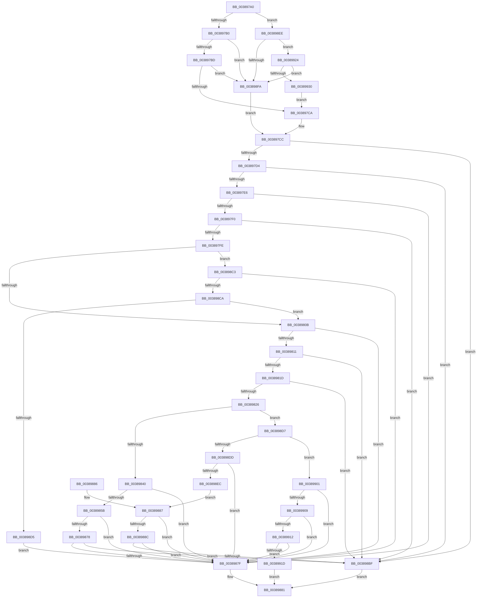

# CcShouldLazyWriteCacheMap

- RVA: `0x003897A0`–`0x00389935` (길이 `405` bytes)
- VA: `0x00000001403897A0`
- 실행 섹션: `.text`
- PDB 이름 있음: `예`; PDB Function 태그: `아니요`
- unwind 정보 RVA: `0x0007FF10`
- 디코드: `96`개 명령, `405/405` bytes 표시
- 미해석 바이트: `0` (있으면 어셈블리에 `.byte`로 보존)

> 이 문서는 커널 이미지의 기계어와 PDB 기호를 분석해 생성했습니다. 4번과 5번은 함수 원형과 자료형을 바이너리 사용 방식에서 추정한 C 해석이며 원본 소스 복구 결과는 아닙니다.

## 1. Dependencies

- 직접 호출 지점: **1**; 고유 호출 대상: **1**
- 직접 호출자로 확인된 함수: **2**
- RIP 상대 이미지 참조: **1**

### Outgoing calls
- `0x003898B6` → [CcCanIWriteStreamEx](CcCanIWriteStreamEx_function_0038993C.md) (function, `0x0038993C`)

### Direct callers
- [CcLazyWriteScanVolume](CcLazyWriteScanVolume_function_00388DC0.md) at `0x00388FE4`
- [CcLazyWriteScan](../3C/CcLazyWriteScan_function_003C9394.md) at `0x003C96BD`

### Static image references
- `0x0038985B` → RVA `0x00FC6AA0` (`ALMOSTRO`; read)

## 2. Other-region calls and transfers

- 다른 실행 섹션으로 향하는 call: **0**
- 별도 외부 분기/꼬리 이동을 확인하지 못했습니다.

## 3. Assembly (complete function range)

```asm
003897A0  48 83 EC 48                     sub rsp, 0x48
003897A4  4C 8B D1                        mov r10, rcx
003897A7  4D 85 C0                        test r8, r8
003897AA  0F 84 3E 01 00 00               je 0x1403898ee
003897B0  49 8D 40 48                     lea rax, [r8 + 0x48]
003897B4  48 3B C8                        cmp rcx, rax
003897B7  0F 84 3D 01 00 00               je 0x1403898fa
003897BD  49 8D 40 60                     lea rax, [r8 + 0x60]
003897C1  48 3B C8                        cmp rcx, rax
003897C4  0F 84 30 01 00 00               je 0x1403898fa
003897CA  32 C0                           xor al, al
003897CC  84 C0                           test al, al
003897CE  0F 85 EB 00 00 00               jne 0x1403898bf
003897D4  8B 89 98 00 00 00               mov ecx, dword ptr [rcx + 0x98]
003897DA  F7 C1 20 00 40 00               test ecx, 0x400020
003897E0  0F 85 D9 00 00 00               jne 0x1403898bf
003897E6  0F BA E1 10                     bt ecx, 0x10
003897EA  0F 82 8F 00 00 00               jb 0x14038987f
003897F0  41 83 BA 0C 02 00 00 00         cmp dword ptr [r10 + 0x20c], 0
003897F8  0F 85 C1 00 00 00               jne 0x1403898bf
003897FE  45 8B 42 04                     mov r8d, dword ptr [r10 + 4]
00389802  45 85 C0                        test r8d, r8d
00389805  0F 84 B8 00 00 00               je 0x1403898c3
0038980B  0F BA E1 1E                     bt ecx, 0x1e
0038980F  72 6E                           jb 0x14038987f
00389811  41 8B 52 70                     mov edx, dword ptr [r10 + 0x70]
00389815  85 D2                           test edx, edx
00389817  0F 84 A2 00 00 00               je 0x1403898bf
0038981D  4D 85 C9                        test r9, r9
00389820  0F 84 99 00 00 00               je 0x1403898bf
00389826  41 8B 82 14 01 00 00            mov eax, dword ptr [r10 + 0x114]
0038982D  FF C0                           inc eax
0038982F  41 89 82 14 01 00 00            mov dword ptr [r10 + 0x114], eax
00389836  0F BA E1 18                     bt ecx, 0x18
0038983A  0F 83 97 00 00 00               jae 0x1403898d7
00389840  48 B9 20 03 00 00 80 F7 FF FF   movabs rcx, 0xfffff78000000320
0038984A  48 8B 09                        mov rcx, qword ptr [rcx]
0038984D  4D 8B 8A F8 00 00 00            mov r9, qword ptr [r10 + 0xf8]
00389854  41 83 79 68 00                  cmp dword ptr [r9 + 0x68], 0
00389859  75 24                           jne 0x14038987f
0038985B  44 8B 05 3E D2 C3 00            mov r8d, dword ptr [rip + 0xc3d23e]
00389862  33 D2                           xor edx, edx
00389864  B8 00 68 89 09                  mov eax, 0x9896800
00389869  49 F7 F0                        div r8
0038986C  49 03 81 88 00 00 00            add rax, qword ptr [r9 + 0x88]
00389873  48 3B C8                        cmp rcx, rax
00389876  7F 07                           jg 0x14038987f
00389878  41 83 7A 70 40                  cmp dword ptr [r10 + 0x70], 0x40
0038987D  72 40                           jb 0x1403898bf
0038987F  B0 01                           mov al, 1
00389881  48 83 C4 48                     add rsp, 0x48
00389885  C3                              ret
00389886  CC                              int3
00389887  45 85 C0                        test r8d, r8d
0038988A  74 F3                           je 0x14038987f
0038988C  49 8B 92 58 02 00 00            mov rdx, qword ptr [r10 + 0x258]
00389893  33 C0                           xor eax, eax
00389895  49 8B 8A 18 02 00 00            mov rcx, qword ptr [r10 + 0x218]
0038989C  41 B9 00 00 00 01               mov r9d, 0x1000000
003898A2  48 89 44 24 30                  mov qword ptr [rsp + 0x30], rax
003898A7  4D 8B C3                        mov r8, r11
003898AA  C7 44 24 28 08 00 00 00         mov dword ptr [rsp + 0x28], 8
003898B2  89 44 24 20                     mov dword ptr [rsp + 0x20], eax
003898B6  E8 81 00 00 00                  call 0x14038993c
003898BB  84 C0                           test al, al
003898BD  74 C0                           je 0x14038987f
003898BF  32 C0                           xor al, al
003898C1  EB BE                           jmp 0x140389881
003898C3  41 83 7A 70 00                  cmp dword ptr [r10 + 0x70], 0
003898C8  74 B5                           je 0x14038987f
003898CA  49 83 7A 08 00                  cmp qword ptr [r10 + 8], 0
003898CF  0F 85 36 FF FF FF               jne 0x14038980b
003898D5  EB A8                           jmp 0x14038987f
003898D7  0F BA E1 09                     bt ecx, 9
003898DB  72 24                           jb 0x140389901
003898DD  4C 8B 5C 24 70                  mov r11, qword ptr [rsp + 0x70]
003898E2  41 F7 43 50 00 80 00 00         test dword ptr [r11 + 0x50], 0x8000
003898EA  74 93                           je 0x14038987f
003898EC  EB 99                           jmp 0x140389887
003898EE  48 8D 82 18 02 00 00            lea rax, [rdx + 0x218]
003898F5  4C 3B D0                        cmp r10, rax
003898F8  75 2A                           jne 0x140389924
003898FA  B0 01                           mov al, 1
003898FC  E9 CB FE FF FF                  jmp 0x1403897cc
00389901  A8 0F                           test al, 0xf
00389903  0F 84 76 FF FF FF               je 0x14038987f
00389909  83 FA 40                        cmp edx, 0x40
0038990C  0F 83 6D FF FF FF               jae 0x14038987f
00389912  83 7C 24 78 10                  cmp dword ptr [rsp + 0x78], 0x10
00389917  0F 84 62 FF FF FF               je 0x14038987f
0038991D  32 C0                           xor al, al
0038991F  E9 5D FF FF FF                  jmp 0x140389881
00389924  48 8D 82 30 02 00 00            lea rax, [rdx + 0x230]
0038992B  4C 3B D0                        cmp r10, rax
0038992E  74 CA                           je 0x1403898fa
00389930  E9 95 FE FF FF                  jmp 0x1403897ca
```

## 4. C-style interpretation (structured pseudocode)

```c
__int64 __fastcall CcShouldLazyWriteCacheMap(__int64 a1, __int64 a2, __int64 a3, __int64 a4, __int64 a5, unsigned int a6)
{
    __int64 result;
    __int64 v_rsp;
    unsigned int v_stack_p20;
    unsigned int v_stack_p28;
    unsigned __int64 v_stack_p30;

    v_rsp = (v_rsp) - (72);
    if (a3 == 0) goto loc_003898EE;
    if (a1 == (a3 + 72)) goto loc_003898FA;
    if (a1 == (a3 + 96)) goto loc_003898FA;
loc_003897CA:
    result = 0;
loc_003897CC:
    if (0 != 0) goto loc_003898BF;
    if ((((unsigned int)((unsigned int)(*(unsigned int *)(a1 + 152)))) & (0x400020ULL)) != 0) goto loc_003898BF;
    if (condition_is_below) goto loc_0038987F;
    if ((*(unsigned int *)(a1 + 524)) != 0) goto loc_003898BF;
    if ((unsigned int)((unsigned int)(*(unsigned int *)(a1 + 4))) == 0) goto loc_003898C3;
loc_0038980B:
    if (condition_is_below) goto loc_0038987F;
    if ((unsigned int)((unsigned int)(*(unsigned int *)(a1 + 112))) == 0) goto loc_003898BF;
    if (a4 == 0) goto loc_003898BF;
    result = (unsigned int)(((unsigned int)(*(unsigned int *)(a1 + 276))) + 1);
    *(unsigned int *)(a1 + 276) = (unsigned int)(result);
    if (condition_is_above_or_equal) goto loc_003898D7;
    if ((*(unsigned int *)(*(unsigned __int64 *)(a1 + 248) + 104)) != 0) goto loc_0038987F;
    a2 = 0;
    result = ((unsigned int)(0x9896800ULL)) + (*(unsigned __int64 *)(*(unsigned __int64 *)(a1 + 248) + 136));
    if ((*(unsigned __int64 *)((unsigned int)(*(unsigned int *)(a1 + 152)))) > result) goto loc_0038987F;
    if ((*(unsigned int *)(a1 + 112)) < 64) goto loc_003898BF;
loc_0038987F:
loc_00389881:
    v_rsp = (v_rsp) + (72);
    return 1;
loc_00389887:
    if ((unsigned int)((unsigned int)(*(unsigned int *)(v_rip + 12833342))) == 0) goto loc_0038987F;
    result = 0;
    v_stack_p30 = 0;
    v_stack_p28 = 8;
    v_stack_p20 = 0;
    result = CcCanIWriteStreamEx(*(unsigned __int64 *)(a1 + 536), *(unsigned __int64 *)(a1 + 600), v_r11, (unsigned int)(0x1000000ULL));
    if ((unsigned __int8)(result) == 0) goto loc_0038987F;
loc_003898BF:
    result = 0;
    goto loc_00389881;
loc_003898C3:
    if ((*(unsigned int *)(a1 + 112)) == 0) goto loc_0038987F;
    if ((*(unsigned __int64 *)(a1 + 8)) != 0) goto loc_0038980B;
    goto loc_0038987F;
loc_003898D7:
    if ((*(unsigned __int64 *)(a1 + 8)) < 0) goto loc_00389901;
    if (((*(unsigned int *)(a5 + 80)) & (0x8000ULL)) == 0) goto loc_0038987F;
    goto loc_00389887;
loc_003898EE:
    if (a1 != (*(unsigned __int64 *)(a1 + 600) + 536)) goto loc_00389924;
loc_003898FA:
    goto loc_003897CC;
loc_00389901:
    if (((1) & (15)) == 0) goto loc_0038987F;
    if (((unsigned int)(*(unsigned __int64 *)(a1 + 600))) >= 64) goto loc_0038987F;
    if (a6 == 16) goto loc_0038987F;
    result = 0;
    goto loc_00389881;
loc_00389924:
    if (a1 == (*(unsigned __int64 *)(a1 + 600) + 560)) goto loc_003898FA;
    goto loc_003897CA;
}
```

## 5. (Beta) C Style

```c
int64_t CcShouldLazyWriteCacheMap(int64_t Arg1, void *Arg2, int64_t Arg3, int64_t Arg4, void *Arg5, uint32_t Arg6)
{
    uint8_t *arg2 = (uint8_t *)Arg2;
    uint8_t *arg5 = (uint8_t *)Arg5;

    int64_t result;
    int64_t local_rsp;
    uint32_t v_stack_p20;
    uint32_t v_stack_p28;
    uint64_t v_stack_p30;

    local_rsp = (local_rsp) - (72);
    if (Arg3 == 0) goto loc_003898EE;
    if (Arg1 == (Arg3 + 72)) goto loc_003898FA;
    if (Arg1 == (Arg3 + 96)) goto loc_003898FA;
loc_003897CA:
    result = 0;
loc_003897CC:
    if (0 != 0) goto loc_003898BF;
    if ((((uint32_t)((uint32_t)(*(uint32_t *)(Arg1 + 0x98)))) & (0x400020ULL)) != 0) goto loc_003898BF;
    if (condition_is_below) goto loc_0038987F;
    if ((*(uint32_t *)(Arg1 + 0x20C)) != 0) goto loc_003898BF;
    if ((uint32_t)((uint32_t)(*(uint32_t *)(Arg1 + 0x4))) == 0) goto loc_003898C3;
loc_0038980B:
    if (condition_is_below) goto loc_0038987F;
    if ((uint32_t)((uint32_t)(*(uint32_t *)(Arg1 + 0x70))) == 0) goto loc_003898BF;
    if (Arg4 == 0) goto loc_003898BF;
    result = (uint32_t)(((uint32_t)(*(uint32_t *)(Arg1 + 0x114))) + 1);
    *(uint32_t *)(Arg1 + 0x114) = (uint32_t)(result);
    if (condition_is_above_or_equal) goto loc_003898D7;
    if ((*(uint32_t *)(*(uint64_t *)(Arg1 + 0xF8) + 0x68)) != 0) goto loc_0038987F;
    Arg2 = 0;
    result = ((uint32_t)(0x9896800ULL)) + (*(uint64_t *)(*(uint64_t *)(Arg1 + 0xF8) + 0x88));
    if ((*(uint64_t *)((uint32_t)(*(uint32_t *)(Arg1 + 0x98)))) > result) goto loc_0038987F;
    if ((*(uint32_t *)(Arg1 + 0x70)) < 64) goto loc_003898BF;
loc_0038987F:
loc_00389881:
    local_rsp = (local_rsp) + (72);
    return 1;
loc_00389887:
    if ((uint32_t)((uint32_t)(*(uint32_t *)(v_rip + 0xC3D23E))) == 0) goto loc_0038987F;
    result = 0;
    v_stack_p30 = 0;
    v_stack_p28 = 8;
    v_stack_p20 = 0;
    result = CcCanIWriteStreamEx(*(uint64_t *)(Arg1 + 0x218), *(uint64_t *)(Arg1 + 0x258), local_r11, (uint32_t)(0x1000000ULL));
    if ((uint8_t)(result) == 0) goto loc_0038987F;
loc_003898BF:
    result = 0;
    goto loc_00389881;
loc_003898C3:
    if ((*(uint32_t *)(Arg1 + 0x70)) == 0) goto loc_0038987F;
    if ((*(uint64_t *)(Arg1 + 0x8)) != 0) goto loc_0038980B;
    goto loc_0038987F;
loc_003898D7:
    if ((*(uint64_t *)(Arg1 + 0x8)) < 0) goto loc_00389901;
    if (((*(uint32_t *)(arg5 + 0x50)) & (0x8000ULL)) == 0) goto loc_0038987F;
    goto loc_00389887;
loc_003898EE:
    if (Arg1 != (*(uint64_t *)(Arg1 + 0x258) + 536)) goto loc_00389924;
loc_003898FA:
    goto loc_003897CC;
loc_00389901:
    if (((1) & (15)) == 0) goto loc_0038987F;
    if (((uint32_t)(*(uint64_t *)(Arg1 + 0x258))) >= 64) goto loc_0038987F;
    if (Arg6 == 16) goto loc_0038987F;
    result = 0;
    goto loc_00389881;
loc_00389924:
    if (Arg1 == (*(uint64_t *)(Arg1 + 0x258) + 560)) goto loc_003898FA;
    goto loc_003897CA;
}
```

### 관측된 메모리 오프셋

구조체 형식이 확인되지 않은 접근은 인자 기준의 오프셋으로만 기록했습니다.

| 기준 인자 | 오프셋 표현 | 폭 (bit) | 접근 |
|---|---:|---:|---|
| `Arg2` | `+ 0x218` | `64` | `R` |
| `Arg2` | `+ 0x230` | `64` | `R` |
| `Arg5` | `+ 0x50` | `32` | `R` |

## 6. Execution-region graph

[열기: 2D/3D 그래프와 함수 탐색 컨트롤 패널](../../../control-panel.html?section=text&rva=0x003897A0&view=graph)

- 2D 그래프는 위에서 아래로 흐르고, 3D 그래프는 빈 공간을 드래그해 회전합니다. Shift+드래그는 이동, 휠은 확대·축소, 함수 노드 선택은 대상 보고서 이동입니다.

### Static fallback


