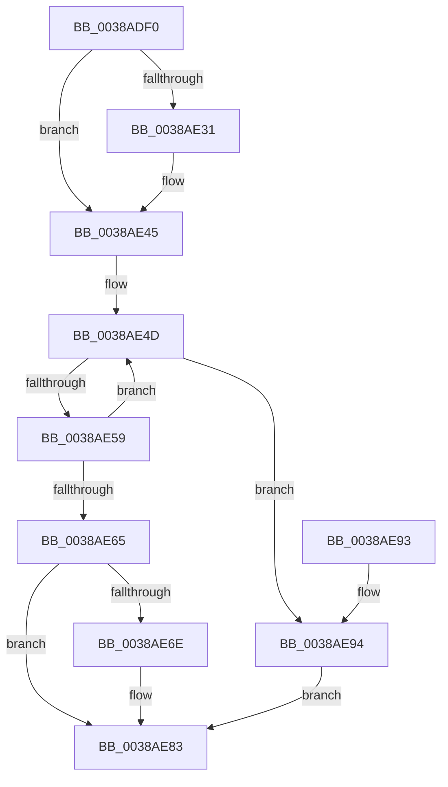

# CcUnmapAndPurge

- RVA: `0x0038ADF0`–`0x0038AEA3` (길이 `179` bytes)
- VA: `0x000000014038ADF0`
- 실행 섹션: `.text`
- PDB 이름 있음: `예`; PDB Function 태그: `아니요`
- unwind 정보 RVA: `0x00080064`
- 디코드: `49`개 명령, `179/179` bytes 표시
- 미해석 바이트: `0` (있으면 어셈블리에 `.byte`로 보존)

> 이 문서는 커널 이미지의 기계어와 PDB 기호를 분석해 생성했습니다. 4번과 5번은 함수 원형과 자료형을 바이너리 사용 방식에서 추정한 C 해석이며 원본 소스 복구 결과는 아닙니다.

## 1. Dependencies

- 직접 호출 지점: **5**; 고유 호출 대상: **5**
- 직접 호출자로 확인된 함수: **1**
- RIP 상대 이미지 참조: **1**

### Outgoing calls
- `0x0038AE04` → [CcReferenceSharedCacheMapFileObject](../23/CcReferenceSharedCacheMapFileObject_function_002379BC.md) (function, `0x002379BC`)
- `0x0038AE21` → [CcUnmapVacbArray](CcUnmapVacbArray_function_0038AEAC.md) (function, `0x0038AEAC`)
- `0x0038AE40` → [CcPurgeCacheSection](CcPurgeCacheSection_function_0038B130.md) (function, `0x0038B130`)
- `0x0038AE7E` → [ObpPushStackInfo](../21/ObpPushStackInfo_function_002109E4.md) (function, `0x002109E4`)
- `0x0038AE9C` → [ObDereferenceObjectDeferDeleteWithTag](../26/ObDereferenceObjectDeferDeleteWithTag_function_00263EA0.md) (function, `0x00263EA0`)

### Direct callers
- [CcDeleteSharedCacheMap](CcDeleteSharedCacheMap_function_0038A804.md) at `0x0038A99A`

### Static image references
- `0x0038AE65` → RVA `0x00FC5010` (`ALMOSTRO`; read)

## 2. Other-region calls and transfers

- 다른 실행 섹션으로 향하는 call: **0**
- 별도 외부 분기/꼬리 이동을 확인하지 못했습니다.

## 3. Assembly (complete function range)

```asm
0038ADF0  48 89 5C 24 08                  mov qword ptr [rsp + 8], rbx
0038ADF5  48 89 74 24 10                  mov qword ptr [rsp + 0x10], rsi
0038ADFA  57                              push rdi
0038ADFB  48 83 EC 30                     sub rsp, 0x30
0038ADFF  8A DA                           mov bl, dl
0038AE01  48 8B F9                        mov rdi, rcx
0038AE04  E8 B3 CB EA FF                  call 0x1402379bc
0038AE09  44 8A CB                        mov r9b, bl
0038AE0C  C6 44 24 28 00                  mov byte ptr [rsp + 0x28], 0
0038AE11  45 33 C0                        xor r8d, r8d
0038AE14  C6 44 24 20 01                  mov byte ptr [rsp + 0x20], 1
0038AE19  33 D2                           xor edx, edx
0038AE1B  48 8B CF                        mov rcx, rdi
0038AE1E  48 8B F0                        mov rsi, rax
0038AE21  E8 86 00 00 00                  call 0x14038aeac
0038AE26  8B 97 98 00 00 00               mov edx, dword ptr [rdi + 0x98]
0038AE2C  F6 C2 10                        test dl, 0x10
0038AE2F  74 14                           je 0x14038ae45
0038AE31  48 8B 4E 28                     mov rcx, qword ptr [rsi + 0x28]
0038AE35  41 B9 02 00 00 00               mov r9d, 2
0038AE3B  45 33 C0                        xor r8d, r8d
0038AE3E  33 D2                           xor edx, edx
0038AE40  E8 EB 02 00 00                  call 0x14038b130
0038AE45  0F 0D 4F 60                     prefetchw byte ptr [rdi + 0x60]
0038AE49  48 8B 47 60                     mov rax, qword ptr [rdi + 0x60]
0038AE4D  48 8B C8                        mov rcx, rax
0038AE50  48 33 CE                        xor rcx, rsi
0038AE53  48 83 F9 0F                     cmp rcx, 0xf
0038AE57  73 3B                           jae 0x14038ae94
0038AE59  48 8D 48 01                     lea rcx, [rax + 1]
0038AE5D  F0 48 0F B1 4F 60               lock cmpxchg qword ptr [rdi + 0x60], rcx
0038AE63  75 E8                           jne 0x14038ae4d
0038AE65  83 3D A4 A1 C3 00 00            cmp dword ptr [rip + 0xc3a1a4], 0
0038AE6C  74 15                           je 0x14038ae83
0038AE6E  33 D2                           xor edx, edx
0038AE70  48 8D 4E D0                     lea rcx, [rsi - 0x30]
0038AE74  41 B9 43 63 53 63               mov r9d, 0x63536343
0038AE7A  44 8D 42 01                     lea r8d, [rdx + 1]
0038AE7E  E8 61 5B E8 FF                  call 0x1402109e4
0038AE83  48 8B 5C 24 40                  mov rbx, qword ptr [rsp + 0x40]
0038AE88  48 8B 74 24 48                  mov rsi, qword ptr [rsp + 0x48]
0038AE8D  48 83 C4 30                     add rsp, 0x30
0038AE91  5F                              pop rdi
0038AE92  C3                              ret
0038AE93  CC                              int3
0038AE94  BA 43 63 53 63                  mov edx, 0x63536343
0038AE99  48 8B CE                        mov rcx, rsi
0038AE9C  E8 FF 8F ED FF                  call 0x140263ea0
0038AEA1  EB E0                           jmp 0x14038ae83
```

## 4. C-style interpretation (structured pseudocode)

```c
__int64 __fastcall CcUnmapAndPurge(__int64 a1, int a2, int a3)
{
    __int64 result;
    __int64 v_rsp;
    unsigned __int8 v_stack_m10;
    unsigned __int8 v_stack_m18;
    unsigned __int64 v_stack_p10;
    unsigned __int64 v_stack_p8;

    v_stack_p8 = v_rbx;
    v_stack_p10 = v_rsi;
    v_rsp = (v_rsp) - (48);
    result = CcReferenceSharedCacheMapFileObject(a1, a2, a3, a4);
    v_stack_m10 = 0;
    a3 = 0;
    v_stack_m18 = 1;
    a2 = 0;
    result = CcUnmapVacbArray(a1, a2, a3, (unsigned __int8)((unsigned __int8)(a2)));
    if ((((unsigned __int8)((unsigned int)(*(unsigned int *)(a1 + 152)))) & (16)) != 0) {
        a1 = *(unsigned __int64 *)(result + 40);
        a4 = 2;
        a3 = 0;
        a2 = 0;
        result = CcPurgeCacheSection(a1, a2, a3, a4);
    }
loc_0038AE4D:
    a1 = (*(unsigned __int64 *)(a1 + 96)) ^ (result);
    if (a1 >= 15) goto loc_0038AE94;
    if (a1 != 15) goto loc_0038AE4D;
    result = *(unsigned __int64 *)(a1 + 96);
    if ((*(unsigned int *)(v_rip + 12820900)) != 0) {
        a2 = 0;
        a1 = result - 48;
        a4 = 0x63536343ULL;
        a3 = a2 + 1;
        result = ObpPushStackInfo(a1, a2, a3, a4);
    }
    v_rsp = (v_rsp) + (48);
    return result;
loc_0038AE94:
    result = ObDereferenceObjectDeferDeleteWithTag(v_stack_p10, (unsigned int)(0x63536343ULL), a3, a4);
    goto loc_0038AE83;
}
```

## 5. (Beta) C Style

```c
int64_t CcUnmapAndPurge(void *Arg1, int32_t Arg2, int32_t Arg3)
{
    uint8_t *arg1 = (uint8_t *)Arg1;

    int64_t result;
    int64_t local_rsp;
    uint8_t v_stack_m10;
    uint8_t v_stack_m18;
    uint64_t v_stack_p10;
    uint64_t v_stack_p8;

    v_stack_p8 = local_rbx;
    v_stack_p10 = local_rsi;
    local_rsp = (local_rsp) - (48);
    result = CcReferenceSharedCacheMapFileObject(Arg1, Arg2, Arg3, a4);
    v_stack_m10 = 0;
    Arg3 = 0;
    v_stack_m18 = 1;
    Arg2 = 0;
    result = CcUnmapVacbArray(Arg1, Arg2, Arg3, (uint8_t)((uint8_t)(Arg2)));
    if ((((uint8_t)((uint32_t)(*(uint32_t *)(arg1 + 0x98)))) & (16)) != 0) {
        Arg1 = *(uint64_t *)(result + 0x28);
        a4 = 2;
        Arg3 = 0;
        Arg2 = 0;
        result = CcPurgeCacheSection(Arg1, Arg2, Arg3, a4);
    }
loc_0038AE4D:
    Arg1 = (*(uint64_t *)(arg1 + 0x60)) ^ (result);
    if (Arg1 >= 15) goto loc_0038AE94;
    if (Arg1 != 15) goto loc_0038AE4D;
    result = *(uint64_t *)(arg1 + 0x60);
    if ((*(uint32_t *)(v_rip + 0xC3A1A4)) != 0) {
        Arg2 = 0;
        Arg1 = result - 48;
        a4 = 0x63536343ULL;
        Arg3 = Arg2 + 1;
        result = ObpPushStackInfo(Arg1, Arg2, Arg3, a4);
    }
    local_rsp = (local_rsp) + (48);
    return result;
loc_0038AE94:
    result = ObDereferenceObjectDeferDeleteWithTag(v_stack_p10, (uint32_t)(0x63536343ULL), Arg3, a4);
    goto loc_0038AE83;
}
```

### 관측된 메모리 오프셋

구조체 형식이 확인되지 않은 접근은 인자 기준의 오프셋으로만 기록했습니다.

| 기준 인자 | 오프셋 표현 | 폭 (bit) | 접근 |
|---|---:|---:|---|
| `Arg1` | `+ 0x60` | `8` | `R` |
| `Arg1` | `+ 0x60` | `64` | `R` |
| `Arg1` | `+ 0x98` | `32` | `R` |

## 6. Execution-region graph

[열기: 2D/3D 그래프와 함수 탐색 컨트롤 패널](../../../control-panel.html?section=text&rva=0x0038ADF0&view=graph)

- 2D 그래프는 위에서 아래로 흐르고, 3D 그래프는 빈 공간을 드래그해 회전합니다. Shift+드래그는 이동, 휠은 확대·축소, 함수 노드 선택은 대상 보고서 이동입니다.

### Static fallback


