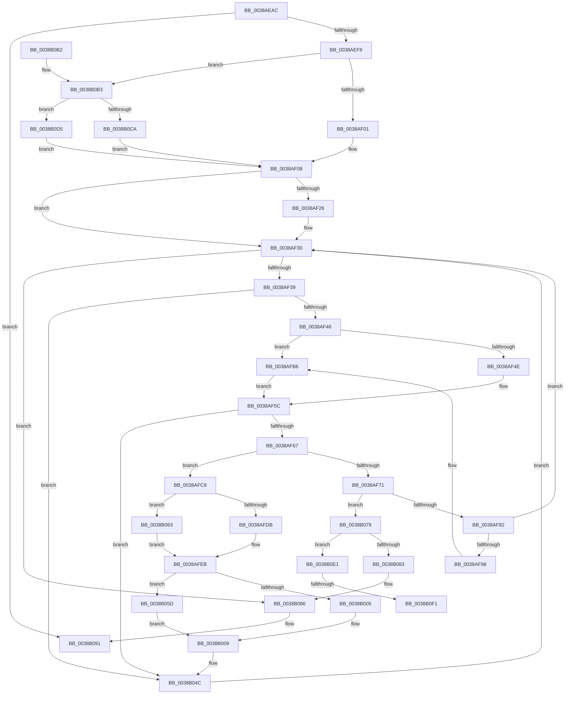

# CcUnmapVacbArray

- RVA: `0x0038AEAC`–`0x0038B11B` (길이 `623` bytes)
- VA: `0x000000014038AEAC`
- 실행 섹션: `.text`
- PDB 이름 있음: `예`; PDB Function 태그: `예`
- unwind 정보 RVA: `0x00080078`
- 디코드: `153`개 명령, `623/623` bytes 표시
- 미해석 바이트: `0` (있으면 어셈블리에 `.byte`로 보존)

> 이 문서는 커널 이미지의 기계어와 PDB 기호를 분석해 생성했습니다. 4번과 5번은 함수 원형과 자료형을 바이너리 사용 방식에서 추정한 C 해석이며 원본 소스 복구 결과는 아닙니다.

## 1. Dependencies

- 직접 호출 지점: **9**; 고유 호출 대상: **9**
- 직접 호출자로 확인된 함수: **6**
- RIP 상대 이미지 참조: **1**

### Outgoing calls
- `0x0038AF1C` → [CcAcquireBcbLockAndVacbLock](../26/CcAcquireBcbLockAndVacbLock_function_0026FC58.md) (function, `0x0026FC58`)
- `0x0038AF54` → [CcGetVacbLargeOffset](CcGetVacbLargeOffset_function_0038A590.md) (function, `0x0038A590`)
- `0x0038AFB0` → [KeBugCheckEx](../4F/KeBugCheckEx_function_004FD660.md) (function, `0x004FD660`)
- `0x0038B012` → [CcUnmapVacb](../../page/9E/CcUnmapVacb_function_009E9600.md) (function, `0x009E9600`)
- `0x0038B01C` → [KeAcquireQueuedSpinLock](../27/KeAcquireQueuedSpinLock_function_00273D80.md) (function, `0x00273D80`)
- `0x0038B03A` → [CcSetVacbInFreeList](../26/CcSetVacbInFreeList_function_0026FBB0.md) (function, `0x0026FBB0`)
- `0x0038B047` → [KeReleaseQueuedSpinLock](../27/KeReleaseQueuedSpinLock_function_00272540.md) (function, `0x00272540`)
- `0x0038B06F` → [CcSetVacbLargeOffset](../27/CcSetVacbLargeOffset_function_002733D0.md) (function, `0x002733D0`)
- `0x0038B08C` → [CcReleaseBcbLockAndVacbLock](../2D/CcReleaseBcbLockAndVacbLock_function_002DFDF0.md) (function, `0x002DFDF0`)

### Direct callers
- [CcSetFileSizesEx](../26/CcSetFileSizesEx_function_0026D070.md) at `0x0026D22C`
- [CcGetVirtualAddress](../34/CcGetVirtualAddress_function_00340C9C.md) at `0x00340F67`
- [CcGetVirtualAddress](../34/CcGetVirtualAddress_function_00340C9C.md) at `0x00340FAA`
- [CcFlushCachePreProcess](../35/CcFlushCachePreProcess_function_0035A9B0.md) at `0x0035AD49`
- [CcUnmapAndPurge](CcUnmapAndPurge_function_0038ADF0.md) at `0x0038AE21`
- [CcPurgeCacheSection](CcPurgeCacheSection_function_0038B130.md) at `0x0038B2D7`
- [CcUnmapFileOffsetFromSystemCache](../4C/CcUnmapFileOffsetFromSystemCache_function_004C0A90.md) at `0x004C0AB0`

### Static image references
- `0x0038AFF7` → RVA `0x00F8F498` (`.data`; read)

## 2. Other-region calls and transfers

- 다른 실행 섹션으로 향하는 call: **1**
  - `0x0038B012` → [CcUnmapVacb](../../page/9E/CcUnmapVacb_function_009E9600.md) (`.text` → `PAGE`)
- call이 아닌 외부 분기/꼬리 이동: **2**
  - `0x0038B0EB` → [sub_006E532A](../6E/Unknown_function_006E532A.md) (`tail-transfer`)
  - `0x0038B116` → [sub_006E532A + 0x14](../6E/Unknown_function_006E532A.md) (`tail-transfer`)

## 3. Assembly (complete function range)

```asm
0038AEAC  48 89 5C 24 10                  mov qword ptr [rsp + 0x10], rbx
0038AEB1  48 89 6C 24 18                  mov qword ptr [rsp + 0x18], rbp
0038AEB6  48 89 74 24 20                  mov qword ptr [rsp + 0x20], rsi
0038AEBB  57                              push rdi
0038AEBC  41 54                           push r12
0038AEBE  41 55                           push r13
0038AEC0  41 56                           push r14
0038AEC2  41 57                           push r15
0038AEC4  48 83 EC 40                     sub rsp, 0x40
0038AEC8  48 8B 81 18 02 00 00            mov rax, qword ptr [rcx + 0x218]
0038AECF  45 33 ED                        xor r13d, r13d
0038AED2  41 8A F1                        mov sil, r9b
0038AED5  48 8B E9                        mov rbp, rcx
0038AED8  45 8B E5                        mov r12d, r13d
0038AEDB  4C 89 6C 24 30                  mov qword ptr [rsp + 0x30], r13
0038AEE0  48 89 44 24 38                  mov qword ptr [rsp + 0x38], rax
0038AEE5  45 8D 75 01                     lea r14d, [r13 + 1]
0038AEE9  44 88 74 24 70                  mov byte ptr [rsp + 0x70], r14b
0038AEEE  4C 39 69 58                     cmp qword ptr [rcx + 0x58], r13
0038AEF2  0F 84 99 01 00 00               je 0x14038b091
0038AEF8  48 85 D2                        test rdx, rdx
0038AEFB  0F 85 B2 01 00 00               jne 0x14038b0b3
0038AF01  48 8B 79 20                     mov rdi, qword ptr [rcx + 0x20]
0038AF05  41 8B DD                        mov ebx, r13d
0038AF08  44 8B B9 98 00 00 00            mov r15d, dword ptr [rcx + 0x98]
0038AF0F  48 8B D5                        mov rdx, rbp
0038AF12  41 C1 EF 09                     shr r15d, 9
0038AF16  45 23 FE                        and r15d, r14d
0038AF19  41 8B CF                        mov ecx, r15d
0038AF1C  E8 37 4D EE FF                  call 0x14026fc58
0038AF21  40 84 F6                        test sil, sil
0038AF24  74 0A                           je 0x14038af30
0038AF26  45 8B E6                        mov r12d, r14d
0038AF29  48 89 BD 58 01 00 00            mov qword ptr [rbp + 0x158], rdi
0038AF30  48 3B DF                        cmp rbx, rdi
0038AF33  0F 8D 4D 01 00 00               jge 0x14038b086
0038AF39  48 8B 45 20                     mov rax, qword ptr [rbp + 0x20]
0038AF3D  48 3B D8                        cmp rbx, rax
0038AF40  0F 8D 06 01 00 00               jge 0x14038b04c
0038AF46  48 3D 00 00 00 02               cmp rax, 0x2000000
0038AF4C  7E 68                           jle 0x14038afb6
0038AF4E  48 8B D3                        mov rdx, rbx
0038AF51  48 8B CD                        mov rcx, rbp
0038AF54  E8 37 F6 FF FF                  call 0x14038a590
0038AF59  4C 8B E8                        mov r13, rax
0038AF5C  33 D2                           xor edx, edx
0038AF5E  4D 85 ED                        test r13, r13
0038AF61  0F 84 E5 00 00 00               je 0x14038b04c
0038AF67  41 0F B7 45 10                  movzx eax, word ptr [r13 + 0x10]
0038AF6C  66 85 C0                        test ax, ax
0038AF6F  74 57                           je 0x14038afc8
0038AF71  45 33 ED                        xor r13d, r13d
0038AF74  44 38 AC 24 98 00 00 00         cmp byte ptr [rsp + 0x98], r13b
0038AF7C  0F 84 F7 00 00 00               je 0x14038b079
0038AF82  48 81 C3 00 00 04 00            add rbx, 0x40000
0038AF89  48 89 5C 24 30                  mov qword ptr [rsp + 0x30], rbx
0038AF8E  44 38 AC 24 90 00 00 00         cmp byte ptr [rsp + 0x90], r13b
0038AF96  74 98                           je 0x14038af30
0038AF98  45 33 C9                        xor r9d, r9d
0038AF9B  4C 89 6C 24 20                  mov qword ptr [rsp + 0x20], r13
0038AFA0  BA 66 0C 00 00                  mov edx, 0xc66
0038AFA5  41 8D 4D 34                     lea ecx, [r13 + 0x34]
0038AFA9  49 C7 C0 20 04 00 C0            mov r8, 0xffffffffc0000420
0038AFB0  E8 AB 26 17 00                  call 0x1404fd660
0038AFB5  CC                              int3
0038AFB6  8B 4C 24 30                     mov ecx, dword ptr [rsp + 0x30]
0038AFBA  48 8B 45 58                     mov rax, qword ptr [rbp + 0x58]
0038AFBE  48 C1 E9 12                     shr rcx, 0x12
0038AFC2  4C 8B 2C C8                     mov r13, qword ptr [rax + rcx*8]
0038AFC6  EB 94                           jmp 0x14038af5c
0038AFC8  48 81 7D 20 00 00 00 02         cmp qword ptr [rbp + 0x20], 0x2000000
0038AFD0  44 88 74 24 70                  mov byte ptr [rsp + 0x70], r14b
0038AFD5  0F 8F 88 00 00 00               jg 0x14038b063
0038AFDB  8B 4C 24 30                     mov ecx, dword ptr [rsp + 0x30]
0038AFDF  48 8B 45 58                     mov rax, qword ptr [rbp + 0x58]
0038AFE3  48 C1 E9 12                     shr rcx, 0x12
0038AFE7  48 89 14 C8                     mov qword ptr [rax + rcx*8], rdx
0038AFEB  F0 FF 8D 24 02 00 00            lock dec dword ptr [rbp + 0x224]
0038AFF2  48 8B 4C 24 38                  mov rcx, qword ptr [rsp + 0x38]
0038AFF7  8B 05 9B 44 C0 00               mov eax, dword ptr [rip + 0xc0449b]
0038AFFD  39 81 E0 04 00 00               cmp dword ptr [rcx + 0x4e0], eax
0038B003  73 58                           jae 0x14038b05d
0038B005  41 83 CC 02                     or r12d, 2
0038B009  45 8B C4                        mov r8d, r12d
0038B00C  48 8B D5                        mov rdx, rbp
0038B00F  49 8B CD                        mov rcx, r13
0038B012  E8 E9 E5 65 00                  call 0x1409e9600
0038B017  B9 04 00 00 00                  mov ecx, 4
0038B01C  E8 5F 8D EE FF                  call 0x140273d80
0038B021  48 8B 4C 24 38                  mov rcx, qword ptr [rsp + 0x38]
0038B026  45 8B C4                        mov r8d, r12d
0038B029  49 83 65 08 00                  and qword ptr [r13 + 8], 0
0038B02E  49 8B D5                        mov rdx, r13
0038B031  41 D1 E8                        shr r8d, 1
0038B034  40 8A F0                        mov sil, al
0038B037  45 22 C6                        and r8b, r14b
0038B03A  E8 71 4B EE FF                  call 0x14026fbb0
0038B03F  40 8A D6                        mov dl, sil
0038B042  B9 04 00 00 00                  mov ecx, 4
0038B047  E8 F4 74 EE FF                  call 0x140272540
0038B04C  48 81 C3 00 00 04 00            add rbx, 0x40000
0038B053  48 89 5C 24 30                  mov qword ptr [rsp + 0x30], rbx
0038B058  E9 D3 FE FF FF                  jmp 0x14038af30
0038B05D  41 83 E4 FD                     and r12d, 0xfffffffd
0038B061  EB A6                           jmp 0x14038b009
0038B063  45 33 C9                        xor r9d, r9d
0038B066  45 33 C0                        xor r8d, r8d
0038B069  48 8B D3                        mov rdx, rbx
0038B06C  48 8B CD                        mov rcx, rbp
0038B06F  E8 5C 83 EE FF                  call 0x1402733d0
0038B074  E9 72 FF FF FF                  jmp 0x14038afeb
0038B079  44 38 AC 24 90 00 00 00         cmp byte ptr [rsp + 0x90], r13b
0038B081  75 5E                           jne 0x14038b0e1
0038B083  45 8A F5                        mov r14b, r13b
0038B086  48 8B D5                        mov rdx, rbp
0038B089  41 8B CF                        mov ecx, r15d
0038B08C  E8 5F 4D F5 FF                  call 0x1402dfdf0
0038B091  4C 8D 5C 24 40                  lea r11, [rsp + 0x40]
0038B096  41 8A C6                        mov al, r14b
0038B099  49 8B 5B 38                     mov rbx, qword ptr [r11 + 0x38]
0038B09D  49 8B 6B 40                     mov rbp, qword ptr [r11 + 0x40]
0038B0A1  49 8B 73 48                     mov rsi, qword ptr [r11 + 0x48]
0038B0A5  49 8B E3                        mov rsp, r11
0038B0A8  41 5F                           pop r15
0038B0AA  41 5E                           pop r14
0038B0AC  41 5D                           pop r13
0038B0AE  41 5C                           pop r12
0038B0B0  5F                              pop rdi
0038B0B1  C3                              ret
0038B0B2  CC                              int3
0038B0B3  48 8B 02                        mov rax, qword ptr [rdx]
0038B0B6  48 8B D8                        mov rbx, rax
0038B0B9  48 81 E3 00 00 FC FF            and rbx, 0xfffffffffffc0000
0038B0C0  48 89 5C 24 30                  mov qword ptr [rsp + 0x30], rbx
0038B0C5  45 85 C0                        test r8d, r8d
0038B0C8  74 0B                           je 0x14038b0d5
0038B0CA  41 8B F8                        mov edi, r8d
0038B0CD  48 03 F8                        add rdi, rax
0038B0D0  E9 33 FE FF FF                  jmp 0x14038af08
0038B0D5  48 8B B9 78 01 00 00            mov rdi, qword ptr [rcx + 0x178]
0038B0DC  E9 27 FE FF FF                  jmp 0x14038af08
0038B0E1  48 8B B5 C0 00 00 00            mov rsi, qword ptr [rbp + 0xc0]
0038B0E8  48 85 F6                        test rsi, rsi
0038B0EB  0F 85 39 A2 35 00               jne 0x1406e532a
0038B0F1  48 8D 8D 60 01 00 00            lea rcx, [rbp + 0x160]
0038B0F8  48 8D 41 08                     lea rax, [rcx + 8]
0038B0FC  66 44 89 29                     mov word ptr [rcx], r13w
0038B100  C6 41 02 06                     mov byte ptr [rcx + 2], 6
0038B104  44 89 69 04                     mov dword ptr [rcx + 4], r13d
0038B108  48 89 40 08                     mov qword ptr [rax + 8], rax
0038B10C  48 89 00                        mov qword ptr [rax], rax
0038B10F  48 87 8D C0 00 00 00            xchg qword ptr [rbp + 0xc0], rcx
0038B116  E9 23 A2 35 00                  jmp 0x1406e533e
```

## 4. C-style interpretation (structured pseudocode)

```c
__int64 __fastcall CcUnmapVacbArray(__int64 a1, __int64 a2, __int64 a3, int a4, unsigned __int8 a5, unsigned __int8 a6)
{
    __int64 result;
    __int64 v_r12;
    __int64 v_r13;
    __int64 v_r15;
    __int64 v_rbx;
    __int64 v_rdi;
    __int64 v_rsp;
    unsigned __int64 v_stack_m10;
    unsigned __int64 v_stack_m28;
    unsigned __int64 v_stack_m30;
    unsigned __int64 v_stack_m38;
    unsigned __int64 v_stack_m48;
    unsigned __int64 v_stack_p10;
    unsigned __int64 v_stack_p18;
    unsigned __int64 v_stack_p20;
    unsigned __int8 v_stack_p8;

    v_stack_p10 = v_rbx;
    v_stack_p18 = v_rbp;
    v_stack_p20 = v_rsi;
    v_rsp = (v_rsp) - (64);
    v_r13 = 0;
    v_stack_m38 = 0;
    v_stack_m30 = *(unsigned __int64 *)(a1 + 536);
    v_stack_p8 = (unsigned __int8)(v_r13 + 1);
    if ((*(unsigned __int64 *)(a1 + 88)) == 0) goto loc_0038B091;
    if (a2 != 0) goto loc_0038B0B3;
loc_0038AF08:
    v_r15 = (unsigned int)(((unsigned int)(*(unsigned int *)(a1 + 152))) >> (9));
    v_r15 = (unsigned int)((v_r15) & ((unsigned int)(v_r13 + 1)));
    result = CcAcquireBcbLockAndVacbLock((unsigned int)((unsigned int)(v_r15)), a1, a3, a4);
    v_r12 = 0;
    if ((unsigned __int8)((unsigned __int8)(a4)) != 0) {
        v_r12 = (unsigned int)(v_r13 + 1);
        *(unsigned __int64 *)(a1 + 344) = *(unsigned __int64 *)(a1 + 32);
    }
    if (0 >= (*(unsigned __int64 *)(a1 + 32))) goto loc_0038B086;
    if (0 >= (*(unsigned __int64 *)(a1 + 32))) goto loc_0038B04C;
    if ((*(unsigned __int64 *)(a1 + 32)) <= 0x2000000ULL) goto loc_0038AFB6;
    result = CcGetVacbLargeOffset(a1, 0, a3, a4);
loc_0038AF5C:
    a2 = 0;
    if (result == 0) goto loc_0038B04C;
    if ((unsigned __int16)(*(unsigned __int16 *)(result + 16)) == 0) goto loc_0038AFC8;
    v_r13 = 0;
    if (a6 == 0) goto loc_0038B079;
    v_rbx = (0) + (0x40000ULL);
    v_stack_m38 = v_rbx;
    if (a5 == 0) goto loc_0038AF30;
    a4 = 0;
    v_stack_m48 = 0;
    result = KeBugCheckEx(v_r13 + 52, (unsigned int)(0xC66ULL), 0xFFFFFFFFC0000420ULL, a4);
loc_0038AFB6:
    a1 = ((unsigned int)(v_stack_m38)) >> (18);
    goto loc_0038AF5C;
loc_0038AFC8:
    v_stack_p8 = (unsigned __int8)(v_r13 + 1);
    if ((*(unsigned __int64 *)(a1 + 32)) > 0x2000000ULL) goto loc_0038B063;
    a1 = ((unsigned int)(v_stack_m38)) >> (18);
    *(unsigned __int64 *)(*(unsigned __int64 *)(a1 + 88) + a1 * 8) = (unsigned int)(0xC66ULL);
loc_0038AFEB:
    if ((*(unsigned int *)(v_stack_m30 + 1248)) >= ((unsigned int)((unsigned int)(*(unsigned int *)(v_rip + 12600475))))) goto loc_0038B05D;
    v_r12 = (unsigned int)((v_r12) | (2));
loc_0038B009:
    result = CcUnmapVacb(*(unsigned __int64 *)(*(unsigned __int64 *)(a1 + 88) + a1 * 8), a1, (unsigned int)((unsigned int)(v_r12)), a4);
    result = KeAcquireQueuedSpinLock(4, a1, (unsigned int)((unsigned int)(v_r12)), a4);
    a3 = (unsigned int)(((unsigned int)((unsigned int)(v_r12))) >> (1));
    a3 = (unsigned __int8)((a3) & ((unsigned __int8)(v_r13 + 1)));
    result = CcSetVacbInFreeList(v_stack_m30, *(unsigned __int64 *)(*(unsigned __int64 *)(a1 + 88) + a1 * 8), a3, a4);
    result = KeReleaseQueuedSpinLock(4, (unsigned __int8)((unsigned __int8)(result)), a3, a4);
loc_0038B04C:
    v_rbx = (v_rbx) + (0x40000ULL);
    v_stack_m38 = v_rbx;
    goto loc_0038AF30;
loc_0038B05D:
    v_r12 = (unsigned int)((v_r12) & (0xFFFFFFFDULL));
    goto loc_0038B009;
loc_0038B063:
    a4 = 0;
    a3 = 0;
    result = CcSetVacbLargeOffset(a1, v_rbx, a3, a4);
    goto loc_0038AFEB;
loc_0038B079:
    if (a5 != ((unsigned __int8)(*(unsigned __int64 *)(*(unsigned __int64 *)(a1 + 88) + a1 * 8)))) goto loc_0038B0E1;
loc_0038B086:
    result = CcReleaseBcbLockAndVacbLock((unsigned int)((unsigned int)(v_r15)), a1, a3, a4);
loc_0038B091:
    return (unsigned __int8)((unsigned __int8)(*(unsigned __int64 *)(*(unsigned __int64 *)(a1 + 88) + a1 * 8)));
loc_0038B0B3:
    v_rbx = (*(unsigned __int64 *)(a1)) & (0xFFFFFFFFFFFC0000ULL);
    v_stack_m10 = v_rbx;
    if (0 == 0) goto loc_0038B0D5;
    v_rdi = (0) + (*(unsigned __int64 *)(a1));
    goto loc_0038AF08;
loc_0038B0D5:
    goto loc_0038AF08;
loc_0038B0E1:
    *(unsigned __int16 *)(*(unsigned __int64 *)(v_stack_m28 + 64) + 352) = (unsigned __int16)(*(unsigned __int64 *)(*(unsigned __int64 *)(a1 + 88) + a1 * 8));
    *(unsigned __int8 *)(*(unsigned __int64 *)(v_stack_m28 + 64) + 352 + 2) = 6;
    *(unsigned int *)(*(unsigned __int64 *)(v_stack_m28 + 64) + 352 + 4) = (unsigned int)(*(unsigned __int64 *)(*(unsigned __int64 *)(a1 + 88) + a1 * 8));
    *(unsigned __int64 *)(*(unsigned __int64 *)(v_stack_m28 + 64) + 352 + 8 + 8) = *(unsigned __int64 *)(v_stack_m28 + 64) + 352 + 8;
    *(unsigned __int64 *)(*(unsigned __int64 *)(v_stack_m28 + 64) + 352 + 8) = *(unsigned __int64 *)(v_stack_m28 + 64) + 352 + 8;
}
```

## 5. (Beta) C Style

```c
int64_t CcUnmapVacbArray(void *Arg1, int64_t Arg2, int64_t Arg3, int32_t Arg4, uint8_t Arg5, uint8_t Arg6)
{
    uint8_t *arg1 = (uint8_t *)Arg1;

    int64_t result;
    int64_t local_r12;
    int64_t local_r13;
    int64_t local_r15;
    int64_t local_rbx;
    int64_t local_rdi;
    int64_t local_rsp;
    uint64_t v_stack_m10;
    uint64_t v_stack_m28;
    uint64_t v_stack_m30;
    uint64_t v_stack_m38;
    uint64_t v_stack_m48;
    uint64_t v_stack_p10;
    uint64_t v_stack_p18;
    uint64_t v_stack_p20;
    uint8_t v_stack_p8;

    v_stack_p10 = local_rbx;
    v_stack_p18 = local_rbp;
    v_stack_p20 = local_rsi;
    local_rsp = (local_rsp) - (64);
    local_r13 = 0;
    v_stack_m38 = 0;
    v_stack_m30 = *(uint64_t *)(arg1 + 0x218);
    v_stack_p8 = (uint8_t)(local_r13 + 1);
    if ((*(uint64_t *)(arg1 + 0x58)) == 0) goto loc_0038B091;
    if (Arg2 != 0) goto loc_0038B0B3;
loc_0038AF08:
    local_r15 = (uint32_t)(((uint32_t)(*(uint32_t *)(arg1 + 0x98))) >> (9));
    local_r15 = (uint32_t)((local_r15) & ((uint32_t)(local_r13 + 1)));
    result = CcAcquireBcbLockAndVacbLock((uint32_t)((uint32_t)(local_r15)), Arg1, Arg3, Arg4);
    local_r12 = 0;
    if ((uint8_t)((uint8_t)(Arg4)) != 0) {
        local_r12 = (uint32_t)(local_r13 + 1);
        *(uint64_t *)(arg1 + 0x158) = *(uint64_t *)(arg1 + 0x20);
    }
    if (0 >= (*(uint64_t *)(arg1 + 0x20))) goto loc_0038B086;
    if (0 >= (*(uint64_t *)(arg1 + 0x20))) goto loc_0038B04C;
    if ((*(uint64_t *)(arg1 + 0x20)) <= 0x2000000ULL) goto loc_0038AFB6;
    result = CcGetVacbLargeOffset(Arg1, 0, Arg3, Arg4);
loc_0038AF5C:
    Arg2 = 0;
    if (result == 0) goto loc_0038B04C;
    if ((uint16_t)(*(uint16_t *)(result + 0x10)) == 0) goto loc_0038AFC8;
    local_r13 = 0;
    if (Arg6 == 0) goto loc_0038B079;
    local_rbx = (0) + (0x40000ULL);
    v_stack_m38 = local_rbx;
    if (Arg5 == 0) goto loc_0038AF30;
    Arg4 = 0;
    v_stack_m48 = 0;
    result = KeBugCheckEx(local_r13 + 52, (uint32_t)(0xC66ULL), 0xFFFFFFFFC0000420ULL, Arg4);
loc_0038AFB6:
    Arg1 = ((uint32_t)(v_stack_m38)) >> (18);
    goto loc_0038AF5C;
loc_0038AFC8:
    v_stack_p8 = (uint8_t)(local_r13 + 1);
    if ((*(uint64_t *)(arg1 + 0x20)) > 0x2000000ULL) goto loc_0038B063;
    Arg1 = ((uint32_t)(v_stack_m38)) >> (18);
    *(uint64_t *)(*(uint64_t *)(arg1 + 0x58) + arg1 * 8) = (uint32_t)(0xC66ULL);
loc_0038AFEB:
    if ((*(uint32_t *)(v_stack_m30 + 0x4E0)) >= ((uint32_t)((uint32_t)(*(uint32_t *)(v_rip + 0xC0449B))))) goto loc_0038B05D;
    local_r12 = (uint32_t)((local_r12) | (2));
loc_0038B009:
    result = CcUnmapVacb(*(uint64_t *)(*(uint64_t *)(arg1 + 0x58) + arg1 * 8), Arg1, (uint32_t)((uint32_t)(local_r12)), Arg4);
    result = KeAcquireQueuedSpinLock(4, Arg1, (uint32_t)((uint32_t)(local_r12)), Arg4);
    Arg3 = (uint32_t)(((uint32_t)((uint32_t)(local_r12))) >> (1));
    Arg3 = (uint8_t)((Arg3) & ((uint8_t)(local_r13 + 1)));
    result = CcSetVacbInFreeList(v_stack_m30, *(uint64_t *)(*(uint64_t *)(arg1 + 0x58) + arg1 * 8), Arg3, Arg4);
    result = KeReleaseQueuedSpinLock(4, (uint8_t)((uint8_t)(result)), Arg3, Arg4);
loc_0038B04C:
    local_rbx = (local_rbx) + (0x40000ULL);
    v_stack_m38 = local_rbx;
    goto loc_0038AF30;
loc_0038B05D:
    local_r12 = (uint32_t)((local_r12) & (0xFFFFFFFDULL));
    goto loc_0038B009;
loc_0038B063:
    Arg4 = 0;
    Arg3 = 0;
    result = CcSetVacbLargeOffset(Arg1, local_rbx, Arg3, Arg4);
    goto loc_0038AFEB;
loc_0038B079:
    if (Arg5 != ((uint8_t)(*(uint64_t *)(*(uint64_t *)(arg1 + 0x58) + arg1 * 8)))) goto loc_0038B0E1;
loc_0038B086:
    result = CcReleaseBcbLockAndVacbLock((uint32_t)((uint32_t)(local_r15)), Arg1, Arg3, Arg4);
loc_0038B091:
    return (uint8_t)((uint8_t)(*(uint64_t *)(*(uint64_t *)(arg1 + 0x58) + arg1 * 8)));
loc_0038B0B3:
    local_rbx = (*(uint64_t *)(arg1)) & (0xFFFFFFFFFFFC0000ULL);
    v_stack_m10 = local_rbx;
    if (0 == 0) goto loc_0038B0D5;
    local_rdi = (0) + (*(uint64_t *)(arg1));
    goto loc_0038AF08;
loc_0038B0D5:
    goto loc_0038AF08;
loc_0038B0E1:
    *(uint16_t *)(*(uint64_t *)(v_stack_m28 + 0x40) + 0x160) = (uint16_t)(*(uint64_t *)(*(uint64_t *)(arg1 + 0x58) + arg1 * 8));
    *(uint8_t *)(*(uint64_t *)(v_stack_m28 + 0x40) + 0x160 + 0x2) = 6;
    *(uint32_t *)(*(uint64_t *)(v_stack_m28 + 0x40) + 0x160 + 0x4) = (uint32_t)(*(uint64_t *)(*(uint64_t *)(arg1 + 0x58) + arg1 * 8));
    *(uint64_t *)(*(uint64_t *)(v_stack_m28 + 0x40) + 0x160 + 0x8 + 0x8) = *(uint64_t *)(v_stack_m28 + 0x40) + 352 + 8;
    *(uint64_t *)(*(uint64_t *)(v_stack_m28 + 0x40) + 0x160 + 0x8) = *(uint64_t *)(v_stack_m28 + 0x40) + 352 + 8;
}
```

### 관측된 메모리 오프셋

구조체 형식이 확인되지 않은 접근은 인자 기준의 오프셋으로만 기록했습니다.

| 기준 인자 | 오프셋 표현 | 폭 (bit) | 접근 |
|---|---:|---:|---|
| `Arg1` | `+ 0x0` | `16` | `W` |
| `Arg1` | `+ 0x0` | `64` | `W` |
| `Arg1` | `+ 0x2` | `8` | `W` |
| `Arg1` | `+ 0x4` | `32` | `W` |
| `Arg1` | `+ 0x8` | `64` | `R` |
| `Arg1` | `+ 0x8` | `64` | `W` |
| `Arg1` | `+ 0x20` | `64` | `R` |
| `Arg1` | `+ 0x58` | `64` | `R` |
| `Arg1` | `+ 0x98` | `32` | `R` |
| `Arg1` | `+ 0xC0` | `64` | `R` |
| `Arg1` | `+ 0xC0` | `64` | `R/W` |
| `Arg1` | `+ 0x158` | `64` | `W` |
| `Arg1` | `+ 0x160` | `64` | `R` |
| `Arg1` | `+ 0x178` | `64` | `R` |
| `Arg1` | `+ 0x218` | `64` | `R` |
| `Arg1` | `+ 0x224` | `32` | `R/W` |

## 6. Execution-region graph

[열기: 2D/3D 그래프와 함수 탐색 컨트롤 패널](../../../control-panel.html?section=text&rva=0x0038AEAC&view=graph)

- 2D 그래프는 위에서 아래로 흐르고, 3D 그래프는 빈 공간을 드래그해 회전합니다. Shift+드래그는 이동, 휠은 확대·축소, 함수 노드 선택은 대상 보고서 이동입니다.

### Static fallback


