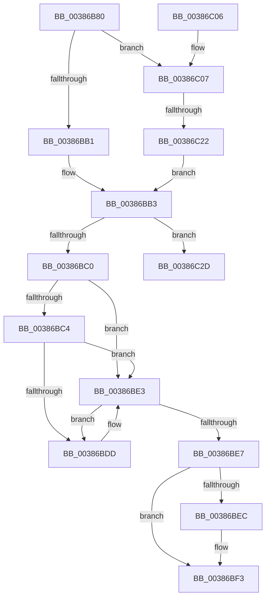

# CcZeroDataOnDisk

- RVA: `0x00386B80`–`0x00386C34` (길이 `180` bytes)
- VA: `0x0000000140386B80`
- 실행 섹션: `.text`
- PDB 이름 있음: `예`; PDB Function 태그: `예`
- unwind 정보 RVA: `0x0007FC20`
- 디코드: `56`개 명령, `180/180` bytes 표시
- 미해석 바이트: `0` (있으면 어셈블리에 `.byte`로 보존)

> 이 문서는 커널 이미지의 기계어와 PDB 기호를 분석해 생성했습니다. 4번과 5번은 함수 원형과 자료형을 바이너리 사용 방식에서 추정한 C 해석이며 원본 소스 복구 결과는 아닙니다.

## 1. Dependencies

- 직접 호출 지점: **2**; 고유 호출 대상: **2**
- 직접 호출자로 확인된 함수: **1**
- RIP 상대 이미지 참조: **3**

### Outgoing calls
- `0x00386BD2` → [MiZeroPageWrite](../29/MiZeroPageWrite_function_0029F280.md) (function, `0x0029F280`)
- `0x00386BDD` → [RtlRaiseStatus](../2F/RtlRaiseStatus_function_002F6A50.md) (function, `0x002F6A50`)

### Direct callers
- [CcZeroData](CcZeroData_function_00387F00.md) at `0x00388133`

### Static image references
- `0x00386BA6` → RVA `0x00E65B60` (`.data`; read)
- `0x00386BEC` → RVA `0x00F8F52C` (`.data`; read/write)
- `0x00386C16` → RVA `0x00F8F528` (`.data`; read)

## 2. Other-region calls and transfers

- 다른 실행 섹션으로 향하는 call: **0**
- call이 아닌 외부 분기/꼬리 이동: **2**
  - `0x00386C1C` → [sub_006E4CB8](../6E/Unknown_function_006E4CB8.md) (`tail-transfer`)
  - `0x00386C2F` → [sub_006E4CB8 + 0x11](../6E/Unknown_function_006E4CB8.md) (`tail-transfer`)

## 3. Assembly (complete function range)

```asm
00386B80  48 89 5C 24 08                  mov qword ptr [rsp + 8], rbx
00386B85  48 89 6C 24 18                  mov qword ptr [rsp + 0x18], rbp
00386B8A  56                              push rsi
00386B8B  57                              push rdi
00386B8C  41 56                           push r14
00386B8E  48 83 EC 20                     sub rsp, 0x20
00386B92  48 8B 02                        mov rax, qword ptr [rdx]
00386B95  40 32 ED                        xor bpl, bpl
00386B98  49 8B 18                        mov rbx, qword ptr [r8]
00386B9B  4C 8B F1                        mov r14, rcx
00386B9E  48 2B D8                        sub rbx, rax
00386BA1  48 89 44 24 48                  mov qword ptr [rsp + 0x48], rax
00386BA6  8B 05 B4 EF AD 00               mov eax, dword ptr [rip + 0xadefb4]
00386BAC  48 3B D8                        cmp rbx, rax
00386BAF  7D 56                           jge 0x140386c07
00386BB1  33 FF                           xor edi, edi
00386BB3  33 C9                           xor ecx, ecx
00386BB5  48 8B C3                        mov rax, rbx
00386BB8  48 C1 E8 20                     shr rax, 0x20
00386BBC  85 C0                           test eax, eax
00386BBE  75 6D                           jne 0x140386c2d
00386BC0  85 DB                           test ebx, ebx
00386BC2  74 1F                           je 0x140386be3
00386BC4  44 8B CF                        mov r9d, edi
00386BC7  48 8D 54 24 48                  lea rdx, [rsp + 0x48]
00386BCC  44 8B C3                        mov r8d, ebx
00386BCF  49 8B CE                        mov rcx, r14
00386BD2  E8 A9 86 F1 FF                  call 0x14029f280
00386BD7  8B C8                           mov ecx, eax
00386BD9  85 C0                           test eax, eax
00386BDB  79 06                           jns 0x140386be3
00386BDD  E8 6E FE F6 FF                  call 0x1402f6a50
00386BE2  CC                              int3
00386BE3  85 C9                           test ecx, ecx
00386BE5  78 F6                           js 0x140386bdd
00386BE7  40 84 ED                        test bpl, bpl
00386BEA  74 07                           je 0x140386bf3
00386BEC  F0 FF 0D 39 89 C0 00            lock dec dword ptr [rip + 0xc08939]
00386BF3  48 8B 5C 24 40                  mov rbx, qword ptr [rsp + 0x40]
00386BF8  48 8B 6C 24 50                  mov rbp, qword ptr [rsp + 0x50]
00386BFD  48 83 C4 20                     add rsp, 0x20
00386C01  41 5E                           pop r14
00386C03  5F                              pop rdi
00386C04  5E                              pop rsi
00386C05  C3                              ret
00386C06  CC                              int3
00386C07  B8 01 00 00 00                  mov eax, 1
00386C0C  F0 0F C1 05 18 89 C0 00         lock xadd dword ptr [rip + 0xc08918], eax
00386C14  FF C0                           inc eax
00386C16  3B 05 0C 89 C0 00               cmp eax, dword ptr [rip + 0xc0890c]
00386C1C  0F 8F 96 E0 35 00               jg 0x1406e4cb8
00386C22  8B 3D 38 EF AD 00               mov edi, dword ptr [rip + 0xadef38]
00386C28  40 B5 01                        mov bpl, 1
00386C2B  EB 86                           jmp 0x140386bb3
00386C2D  33 F6                           xor esi, esi
00386C2F  E9 95 E0 35 00                  jmp 0x1406e4cc9
```

## 4. C-style interpretation (structured pseudocode)

```c
__int64 __fastcall CcZeroDataOnDisk(__int64 a1, __int64 a2, __int64 a3)
{
    __int64 result;
    __int64 v_rbp;
    __int64 v_rbx;
    __int64 v_rdi;
    __int64 v_rsi;
    __int64 v_rsp;
    unsigned __int64 v_stack_p10;
    unsigned __int64 v_stack_p18;
    unsigned __int64 v_stack_p8;

    v_stack_p8 = v_rbx;
    v_stack_p18 = v_rbp;
    v_rsp = (v_rsp) - (32);
    v_rbp = 0;
    v_rbx = (*(unsigned __int64 *)(a3)) - (*(unsigned __int64 *)(a2));
    v_stack_p10 = *(unsigned __int64 *)(a2);
    if (v_rbx >= ((unsigned int)(*(unsigned int *)(v_rip + 11399092)))) goto loc_00386C07;
    v_rdi = 0;
loc_00386BB3:
    a1 = 0;
    result = (v_rbx) >> (32);
    if ((unsigned int)(result) != 0) goto loc_00386C2D;
    if ((unsigned int)(v_rbx) == 0) goto loc_00386BE3;
    result = MiZeroPageWrite(0, v_stack_p10, (unsigned int)((unsigned int)(v_rbx)), 0);
    if (sign_flag) {
        result = RtlRaiseStatus((unsigned int)((unsigned int)(result)), v_stack_p10, (unsigned int)((unsigned int)(v_rbx)), 0);
    }
    if (sign_flag) goto loc_00386BDD;
    if (0 != 0) {
    }
    v_rsp = (v_rsp) + (32);
    return result;
loc_00386C07:
    result = (unsigned int)((1) + 1);
    goto loc_00386BB3;
loc_00386C2D:
    v_rsi = 0;
}
```

## 5. (Beta) C Style

```c
int64_t CcZeroDataOnDisk(int64_t Arg1, void *Arg2, void *Arg3)
{
    uint8_t *arg2 = (uint8_t *)Arg2;
    uint8_t *arg3 = (uint8_t *)Arg3;

    int64_t result;
    int64_t local_rbp;
    int64_t local_rbx;
    int64_t local_rdi;
    int64_t local_rsi;
    int64_t local_rsp;
    uint64_t v_stack_p10;
    uint64_t v_stack_p18;
    uint64_t v_stack_p8;

    v_stack_p8 = local_rbx;
    v_stack_p18 = local_rbp;
    local_rsp = (local_rsp) - (32);
    local_rbp = 0;
    local_rbx = (*(uint64_t *)(arg3)) - (*(uint64_t *)(arg2));
    v_stack_p10 = *(uint64_t *)(arg2);
    if (local_rbx >= ((uint32_t)(*(uint32_t *)(v_rip + 0xADEFB4)))) goto loc_00386C07;
    local_rdi = 0;
loc_00386BB3:
    Arg1 = 0;
    result = (local_rbx) >> (32);
    if ((uint32_t)(result) != 0) goto loc_00386C2D;
    if ((uint32_t)(local_rbx) == 0) goto loc_00386BE3;
    result = MiZeroPageWrite(0, v_stack_p10, (uint32_t)((uint32_t)(local_rbx)), 0);
    if (sign_flag) {
        result = RtlRaiseStatus((uint32_t)((uint32_t)(result)), v_stack_p10, (uint32_t)((uint32_t)(local_rbx)), 0);
    }
    if (sign_flag) goto loc_00386BDD;
    if (0 != 0) {
    }
    local_rsp = (local_rsp) + (32);
    return result;
loc_00386C07:
    result = (uint32_t)((1) + 1);
    goto loc_00386BB3;
loc_00386C2D:
    local_rsi = 0;
}
```

### 관측된 메모리 오프셋

구조체 형식이 확인되지 않은 접근은 인자 기준의 오프셋으로만 기록했습니다.

| 기준 인자 | 오프셋 표현 | 폭 (bit) | 접근 |
|---|---:|---:|---|
| `Arg2` | `+ 0x0` | `64` | `R` |
| `Arg3` | `+ 0x0` | `64` | `R` |

## 6. Execution-region graph

[열기: 2D/3D 그래프와 함수 탐색 컨트롤 패널](../../../control-panel.html?section=text&rva=0x00386B80&view=graph)

- 2D 그래프는 위에서 아래로 흐르고, 3D 그래프는 빈 공간을 드래그해 회전합니다. Shift+드래그는 이동, 휠은 확대·축소, 함수 노드 선택은 대상 보고서 이동입니다.

### Static fallback


