# CcZeroData

- RVA: `0x00387F00`–`0x003881FA` (길이 `762` bytes)
- VA: `0x0000000140387F00`
- 실행 섹션: `.text`
- PDB 이름 있음: `예`; PDB Function 태그: `아니요`
- unwind 정보 RVA: `0x0007FE14`
- 디코드: `184`개 명령, `762/762` bytes 표시
- 미해석 바이트: `0` (있으면 어셈블리에 `.byte`로 보존)

> 이 문서는 커널 이미지의 기계어와 PDB 기호를 분석해 생성했습니다. 4번과 5번은 함수 원형과 자료형을 바이너리 사용 방식에서 추정한 C 해석이며 원본 소스 복구 결과는 아닙니다.

## 1. Dependencies

- 직접 호출 지점: **11**; 고유 호출 대상: **9**
- 직접 호출자로 확인된 함수: **2**
- RIP 상대 이미지 참조: **0**

### Outgoing calls
- `0x00387F49` → [KeRcuReadLock](KeRcuReadLock_function_0038A1A0.md) (function, `0x0038A1A0`)
- `0x00387F51` → [CcReferencePartitionFromFileObject](CcReferencePartitionFromFileObject_function_00388200.md) (function, `0x00388200`)
- `0x00387F63` → [KeRcuReadUnlock](KeRcuReadUnlock_function_0038A070.md) (function, `0x0038A070`)
- `0x00387FA2` → [IoGetRelatedDeviceObject](../29/IoGetRelatedDeviceObject_function_0029B120.md) (function, `0x0029B120`)
- `0x00387FC0` → [IoGetRelatedDeviceObject](../29/IoGetRelatedDeviceObject_function_0029B120.md) (function, `0x0029B120`)
- `0x00388013` → [CcZeroDataInCache](../29/CcZeroDataInCache_function_0029E894.md) (function, `0x0029E894`)
- `0x0038809F` → [CcZeroDataInCache](../29/CcZeroDataInCache_function_0029E894.md) (function, `0x0029E894`)
- `0x003880D2` → [CcFlushCachePriv](../35/CcFlushCachePriv_function_0035B040.md) (function, `0x0035B040`)
- `0x00388133` → [CcZeroDataOnDisk](CcZeroDataOnDisk_function_00386B80.md) (function, `0x00386B80`)
- `0x00388145` → [RtlRaiseStatus](../2F/RtlRaiseStatus_function_002F6A50.md) (function, `0x002F6A50`)
- `0x003881CF` → [CcDereferencePartition](../35/CcDereferencePartition_function_003572F0.md) (function, `0x003572F0`)

### Direct callers
- [FsRtlPrepareMdlWriteDev](../../page/71/FsRtlPrepareMdlWriteDev_function_00713BB0.md) at `0x00713E38`
- [FsRtlCopyWrite](../../page/A4/FsRtlCopyWrite_function_00A48210.md) at `0x00A48403`

### Static image references
- 디코드된 RIP-relative 메모리 참조가 없습니다.

## 2. Other-region calls and transfers

- 다른 실행 섹션으로 향하는 call: **0**
- 별도 외부 분기/꼬리 이동을 확인하지 못했습니다.

## 3. Assembly (complete function range)

```asm
00387F00  48 8B C4                        mov rax, rsp
00387F03  44 88 48 20                     mov byte ptr [rax + 0x20], r9b
00387F07  4C 89 40 18                     mov qword ptr [rax + 0x18], r8
00387F0B  48 89 50 10                     mov qword ptr [rax + 0x10], rdx
00387F0F  53                              push rbx
00387F10  56                              push rsi
00387F11  57                              push rdi
00387F12  41 54                           push r12
00387F14  41 55                           push r13
00387F16  41 56                           push r14
00387F18  41 57                           push r15
00387F1A  48 83 EC 70                     sub rsp, 0x70
00387F1E  45 8A F1                        mov r14b, r9b
00387F21  4C 8B F9                        mov r15, rcx
00387F24  48 8B 3A                        mov rdi, qword ptr [rdx]
00387F27  48 89 78 A0                     mov qword ptr [rax - 0x60], rdi
00387F2B  33 F6                           xor esi, esi
00387F2D  48 89 70 C0                     mov qword ptr [rax - 0x40], rsi
00387F31  40 88 70 98                     mov byte ptr [rax - 0x68], sil
00387F35  8B 41 50                        mov eax, dword ptr [rcx + 0x50]
00387F38  A8 10                           test al, 0x10
00387F3A  0F 84 A8 02 00 00               je 0x1403881e8
00387F40  41 B4 01                        mov r12b, 1
00387F43  49 8B 18                        mov rbx, qword ptr [r8]
00387F46  48 2B DF                        sub rbx, rdi
00387F49  E8 52 22 00 00                  call 0x14038a1a0
00387F4E  49 8B CF                        mov rcx, r15
00387F51  E8 AA 02 00 00                  call 0x140388200
00387F56  4C 8B E8                        mov r13, rax
00387F59  48 89 44 24 68                  mov qword ptr [rsp + 0x68], rax
00387F5E  C6 44 24 40 01                  mov byte ptr [rsp + 0x40], 1
00387F63  E8 08 21 00 00                  call 0x14038a070
00387F68  45 84 E4                        test r12b, r12b
00387F6B  0F 85 D5 00 00 00               jne 0x140388046
00387F71  48 81 FB 00 00 20 00            cmp rbx, 0x200000
00387F78  0F 8F C8 00 00 00               jg 0x140388046
00387F7E  49 8B 45 08                     mov rax, qword ptr [r13 + 8]
00387F82  48 8B 08                        mov rcx, qword ptr [rax]
00387F85  48 81 B9 00 49 00 00 00 08 00 00  cmp qword ptr [rcx + 0x4900], 0x800
00387F90  73 0D                           jae 0x140387f9f
00387F92  48 81 FB 00 20 00 00            cmp rbx, 0x2000
00387F99  0F 8F A7 00 00 00               jg 0x140388046
00387F9F  49 8B CF                        mov rcx, r15
00387FA2  E8 79 31 F1 FF                  call 0x14029b120
00387FA7  0F B7 80 30 01 00 00            movzx eax, word ptr [rax + 0x130]
00387FAE  89 84 24 B0 00 00 00            mov dword ptr [rsp + 0xb0], eax
00387FB5  85 C0                           test eax, eax
00387FB7  0F 84 80 01 00 00               je 0x14038813d
00387FBD  49 8B CF                        mov rcx, r15
00387FC0  E8 5B 31 F1 FF                  call 0x14029b120
00387FC5  44 0F B7 B0 30 01 00 00         movzx r14d, word ptr [rax + 0x130]
00387FCD  41 FF CE                        dec r14d
00387FD0  45 84 E4                        test r12b, r12b
00387FD3  75 7F                           jne 0x140388054
00387FD5  49 8B 45 08                     mov rax, qword ptr [r13 + 8]
00387FD9  48 8B 08                        mov rcx, qword ptr [rax]
00387FDC  48 8B 81 00 49 00 00            mov rax, qword ptr [rcx + 0x4900]
00387FE3  48 3D 00 08 00 00               cmp rax, 0x800
00387FE9  0F 82 5B 01 00 00               jb 0x14038814a
00387FEF  48 81 FB 00 00 20 00            cmp rbx, 0x200000
00387FF6  0F 8F A0 01 00 00               jg 0x14038819c
00387FFC  85 DB                           test ebx, ebx
00387FFE  74 20                           je 0x140388020
00388000  44 8A 8C 24 C8 00 00 00         mov r9b, byte ptr [rsp + 0xc8]
00388008  44 8B C3                        mov r8d, ebx
0038800B  48 8D 54 24 48                  lea rdx, [rsp + 0x48]
00388010  49 8B CF                        mov rcx, r15
00388013  E8 7C 68 F1 FF                  call 0x14029e894
00388018  84 C0                           test al, al
0038801A  0F 84 AC 01 00 00               je 0x1403881cc
00388020  8B C3                           mov eax, ebx
00388022  48 03 F8                        add rdi, rax
00388025  48 89 7C 24 48                  mov qword ptr [rsp + 0x48], rdi
0038802A  48 8B 84 24 C0 00 00 00         mov rax, qword ptr [rsp + 0xc0]
00388032  48 8B 00                        mov rax, qword ptr [rax]
00388035  48 3B F8                        cmp rdi, rax
00388038  0F 8C B4 00 00 00               jl 0x1403880f2
0038803E  40 B6 01                        mov sil, 1
00388041  E9 86 01 00 00                  jmp 0x1403881cc
00388046  45 84 F6                        test r14b, r14b
00388049  0F 84 7D 01 00 00               je 0x1403881cc
0038804F  E9 4B FF FF FF                  jmp 0x140387f9f
00388054  44 85 74 24 48                  test dword ptr [rsp + 0x48], r14d
00388059  0F 84 85 00 00 00               je 0x1403880e4
0038805F  0F 57 C0                        xorps xmm0, xmm0
00388062  0F 11 44 24 58                  movups xmmword ptr [rsp + 0x58], xmm0
00388067  48 89 7C 24 48                  mov qword ptr [rsp + 0x48], rdi
0038806C  41 8B C6                        mov eax, r14d
0038806F  48 03 F8                        add rdi, rax
00388072  48 89 7C 24 48                  mov qword ptr [rsp + 0x48], rdi
00388077  41 8B FE                        mov edi, r14d
0038807A  F7 D7                           not edi
0038807C  23 7C 24 48                     and edi, dword ptr [rsp + 0x48]
00388080  89 7C 24 48                     mov dword ptr [rsp + 0x48], edi
00388084  48 8B 84 24 B8 00 00 00         mov rax, qword ptr [rsp + 0xb8]
0038808C  2B 38                           sub edi, dword ptr [rax]
0038808E  44 8A 8C 24 C8 00 00 00         mov r9b, byte ptr [rsp + 0xc8]
00388096  44 8B C7                        mov r8d, edi
00388099  48 8B D0                        mov rdx, rax
0038809C  49 8B CF                        mov rcx, r15
0038809F  E8 F0 67 F1 FF                  call 0x14029e894
003880A4  84 C0                           test al, al
003880A6  0F 84 20 01 00 00               je 0x1403881cc
003880AC  49 8B 4F 28                     mov rcx, qword ptr [r15 + 0x28]
003880B0  48 89 74 24 30                  mov qword ptr [rsp + 0x30], rsi
003880B5  48 8D 44 24 58                  lea rax, [rsp + 0x58]
003880BA  48 89 44 24 28                  mov qword ptr [rsp + 0x28], rax
003880BF  40 88 74 24 20                  mov byte ptr [rsp + 0x20], sil
003880C4  45 33 C9                        xor r9d, r9d
003880C7  44 8B C7                        mov r8d, edi
003880CA  48 8B 94 24 B8 00 00 00         mov rdx, qword ptr [rsp + 0xb8]
003880D2  E8 69 2F FD FF                  call 0x14035b040
003880D7  8B 4C 24 58                     mov ecx, dword ptr [rsp + 0x58]
003880DB  85 C9                           test ecx, ecx
003880DD  78 66                           js 0x140388145
003880DF  48 8B 7C 24 48                  mov rdi, qword ptr [rsp + 0x48]
003880E4  45 84 E4                        test r12b, r12b
003880E7  0F 85 3D FF FF FF               jne 0x14038802a
003880ED  E9 E3 FE FF FF                  jmp 0x140387fd5
003880F2  48 89 84 24 B8 00 00 00         mov qword ptr [rsp + 0xb8], rax
003880FA  48 89 84 24 B8 00 00 00         mov qword ptr [rsp + 0xb8], rax
00388102  41 8B CE                        mov ecx, r14d
00388105  48 03 C1                        add rax, rcx
00388108  48 89 84 24 B8 00 00 00         mov qword ptr [rsp + 0xb8], rax
00388110  41 F7 D6                        not r14d
00388113  44 21 B4 24 B8 00 00 00         and dword ptr [rsp + 0xb8], r14d
0038811B  44 8B 8C 24 B0 00 00 00         mov r9d, dword ptr [rsp + 0xb0]
00388123  4C 8D 84 24 B8 00 00 00         lea r8, [rsp + 0xb8]
0038812B  48 8D 54 24 48                  lea rdx, [rsp + 0x48]
00388130  49 8B CF                        mov rcx, r15
00388133  E8 48 EA FF FF                  call 0x140386b80
00388138  E9 01 FF FF FF                  jmp 0x14038803e
0038813D  44 8B F6                        mov r14d, esi
00388140  E9 8B FE FF FF                  jmp 0x140387fd0
00388145  E8 06 E9 F6 FF                  call 0x1402f6a50
0038814A  48 81 FB 00 20 00 00            cmp rbx, 0x2000
00388151  7E 29                           jle 0x14038817c
00388153  44 85 74 24 48                  test dword ptr [rsp + 0x48], r14d
00388158  74 22                           je 0x14038817c
0038815A  48 89 7C 24 50                  mov qword ptr [rsp + 0x50], rdi
0038815F  48 89 7C 24 50                  mov qword ptr [rsp + 0x50], rdi
00388164  41 8B C6                        mov eax, r14d
00388167  48 03 C7                        add rax, rdi
0038816A  48 89 44 24 50                  mov qword ptr [rsp + 0x50], rax
0038816F  41 8B DE                        mov ebx, r14d
00388172  F7 D3                           not ebx
00388174  23 D8                           and ebx, eax
00388176  89 5C 24 50                     mov dword ptr [rsp + 0x50], ebx
0038817A  EB 47                           jmp 0x1403881c3
0038817C  48 3D 00 08 00 00               cmp rax, 0x800
00388182  0F 83 67 FE FF FF               jae 0x140387fef
00388188  48 81 FB 00 20 00 00            cmp rbx, 0x2000
0038818F  0F 8E 5A FE FF FF               jle 0x140387fef
00388195  8B DE                           mov ebx, esi
00388197  E9 60 FE FF FF                  jmp 0x140387ffc
0038819C  48 89 7C 24 58                  mov qword ptr [rsp + 0x58], rdi
003881A1  48 8D 8F 00 00 20 00            lea rcx, [rdi + 0x200000]
003881A8  48 89 4C 24 58                  mov qword ptr [rsp + 0x58], rcx
003881AD  41 8B C6                        mov eax, r14d
003881B0  48 03 C1                        add rax, rcx
003881B3  48 89 44 24 58                  mov qword ptr [rsp + 0x58], rax
003881B8  41 8B DE                        mov ebx, r14d
003881BB  F7 D3                           not ebx
003881BD  23 D8                           and ebx, eax
003881BF  89 5C 24 58                     mov dword ptr [rsp + 0x58], ebx
003881C3  2B 5C 24 48                     sub ebx, dword ptr [rsp + 0x48]
003881C7  E9 30 FE FF FF                  jmp 0x140387ffc
003881CC  49 8B CD                        mov rcx, r13
003881CF  E8 1C F1 FC FF                  call 0x1403572f0
003881D4  40 8A C6                        mov al, sil
003881D7  48 83 C4 70                     add rsp, 0x70
003881DB  41 5F                           pop r15
003881DD  41 5E                           pop r14
003881DF  41 5D                           pop r13
003881E1  41 5C                           pop r12
003881E3  5F                              pop rdi
003881E4  5E                              pop rsi
003881E5  5B                              pop rbx
003881E6  C3                              ret
003881E7  CC                              int3
003881E8  48 39 71 30                     cmp qword ptr [rcx + 0x30], rsi
003881EC  44 8A E6                        mov r12b, sil
003881EF  0F 85 4E FD FF FF               jne 0x140387f43
003881F5  E9 46 FD FF FF                  jmp 0x140387f40
```

## 4. C-style interpretation (structured pseudocode)

```c
__int64 __fastcall CcZeroData(__int64 a1, __int64 a2, __int64 a3, unsigned __int8 a4)
{
    __int64 result;
    __int64 v_r14;
    __int64 v_rbx;
    __int64 v_rdi;
    __int64 v_rsi;
    __int64 v_rsp;
    unsigned __int64 v_stack_m40;
    unsigned __int64 v_stack_m50;
    unsigned __int64 v_stack_m58;
    unsigned __int64 v_stack_m60;
    unsigned __int8 v_stack_m68;
    unsigned __int64 v_stack_m78;
    unsigned __int64 v_stack_m80;
    unsigned __int8 v_stack_m88;
    unsigned __int64 v_stack_p10;
    unsigned __int64 v_stack_p18;
    unsigned __int8 v_stack_p20;
    unsigned int v_stack_p8;

    *(unsigned __int8 *)(v_rsp + 32) = a4;
    *(unsigned __int64 *)(v_rsp + 24) = a3;
    *(unsigned __int64 *)(v_rsp + 16) = a2;
    v_rsp = (v_rsp) - (112);
    *(unsigned __int64 *)(v_rsp - 96) = *(unsigned __int64 *)(a2);
    v_rsi = 0;
    *(unsigned __int64 *)(v_rsp - 64) = 0;
    *(unsigned __int8 *)(v_rsp - 104) = 0;
    if ((((unsigned __int8)((unsigned int)(*(unsigned int *)(a1 + 80)))) & (16)) == 0) goto loc_003881E8;
loc_00387F40:
loc_00387F43:
    v_rbx = (*(unsigned __int64 *)(a3)) - (*(unsigned __int64 *)(a2));
    result = KeRcuReadLock(a1, a2, a3, a4);
    result = CcReferencePartitionFromFileObject(a1, a2, a3, a4);
    v_stack_m40 = result;
    v_stack_m68 = 1;
    result = KeRcuReadUnlock(a1, a2, a3, a4);
    if (1 != 0) goto loc_00388046;
    if (v_rbx > 0x200000ULL) goto loc_00388046;
    if ((*(unsigned __int64 *)(*(unsigned __int64 *)(*(unsigned __int64 *)(result + 8)) + 18688)) >= 0x800ULL) goto loc_00387F9F;
    if (v_rbx > 0x2000ULL) goto loc_00388046;
loc_00387F9F:
    result = IoGetRelatedDeviceObject(a1, a2, a3, a4);
    v_stack_p8 = (unsigned int)(*(unsigned __int16 *)(result + 304));
    if ((unsigned int)(*(unsigned __int16 *)(result + 304)) == 0) goto loc_0038813D;
    result = IoGetRelatedDeviceObject(a1, a2, a3, a4);
    v_r14 = (unsigned int)((*(unsigned __int16 *)(result + 304)) - 1);
loc_00387FD0:
    if (1 != 0) goto loc_00388054;
loc_00387FD5:
    if ((*(unsigned __int64 *)(*(unsigned __int64 *)(*(unsigned __int64 *)(result + 8)) + 18688)) < 0x800ULL) goto loc_0038814A;
loc_00387FEF:
    if (v_rbx > 0x200000ULL) goto loc_0038819C;
loc_00387FFC:
    if ((unsigned int)(v_rbx) == 0) goto loc_00388020;
    result = CcZeroDataInCache(a1, v_stack_m60, (unsigned int)((unsigned int)(v_rbx)), v_stack_p20);
    if ((unsigned __int8)(result) == 0) goto loc_003881CC;
loc_00388020:
    v_rdi = (*(unsigned __int64 *)(a2)) + ((unsigned int)((unsigned int)(v_rbx)));
    v_stack_m60 = v_rdi;
loc_0038802A:
    if (v_rdi < (*(unsigned __int64 *)(v_stack_p18))) goto loc_003880F2;
loc_0038803E:
    goto loc_003881CC;
loc_00388046:
    if ((unsigned __int8)(v_r14) == 0) goto loc_003881CC;
    goto loc_00387F9F;
loc_00388054:
    if (((v_stack_m60) & ((unsigned int)(v_r14))) == 0) goto loc_003880E4;
    v_stack_m50 = v_xmm0;
    v_stack_m60 = v_rdi;
    v_rdi = (v_rdi) + ((unsigned int)((unsigned int)(v_r14)));
    v_stack_m60 = v_rdi;
    v_rdi = (unsigned int)(~((unsigned int)((unsigned int)(v_r14))));
    v_rdi = (unsigned int)((v_rdi) & (v_stack_m60));
    v_stack_m60 = (unsigned int)(v_rdi);
    v_rdi = (unsigned int)((v_rdi) - (*(unsigned int *)(v_stack_p10)));
    result = CcZeroDataInCache(a1, v_stack_p10, (unsigned int)((unsigned int)(v_rdi)), v_stack_p20);
    if ((unsigned __int8)(result) == 0) goto loc_003881CC;
    v_stack_m78 = 1;
    v_stack_m80 = v_stack_m50;
    v_stack_m88 = 1;
    a4 = 0;
    result = CcFlushCachePriv(*(unsigned __int64 *)(a1 + 40), v_stack_p10, (unsigned int)((unsigned int)(v_rdi)), a4);
    if (sign_flag) goto loc_00388145;
loc_003880E4:
    if (1 != 0) goto loc_0038802A;
    goto loc_00387FD5;
loc_003880F2:
    v_stack_p10 = result;
    v_stack_p10 = result;
    result = (result) + ((unsigned int)((unsigned int)(v_r14)));
    v_stack_p10 = result;
    v_r14 = (unsigned int)(~(v_r14));
    result = CcZeroDataOnDisk(a1, v_stack_m60, v_stack_p10, (unsigned int)(v_stack_p8));
    goto loc_0038803E;
loc_0038813D:
    goto loc_00387FD0;
loc_00388145:
    result = RtlRaiseStatus(a1, v_stack_m60, v_stack_p10, (unsigned int)(v_stack_p8));
loc_0038814A:
    if (v_rbx <= 0x2000ULL) goto loc_0038817C;
    if (((v_stack_m60) & (1)) == 0) goto loc_0038817C;
    v_stack_m58 = v_stack_m60;
    v_stack_m58 = v_stack_m60;
    result = (1) + (v_stack_m60);
    v_stack_m58 = result;
    v_rbx = (unsigned int)(~(1));
    v_rbx = (unsigned int)((v_rbx) & ((unsigned int)(result)));
    v_stack_m58 = (unsigned int)(v_rbx);
    goto loc_003881C3;
loc_0038817C:
    if (result >= 0x800ULL) goto loc_00387FEF;
    if (v_rbx <= 0x2000ULL) goto loc_00387FEF;
    goto loc_00387FFC;
loc_0038819C:
    v_stack_m50 = v_stack_m60;
    v_stack_m50 = v_stack_m60 + 2097152;
    result = (1) + (v_stack_m60 + 2097152);
    v_stack_m50 = result;
    v_rbx = (unsigned int)(~(1));
    v_rbx = (unsigned int)((v_rbx) & ((unsigned int)(result)));
    v_stack_m50 = (unsigned int)(v_rbx);
loc_003881C3:
    v_rbx = (unsigned int)((v_rbx) - (v_stack_m60));
    goto loc_00387FFC;
loc_003881CC:
    result = CcDereferencePartition(result, v_stack_m60, v_stack_p10, (unsigned int)(v_stack_p8));
    v_rsp = (v_rsp) + (112);
    return 1;
loc_003881E8:
    if ((*(unsigned __int64 *)(result + 48)) != 1) goto loc_00387F43;
    goto loc_00387F40;
}
```

## 5. (Beta) C Style

```c
int64_t CcZeroData(void *Arg1, void *Arg2, void *Arg3, uint8_t Arg4)
{
    uint8_t *arg1 = (uint8_t *)Arg1;
    uint8_t *arg2 = (uint8_t *)Arg2;
    uint8_t *arg3 = (uint8_t *)Arg3;

    int64_t result;
    int64_t local_r14;
    int64_t local_rbx;
    int64_t local_rdi;
    int64_t local_rsi;
    int64_t local_rsp;
    uint64_t v_stack_m40;
    uint64_t v_stack_m50;
    uint64_t v_stack_m58;
    uint64_t v_stack_m60;
    uint8_t v_stack_m68;
    uint64_t v_stack_m78;
    uint64_t v_stack_m80;
    uint8_t v_stack_m88;
    uint64_t v_stack_p10;
    uint64_t v_stack_p18;
    uint8_t v_stack_p20;
    uint32_t v_stack_p8;

    *(uint8_t *)(local_rsp + 0x20) = Arg4;
    *(void **)(local_rsp + 0x18) = Arg3;
    *(void **)(local_rsp + 0x10) = Arg2;
    local_rsp = (local_rsp) - (112);
    *(uint64_t *)(local_rsp - 0x60) = *(uint64_t *)(arg2);
    local_rsi = 0;
    *(uint64_t *)(local_rsp - 0x40) = 0;
    *(uint8_t *)(local_rsp - 0x68) = 0;
    if ((((uint8_t)((uint32_t)(*(uint32_t *)(arg1 + 0x50)))) & (16)) == 0) goto loc_003881E8;
loc_00387F40:
loc_00387F43:
    local_rbx = (*(uint64_t *)(arg3)) - (*(uint64_t *)(arg2));
    result = KeRcuReadLock(Arg1, Arg2, Arg3, Arg4);
    result = CcReferencePartitionFromFileObject(Arg1, Arg2, Arg3, Arg4);
    v_stack_m40 = result;
    v_stack_m68 = 1;
    result = KeRcuReadUnlock(Arg1, Arg2, Arg3, Arg4);
    if (1 != 0) goto loc_00388046;
    if (local_rbx > 0x200000ULL) goto loc_00388046;
    if ((*(uint64_t *)(*(uint64_t *)(*(uint64_t *)(result + 0x8)) + 0x4900)) >= 0x800ULL) goto loc_00387F9F;
    if (local_rbx > 0x2000ULL) goto loc_00388046;
loc_00387F9F:
    result = IoGetRelatedDeviceObject(Arg1, Arg2, Arg3, Arg4);
    v_stack_p8 = (uint32_t)(*(uint16_t *)(result + 0x130));
    if ((uint32_t)(*(uint16_t *)(result + 0x130)) == 0) goto loc_0038813D;
    result = IoGetRelatedDeviceObject(Arg1, Arg2, Arg3, Arg4);
    local_r14 = (uint32_t)((*(uint16_t *)(result + 0x130)) - 1);
loc_00387FD0:
    if (1 != 0) goto loc_00388054;
loc_00387FD5:
    if ((*(uint64_t *)(*(uint64_t *)(*(uint64_t *)(result + 0x8)) + 0x4900)) < 0x800ULL) goto loc_0038814A;
loc_00387FEF:
    if (local_rbx > 0x200000ULL) goto loc_0038819C;
loc_00387FFC:
    if ((uint32_t)(local_rbx) == 0) goto loc_00388020;
    result = CcZeroDataInCache(Arg1, v_stack_m60, (uint32_t)((uint32_t)(local_rbx)), v_stack_p20);
    if ((uint8_t)(result) == 0) goto loc_003881CC;
loc_00388020:
    local_rdi = (*(uint64_t *)(arg2)) + ((uint32_t)((uint32_t)(local_rbx)));
    v_stack_m60 = local_rdi;
loc_0038802A:
    if (local_rdi < (*(uint64_t *)(v_stack_p18))) goto loc_003880F2;
loc_0038803E:
    goto loc_003881CC;
loc_00388046:
    if ((uint8_t)(local_r14) == 0) goto loc_003881CC;
    goto loc_00387F9F;
loc_00388054:
    if (((v_stack_m60) & ((uint32_t)(local_r14))) == 0) goto loc_003880E4;
    v_stack_m50 = v_xmm0;
    v_stack_m60 = local_rdi;
    local_rdi = (local_rdi) + ((uint32_t)((uint32_t)(local_r14)));
    v_stack_m60 = local_rdi;
    local_rdi = (uint32_t)(~((uint32_t)((uint32_t)(local_r14))));
    local_rdi = (uint32_t)((local_rdi) & (v_stack_m60));
    v_stack_m60 = (uint32_t)(local_rdi);
    local_rdi = (uint32_t)((local_rdi) - (*(uint32_t *)(v_stack_p10)));
    result = CcZeroDataInCache(Arg1, v_stack_p10, (uint32_t)((uint32_t)(local_rdi)), v_stack_p20);
    if ((uint8_t)(result) == 0) goto loc_003881CC;
    v_stack_m78 = 1;
    v_stack_m80 = v_stack_m50;
    v_stack_m88 = 1;
    Arg4 = 0;
    result = CcFlushCachePriv(*(uint64_t *)(arg1 + 0x28), v_stack_p10, (uint32_t)((uint32_t)(local_rdi)), Arg4);
    if (sign_flag) goto loc_00388145;
loc_003880E4:
    if (1 != 0) goto loc_0038802A;
    goto loc_00387FD5;
loc_003880F2:
    v_stack_p10 = result;
    v_stack_p10 = result;
    result = (result) + ((uint32_t)((uint32_t)(local_r14)));
    v_stack_p10 = result;
    local_r14 = (uint32_t)(~(local_r14));
    result = CcZeroDataOnDisk(Arg1, v_stack_m60, v_stack_p10, (uint32_t)(v_stack_p8));
    goto loc_0038803E;
loc_0038813D:
    goto loc_00387FD0;
loc_00388145:
    result = RtlRaiseStatus(Arg1, v_stack_m60, v_stack_p10, (uint32_t)(v_stack_p8));
loc_0038814A:
    if (local_rbx <= 0x2000ULL) goto loc_0038817C;
    if (((v_stack_m60) & (1)) == 0) goto loc_0038817C;
    v_stack_m58 = v_stack_m60;
    v_stack_m58 = v_stack_m60;
    result = (1) + (v_stack_m60);
    v_stack_m58 = result;
    local_rbx = (uint32_t)(~(1));
    local_rbx = (uint32_t)((local_rbx) & ((uint32_t)(result)));
    v_stack_m58 = (uint32_t)(local_rbx);
    goto loc_003881C3;
loc_0038817C:
    if (result >= 0x800ULL) goto loc_00387FEF;
    if (local_rbx <= 0x2000ULL) goto loc_00387FEF;
    goto loc_00387FFC;
loc_0038819C:
    v_stack_m50 = v_stack_m60;
    v_stack_m50 = v_stack_m60 + 2097152;
    result = (1) + (v_stack_m60 + 2097152);
    v_stack_m50 = result;
    local_rbx = (uint32_t)(~(1));
    local_rbx = (uint32_t)((local_rbx) & ((uint32_t)(result)));
    v_stack_m50 = (uint32_t)(local_rbx);
loc_003881C3:
    local_rbx = (uint32_t)((local_rbx) - (v_stack_m60));
    goto loc_00387FFC;
loc_003881CC:
    result = CcDereferencePartition(result, v_stack_m60, v_stack_p10, (uint32_t)(v_stack_p8));
    local_rsp = (local_rsp) + (112);
    return 1;
loc_003881E8:
    if ((*(uint64_t *)(result + 0x30)) != 1) goto loc_00387F43;
    goto loc_00387F40;
}
```

### 관측된 메모리 오프셋

구조체 형식이 확인되지 않은 접근은 인자 기준의 오프셋으로만 기록했습니다.

| 기준 인자 | 오프셋 표현 | 폭 (bit) | 접근 |
|---|---:|---:|---|
| `Arg1` | `+ 0x28` | `64` | `R` |
| `Arg1` | `+ 0x30` | `64` | `R` |
| `Arg1` | `+ 0x50` | `32` | `R` |
| `Arg2` | `+ 0x0` | `64` | `R` |
| `Arg3` | `+ 0x0` | `64` | `R` |

## 6. Execution-region graph

[열기: 2D/3D 그래프와 함수 탐색 컨트롤 패널](../../../control-panel.html?section=text&rva=0x00387F00&view=graph)

- 2D 그래프는 위에서 아래로 흐르고, 3D 그래프는 빈 공간을 드래그해 회전합니다. Shift+드래그는 이동, 휠은 확대·축소, 함수 노드 선택은 대상 보고서 이동입니다.

### Static fallback

```mermaid
flowchart TD
  bb_00387F00[BB_00387F00]
  bb_00387F40[BB_00387F40]
  bb_00387F43[BB_00387F43]
  bb_00387F71[BB_00387F71]
  bb_00387F7E[BB_00387F7E]
  bb_00387F92[BB_00387F92]
  bb_00387F9F[BB_00387F9F]
  bb_00387FBD[BB_00387FBD]
  bb_00387FD0[BB_00387FD0]
  bb_00387FD5[BB_00387FD5]
  bb_00387FEF[BB_00387FEF]
  bb_00387FFC[BB_00387FFC]
  bb_00388000[BB_00388000]
  bb_00388020[BB_00388020]
  bb_0038802A[BB_0038802A]
  bb_0038803E[BB_0038803E]
  bb_00388046[BB_00388046]
  bb_0038804F[BB_0038804F]
  bb_00388054[BB_00388054]
  bb_0038805F[BB_0038805F]
  bb_003880AC[BB_003880AC]
  bb_003880DF[BB_003880DF]
  bb_003880E4[BB_003880E4]
  bb_003880ED[BB_003880ED]
  bb_003880F2[BB_003880F2]
  bb_0038813D[BB_0038813D]
  bb_00388145[BB_00388145]
  bb_0038814A[BB_0038814A]
  bb_00388153[BB_00388153]
  bb_0038815A[BB_0038815A]
  bb_0038817C[BB_0038817C]
  bb_00388188[BB_00388188]
  bb_00388195[BB_00388195]
  bb_0038819C[BB_0038819C]
  bb_003881C3[BB_003881C3]
  bb_003881CC[BB_003881CC]
  bb_003881E7[BB_003881E7]
  bb_003881E8[BB_003881E8]
  bb_003881F5[BB_003881F5]
  bb_00387F00 -->|branch| bb_003881E8
  bb_00387F00 -->|fallthrough| bb_00387F40
  bb_00387F40 -->|flow| bb_00387F43
  bb_00387F43 -->|branch| bb_00388046
  bb_00387F43 -->|fallthrough| bb_00387F71
  bb_00387F71 -->|branch| bb_00388046
  bb_00387F71 -->|fallthrough| bb_00387F7E
  bb_00387F7E -->|branch| bb_00387F9F
  bb_00387F7E -->|fallthrough| bb_00387F92
  bb_00387F92 -->|branch| bb_00388046
  bb_00387F92 -->|fallthrough| bb_00387F9F
  bb_00387F9F -->|branch| bb_0038813D
  bb_00387F9F -->|fallthrough| bb_00387FBD
  bb_00387FBD -->|flow| bb_00387FD0
  bb_00387FD0 -->|branch| bb_00388054
  bb_00387FD0 -->|fallthrough| bb_00387FD5
  bb_00387FD5 -->|branch| bb_0038814A
  bb_00387FD5 -->|fallthrough| bb_00387FEF
  bb_00387FEF -->|branch| bb_0038819C
  bb_00387FEF -->|fallthrough| bb_00387FFC
  bb_00387FFC -->|branch| bb_00388020
  bb_00387FFC -->|fallthrough| bb_00388000
  bb_00388000 -->|branch| bb_003881CC
  bb_00388000 -->|fallthrough| bb_00388020
  bb_00388020 -->|flow| bb_0038802A
  bb_0038802A -->|branch| bb_003880F2
  bb_0038802A -->|fallthrough| bb_0038803E
  bb_0038803E -->|branch| bb_003881CC
  bb_00388046 -->|branch| bb_003881CC
  bb_00388046 -->|fallthrough| bb_0038804F
  bb_0038804F -->|branch| bb_00387F9F
  bb_00388054 -->|branch| bb_003880E4
  bb_00388054 -->|fallthrough| bb_0038805F
  bb_0038805F -->|branch| bb_003881CC
  bb_0038805F -->|fallthrough| bb_003880AC
  bb_003880AC -->|branch| bb_00388145
  bb_003880AC -->|fallthrough| bb_003880DF
  bb_003880DF -->|flow| bb_003880E4
  bb_003880E4 -->|branch| bb_0038802A
  bb_003880E4 -->|fallthrough| bb_003880ED
  bb_003880ED -->|branch| bb_00387FD5
  bb_003880F2 -->|branch| bb_0038803E
  bb_0038813D -->|branch| bb_00387FD0
  bb_00388145 -->|flow| bb_0038814A
  bb_0038814A -->|branch| bb_0038817C
  bb_0038814A -->|fallthrough| bb_00388153
  bb_00388153 -->|branch| bb_0038817C
  bb_00388153 -->|fallthrough| bb_0038815A
  bb_0038815A -->|branch| bb_003881C3
  bb_0038817C -->|branch| bb_00387FEF
  bb_0038817C -->|fallthrough| bb_00388188
  bb_00388188 -->|branch| bb_00387FEF
  bb_00388188 -->|fallthrough| bb_00388195
  bb_00388195 -->|branch| bb_00387FFC
  bb_0038819C -->|flow| bb_003881C3
  bb_003881C3 -->|branch| bb_00387FFC
  bb_003881E7 -->|flow| bb_003881E8
  bb_003881E8 -->|branch| bb_00387F43
  bb_003881E8 -->|fallthrough| bb_003881F5
  bb_003881F5 -->|branch| bb_00387F40
```


