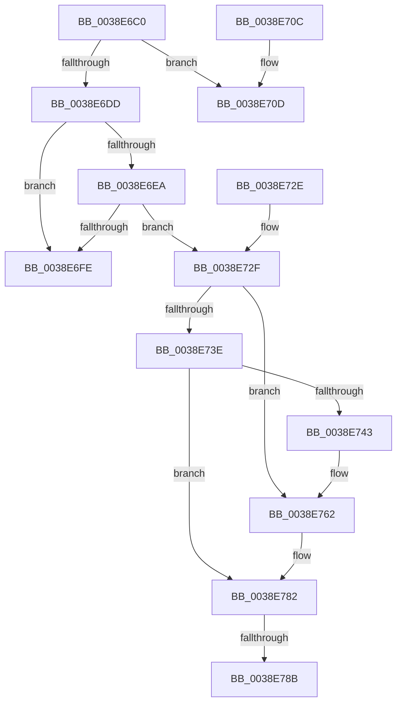

# ExAllocateFromNPagedLookasideList

- RVA: `0x0038E6C0`–`0x0038E7A7` (길이 `231` bytes)
- VA: `0x000000014038E6C0`
- 실행 섹션: `.text`
- PDB 이름 있음: `예`; PDB Function 태그: `아니요`
- unwind 정보 RVA: `0x00080640`
- 디코드: `63`개 명령, `231/231` bytes 표시
- 미해석 바이트: `0` (있으면 어셈블리에 `.byte`로 보존)

> 이 문서는 커널 이미지의 기계어와 PDB 기호를 분석해 생성했습니다. 4번과 5번은 함수 원형과 자료형을 바이너리 사용 방식에서 추정한 C 해석이며 원본 소스 복구 결과는 아닙니다.

## 1. Dependencies

- 직접 호출 지점: **5**; 고유 호출 대상: **3**
- 직접 호출자로 확인된 함수: **38**
- RIP 상대 이미지 참조: **2**

### Outgoing calls
- `0x0038E6D0` → [ExpInterlockedPopEntrySList](../6B/ExpInterlockedPopEntrySList_function_006BA570.md) (function, `0x006BA570`)
- `0x0038E71E` → [guard_dispatch_icall](../6B/guard_dispatch_icall_function_006BAAD0.md) (function, `0x006BAAD0`)
- `0x0038E75C` → [KeBugCheckEx](../4F/KeBugCheckEx_function_004FD660.md) (function, `0x004FD660`)
- `0x0038E77C` → [KeBugCheckEx](../4F/KeBugCheckEx_function_004FD660.md) (function, `0x004FD660`)
- `0x0038E7A1` → [KeBugCheckEx](../4F/KeBugCheckEx_function_004FD660.md) (function, `0x004FD660`)

### Direct callers
- [CcExtendVacbArray](../26/CcExtendVacbArray_function_0026DCD0.md) at `0x0026DFDA`
- [PopAllocateIrp](../27/PopAllocateIrp_function_0027116C.md) at `0x0027142C`
- [FsRtlPrivateLock](FsRtlPrivateLock_function_0038DF90.md) at `0x0038E0E8`
- [FsRtlPrivateLock](FsRtlPrivateLock_function_0038DF90.md) at `0x0038E1A2`
- [FsRtlPrivateLock](FsRtlPrivateLock_function_0038DF90.md) at `0x0038E362`
- [FsRtlPrivateInsertLock](FsRtlPrivateInsertLock_function_0038E5D0.md) at `0x0038E601`
- [FsRtlPrivateInsertLock](FsRtlPrivateInsertLock_function_0038E5D0.md) at `0x0038E671`
- [FsRtlPrivateInsertSharedLock](FsRtlPrivateInsertSharedLock_function_0038E810.md) at `0x0038E8A9`
- [FsRtlPrivateInitializeFileLock](FsRtlPrivateInitializeFileLock_function_0038ED34.md) at `0x0038ED65`
- [LZNT1DecompressChunkNewThread](LZNT1DecompressChunkNewThread_function_0038F3F8.md) at `0x0038F44B`
- [IoSetOplockPrivateFoExt](IoSetOplockPrivateFoExt_function_0038F5A4.md) at `0x0038F5F3`
- [IoSetOplockKeyContext](IoSetOplockKeyContext_function_0038F7BC.md) at `0x0038F81A`
- [CcSetDirtyInMask](../3C/CcSetDirtyInMask_function_003CB688.md) at `0x003CBA6C`
- [VfAvlReserveNode](../3E/VfAvlReserveNode_function_003EF760.md) at `0x003EF787`
- [FsRtlTruncateBaseMcb](../3F/FsRtlTruncateBaseMcb_function_003FB460.md) at `0x003FB55F`
- [FsRtlInitializeLargeMcb](../3F/FsRtlInitializeLargeMcb_function_003FB640.md) at `0x003FB65F`
- [FsRtlInitializeBaseMcbEx](../3F/FsRtlInitializeBaseMcbEx_function_003FB6B0.md) at `0x003FB703`
- [CcAllocateVacbLevels](../48/CcAllocateVacbLevels_function_00482050.md) at `0x0048207A`
- [CcAllocateVacbLevels](../48/CcAllocateVacbLevels_function_00482050.md) at `0x004820DF`
- [MiAddMdlTracker](../49/MiAddMdlTracker_function_0049A240.md) at `0x0049A2B6`
- [PopCreateDynamicIrpWorker](../4A/PopCreateDynamicIrpWorker_function_004A175C.md) at `0x004A1775`
- [WmipAllocRegEntry](../4B/WmipAllocRegEntry_function_004B6D24.md) at `0x004B6D3F`
- [sub_0050C0E0](../50/Unknown_function_0050C0E0.md) at `0x0050C2EA`
- [sub_006E54BE](../6E/Unknown_function_006E54BE.md) at `0x006E54C5`
- [sub_006E5574](../6E/Unknown_function_006E5574.md) at `0x006E557B`
- [sub_006EBE5A](../6E/Unknown_function_006EBE5A.md) at `0x006EBE61`
- [FsRtlpOplockTryPrepForAckTimeout](../../page/71/FsRtlpOplockTryPrepForAckTimeout_function_007156C0.md) at `0x007157F2`
- [ObWaitForMultipleObjects](../../page/86/ObWaitForMultipleObjects_function_00868DF0.md) at `0x00869343`
- [FsRtlAllocateExtraCreateParameterFromLookasideList](../../page/8A/FsRtlAllocateExtraCreateParameterFromLookasideList_function_008A1CD0.md) at `0x008A1DF7`
- [AlpcpInitializePort](../../page/92/AlpcpInitializePort_function_00925DC4.md) at `0x00925EA6`
- [ViAllocateContextTable](../../pagevrfy/B9/ViAllocateContextTable_function_00B9488C.md) at `0x00B9489B`
- [VfAllocateAdapterChannel](../../pagevrfy/B9/VfAllocateAdapterChannel_function_00B95180.md) at `0x00B951CD`
- [VfAllocateAdapterChannelEx](../../pagevrfy/B9/VfAllocateAdapterChannelEx_function_00B95360.md) at `0x00B953C7`
- [VfBuildScatterGatherList](../../pagevrfy/B9/VfBuildScatterGatherList_function_00B95AA0.md) at `0x00B95BA3`
- [VfGetScatterGatherList](../../pagevrfy/B9/VfGetScatterGatherList_function_00B96BD0.md) at `0x00B96CCC`
- [VfIrpAllocateCallDriverData](../../pagevrfy/B9/VfIrpAllocateCallDriverData_function_00B9DE90.md) at `0x00B9DEA7`
- [ViDeadlockAllocate](../../pagevrfy/BA/ViDeadlockAllocate_function_00BA8B78.md) at `0x00BA8BA8`
- [ViDeadlockPopulateLookasideCache](../../pagevrfy/BA/ViDeadlockPopulateLookasideCache_function_00BA9B4C.md) at `0x00BA9B66`
- [VfPacketCreateAndLock](../../pagevrfy/BA/VfPacketCreateAndLock_function_00BAB420.md) at `0x00BAB448`
- [IovpSessionDataCreate](../../pagevrfy/BA/IovpSessionDataCreate_function_00BAC6FC.md) at `0x00BAC751`
- [ViWdBeforeCallDriver](../../pagevrfy/BA/ViWdBeforeCallDriver_function_00BACA00.md) at `0x00BACA39`
- [ViIoCallbackSnapState](../../pagevrfy/BB/ViIoCallbackSnapState_function_00BB7EE4.md) at `0x00BB7EEF`

### Static image references
- `0x0038E6DD` → RVA `0x00475D80` (`CmSiFreeMemory`; read)
- `0x0038E6F5` → RVA `0x00FCEC68` (`ALMOSTRO`; read)

## 2. Other-region calls and transfers

- 다른 실행 섹션으로 향하는 call: **0**
- call이 아닌 외부 분기/꼬리 이동: **1**
  - `0x0038E789` → [sub_0038E7A7](Unknown_function_0038E7A7.md) (`tail-transfer`)

## 3. Assembly (complete function range)

```asm
0038E6C0  48 89 5C 24 18                  mov qword ptr [rsp + 0x18], rbx
0038E6C5  57                              push rdi
0038E6C6  48 83 EC 30                     sub rsp, 0x30
0038E6CA  FF 41 14                        inc dword ptr [rcx + 0x14]
0038E6CD  48 8B D9                        mov rbx, rcx
0038E6D0  E8 9B BE 32 00                  call 0x1406ba570
0038E6D5  48 8B F8                        mov rdi, rax
0038E6D8  48 85 C0                        test rax, rax
0038E6DB  74 30                           je 0x14038e70d
0038E6DD  48 8D 05 9C 76 0E 00            lea rax, [rip + 0xe769c]
0038E6E4  48 39 43 38                     cmp qword ptr [rbx + 0x38], rax
0038E6E8  75 14                           jne 0x14038e6fe
0038E6EA  8B 5B 2C                        mov ebx, dword ptr [rbx + 0x2c]
0038E6ED  48 8D 4F 08                     lea rcx, [rdi + 8]
0038E6F1  48 83 EB 08                     sub rbx, 8
0038E6F5  80 3D 6C 05 C4 00 00            cmp byte ptr [rip + 0xc4056c], 0
0038E6FC  75 31                           jne 0x14038e72f
0038E6FE  48 8B C7                        mov rax, rdi
0038E701  48 8B 5C 24 50                  mov rbx, qword ptr [rsp + 0x50]
0038E706  48 83 C4 30                     add rsp, 0x30
0038E70A  5F                              pop rdi
0038E70B  C3                              ret
0038E70C  CC                              int3
0038E70D  FF 43 18                        inc dword ptr [rbx + 0x18]
0038E710  8B 53 2C                        mov edx, dword ptr [rbx + 0x2c]
0038E713  48 8B 43 30                     mov rax, qword ptr [rbx + 0x30]
0038E717  44 8B 43 28                     mov r8d, dword ptr [rbx + 0x28]
0038E71B  8B 4B 24                        mov ecx, dword ptr [rbx + 0x24]
0038E71E  E8 AD C3 32 00                  call 0x1406baad0
0038E723  48 8B 5C 24 50                  mov rbx, qword ptr [rsp + 0x50]
0038E728  48 83 C4 30                     add rsp, 0x30
0038E72C  5F                              pop rdi
0038E72D  C3                              ret
0038E72E  CC                              int3
0038E72F  48 B8 00 00 00 00 00 80 FF FF   movabs rax, 0xffff800000000000
0038E739  48 3B C8                        cmp rcx, rax
0038E73C  72 24                           jb 0x14038e762
0038E73E  F6 C1 07                        test cl, 7
0038E741  74 3F                           je 0x14038e782
0038E743  BA 02 00 00 00                  mov edx, 2
0038E748  48 C7 44 24 20 08 00 00 00      mov qword ptr [rsp + 0x20], 8
0038E751  4C 8B C9                        mov r9, rcx
0038E754  44 8B C2                        mov r8d, edx
0038E757  B9 F1 01 00 00                  mov ecx, 0x1f1
0038E75C  E8 FF EE 16 00                  call 0x1404fd660
0038E761  CC                              int3
0038E762  BA 02 00 00 00                  mov edx, 2
0038E767  48 C7 44 24 20 00 00 00 00      mov qword ptr [rsp + 0x20], 0
0038E770  4C 8B C9                        mov r9, rcx
0038E773  B9 F1 01 00 00                  mov ecx, 0x1f1
0038E778  44 8D 42 FF                     lea r8d, [rdx - 1]
0038E77C  E8 DF EE 16 00                  call 0x1404fd660
0038E781  CC                              int3
0038E782  48 8D 04 19                     lea rax, [rcx + rbx]
0038E786  48 3B C1                        cmp rax, rcx
0038E789  73 1C                           jae 0x14038e7a7
0038E78B  BA 02 00 00 00                  mov edx, 2
0038E790  48 89 5C 24 20                  mov qword ptr [rsp + 0x20], rbx
0038E795  4C 8B C9                        mov r9, rcx
0038E798  B9 F1 01 00 00                  mov ecx, 0x1f1
0038E79D  44 8D 42 01                     lea r8d, [rdx + 1]
0038E7A1  E8 BA EE 16 00                  call 0x1404fd660
0038E7A6  CC                              int3
```

## 4. C-style interpretation (structured pseudocode)

```c
__int64 __fastcall ExAllocateFromNPagedLookasideList(__int64 a1)
{
    __int64 result;
    __int64 v_rbx;
    __int64 v_rsp;
    unsigned __int64 v_stack_p18;
    unsigned __int64 v_stack_p50;
    unsigned __int64 v_stack_p58;

    v_stack_p18 = v_rbx;
    v_rsp = (v_rsp) - (48);
    result = ExpInterlockedPopEntrySList(a1, a2, a3, a4);
    if (result == 0) goto loc_0038E70D;
    if ((*(unsigned __int64 *)(a1 + 56)) != (v_rip + 947868)) goto loc_0038E6FE;
    v_rbx = ((unsigned int)(*(unsigned int *)(a1 + 44))) - (8);
    if ((*(unsigned __int8 *)(v_rip + 12846444)) != 0) goto loc_0038E72F;
loc_0038E6FE:
    v_rsp = (v_rsp) + (48);
    return result;
loc_0038E70D:
    result = guard_dispatch_icall((unsigned int)(*(unsigned int *)(v_stack_p18 + 36)), (unsigned int)(*(unsigned int *)(v_stack_p18 + 44)), (unsigned int)(*(unsigned int *)(v_stack_p18 + 40)), a4);
    v_rsp = (v_rsp) + (48);
    return result;
loc_0038E72F:
    if (((unsigned int)(*(unsigned int *)(v_stack_p18 + 36))) < result) goto loc_0038E762;
    if ((((unsigned __int8)((unsigned int)(*(unsigned int *)(v_stack_p18 + 36)))) & (7)) == 0) goto loc_0038E782;
    v_stack_p58 = 8;
    result = KeBugCheckEx(497, 2, 2, (unsigned int)(*(unsigned int *)(v_stack_p18 + 36)));
loc_0038E762:
    v_stack_p58 = 0;
    result = KeBugCheckEx(497, 2, 2 - 1, 497);
loc_0038E782:
    v_stack_p58 = v_stack_p50;
    result = KeBugCheckEx(497, 2, 2 + 1, 497);
    return result;
}
```

## 5. (Beta) C Style

```c
int64_t ExAllocateFromNPagedLookasideList(void *Arg1)
{
    uint8_t *arg1 = (uint8_t *)Arg1;

    int64_t result;
    int64_t local_rbx;
    int64_t local_rsp;
    uint64_t v_stack_p18;
    uint64_t v_stack_p50;
    uint64_t v_stack_p58;

    v_stack_p18 = local_rbx;
    local_rsp = (local_rsp) - (48);
    result = ExpInterlockedPopEntrySList(Arg1, a2, a3, a4);
    if (result == 0) goto loc_0038E70D;
    if ((*(uint64_t *)(arg1 + 0x38)) != (v_rip + 947868)) goto loc_0038E6FE;
    local_rbx = ((uint32_t)(*(uint32_t *)(arg1 + 0x2C))) - (8);
    if ((*(uint8_t *)(v_rip + 0xC4056C)) != 0) goto loc_0038E72F;
loc_0038E6FE:
    local_rsp = (local_rsp) + (48);
    return result;
loc_0038E70D:
    result = guard_dispatch_icall((uint32_t)(*(uint32_t *)(v_stack_p18 + 0x24)), (uint32_t)(*(uint32_t *)(v_stack_p18 + 0x2C)), (uint32_t)(*(uint32_t *)(v_stack_p18 + 0x28)), a4);
    local_rsp = (local_rsp) + (48);
    return result;
loc_0038E72F:
    if (((uint32_t)(*(uint32_t *)(v_stack_p18 + 0x24))) < result) goto loc_0038E762;
    if ((((uint8_t)((uint32_t)(*(uint32_t *)(v_stack_p18 + 0x24)))) & (7)) == 0) goto loc_0038E782;
    v_stack_p58 = 8;
    result = KeBugCheckEx(497, 2, 2, (uint32_t)(*(uint32_t *)(v_stack_p18 + 0x24)));
loc_0038E762:
    v_stack_p58 = 0;
    result = KeBugCheckEx(497, 2, 2 - 1, 497);
loc_0038E782:
    v_stack_p58 = v_stack_p50;
    result = KeBugCheckEx(497, 2, 2 + 1, 497);
    return result;
}
```

### 관측된 메모리 오프셋

구조체 형식이 확인되지 않은 접근은 인자 기준의 오프셋으로만 기록했습니다.

| 기준 인자 | 오프셋 표현 | 폭 (bit) | 접근 |
|---|---:|---:|---|
| `Arg1` | `+ 0x14` | `32` | `R/W` |
| `Arg1` | `+ 0x18` | `32` | `R/W` |
| `Arg1` | `+ 0x24` | `32` | `R` |
| `Arg1` | `+ 0x28` | `32` | `R` |
| `Arg1` | `+ 0x2C` | `32` | `R` |
| `Arg1` | `+ 0x30` | `64` | `R` |
| `Arg1` | `+ 0x38` | `64` | `R` |

## 6. Execution-region graph

[열기: 2D/3D 그래프와 함수 탐색 컨트롤 패널](../../../control-panel.html?section=text&rva=0x0038E6C0&view=graph)

- 2D 그래프는 위에서 아래로 흐르고, 3D 그래프는 빈 공간을 드래그해 회전합니다. Shift+드래그는 이동, 휠은 확대·축소, 함수 노드 선택은 대상 보고서 이동입니다.

### Static fallback


