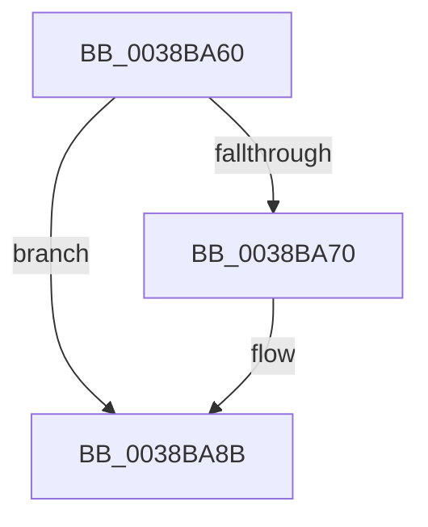

# ExDeleteResourceLite

- RVA: `0x0038BA60`–`0x0038BA93` (길이 `51` bytes)
- VA: `0x000000014038BA60`
- 실행 섹션: `.text`
- PDB 이름 있음: `예`; PDB Function 태그: `아니요`
- unwind 정보 RVA: `0x00080134`
- 디코드: `15`개 명령, `51/51` bytes 표시
- 미해석 바이트: `0` (있으면 어셈블리에 `.byte`로 보존)

> 이 문서는 커널 이미지의 기계어와 PDB 기호를 분석해 생성했습니다. 4번과 5번은 함수 원형과 자료형을 바이너리 사용 방식에서 추정한 C 해석이며 원본 소스 복구 결과는 아닙니다.

## 1. Dependencies

- 직접 호출 지점: **1**; 고유 호출 대상: **1**
- 직접 호출자로 확인된 함수: **15**
- RIP 상대 이미지 참조: **0**

### Outgoing calls
- `0x0038BA85` → [KeBugCheckEx](../4F/KeBugCheckEx_function_004FD660.md) (function, `0x004FD660`)

### Direct callers
- [CcDeallocateBcb](CcDeallocateBcb_function_0038BA24.md) at `0x0038BA3B`
- [PspJobDelete](../4B/PspJobDelete_function_004BF8F0.md) at `0x004BFBD9`
- [RtlpCreateHeap](../4E/RtlpCreateHeap_function_004E1904.md) at `0x004E2245`
- [DifExDeleteResourceLiteWrapper](../61/DifExDeleteResourceLiteWrapper_function_0061FA10.md) at `0x0061FADD`
- [PiDrvDbDestroyNode](../../page/74/PiDrvDbDestroyNode_function_00740DF8.md) at `0x00740E68`
- [TtmpDeleteQueue](../../page/77/TtmpDeleteQueue_function_0077DFC0.md) at `0x0077E00C`
- [PnpCtxCloseMachine](../../page/82/PnpCtxCloseMachine_function_00828B10.md) at `0x00828B93`
- [DrvDbOpenContext](../../page/83/DrvDbOpenContext_function_00834F8C.md) at `0x00835102`
- [DrvDbDestroyDatabaseNode](../../page/83/DrvDbDestroyDatabaseNode_function_00835674.md) at `0x008356DB`
- [CmpInitCmRM](../../page/87/CmpInitCmRM_function_0087C700.md) at `0x0087D259`
- [PnpDereferenceNotify](../../page/95/PnpDereferenceNotify_function_00954A04.md) at `0x00954A6E`
- [MUIInitializeResourceLock](../../page/9E/MUIInitializeResourceLock_function_009ECB08.md) at `0x009ECB79`
- [CmpDelayFreeRMWorker](../../page/AB/CmpDelayFreeRMWorker_function_00AB65B0.md) at `0x00AB6624`
- [SepTokenDeleteMethod](../../page/AF/SepTokenDeleteMethod_function_00AF23D0.md) at `0x00AF25B6`
- [sub_00B4A4E4](../../page/B4/Unknown_function_00B4A4E4.md) at `0x00B4A537`

### Static image references
- 디코드된 RIP-relative 메모리 참조가 없습니다.

## 2. Other-region calls and transfers

- 다른 실행 섹션으로 향하는 call: **0**
- 별도 외부 분기/꼬리 이동을 확인하지 못했습니다.

## 3. Assembly (complete function range)

```asm
0038BA60  40 53                           push rbx
0038BA62  56                              push rsi
0038BA63  48 83 EC 38                     sub rsp, 0x38
0038BA67  F6 41 1A 01                     test byte ptr [rcx + 0x1a], 1
0038BA6B  48 8B D9                        mov rbx, rcx
0038BA6E  74 1B                           je 0x14038ba8b
0038BA70  33 F6                           xor esi, esi
0038BA72  4C 8B C1                        mov r8, rcx
0038BA75  45 33 C9                        xor r9d, r9d
0038BA78  48 89 74 24 20                  mov qword ptr [rsp + 0x20], rsi
0038BA7D  B9 C6 01 00 00                  mov ecx, 0x1c6
0038BA82  8D 56 0E                        lea edx, [rsi + 0xe]
0038BA85  E8 D6 1B 17 00                  call 0x1404fd660
0038BA8A  CC                              int3
0038BA8B  65 FF 04 25 60 90 00 00         inc dword ptr gs:[0x9060]
```

## 4. C-style interpretation (structured pseudocode)

```c
__int64 __fastcall ExDeleteResourceLite(__int64 a1, __int64 a2, __int64 a3, int a4)
{
    __int64 result;
    __int64 v_rsi;
    __int64 v_rsp;
    unsigned __int64 v_stack_m28;

    v_rsp = (v_rsp) - (56);
    if (((*(unsigned __int8 *)(a1 + 26)) & (1)) != 0) {
        v_rsi = 0;
        a3 = a1;
        a4 = 0;
        v_stack_m28 = 0;
        a1 = 454;
        a2 = v_rsi + 14;
        result = KeBugCheckEx(a1, a2, a3, a4);
    }
    return result;
}
```

## 5. (Beta) C Style

```c
int64_t ExDeleteResourceLite(void *Arg1, int64_t Arg2, int64_t Arg3, int32_t Arg4)
{
    uint8_t *arg1 = (uint8_t *)Arg1;

    int64_t result;
    int64_t local_rsi;
    int64_t local_rsp;
    uint64_t v_stack_m28;

    local_rsp = (local_rsp) - (56);
    if (((*(uint8_t *)(arg1 + 0x1A)) & (1)) != 0) {
        local_rsi = 0;
        Arg3 = Arg1;
        Arg4 = 0;
        v_stack_m28 = 0;
        Arg1 = 454;
        Arg2 = local_rsi + 14;
        result = KeBugCheckEx(Arg1, Arg2, Arg3, Arg4);
    }
    return result;
}
```

### 관측된 메모리 오프셋

구조체 형식이 확인되지 않은 접근은 인자 기준의 오프셋으로만 기록했습니다.

| 기준 인자 | 오프셋 표현 | 폭 (bit) | 접근 |
|---|---:|---:|---|
| `Arg1` | `+ 0x1A` | `8` | `R` |

## 6. Execution-region graph

[열기: 2D/3D 그래프와 함수 탐색 컨트롤 패널](../../../control-panel.html?section=text&rva=0x0038BA60&view=graph)

- 2D 그래프는 위에서 아래로 흐르고, 3D 그래프는 빈 공간을 드래그해 회전합니다. Shift+드래그는 이동, 휠은 확대·축소, 함수 노드 선택은 대상 보고서 이동입니다.

### Static fallback


