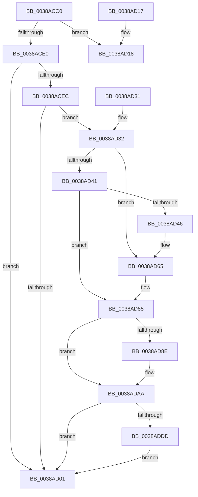

# ExFreeToLookasideListEx

- RVA: `0x0038ACC0`–`0x0038ADE9` (길이 `297` bytes)
- VA: `0x000000014038ACC0`
- 실행 섹션: `.text`
- PDB 이름 있음: `예`; PDB Function 태그: `아니요`
- unwind 정보 RVA: `0x00080050`
- 디코드: `78`개 명령, `297/297` bytes 표시
- 미해석 바이트: `0` (있으면 어셈블리에 `.byte`로 보존)

> 이 문서는 커널 이미지의 기계어와 PDB 기호를 분석해 생성했습니다. 4번과 5번은 함수 원형과 자료형을 바이너리 사용 방식에서 추정한 C 해석이며 원본 소스 복구 결과는 아닙니다.

## 1. Dependencies

- 직접 호출 지점: **6**; 고유 호출 대상: **4**
- 직접 호출자로 확인된 함수: **10**
- RIP 상대 이미지 참조: **3**

### Outgoing calls
- `0x0038AD07` → [ExpInterlockedPushEntrySList](../6B/ExpInterlockedPushEntrySList_function_006BA5B0.md) (function, `0x006BA5B0`)
- `0x0038AD21` → [guard_dispatch_icall](../6B/guard_dispatch_icall_function_006BAAD0.md) (function, `0x006BAAD0`)
- `0x0038AD5F` → [KeBugCheckEx](../4F/KeBugCheckEx_function_004FD660.md) (function, `0x004FD660`)
- `0x0038AD7F` → [KeBugCheckEx](../4F/KeBugCheckEx_function_004FD660.md) (function, `0x004FD660`)
- `0x0038ADA4` → [KeBugCheckEx](../4F/KeBugCheckEx_function_004FD660.md) (function, `0x004FD660`)
- `0x0038ADDF` → [memset](../6C/memset_function_006C6C40.md) (function, `0x006C6C40`)

### Direct callers
- [CcFreePrivateCacheMapIgnoreNull](CcFreePrivateCacheMapIgnoreNull_function_0038AC64.md) at `0x0038AC7D`
- [CcFreeSharedCacheMapIgnoreNull](CcFreeSharedCacheMapIgnoreNull_function_0038AC8C.md) at `0x0038ACA5`
- [CmpDecommisssionKcb](../../page/86/CmpDecommisssionKcb_function_00862750.md) at `0x008627C5`
- [sub_00862E81](../../page/86/Unknown_function_00862E81.md) at `0x00862FAF`
- [NtQueryKey](../../page/86/NtQueryKey_function_008676E0.md) at `0x00867BF4`
- [CmpBounceContextCleanup](../../page/8B/CmpBounceContextCleanup_function_008B2520.md) at `0x008B254E`
- [NtQueryValueKey](../../page/8B/NtQueryValueKey_function_008B2A00.md) at `0x008B308F`
- [NtEnumerateValueKey](../../page/8B/NtEnumerateValueKey_function_008B3B50.md) at `0x008B4276`
- [CmpFreeKeyControlBlock](../../page/9D/CmpFreeKeyControlBlock_function_009DB7B0.md) at `0x009DB812`
- [VmAccessFault](../../page/A1/VmAccessFault_function_00A18BF0.md) at `0x00A18F93`

### Static image references
- `0x0038ACE0` → RVA `0x00475D80` (`CmSiFreeMemory`; read)
- `0x0038ACF8` → RVA `0x00FCEC68` (`ALMOSTRO`; read)
- `0x0038ADC9` → RVA `0x00FC6ED8` (`ALMOSTRO`; read)

## 2. Other-region calls and transfers

- 다른 실행 섹션으로 향하는 call: **0**
- 별도 외부 분기/꼬리 이동을 확인하지 못했습니다.

## 3. Assembly (complete function range)

```asm
0038ACC0  48 89 5C 24 08                  mov qword ptr [rsp + 8], rbx
0038ACC5  57                              push rdi
0038ACC6  48 83 EC 30                     sub rsp, 0x30
0038ACCA  FF 41 1C                        inc dword ptr [rcx + 0x1c]
0038ACCD  48 8B D9                        mov rbx, rcx
0038ACD0  48 8B 41 38                     mov rax, qword ptr [rcx + 0x38]
0038ACD4  48 8B FA                        mov rdi, rdx
0038ACD7  0F B7 49 10                     movzx ecx, word ptr [rcx + 0x10]
0038ACDB  66 39 0B                        cmp word ptr [rbx], cx
0038ACDE  73 38                           jae 0x14038ad18
0038ACE0  48 8D 0D 99 B0 0E 00            lea rcx, [rip + 0xeb099]
0038ACE7  48 3B C1                        cmp rax, rcx
0038ACEA  75 15                           jne 0x14038ad01
0038ACEC  44 8B 43 2C                     mov r8d, dword ptr [rbx + 0x2c]
0038ACF0  48 8D 4A 08                     lea rcx, [rdx + 8]
0038ACF4  49 83 E8 08                     sub r8, 8
0038ACF8  80 3D 69 3F C4 00 00            cmp byte ptr [rip + 0xc43f69], 0
0038ACFF  75 31                           jne 0x14038ad32
0038AD01  48 8B D7                        mov rdx, rdi
0038AD04  48 8B CB                        mov rcx, rbx
0038AD07  E8 A4 F8 32 00                  call 0x1406ba5b0
0038AD0C  48 8B 5C 24 40                  mov rbx, qword ptr [rsp + 0x40]
0038AD11  48 83 C4 30                     add rsp, 0x30
0038AD15  5F                              pop rdi
0038AD16  C3                              ret
0038AD17  CC                              int3
0038AD18  FF 43 20                        inc dword ptr [rbx + 0x20]
0038AD1B  48 8B D3                        mov rdx, rbx
0038AD1E  48 8B CF                        mov rcx, rdi
0038AD21  E8 AA FD 32 00                  call 0x1406baad0
0038AD26  48 8B 5C 24 40                  mov rbx, qword ptr [rsp + 0x40]
0038AD2B  48 83 C4 30                     add rsp, 0x30
0038AD2F  5F                              pop rdi
0038AD30  C3                              ret
0038AD31  CC                              int3
0038AD32  48 B8 00 00 00 00 00 80 FF FF   movabs rax, 0xffff800000000000
0038AD3C  48 3B C8                        cmp rcx, rax
0038AD3F  72 24                           jb 0x14038ad65
0038AD41  F6 C1 07                        test cl, 7
0038AD44  74 3F                           je 0x14038ad85
0038AD46  BA 02 00 00 00                  mov edx, 2
0038AD4B  48 C7 44 24 20 08 00 00 00      mov qword ptr [rsp + 0x20], 8
0038AD54  4C 8B C9                        mov r9, rcx
0038AD57  44 8B C2                        mov r8d, edx
0038AD5A  B9 F1 01 00 00                  mov ecx, 0x1f1
0038AD5F  E8 FC 28 17 00                  call 0x1404fd660
0038AD64  CC                              int3
0038AD65  BA 02 00 00 00                  mov edx, 2
0038AD6A  48 C7 44 24 20 00 00 00 00      mov qword ptr [rsp + 0x20], 0
0038AD73  4C 8B C9                        mov r9, rcx
0038AD76  B9 F1 01 00 00                  mov ecx, 0x1f1
0038AD7B  44 8D 42 FF                     lea r8d, [rdx - 1]
0038AD7F  E8 DC 28 17 00                  call 0x1404fd660
0038AD84  CC                              int3
0038AD85  4A 8D 04 01                     lea rax, [rcx + r8]
0038AD89  48 3B C1                        cmp rax, rcx
0038AD8C  73 1C                           jae 0x14038adaa
0038AD8E  BA 02 00 00 00                  mov edx, 2
0038AD93  4C 89 44 24 20                  mov qword ptr [rsp + 0x20], r8
0038AD98  4C 8B C9                        mov r9, rcx
0038AD9B  B9 F1 01 00 00                  mov ecx, 0x1f1
0038ADA0  44 8D 42 01                     lea r8d, [rdx + 1]
0038ADA4  E8 B7 28 17 00                  call 0x1404fd660
0038ADA9  CC                              int3
0038ADAA  49 8D 40 FF                     lea rax, [r8 - 1]
0038ADAE  83 E0 07                        and eax, 7
0038ADB1  4C 2B C0                        sub r8, rax
0038ADB4  48 B8 00 00 00 00 00 80 00 00   movabs rax, 0x800000000000
0038ADBE  48 03 C8                        add rcx, rax
0038ADC1  49 83 C0 07                     add r8, 7
0038ADC5  48 C1 E9 03                     shr rcx, 3
0038ADC9  48 03 0D 08 C1 C3 00            add rcx, qword ptr [rip + 0xc3c108]
0038ADD0  49 C1 E8 03                     shr r8, 3
0038ADD4  4D 85 C0                        test r8, r8
0038ADD7  0F 84 24 FF FF FF               je 0x14038ad01
0038ADDD  B2 8C                           mov dl, 0x8c
0038ADDF  E8 5C BE 33 00                  call 0x1406c6c40
0038ADE4  E9 18 FF FF FF                  jmp 0x14038ad01
```

## 4. C-style interpretation (structured pseudocode)

```c
__int64 __fastcall ExFreeToLookasideListEx(__int64 a1, __int64 a2)
{
    __int64 result;
    __int64 v_rsp;
    unsigned __int64 v_stack_p40;
    unsigned __int64 v_stack_p58;
    unsigned __int64 v_stack_p8;

    v_stack_p8 = v_rbx;
    v_rsp = (v_rsp) - (48);
    if ((*(unsigned __int16 *)(a1)) >= ((unsigned __int16)(*(unsigned __int16 *)(a1 + 16)))) goto loc_0038AD18;
    if ((*(unsigned __int64 *)(a1 + 56)) != (v_rip + 962713)) goto loc_0038AD01;
    a3 = ((unsigned int)(*(unsigned int *)(a1 + 44))) - (8);
    if ((*(unsigned __int8 *)(v_rip + 12861289)) != 0) goto loc_0038AD32;
loc_0038AD01:
    result = ExpInterlockedPushEntrySList(a1, a2, a3, a4);
    v_rsp = (v_rsp) + (48);
    return result;
loc_0038AD18:
    result = guard_dispatch_icall(a2, v_stack_p8, a3, a4);
    v_rsp = (v_rsp) + (48);
    return result;
loc_0038AD32:
    if (a2 < result) goto loc_0038AD65;
    if ((((unsigned __int8)(a2)) & (7)) == 0) goto loc_0038AD85;
    v_stack_p58 = 8;
    result = KeBugCheckEx(497, 2, 2, a2);
loc_0038AD65:
    v_stack_p58 = 0;
    result = KeBugCheckEx(497, 2, 2 - 1, 497);
loc_0038AD85:
    result = 497 + 2 - 1 * 1;
    if ((497 + 2 - 1 * 1) < 497) {
        a2 = 2;
        v_stack_p58 = 2 - 1;
        a4 = 497;
        a1 = 497;
        a3 = a2 + 1;
        result = KeBugCheckEx(a1, a2, a3, a4);
    }
    result = (unsigned int)((a3 - 1) & (7));
    a3 = (a3) - (result);
    a1 = (a1) + (result);
    a3 = (a3) + (7);
    a1 = (a1) >> (3);
    a1 = (a1) + (*(unsigned __int64 *)(v_rip + 12828936));
    a3 = (a3) >> (3);
    if (a3 == 0) goto loc_0038AD01;
    result = memset(a1, 140, a3, a4);
    goto loc_0038AD01;
}
```

## 5. (Beta) C Style

```c
int64_t ExFreeToLookasideListEx(void *Arg1, void *Arg2)
{
    uint8_t *arg1 = (uint8_t *)Arg1;
    uint8_t *arg2 = (uint8_t *)Arg2;

    int64_t result;
    int64_t local_rsp;
    uint64_t v_stack_p40;
    uint64_t v_stack_p58;
    uint64_t v_stack_p8;

    v_stack_p8 = local_rbx;
    local_rsp = (local_rsp) - (48);
    if ((*(uint16_t *)(arg1)) >= ((uint16_t)(*(uint16_t *)(arg1 + 0x10)))) goto loc_0038AD18;
    if ((*(uint64_t *)(arg1 + 0x38)) != (v_rip + 962713)) goto loc_0038AD01;
    a3 = ((uint32_t)(*(uint32_t *)(arg1 + 0x2C))) - (8);
    if ((*(uint8_t *)(v_rip + 0xC43F69)) != 0) goto loc_0038AD32;
loc_0038AD01:
    result = ExpInterlockedPushEntrySList(Arg1, Arg2, a3, a4);
    local_rsp = (local_rsp) + (48);
    return result;
loc_0038AD18:
    result = guard_dispatch_icall(Arg2, v_stack_p8, a3, a4);
    local_rsp = (local_rsp) + (48);
    return result;
loc_0038AD32:
    if (Arg2 < result) goto loc_0038AD65;
    if ((((uint8_t)(Arg2)) & (7)) == 0) goto loc_0038AD85;
    v_stack_p58 = 8;
    result = KeBugCheckEx(497, 2, 2, Arg2);
loc_0038AD65:
    v_stack_p58 = 0;
    result = KeBugCheckEx(497, 2, 2 - 1, 497);
loc_0038AD85:
    result = 497 + 2 - 1 * 1;
    if ((497 + 2 - 1 * 1) < 497) {
        Arg2 = 2;
        v_stack_p58 = 2 - 1;
        a4 = 497;
        Arg1 = 497;
        a3 = Arg2 + 1;
        result = KeBugCheckEx(Arg1, Arg2, a3, a4);
    }
    result = (uint32_t)((a3 - 1) & (7));
    a3 = (a3) - (result);
    Arg1 = (Arg1) + (result);
    a3 = (a3) + (7);
    Arg1 = (Arg1) >> (3);
    Arg1 = (Arg1) + (*(uint64_t *)(v_rip + 0xC3C108));
    a3 = (a3) >> (3);
    if (a3 == 0) goto loc_0038AD01;
    result = memset(Arg1, 140, a3, a4);
    goto loc_0038AD01;
}
```

### 관측된 메모리 오프셋

구조체 형식이 확인되지 않은 접근은 인자 기준의 오프셋으로만 기록했습니다.

| 기준 인자 | 오프셋 표현 | 폭 (bit) | 접근 |
|---|---:|---:|---|
| `Arg1` | `+ 0x0` | `16` | `R` |
| `Arg1` | `+ 0x10` | `16` | `R` |
| `Arg1` | `+ 0x1C` | `32` | `R/W` |
| `Arg1` | `+ 0x20` | `32` | `R/W` |
| `Arg1` | `+ 0x2C` | `32` | `R` |
| `Arg1` | `+ 0x38` | `64` | `R` |
| `Arg2` | `+ 0x8` | `64` | `R` |

## 6. Execution-region graph

[열기: 2D/3D 그래프와 함수 탐색 컨트롤 패널](../../../control-panel.html?section=text&rva=0x0038ACC0&view=graph)

- 2D 그래프는 위에서 아래로 흐르고, 3D 그래프는 빈 공간을 드래그해 회전합니다. Shift+드래그는 이동, 휠은 확대·축소, 함수 노드 선택은 대상 보고서 이동입니다.

### Static fallback


