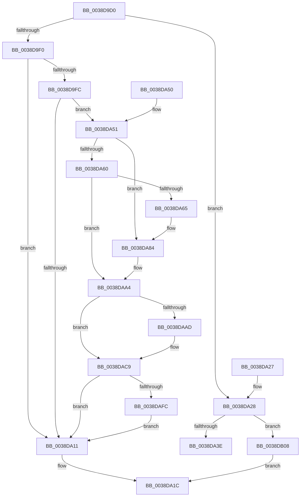

# ExFreeToNPagedLookasideList

- RVA: `0x0038D9D0`–`0x0038DB15` (길이 `325` bytes)
- VA: `0x000000014038D9D0`
- 실행 섹션: `.text`
- PDB 이름 있음: `예`; PDB Function 태그: `아니요`
- unwind 정보 RVA: `0x00080580`
- 디코드: `84`개 명령, `325/325` bytes 표시
- 미해석 바이트: `0` (있으면 어셈블리에 `.byte`로 보존)

> 이 문서는 커널 이미지의 기계어와 PDB 기호를 분석해 생성했습니다. 4번과 5번은 함수 원형과 자료형을 바이너리 사용 방식에서 추정한 C 해석이며 원본 소스 복구 결과는 아닙니다.

## 1. Dependencies

- 직접 호출 지점: **7**; 고유 호출 대상: **5**
- 직접 호출자로 확인된 함수: **59**
- RIP 상대 이미지 참조: **4**

### Outgoing calls
- `0x0038DA17` → [ExpInterlockedPushEntrySList](../6B/ExpInterlockedPushEntrySList_function_006BA5B0.md) (function, `0x006BA5B0`)
- `0x0038DA40` → [ExFreePoolWithTag](../../poolcode/B8/ExFreePoolWithTag_function_00B82870.md) (function, `0x00B82870`)
- `0x0038DA7E` → [KeBugCheckEx](../4F/KeBugCheckEx_function_004FD660.md) (function, `0x004FD660`)
- `0x0038DA9E` → [KeBugCheckEx](../4F/KeBugCheckEx_function_004FD660.md) (function, `0x004FD660`)
- `0x0038DAC3` → [KeBugCheckEx](../4F/KeBugCheckEx_function_004FD660.md) (function, `0x004FD660`)
- `0x0038DAFE` → [memset](../6C/memset_function_006C6C40.md) (function, `0x006C6C40`)
- `0x0038DB0B` → [guard_dispatch_icall](../6B/guard_dispatch_icall_function_006BAAD0.md) (function, `0x006BAAD0`)

### Direct callers
- [CcExtendVacbArray](../26/CcExtendVacbArray_function_0026DCD0.md) at `0x0026E1A8`
- [PopFreeIrp](../26/PopFreeIrp_function_0026FAA0.md) at `0x0026FB67`
- [PopAllocateIrp](../27/PopAllocateIrp_function_0027116C.md) at `0x00271608`
- [CcFreeUnusedVacbLevels](../27/CcFreeUnusedVacbLevels_function_00273B1C.md) at `0x00273B5A`
- [CcFreeUnusedVacbLevels](../27/CcFreeUnusedVacbLevels_function_00273B1C.md) at `0x00273B72`
- [FsRtlUninitializeFileLock](FsRtlUninitializeFileLock_function_00386F50.md) at `0x00386FEB`
- [FsRtlUninitializeFileLock](FsRtlUninitializeFileLock_function_00386F50.md) at `0x0038701B`
- [FsRtlUninitializeFileLock](FsRtlUninitializeFileLock_function_00386F50.md) at `0x0038702F`
- [FsRtlUninitializeFileLock](FsRtlUninitializeFileLock_function_00386F50.md) at `0x0038704B`
- [sub_00387740](Unknown_function_00387740.md) at `0x00387AA2`
- [FsRtlAddEntry](FsRtlAddEntry_function_00387BE0.md) at `0x00387D0F`
- [CcDeallocateVacbLevel](CcDeallocateVacbLevel_function_0038C058.md) at `0x0038C076`
- [CcDeleteMbcb](CcDeleteMbcb_function_0038C088.md) at `0x0038C1C4`
- [sub_0038C58B](Unknown_function_0038C58B.md) at `0x0038C654`
- [FsRtlFastUnlockSingleExclusive](FsRtlFastUnlockSingleExclusive_function_0038C8E0.md) at `0x0038CA60`
- [sub_0038CBC6](Unknown_function_0038CBC6.md) at `0x0038CD45`
- [sub_0038CBC6](Unknown_function_0038CBC6.md) at `0x0038CE08`
- [sub_0038CE61](Unknown_function_0038CE61.md) at `0x0038CF63`
- [FsRtlPrivateCheckWaitingLocks](FsRtlPrivateCheckWaitingLocks_function_0038DCBC.md) at `0x0038DE6A`
- [FsRtlPrivateLock](FsRtlPrivateLock_function_0038DF90.md) at `0x0038E4B4`
- [FsRtlPrivateInsertLock](FsRtlPrivateInsertLock_function_0038E5D0.md) at `0x0038E6AE`
- [IoSetOplockPrivateFoExt](IoSetOplockPrivateFoExt_function_0038F5A4.md) at `0x0038F6CF`
- [IoSetOplockKeyContext](IoSetOplockKeyContext_function_0038F7BC.md) at `0x0038F934`
- [CcSetDirtyInMask](../3C/CcSetDirtyInMask_function_003CB688.md) at `0x003CB92D`
- [FsRtlPrivateFastUnlockAll](../3F/FsRtlPrivateFastUnlockAll_function_003FD554.md) at `0x003FD75E`
- [FsRtlPrivateFastUnlockAll](../3F/FsRtlPrivateFastUnlockAll_function_003FD554.md) at `0x003FD77E`
- [FsRtlPrivateFastUnlockAll](../3F/FsRtlPrivateFastUnlockAll_function_003FD554.md) at `0x003FD84F`
- [FsRtlUninitializeLargeMcb](../44/FsRtlUninitializeLargeMcb_function_00446C70.md) at `0x00446C88`
- [FsRtlUninitializeBaseMcb](../44/FsRtlUninitializeBaseMcb_function_00446CB0.md) at `0x00446D94`
- [WmipDeregisterRegEntry](../47/WmipDeregisterRegEntry_function_0047B568.md) at `0x0047B6C6`
- [MiFreeMdlTracker](../49/MiFreeMdlTracker_function_00494838.md) at `0x00494938`
- [PopCreateDynamicIrpWorker](../4A/PopCreateDynamicIrpWorker_function_004A175C.md) at `0x004A17C7`
- [FsRtlPrivateCancelFileLockIrp](../4D/FsRtlPrivateCancelFileLockIrp_function_004D4B70.md) at `0x004D4C5F`
- [FsRtlpSyncWithAckTimeout](../4F/FsRtlpSyncWithAckTimeout_function_004F23C4.md) at `0x004F240E`
- [sub_0050C0E0](../50/Unknown_function_0050C0E0.md) at `0x0051A817`
- [FsRtlpOplockAckTimeoutWorker](../58/FsRtlpOplockAckTimeoutWorker_function_00582950.md) at `0x00582AC3`
- [VfAvlFreeNodeNoLock](../61/VfAvlFreeNodeNoLock_function_006126D8.md) at `0x006126E9`
- [ViFlushZeroMapRegisterBaseWcbs](../61/ViFlushZeroMapRegisterBaseWcbs_function_00612D2C.md) at `0x00612DB1`
- [sub_006D9D60](../6D/Unknown_function_006D9D60.md) at `0x006D9D6A`
- [sub_006E4D86](../6E/Unknown_function_006E4D86.md) at `0x006E4E17`
- [sub_006E56AC](../6E/Unknown_function_006E56AC.md) at `0x006E5721`
- [sub_006EBD42](../6E/Unknown_function_006EBD42.md) at `0x006EBD7C`
- [sub_006EBD42](../6E/Unknown_function_006EBD42.md) at `0x006EBE4E`
- [ObWaitForMultipleObjects](../../page/86/ObWaitForMultipleObjects_function_00868DF0.md) at `0x008693C5`
- [sub_008A134D](../../page/8A/Unknown_function_008A134D.md) at `0x008A13C8`
- [FsRtlFreeExtraCreateParameterList](../../page/8A/FsRtlFreeExtraCreateParameterList_function_008A1420.md) at `0x008A153B`
- [FsRtlFreeExtraCreateParameter](../../page/8A/FsRtlFreeExtraCreateParameter_function_008A1760.md) at `0x008A17FE`
- [AlpcpDestroyPort](../../page/92/AlpcpDestroyPort_function_0092517C.md) at `0x00925235`
- [ViFreeContextTable](../../pagevrfy/B9/ViFreeContextTable_function_00B948C8.md) at `0x00B948D6`
- [VfAllocateAdapterChannel](../../pagevrfy/B9/VfAllocateAdapterChannel_function_00B95180.md) at `0x00B95323`
- [VfAllocateAdapterChannelEx](../../pagevrfy/B9/VfAllocateAdapterChannelEx_function_00B95360.md) at `0x00B9554E`
- [VfBuildScatterGatherList](../../pagevrfy/B9/VfBuildScatterGatherList_function_00B95AA0.md) at `0x00B95C15`
- [VfBuildScatterGatherList](../../pagevrfy/B9/VfBuildScatterGatherList_function_00B95AA0.md) at `0x00B95D56`
- [VfCancelAdapterChannel](../../pagevrfy/B9/VfCancelAdapterChannel_function_00B95FD0.md) at `0x00B9606F`
- [VfFreeAdapterChannel](../../pagevrfy/B9/VfFreeAdapterChannel_function_00B96480.md) at `0x00B9650C`
- [VfFreeAdapterObject](../../pagevrfy/B9/VfFreeAdapterObject_function_00B96530.md) at `0x00B96630`
- [VfFreeMapRegisters](../../pagevrfy/B9/VfFreeMapRegisters_function_00B967D0.md) at `0x00B968A4`
- [VfGetScatterGatherList](../../pagevrfy/B9/VfGetScatterGatherList_function_00B96BD0.md) at `0x00B96D6A`
- [VfGetScatterGatherList](../../pagevrfy/B9/VfGetScatterGatherList_function_00B96BD0.md) at `0x00B96DB4`
- [VfGetScatterGatherList](../../pagevrfy/B9/VfGetScatterGatherList_function_00B96BD0.md) at `0x00B96EDF`
- [VfPutScatterGatherList](../../pagevrfy/B9/VfPutScatterGatherList_function_00B97970.md) at `0x00B97A85`
- [ViAdapterCallback](../../pagevrfy/B9/ViAdapterCallback_function_00B97B40.md) at `0x00B97CAF`
- [ViDeadlockFree](../../pagevrfy/BA/ViDeadlockFree_function_00BA9670.md) at `0x00BA96A5`
- [ViDeadlockPopulateLookasideCache](../../pagevrfy/BA/ViDeadlockPopulateLookasideCache_function_00BA9B4C.md) at `0x00BA9B8E`
- [ViPacketNotificationCallback](../../pagevrfy/BA/ViPacketNotificationCallback_function_00BAB520.md) at `0x00BAB555`
- [IovpSessionDataDereference](../../pagevrfy/BA/IovpSessionDataDereference_function_00BAC808.md) at `0x00BAC84F`
- [ViWdIrpBeforeCompletionRoutine](../../pagevrfy/BA/ViWdIrpBeforeCompletionRoutine_function_00BACB7C.md) at `0x00BACBEC`
- [VfIoCompletionCheckState](../../pagevrfy/BB/VfIoCompletionCheckState_function_00BB70FC.md) at `0x00BB7135`
- [VfFastIoCheckState](../../pagevrfy/BB/VfFastIoCheckState_function_00BB9440.md) at `0x00BB9526`
- [sub_00BBC34E](../../pagevrfy/BB/Unknown_function_00BBC34E.md) at `0x00BBC50D`

### Static image references
- `0x0038D9F0` → RVA `0x00475D80` (`CmSiFreeMemory`; read)
- `0x0038DA08` → RVA `0x00FCEC68` (`ALMOSTRO`; read)
- `0x0038DA2B` → RVA `0x00B82850` (`ExFreePool`; read)
- `0x0038DAE8` → RVA `0x00FC6ED8` (`ALMOSTRO`; read)

## 2. Other-region calls and transfers

- 다른 실행 섹션으로 향하는 call: **1**
  - `0x0038DA40` → [ExFreePoolWithTag](../../poolcode/B8/ExFreePoolWithTag_function_00B82870.md) (`.text` → `POOLCODE`)
- 별도 외부 분기/꼬리 이동을 확인하지 못했습니다.

## 3. Assembly (complete function range)

```asm
0038D9D0  48 89 5C 24 08                  mov qword ptr [rsp + 8], rbx
0038D9D5  57                              push rdi
0038D9D6  48 83 EC 30                     sub rsp, 0x30
0038D9DA  FF 41 1C                        inc dword ptr [rcx + 0x1c]
0038D9DD  48 8B FA                        mov rdi, rdx
0038D9E0  0F B7 41 10                     movzx eax, word ptr [rcx + 0x10]
0038D9E4  48 8B D9                        mov rbx, rcx
0038D9E7  48 8B 51 38                     mov rdx, qword ptr [rcx + 0x38]
0038D9EB  66 39 01                        cmp word ptr [rcx], ax
0038D9EE  73 38                           jae 0x14038da28
0038D9F0  48 8D 05 89 83 0E 00            lea rax, [rip + 0xe8389]
0038D9F7  48 3B D0                        cmp rdx, rax
0038D9FA  75 15                           jne 0x14038da11
0038D9FC  44 8B 41 2C                     mov r8d, dword ptr [rcx + 0x2c]
0038DA00  48 8D 4F 08                     lea rcx, [rdi + 8]
0038DA04  49 83 E8 08                     sub r8, 8
0038DA08  80 3D 59 12 C4 00 00            cmp byte ptr [rip + 0xc41259], 0
0038DA0F  75 40                           jne 0x14038da51
0038DA11  48 8B D7                        mov rdx, rdi
0038DA14  48 8B CB                        mov rcx, rbx
0038DA17  E8 94 CB 32 00                  call 0x1406ba5b0
0038DA1C  48 8B 5C 24 40                  mov rbx, qword ptr [rsp + 0x40]
0038DA21  48 83 C4 30                     add rsp, 0x30
0038DA25  5F                              pop rdi
0038DA26  C3                              ret
0038DA27  CC                              int3
0038DA28  FF 41 20                        inc dword ptr [rcx + 0x20]
0038DA2B  48 8D 05 1E 4E 7F 00            lea rax, [rip + 0x7f4e1e]
0038DA32  48 8B CF                        mov rcx, rdi
0038DA35  48 3B D0                        cmp rdx, rax
0038DA38  0F 85 CA 00 00 00               jne 0x14038db08
0038DA3E  33 D2                           xor edx, edx
0038DA40  E8 2B 4E 7F 00                  call 0x140b82870
0038DA45  48 8B 5C 24 40                  mov rbx, qword ptr [rsp + 0x40]
0038DA4A  48 83 C4 30                     add rsp, 0x30
0038DA4E  5F                              pop rdi
0038DA4F  C3                              ret
0038DA50  CC                              int3
0038DA51  48 B8 00 00 00 00 00 80 FF FF   movabs rax, 0xffff800000000000
0038DA5B  48 3B C8                        cmp rcx, rax
0038DA5E  72 24                           jb 0x14038da84
0038DA60  F6 C1 07                        test cl, 7
0038DA63  74 3F                           je 0x14038daa4
0038DA65  BA 02 00 00 00                  mov edx, 2
0038DA6A  48 C7 44 24 20 08 00 00 00      mov qword ptr [rsp + 0x20], 8
0038DA73  4C 8B C9                        mov r9, rcx
0038DA76  44 8B C2                        mov r8d, edx
0038DA79  B9 F1 01 00 00                  mov ecx, 0x1f1
0038DA7E  E8 DD FB 16 00                  call 0x1404fd660
0038DA83  CC                              int3
0038DA84  BA 02 00 00 00                  mov edx, 2
0038DA89  48 C7 44 24 20 00 00 00 00      mov qword ptr [rsp + 0x20], 0
0038DA92  4C 8B C9                        mov r9, rcx
0038DA95  B9 F1 01 00 00                  mov ecx, 0x1f1
0038DA9A  44 8D 42 FF                     lea r8d, [rdx - 1]
0038DA9E  E8 BD FB 16 00                  call 0x1404fd660
0038DAA3  CC                              int3
0038DAA4  4A 8D 04 01                     lea rax, [rcx + r8]
0038DAA8  48 3B C1                        cmp rax, rcx
0038DAAB  73 1C                           jae 0x14038dac9
0038DAAD  BA 02 00 00 00                  mov edx, 2
0038DAB2  4C 89 44 24 20                  mov qword ptr [rsp + 0x20], r8
0038DAB7  4C 8B C9                        mov r9, rcx
0038DABA  B9 F1 01 00 00                  mov ecx, 0x1f1
0038DABF  44 8D 42 01                     lea r8d, [rdx + 1]
0038DAC3  E8 98 FB 16 00                  call 0x1404fd660
0038DAC8  CC                              int3
0038DAC9  49 8D 40 FF                     lea rax, [r8 - 1]
0038DACD  83 E0 07                        and eax, 7
0038DAD0  4C 2B C0                        sub r8, rax
0038DAD3  48 B8 00 00 00 00 00 80 00 00   movabs rax, 0x800000000000
0038DADD  48 03 C8                        add rcx, rax
0038DAE0  49 83 C0 07                     add r8, 7
0038DAE4  48 C1 E9 03                     shr rcx, 3
0038DAE8  48 03 0D E9 93 C3 00            add rcx, qword ptr [rip + 0xc393e9]
0038DAEF  49 C1 E8 03                     shr r8, 3
0038DAF3  4D 85 C0                        test r8, r8
0038DAF6  0F 84 15 FF FF FF               je 0x14038da11
0038DAFC  B2 8C                           mov dl, 0x8c
0038DAFE  E8 3D 91 33 00                  call 0x1406c6c40
0038DB03  E9 09 FF FF FF                  jmp 0x14038da11
0038DB08  48 8B C2                        mov rax, rdx
0038DB0B  E8 C0 CF 32 00                  call 0x1406baad0
0038DB10  E9 07 FF FF FF                  jmp 0x14038da1c
```

## 4. C-style interpretation (structured pseudocode)

```c
__int64 __fastcall ExFreeToNPagedLookasideList(__int64 a1, __int64 a2)
{
    __int64 result;
    __int64 v_rsp;
    unsigned __int64 v_stack_p40;
    unsigned __int64 v_stack_p58;
    unsigned __int64 v_stack_p8;

    v_stack_p8 = v_rbx;
    v_rsp = (v_rsp) - (48);
    if ((*(unsigned __int16 *)(a1)) >= ((unsigned __int16)(*(unsigned __int16 *)(a1 + 16)))) goto loc_0038DA28;
    if ((*(unsigned __int64 *)(a1 + 56)) != (v_rip + 951177)) goto loc_0038DA11;
    a3 = ((unsigned int)(*(unsigned int *)(a1 + 44))) - (8);
    if ((*(unsigned __int8 *)(v_rip + 12849753)) != 0) goto loc_0038DA51;
loc_0038DA11:
    result = ExpInterlockedPushEntrySList(a1, a2, a3, a4);
loc_0038DA1C:
    v_rsp = (v_rsp) + (48);
    return result;
loc_0038DA28:
    if (a2 != (v_rip + 8343070)) goto loc_0038DB08;
    a2 = 0;
    result = ExFreePoolWithTag(a2, a2, a3, a4);
    v_rsp = (v_rsp) + (48);
    return result;
loc_0038DA51:
    if (0 < result) goto loc_0038DA84;
    if (((0) & (7)) == 0) goto loc_0038DAA4;
    v_stack_p58 = 8;
    result = KeBugCheckEx(497, 2, 2, 0);
loc_0038DA84:
    v_stack_p58 = 0;
    result = KeBugCheckEx(497, 2, 2 - 1, 497);
loc_0038DAA4:
    result = 497 + 2 - 1 * 1;
    if ((497 + 2 - 1 * 1) < 497) {
        a2 = 2;
        v_stack_p58 = 2 - 1;
        a4 = 497;
        a1 = 497;
        a3 = a2 + 1;
        result = KeBugCheckEx(a1, a2, a3, a4);
    }
    result = (unsigned int)((a3 - 1) & (7));
    a3 = (a3) - (result);
    a1 = (a1) + (result);
    a3 = (a3) + (7);
    a1 = (a1) >> (3);
    a1 = (a1) + (*(unsigned __int64 *)(v_rip + 12817385));
    a3 = (a3) >> (3);
    if (a3 == 0) goto loc_0038DA11;
    result = memset(a1, 140, a3, a4);
    goto loc_0038DA11;
loc_0038DB08:
    result = guard_dispatch_icall(a1, 140, a3, a4);
    goto loc_0038DA1C;
}
```

## 5. (Beta) C Style

```c
int64_t ExFreeToNPagedLookasideList(void *Arg1, void *Arg2)
{
    uint8_t *arg1 = (uint8_t *)Arg1;
    uint8_t *arg2 = (uint8_t *)Arg2;

    int64_t result;
    int64_t local_rsp;
    uint64_t v_stack_p40;
    uint64_t v_stack_p58;
    uint64_t v_stack_p8;

    v_stack_p8 = local_rbx;
    local_rsp = (local_rsp) - (48);
    if ((*(uint16_t *)(arg1)) >= ((uint16_t)(*(uint16_t *)(arg1 + 0x10)))) goto loc_0038DA28;
    if ((*(uint64_t *)(arg1 + 0x38)) != (v_rip + 951177)) goto loc_0038DA11;
    a3 = ((uint32_t)(*(uint32_t *)(arg1 + 0x2C))) - (8);
    if ((*(uint8_t *)(v_rip + 0xC41259)) != 0) goto loc_0038DA51;
loc_0038DA11:
    result = ExpInterlockedPushEntrySList(Arg1, Arg2, a3, a4);
loc_0038DA1C:
    local_rsp = (local_rsp) + (48);
    return result;
loc_0038DA28:
    if (Arg2 != (v_rip + 8343070)) goto loc_0038DB08;
    Arg2 = 0;
    result = ExFreePoolWithTag(Arg2, Arg2, a3, a4);
    local_rsp = (local_rsp) + (48);
    return result;
loc_0038DA51:
    if (0 < result) goto loc_0038DA84;
    if (((0) & (7)) == 0) goto loc_0038DAA4;
    v_stack_p58 = 8;
    result = KeBugCheckEx(497, 2, 2, 0);
loc_0038DA84:
    v_stack_p58 = 0;
    result = KeBugCheckEx(497, 2, 2 - 1, 497);
loc_0038DAA4:
    result = 497 + 2 - 1 * 1;
    if ((497 + 2 - 1 * 1) < 497) {
        Arg2 = 2;
        v_stack_p58 = 2 - 1;
        a4 = 497;
        Arg1 = 497;
        a3 = Arg2 + 1;
        result = KeBugCheckEx(Arg1, Arg2, a3, a4);
    }
    result = (uint32_t)((a3 - 1) & (7));
    a3 = (a3) - (result);
    Arg1 = (Arg1) + (result);
    a3 = (a3) + (7);
    Arg1 = (Arg1) >> (3);
    Arg1 = (Arg1) + (*(uint64_t *)(v_rip + 0xC393E9));
    a3 = (a3) >> (3);
    if (a3 == 0) goto loc_0038DA11;
    result = memset(Arg1, 140, a3, a4);
    goto loc_0038DA11;
loc_0038DB08:
    result = guard_dispatch_icall(Arg1, 140, a3, a4);
    goto loc_0038DA1C;
}
```

### 관측된 메모리 오프셋

구조체 형식이 확인되지 않은 접근은 인자 기준의 오프셋으로만 기록했습니다.

| 기준 인자 | 오프셋 표현 | 폭 (bit) | 접근 |
|---|---:|---:|---|
| `Arg1` | `+ 0x0` | `16` | `R` |
| `Arg1` | `+ 0x10` | `16` | `R` |
| `Arg1` | `+ 0x1C` | `32` | `R/W` |
| `Arg1` | `+ 0x20` | `32` | `R/W` |
| `Arg1` | `+ 0x2C` | `32` | `R` |
| `Arg1` | `+ 0x38` | `64` | `R` |
| `Arg2` | `+ 0x8` | `64` | `R` |

## 6. Execution-region graph

[열기: 2D/3D 그래프와 함수 탐색 컨트롤 패널](../../../control-panel.html?section=text&rva=0x0038D9D0&view=graph)

- 2D 그래프는 위에서 아래로 흐르고, 3D 그래프는 빈 공간을 드래그해 회전합니다. Shift+드래그는 이동, 휠은 확대·축소, 함수 노드 선택은 대상 보고서 이동입니다.

### Static fallback


