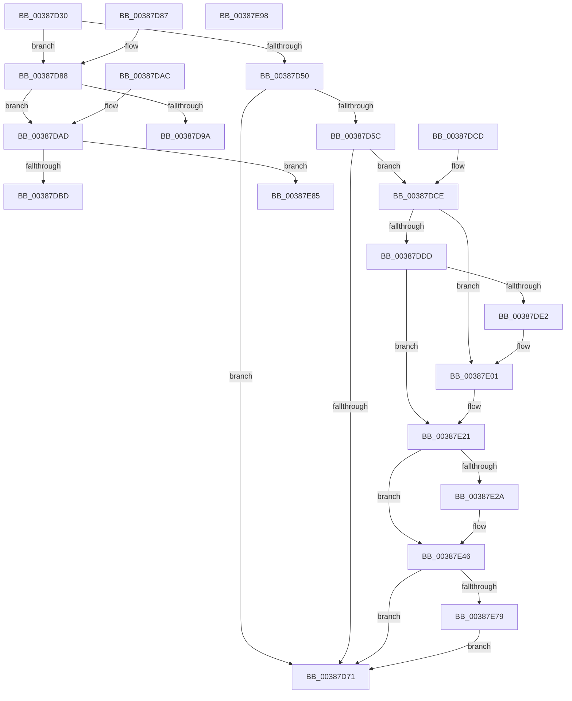

# ExFreeToPagedLookasideList

- RVA: `0x00387D30`–`0x00387E99` (길이 `361` bytes)
- VA: `0x0000000140387D30`
- 실행 섹션: `.text`
- PDB 이름 있음: `예`; PDB Function 태그: `아니요`
- unwind 정보 RVA: `0x0007FDFC`
- 디코드: `97`개 명령, `361/361` bytes 표시
- 미해석 바이트: `0` (있으면 어셈블리에 `.byte`로 보존)

> 이 문서는 커널 이미지의 기계어와 PDB 기호를 분석해 생성했습니다. 4번과 5번은 함수 원형과 자료형을 바이너리 사용 방식에서 추정한 C 해석이며 원본 소스 복구 결과는 아닙니다.

## 1. Dependencies

- 직접 호출 지점: **8**; 고유 호출 대상: **6**
- 직접 호출자로 확인된 함수: **19**
- RIP 상대 이미지 참조: **5**

### Outgoing calls
- `0x00387D77` → [ExpInterlockedPushEntrySList](../6B/ExpInterlockedPushEntrySList_function_006BA5B0.md) (function, `0x006BA5B0`)
- `0x00387D9C` → [ExFreePoolWithTag](../../poolcode/B8/ExFreePoolWithTag_function_00B82870.md) (function, `0x00B82870`)
- `0x00387DBD` → [AlpcpFreeMessageFunction](../../page/88/AlpcpFreeMessageFunction_function_0088A060.md) (function, `0x0088A060`)
- `0x00387DFB` → [KeBugCheckEx](../4F/KeBugCheckEx_function_004FD660.md) (function, `0x004FD660`)
- `0x00387E1B` → [KeBugCheckEx](../4F/KeBugCheckEx_function_004FD660.md) (function, `0x004FD660`)
- `0x00387E40` → [KeBugCheckEx](../4F/KeBugCheckEx_function_004FD660.md) (function, `0x004FD660`)
- `0x00387E7B` → [memset](../6C/memset_function_006C6C40.md) (function, `0x006C6C40`)
- `0x00387E88` → [guard_dispatch_icall](../6B/guard_dispatch_icall_function_006BAAD0.md) (function, `0x006BAAD0`)

### Direct callers
- [FsRtlEmptyFreePoolList](FsRtlEmptyFreePoolList_function_00386D30.md) at `0x00386D86`
- [FsRtlFreeFileLock](FsRtlFreeFileLock_function_00386F20.md) at `0x00386F38`
- [sub_00387740](Unknown_function_00387740.md) at `0x003879A3`
- [FsRtlAddEntry](FsRtlAddEntry_function_00387BE0.md) at `0x00387CEC`
- [FsRtlFreeTunnelNode](FsRtlFreeTunnelNode_function_00388D68.md) at `0x00388DA1`
- [HashpHashMemory](../../page/84/HashpHashMemory_function_008419AC.md) at `0x00841AB6`
- [HashpVerifyPkcs1Signature](../../page/84/HashpVerifyPkcs1Signature_function_00841C68.md) at `0x00841EE9`
- [sub_0088AF37](../../page/88/Unknown_function_0088AF37.md) at `0x0088AFAE`
- [sub_0088B593](../../page/88/Unknown_function_0088B593.md) at `0x0088B602`
- [sub_0088BA74](../../page/88/Unknown_function_0088BA74.md) at `0x0088BAB1`
- [sub_00892205](../../page/89/Unknown_function_00892205.md) at `0x00892280`
- [sub_00897BD2](../../page/89/Unknown_function_00897BD2.md) at `0x00897C0F`
- [sub_008A1237](../../page/8A/Unknown_function_008A1237.md) at `0x008A12E6`
- [sub_008A1237](../../page/8A/Unknown_function_008A1237.md) at `0x008A1321`
- [FsRtlFreeExtraCreateParameterList](../../page/8A/FsRtlFreeExtraCreateParameterList_function_008A1420.md) at `0x008A14C1`
- [FsRtlFreeExtraCreateParameterList](../../page/8A/FsRtlFreeExtraCreateParameterList_function_008A1420.md) at `0x008A14F4`
- [FsRtlFreeExtraCreateParameter](../../page/8A/FsRtlFreeExtraCreateParameter_function_008A1760.md) at `0x008A17B0`
- [AlpcConnectionDestroyProcedure](../../page/92/AlpcConnectionDestroyProcedure_function_00924310.md) at `0x009243D8`
- [WmipUnreferenceEntry](../../page/9E/WmipUnreferenceEntry_function_009E0CC8.md) at `0x009E0D8C`
- [RtlpFreeRangeListEntry](../../page/A6/RtlpFreeRangeListEntry_function_00A69918.md) at `0x00A69937`
- [FsRtlDeleteTunnelCache](../../page/A9/FsRtlDeleteTunnelCache_function_00A97F50.md) at `0x00A97FB2`

### Static image references
- `0x00387D50` → RVA `0x00475D80` (`CmSiFreeMemory`; read)
- `0x00387D68` → RVA `0x00FCEC68` (`ALMOSTRO`; read)
- `0x00387D8B` → RVA `0x00B82850` (`ExFreePool`; read)
- `0x00387DAD` → RVA `0x0088A060` (`AlpcpFreeMessageFunction`; read)
- `0x00387E65` → RVA `0x00FC6ED8` (`ALMOSTRO`; read)

## 2. Other-region calls and transfers

- 다른 실행 섹션으로 향하는 call: **2**
  - `0x00387D9C` → [ExFreePoolWithTag](../../poolcode/B8/ExFreePoolWithTag_function_00B82870.md) (`.text` → `POOLCODE`)
  - `0x00387DBD` → [AlpcpFreeMessageFunction](../../page/88/AlpcpFreeMessageFunction_function_0088A060.md) (`.text` → `PAGE`)
- 별도 외부 분기/꼬리 이동을 확인하지 못했습니다.

## 3. Assembly (complete function range)

```asm
00387D30  48 89 5C 24 08                  mov qword ptr [rsp + 8], rbx
00387D35  57                              push rdi
00387D36  48 83 EC 30                     sub rsp, 0x30
00387D3A  FF 41 1C                        inc dword ptr [rcx + 0x1c]
00387D3D  48 8B FA                        mov rdi, rdx
00387D40  0F B7 41 10                     movzx eax, word ptr [rcx + 0x10]
00387D44  48 8B D9                        mov rbx, rcx
00387D47  48 8B 51 38                     mov rdx, qword ptr [rcx + 0x38]
00387D4B  66 39 01                        cmp word ptr [rcx], ax
00387D4E  73 38                           jae 0x140387d88
00387D50  48 8D 05 29 E0 0E 00            lea rax, [rip + 0xee029]
00387D57  48 3B D0                        cmp rdx, rax
00387D5A  75 15                           jne 0x140387d71
00387D5C  44 8B 41 2C                     mov r8d, dword ptr [rcx + 0x2c]
00387D60  48 8D 4F 08                     lea rcx, [rdi + 8]
00387D64  49 83 E8 08                     sub r8, 8
00387D68  80 3D F9 6E C4 00 00            cmp byte ptr [rip + 0xc46ef9], 0
00387D6F  75 5D                           jne 0x140387dce
00387D71  48 8B D7                        mov rdx, rdi
00387D74  48 8B CB                        mov rcx, rbx
00387D77  E8 34 28 33 00                  call 0x1406ba5b0
00387D7C  48 8B 5C 24 40                  mov rbx, qword ptr [rsp + 0x40]
00387D81  48 83 C4 30                     add rsp, 0x30
00387D85  5F                              pop rdi
00387D86  C3                              ret
00387D87  CC                              int3
00387D88  FF 41 20                        inc dword ptr [rcx + 0x20]
00387D8B  48 8D 05 BE AA 7F 00            lea rax, [rip + 0x7faabe]
00387D92  48 8B CF                        mov rcx, rdi
00387D95  48 3B D0                        cmp rdx, rax
00387D98  75 13                           jne 0x140387dad
00387D9A  33 D2                           xor edx, edx
00387D9C  E8 CF AA 7F 00                  call 0x140b82870
00387DA1  48 8B 5C 24 40                  mov rbx, qword ptr [rsp + 0x40]
00387DA6  48 83 C4 30                     add rsp, 0x30
00387DAA  5F                              pop rdi
00387DAB  C3                              ret
00387DAC  CC                              int3
00387DAD  48 8D 05 AC 22 50 00            lea rax, [rip + 0x5022ac]
00387DB4  48 3B D0                        cmp rdx, rax
00387DB7  0F 85 C8 00 00 00               jne 0x140387e85
00387DBD  E8 9E 22 50 00                  call 0x14088a060
00387DC2  48 8B 5C 24 40                  mov rbx, qword ptr [rsp + 0x40]
00387DC7  48 83 C4 30                     add rsp, 0x30
00387DCB  5F                              pop rdi
00387DCC  C3                              ret
00387DCD  CC                              int3
00387DCE  48 B8 00 00 00 00 00 80 FF FF   movabs rax, 0xffff800000000000
00387DD8  48 3B C8                        cmp rcx, rax
00387DDB  72 24                           jb 0x140387e01
00387DDD  F6 C1 07                        test cl, 7
00387DE0  74 3F                           je 0x140387e21
00387DE2  BA 02 00 00 00                  mov edx, 2
00387DE7  48 C7 44 24 20 08 00 00 00      mov qword ptr [rsp + 0x20], 8
00387DF0  4C 8B C9                        mov r9, rcx
00387DF3  44 8B C2                        mov r8d, edx
00387DF6  B9 F1 01 00 00                  mov ecx, 0x1f1
00387DFB  E8 60 58 17 00                  call 0x1404fd660
00387E00  CC                              int3
00387E01  BA 02 00 00 00                  mov edx, 2
00387E06  48 C7 44 24 20 00 00 00 00      mov qword ptr [rsp + 0x20], 0
00387E0F  4C 8B C9                        mov r9, rcx
00387E12  B9 F1 01 00 00                  mov ecx, 0x1f1
00387E17  44 8D 42 FF                     lea r8d, [rdx - 1]
00387E1B  E8 40 58 17 00                  call 0x1404fd660
00387E20  CC                              int3
00387E21  4A 8D 04 01                     lea rax, [rcx + r8]
00387E25  48 3B C1                        cmp rax, rcx
00387E28  73 1C                           jae 0x140387e46
00387E2A  BA 02 00 00 00                  mov edx, 2
00387E2F  4C 89 44 24 20                  mov qword ptr [rsp + 0x20], r8
00387E34  4C 8B C9                        mov r9, rcx
00387E37  B9 F1 01 00 00                  mov ecx, 0x1f1
00387E3C  44 8D 42 01                     lea r8d, [rdx + 1]
00387E40  E8 1B 58 17 00                  call 0x1404fd660
00387E45  CC                              int3
00387E46  49 8D 40 FF                     lea rax, [r8 - 1]
00387E4A  83 E0 07                        and eax, 7
00387E4D  4C 2B C0                        sub r8, rax
00387E50  48 B8 00 00 00 00 00 80 00 00   movabs rax, 0x800000000000
00387E5A  48 03 C8                        add rcx, rax
00387E5D  49 83 C0 07                     add r8, 7
00387E61  48 C1 E9 03                     shr rcx, 3
00387E65  48 03 0D 6C F0 C3 00            add rcx, qword ptr [rip + 0xc3f06c]
00387E6C  49 C1 E8 03                     shr r8, 3
00387E70  4D 85 C0                        test r8, r8
00387E73  0F 84 F8 FE FF FF               je 0x140387d71
00387E79  B2 8C                           mov dl, 0x8c
00387E7B  E8 C0 ED 33 00                  call 0x1406c6c40
00387E80  E9 EC FE FF FF                  jmp 0x140387d71
00387E85  48 8B C2                        mov rax, rdx
00387E88  E8 43 2C 33 00                  call 0x1406baad0
00387E8D  48 8B 5C 24 40                  mov rbx, qword ptr [rsp + 0x40]
00387E92  48 83 C4 30                     add rsp, 0x30
00387E96  5F                              pop rdi
00387E97  C3                              ret
00387E98  CC                              int3
```

## 4. C-style interpretation (structured pseudocode)

```c
__int64 __fastcall ExFreeToPagedLookasideList(__int64 a1, __int64 a2)
{
    __int64 result;
    __int64 v_rsp;
    unsigned __int64 v_stack_p40;
    unsigned __int64 v_stack_p78;
    unsigned __int64 v_stack_p8;
    unsigned __int64 v_stack_p90;
    unsigned __int64 v_stack_pB0;

    v_stack_p8 = v_rbx;
    v_rsp = (v_rsp) - (48);
    if ((*(unsigned __int16 *)(a1)) >= ((unsigned __int16)(*(unsigned __int16 *)(a1 + 16)))) goto loc_00387D88;
    if ((*(unsigned __int64 *)(a1 + 56)) != (v_rip + 974889)) goto loc_00387D71;
    a3 = ((unsigned int)(*(unsigned int *)(a1 + 44))) - (8);
    if ((*(unsigned __int8 *)(v_rip + 12873465)) != 0) goto loc_00387DCE;
loc_00387D71:
    result = ExpInterlockedPushEntrySList(a1, a2, a3, a4);
    v_rsp = (v_rsp) + (48);
    return result;
loc_00387D88:
    if (a2 != (v_rip + 8366782)) goto loc_00387DAD;
    a2 = 0;
    result = ExFreePoolWithTag(a2, a2, a3, a4);
    v_rsp = (v_rsp) + (48);
    return result;
loc_00387DAD:
    if (0 != (v_rip + 5251756)) goto loc_00387E85;
    result = AlpcpFreeMessageFunction(a2, a2, a3, a4);
    v_rsp = (v_rsp) + (48);
    return result;
loc_00387DCE:
    if (0 < result) goto loc_00387E01;
    if (((0) & (7)) == 0) goto loc_00387E21;
    v_stack_p90 = 8;
    result = KeBugCheckEx(497, 2, 2, 0);
loc_00387E01:
    v_stack_p90 = 0;
    result = KeBugCheckEx(497, 2, 2 - 1, 497);
loc_00387E21:
    result = 497 + 2 - 1 * 1;
    if ((497 + 2 - 1 * 1) < 497) {
        a2 = 2;
        v_stack_p90 = 2 - 1;
        a4 = 497;
        a1 = 497;
        a3 = a2 + 1;
        result = KeBugCheckEx(a1, a2, a3, a4);
    }
    result = (unsigned int)((a3 - 1) & (7));
    a3 = (a3) - (result);
    a1 = (a1) + (result);
    a3 = (a3) + (7);
    a1 = (a1) >> (3);
    a1 = (a1) + (*(unsigned __int64 *)(v_rip + 12841068));
    a3 = (a3) >> (3);
    if (a3 == 0) goto loc_00387D71;
    result = memset(a1, 140, a3, a4);
    goto loc_00387D71;
loc_00387E85:
    result = guard_dispatch_icall(a1, 140, a3, a4);
    v_rsp = (v_rsp) + (48);
    return result;
}
```

## 5. (Beta) C Style

```c
int64_t ExFreeToPagedLookasideList(void *Arg1, void *Arg2)
{
    uint8_t *arg1 = (uint8_t *)Arg1;
    uint8_t *arg2 = (uint8_t *)Arg2;

    int64_t result;
    int64_t local_rsp;
    uint64_t v_stack_p40;
    uint64_t v_stack_p78;
    uint64_t v_stack_p8;
    uint64_t v_stack_p90;
    uint64_t v_stack_pB0;

    v_stack_p8 = local_rbx;
    local_rsp = (local_rsp) - (48);
    if ((*(uint16_t *)(arg1)) >= ((uint16_t)(*(uint16_t *)(arg1 + 0x10)))) goto loc_00387D88;
    if ((*(uint64_t *)(arg1 + 0x38)) != (v_rip + 974889)) goto loc_00387D71;
    a3 = ((uint32_t)(*(uint32_t *)(arg1 + 0x2C))) - (8);
    if ((*(uint8_t *)(v_rip + 0xC46EF9)) != 0) goto loc_00387DCE;
loc_00387D71:
    result = ExpInterlockedPushEntrySList(Arg1, Arg2, a3, a4);
    local_rsp = (local_rsp) + (48);
    return result;
loc_00387D88:
    if (Arg2 != (v_rip + 8366782)) goto loc_00387DAD;
    Arg2 = 0;
    result = ExFreePoolWithTag(Arg2, Arg2, a3, a4);
    local_rsp = (local_rsp) + (48);
    return result;
loc_00387DAD:
    if (0 != (v_rip + 5251756)) goto loc_00387E85;
    result = AlpcpFreeMessageFunction(Arg2, Arg2, a3, a4);
    local_rsp = (local_rsp) + (48);
    return result;
loc_00387DCE:
    if (0 < result) goto loc_00387E01;
    if (((0) & (7)) == 0) goto loc_00387E21;
    v_stack_p90 = 8;
    result = KeBugCheckEx(497, 2, 2, 0);
loc_00387E01:
    v_stack_p90 = 0;
    result = KeBugCheckEx(497, 2, 2 - 1, 497);
loc_00387E21:
    result = 497 + 2 - 1 * 1;
    if ((497 + 2 - 1 * 1) < 497) {
        Arg2 = 2;
        v_stack_p90 = 2 - 1;
        a4 = 497;
        Arg1 = 497;
        a3 = Arg2 + 1;
        result = KeBugCheckEx(Arg1, Arg2, a3, a4);
    }
    result = (uint32_t)((a3 - 1) & (7));
    a3 = (a3) - (result);
    Arg1 = (Arg1) + (result);
    a3 = (a3) + (7);
    Arg1 = (Arg1) >> (3);
    Arg1 = (Arg1) + (*(uint64_t *)(v_rip + 0xC3F06C));
    a3 = (a3) >> (3);
    if (a3 == 0) goto loc_00387D71;
    result = memset(Arg1, 140, a3, a4);
    goto loc_00387D71;
loc_00387E85:
    result = guard_dispatch_icall(Arg1, 140, a3, a4);
    local_rsp = (local_rsp) + (48);
    return result;
}
```

### 관측된 메모리 오프셋

구조체 형식이 확인되지 않은 접근은 인자 기준의 오프셋으로만 기록했습니다.

| 기준 인자 | 오프셋 표현 | 폭 (bit) | 접근 |
|---|---:|---:|---|
| `Arg1` | `+ 0x0` | `16` | `R` |
| `Arg1` | `+ 0x10` | `16` | `R` |
| `Arg1` | `+ 0x1C` | `32` | `R/W` |
| `Arg1` | `+ 0x20` | `32` | `R/W` |
| `Arg1` | `+ 0x2C` | `32` | `R` |
| `Arg1` | `+ 0x38` | `64` | `R` |
| `Arg2` | `+ 0x8` | `64` | `R` |

## 6. Execution-region graph

[열기: 2D/3D 그래프와 함수 탐색 컨트롤 패널](../../../control-panel.html?section=text&rva=0x00387D30&view=graph)

- 2D 그래프는 위에서 아래로 흐르고, 3D 그래프는 빈 공간을 드래그해 회전합니다. Shift+드래그는 이동, 휠은 확대·축소, 함수 노드 선택은 대상 보고서 이동입니다.

### Static fallback


