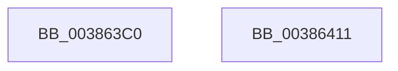

# ExInterlockedAddLargeInteger

- RVA: `0x003863C0`–`0x00386412` (길이 `82` bytes)
- VA: `0x00000001403863C0`
- 실행 섹션: `.text`
- PDB 이름 있음: `예`; PDB Function 태그: `아니요`
- unwind 정보 RVA: `0x0005C954`
- 디코드: `24`개 명령, `82/82` bytes 표시
- 미해석 바이트: `0` (있으면 어셈블리에 `.byte`로 보존)

> 이 문서는 커널 이미지의 기계어와 PDB 기호를 분석해 생성했습니다. 4번과 5번은 함수 원형과 자료형을 바이너리 사용 방식에서 추정한 C 해석이며 원본 소스 복구 결과는 아닙니다.

## 1. Dependencies

- 직접 호출 지점: **2**; 고유 호출 대상: **2**
- 직접 호출자로 확인된 함수: **0**
- RIP 상대 이미지 참조: **0**

### Outgoing calls
- `0x003863E0` → [ExpAcquireSpinLockDisabled](ExpAcquireSpinLockDisabled_function_00386858.md) (function, `0x00386858`)
- `0x003863F4` → [ExpReleaseSpinLockDisabled](ExpReleaseSpinLockDisabled_function_003869E4.md) (function, `0x003869E4`)

### Direct callers
- 이 함수 시작 RVA로 연결되는 직접 call은 확인되지 않았습니다. 간접 호출은 완전히 역산할 수 없습니다.

### Static image references
- 디코드된 RIP-relative 메모리 참조가 없습니다.

## 2. Other-region calls and transfers

- 다른 실행 섹션으로 향하는 call: **0**
- 별도 외부 분기/꼬리 이동을 확인하지 못했습니다.

## 3. Assembly (complete function range)

```asm
003863C0  48 89 5C 24 08                  mov qword ptr [rsp + 8], rbx
003863C5  48 89 6C 24 10                  mov qword ptr [rsp + 0x10], rbp
003863CA  48 89 74 24 18                  mov qword ptr [rsp + 0x18], rsi
003863CF  57                              push rdi
003863D0  48 83 EC 20                     sub rsp, 0x20
003863D4  48 8B F1                        mov rsi, rcx
003863D7  49 8B E8                        mov rbp, r8
003863DA  49 8B C8                        mov rcx, r8
003863DD  48 8B FA                        mov rdi, rdx
003863E0  E8 73 04 00 00                  call 0x140386858
003863E5  48 8B 1E                        mov rbx, qword ptr [rsi]
003863E8  48 8B CD                        mov rcx, rbp
003863EB  48 8D 14 3B                     lea rdx, [rbx + rdi]
003863EF  48 89 16                        mov qword ptr [rsi], rdx
003863F2  8A D0                           mov dl, al
003863F4  E8 EB 05 00 00                  call 0x1403869e4
003863F9  48 8B 6C 24 38                  mov rbp, qword ptr [rsp + 0x38]
003863FE  48 8B C3                        mov rax, rbx
00386401  48 8B 5C 24 30                  mov rbx, qword ptr [rsp + 0x30]
00386406  48 8B 74 24 40                  mov rsi, qword ptr [rsp + 0x40]
0038640B  48 83 C4 20                     add rsp, 0x20
0038640F  5F                              pop rdi
00386410  C3                              ret
00386411  CC                              int3
```

## 4. C-style interpretation (structured pseudocode)

```c
__int64 __fastcall ExInterlockedAddLargeInteger(__int64 a1, __int64 a2, __int64 a3)
{
    __int64 result;
    __int64 v_rsp;
    unsigned __int64 v_stack_p10;
    unsigned __int64 v_stack_p18;
    unsigned __int64 v_stack_p8;

    v_stack_p8 = v_rbx;
    v_stack_p10 = v_rbp;
    v_stack_p18 = v_rsi;
    v_rsp = (v_rsp) - (32);
    result = ExpAcquireSpinLockDisabled(a3, a2, a3, a4);
    *(unsigned __int64 *)(a1) = *(unsigned __int64 *)(a1) + a2 * 1;
    result = ExpReleaseSpinLockDisabled(a3, (unsigned __int8)(result), a3, a4);
    v_rsp = (v_rsp) + (32);
    return *(unsigned __int64 *)(a1);
}
```

## 5. (Beta) C Style

```c
int64_t ExInterlockedAddLargeInteger(void *Arg1, int64_t Arg2, int64_t Arg3)
{
    uint8_t *arg1 = (uint8_t *)Arg1;

    int64_t result;
    int64_t local_rsp;
    uint64_t v_stack_p10;
    uint64_t v_stack_p18;
    uint64_t v_stack_p8;

    v_stack_p8 = local_rbx;
    v_stack_p10 = local_rbp;
    v_stack_p18 = local_rsi;
    local_rsp = (local_rsp) - (32);
    result = ExpAcquireSpinLockDisabled(Arg3, Arg2, Arg3, a4);
    *(uint64_t *)(arg1) = *(uint64_t *)(arg1) + Arg2 * 1;
    result = ExpReleaseSpinLockDisabled(Arg3, (uint8_t)(result), Arg3, a4);
    local_rsp = (local_rsp) + (32);
    return *(uint64_t *)(arg1);
}
```

### 관측된 메모리 오프셋

구조체 형식이 확인되지 않은 접근은 인자 기준의 오프셋으로만 기록했습니다.

| 기준 인자 | 오프셋 표현 | 폭 (bit) | 접근 |
|---|---:|---:|---|
| `Arg1` | `+ 0x0` | `64` | `R` |
| `Arg1` | `+ 0x0` | `64` | `W` |

## 6. Execution-region graph

[열기: 2D/3D 그래프와 함수 탐색 컨트롤 패널](../../../control-panel.html?section=text&rva=0x003863C0&view=graph)

- 2D 그래프는 위에서 아래로 흐르고, 3D 그래프는 빈 공간을 드래그해 회전합니다. Shift+드래그는 이동, 휠은 확대·축소, 함수 노드 선택은 대상 보고서 이동입니다.

### Static fallback


