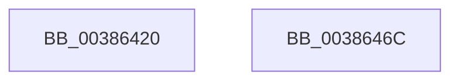

# ExInterlockedAddUlong

- RVA: `0x00386420`–`0x0038646D` (길이 `77` bytes)
- VA: `0x0000000140386420`
- 실행 섹션: `.text`
- PDB 이름 있음: `예`; PDB Function 태그: `아니요`
- unwind 정보 RVA: `0x0005C954`
- 디코드: `24`개 명령, `77/77` bytes 표시
- 미해석 바이트: `0` (있으면 어셈블리에 `.byte`로 보존)

> 이 문서는 커널 이미지의 기계어와 PDB 기호를 분석해 생성했습니다. 4번과 5번은 함수 원형과 자료형을 바이너리 사용 방식에서 추정한 C 해석이며 원본 소스 복구 결과는 아닙니다.

## 1. Dependencies

- 직접 호출 지점: **2**; 고유 호출 대상: **2**
- 직접 호출자로 확인된 함수: **0**
- RIP 상대 이미지 참조: **0**

### Outgoing calls
- `0x0038643F` → [ExpAcquireSpinLockDisabled](ExpAcquireSpinLockDisabled_function_00386858.md) (function, `0x00386858`)
- `0x00386450` → [ExpReleaseSpinLockDisabled](ExpReleaseSpinLockDisabled_function_003869E4.md) (function, `0x003869E4`)

### Direct callers
- 이 함수 시작 RVA로 연결되는 직접 call은 확인되지 않았습니다. 간접 호출은 완전히 역산할 수 없습니다.

### Static image references
- 디코드된 RIP-relative 메모리 참조가 없습니다.

## 2. Other-region calls and transfers

- 다른 실행 섹션으로 향하는 call: **0**
- 별도 외부 분기/꼬리 이동을 확인하지 못했습니다.

## 3. Assembly (complete function range)

```asm
00386420  48 89 5C 24 08                  mov qword ptr [rsp + 8], rbx
00386425  48 89 6C 24 10                  mov qword ptr [rsp + 0x10], rbp
0038642A  48 89 74 24 18                  mov qword ptr [rsp + 0x18], rsi
0038642F  57                              push rdi
00386430  48 83 EC 20                     sub rsp, 0x20
00386434  48 8B F1                        mov rsi, rcx
00386437  49 8B E8                        mov rbp, r8
0038643A  49 8B C8                        mov rcx, r8
0038643D  8B FA                           mov edi, edx
0038643F  E8 14 04 00 00                  call 0x140386858
00386444  8B 1E                           mov ebx, dword ptr [rsi]
00386446  48 8B CD                        mov rcx, rbp
00386449  8D 14 3B                        lea edx, [rbx + rdi]
0038644C  89 16                           mov dword ptr [rsi], edx
0038644E  8A D0                           mov dl, al
00386450  E8 8F 05 00 00                  call 0x1403869e4
00386455  48 8B 6C 24 38                  mov rbp, qword ptr [rsp + 0x38]
0038645A  8B C3                           mov eax, ebx
0038645C  48 8B 5C 24 30                  mov rbx, qword ptr [rsp + 0x30]
00386461  48 8B 74 24 40                  mov rsi, qword ptr [rsp + 0x40]
00386466  48 83 C4 20                     add rsp, 0x20
0038646A  5F                              pop rdi
0038646B  C3                              ret
0038646C  CC                              int3
```

## 4. C-style interpretation (structured pseudocode)

```c
__int64 __fastcall ExInterlockedAddUlong(__int64 a1, int a2, __int64 a3)
{
    __int64 result;
    __int64 v_rsp;
    unsigned __int64 v_stack_p10;
    unsigned __int64 v_stack_p18;
    unsigned __int64 v_stack_p8;

    v_stack_p8 = v_rbx;
    v_stack_p10 = v_rbp;
    v_stack_p18 = v_rsi;
    v_rsp = (v_rsp) - (32);
    result = ExpAcquireSpinLockDisabled(a3, a2, a3, a4);
    *(unsigned int *)(a1) = (unsigned int)((unsigned int)(*(unsigned int *)(a1)) + (unsigned int)(a2) * 1);
    result = ExpReleaseSpinLockDisabled(a3, (unsigned __int8)(result), a3, a4);
    v_rsp = (v_rsp) + (32);
    return (unsigned int)((unsigned int)((unsigned int)(*(unsigned int *)(a1))));
}
```

## 5. (Beta) C Style

```c
int64_t ExInterlockedAddUlong(void *Arg1, int32_t Arg2, int64_t Arg3)
{
    uint8_t *arg1 = (uint8_t *)Arg1;

    int64_t result;
    int64_t local_rsp;
    uint64_t v_stack_p10;
    uint64_t v_stack_p18;
    uint64_t v_stack_p8;

    v_stack_p8 = local_rbx;
    v_stack_p10 = local_rbp;
    v_stack_p18 = local_rsi;
    local_rsp = (local_rsp) - (32);
    result = ExpAcquireSpinLockDisabled(Arg3, Arg2, Arg3, a4);
    *(uint32_t *)(arg1) = (uint32_t)((uint32_t)(*(uint32_t *)(arg1)) + (uint32_t)(Arg2) * 1);
    result = ExpReleaseSpinLockDisabled(Arg3, (uint8_t)(result), Arg3, a4);
    local_rsp = (local_rsp) + (32);
    return (uint32_t)((uint32_t)((uint32_t)(*(uint32_t *)(arg1))));
}
```

### 관측된 메모리 오프셋

구조체 형식이 확인되지 않은 접근은 인자 기준의 오프셋으로만 기록했습니다.

| 기준 인자 | 오프셋 표현 | 폭 (bit) | 접근 |
|---|---:|---:|---|
| `Arg1` | `+ 0x0` | `32` | `R` |
| `Arg1` | `+ 0x0` | `32` | `W` |

## 6. Execution-region graph

[열기: 2D/3D 그래프와 함수 탐색 컨트롤 패널](../../../control-panel.html?section=text&rva=0x00386420&view=graph)

- 2D 그래프는 위에서 아래로 흐르고, 3D 그래프는 빈 공간을 드래그해 회전합니다. Shift+드래그는 이동, 휠은 확대·축소, 함수 노드 선택은 대상 보고서 이동입니다.

### Static fallback


