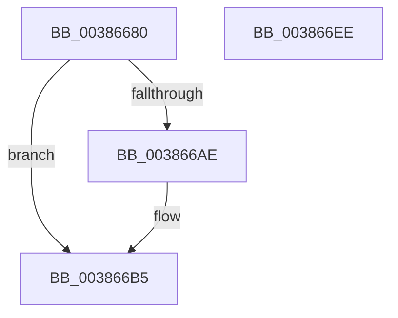

# ExInterlockedInsertHeadList

- RVA: `0x00386680`–`0x003866EF` (길이 `111` bytes)
- VA: `0x0000000140386680`
- 실행 섹션: `.text`
- PDB 이름 있음: `예`; PDB Function 태그: `아니요`
- unwind 정보 RVA: `0x0005C954`
- 디코드: `33`개 명령, `111/111` bytes 표시
- 미해석 바이트: `0` (있으면 어셈블리에 `.byte`로 보존)

> 이 문서는 커널 이미지의 기계어와 PDB 기호를 분석해 생성했습니다. 4번과 5번은 함수 원형과 자료형을 바이너리 사용 방식에서 추정한 C 해석이며 원본 소스 복구 결과는 아닙니다.

## 1. Dependencies

- 직접 호출 지점: **2**; 고유 호출 대상: **2**
- 직접 호출자로 확인된 함수: **6**
- RIP 상대 이미지 참조: **0**

### Outgoing calls
- `0x003866A0` → [ExpAcquireSpinLockDisabled](ExpAcquireSpinLockDisabled_function_00386858.md) (function, `0x00386858`)
- `0x003866C8` → [ExpReleaseSpinLockDisabled](ExpReleaseSpinLockDisabled_function_003869E4.md) (function, `0x003869E4`)

### Direct callers
- [CcCanIWrite](CcCanIWrite_function_00388250.md) at `0x003885D4`
- [CcDeferWrite](../57/CcDeferWrite_function_0057C860.md) at `0x0057C95C`
- [ViAllocateMapRegisterFile](../../pagevrfy/B9/ViAllocateMapRegisterFile_function_00B97E9C.md) at `0x00B9801A`
- [ViHookDmaAdapter](../../pagevrfy/B9/ViHookDmaAdapter_function_00B993D8.md) at `0x00B9956E`
- [ViScatterGatherCallback](../../pagevrfy/B9/ViScatterGatherCallback_function_00B99B20.md) at `0x00B99B66`
- [ViSpecialAllocateCommonBuffer](../../pagevrfy/B9/ViSpecialAllocateCommonBuffer_function_00B99BB0.md) at `0x00B99D10`

### Static image references
- 디코드된 RIP-relative 메모리 참조가 없습니다.

## 2. Other-region calls and transfers

- 다른 실행 섹션으로 향하는 call: **0**
- 별도 외부 분기/꼬리 이동을 확인하지 못했습니다.

## 3. Assembly (complete function range)

```asm
00386680  48 89 5C 24 08                  mov qword ptr [rsp + 8], rbx
00386685  48 89 6C 24 10                  mov qword ptr [rsp + 0x10], rbp
0038668A  48 89 74 24 18                  mov qword ptr [rsp + 0x18], rsi
0038668F  57                              push rdi
00386690  48 83 EC 20                     sub rsp, 0x20
00386694  48 8B F9                        mov rdi, rcx
00386697  49 8B E8                        mov rbp, r8
0038669A  49 8B C8                        mov rcx, r8
0038669D  48 8B F2                        mov rsi, rdx
003866A0  E8 B3 01 00 00                  call 0x140386858
003866A5  48 8B 1F                        mov rbx, qword ptr [rdi]
003866A8  48 39 7B 08                     cmp qword ptr [rbx + 8], rdi
003866AC  74 07                           je 0x1403866b5
003866AE  B9 03 00 00 00                  mov ecx, 3
003866B3  CD 29                           int 0x29
003866B5  48 89 1E                        mov qword ptr [rsi], rbx
003866B8  8A D0                           mov dl, al
003866BA  48 89 7E 08                     mov qword ptr [rsi + 8], rdi
003866BE  48 8B CD                        mov rcx, rbp
003866C1  48 89 73 08                     mov qword ptr [rbx + 8], rsi
003866C5  48 89 37                        mov qword ptr [rdi], rsi
003866C8  E8 17 03 00 00                  call 0x1403869e4
003866CD  48 8B 6C 24 38                  mov rbp, qword ptr [rsp + 0x38]
003866D2  33 C0                           xor eax, eax
003866D4  48 8B 74 24 40                  mov rsi, qword ptr [rsp + 0x40]
003866D9  48 3B DF                        cmp rbx, rdi
003866DC  48 0F 44 D8                     cmove rbx, rax
003866E0  48 8B C3                        mov rax, rbx
003866E3  48 8B 5C 24 30                  mov rbx, qword ptr [rsp + 0x30]
003866E8  48 83 C4 20                     add rsp, 0x20
003866EC  5F                              pop rdi
003866ED  C3                              ret
003866EE  CC                              int3
```

## 4. C-style interpretation (structured pseudocode)

```c
__int64 __fastcall ExInterlockedInsertHeadList(__int64 a1, __int64 a2, __int64 a3)
{
    __int64 result;
    __int64 v_rbx;
    __int64 v_rsp;
    unsigned __int64 v_stack_p10;
    unsigned __int64 v_stack_p18;
    unsigned __int64 v_stack_p8;

    v_stack_p8 = v_rbx;
    v_stack_p10 = v_rbp;
    v_stack_p18 = v_rsi;
    v_rsp = (v_rsp) - (32);
    result = ExpAcquireSpinLockDisabled(a3, a2, a3, a4);
    if ((*(unsigned __int64 *)(*(unsigned __int64 *)(a1) + 8)) != a1) {
        a1 = 3;
    }
    *(unsigned __int64 *)(a2) = *(unsigned __int64 *)(a1);
    *(unsigned __int64 *)(a2 + 8) = a1;
    *(unsigned __int64 *)(*(unsigned __int64 *)(a1) + 8) = a2;
    *(unsigned __int64 *)(a1) = a2;
    result = ExpReleaseSpinLockDisabled(a3, (unsigned __int8)(result), a3, a4);
    result = 0;
    v_rbx = *(unsigned __int64 *)(a1);
    if ((*(unsigned __int64 *)(a1)) == a1) { v_rbx = 0; }
    v_rsp = (v_rsp) + (32);
    return v_rbx;
}
```

## 5. (Beta) C Style

```c
int64_t ExInterlockedInsertHeadList(void *Arg1, void *Arg2, int64_t Arg3)
{
    uint8_t *arg1 = (uint8_t *)Arg1;
    uint8_t *arg2 = (uint8_t *)Arg2;

    int64_t result;
    int64_t local_rbx;
    int64_t local_rsp;
    uint64_t v_stack_p10;
    uint64_t v_stack_p18;
    uint64_t v_stack_p8;

    v_stack_p8 = local_rbx;
    v_stack_p10 = local_rbp;
    v_stack_p18 = local_rsi;
    local_rsp = (local_rsp) - (32);
    result = ExpAcquireSpinLockDisabled(Arg3, Arg2, Arg3, a4);
    if ((*(uint64_t *)(*(uint64_t *)(arg1) + 0x8)) != Arg1) {
        Arg1 = 3;
    }
    *(uint64_t *)(arg2) = *(uint64_t *)(arg1);
    *(void **)(arg2 + 0x8) = Arg1;
    *(void **)(*(uint64_t *)(arg1) + 0x8) = Arg2;
    *(void **)(arg1) = Arg2;
    result = ExpReleaseSpinLockDisabled(Arg3, (uint8_t)(result), Arg3, a4);
    result = 0;
    local_rbx = *(uint64_t *)(arg1);
    if ((*(uint64_t *)(arg1)) == Arg1) { local_rbx = 0; }
    local_rsp = (local_rsp) + (32);
    return local_rbx;
}
```

### 관측된 메모리 오프셋

구조체 형식이 확인되지 않은 접근은 인자 기준의 오프셋으로만 기록했습니다.

| 기준 인자 | 오프셋 표현 | 폭 (bit) | 접근 |
|---|---:|---:|---|
| `Arg1` | `+ 0x0` | `64` | `R` |
| `Arg1` | `+ 0x0` | `64` | `W` |
| `Arg2` | `+ 0x0` | `64` | `W` |
| `Arg2` | `+ 0x8` | `64` | `W` |

## 6. Execution-region graph

[열기: 2D/3D 그래프와 함수 탐색 컨트롤 패널](../../../control-panel.html?section=text&rva=0x00386680&view=graph)

- 2D 그래프는 위에서 아래로 흐르고, 3D 그래프는 빈 공간을 드래그해 회전합니다. Shift+드래그는 이동, 휠은 확대·축소, 함수 노드 선택은 대상 보고서 이동입니다.

### Static fallback


